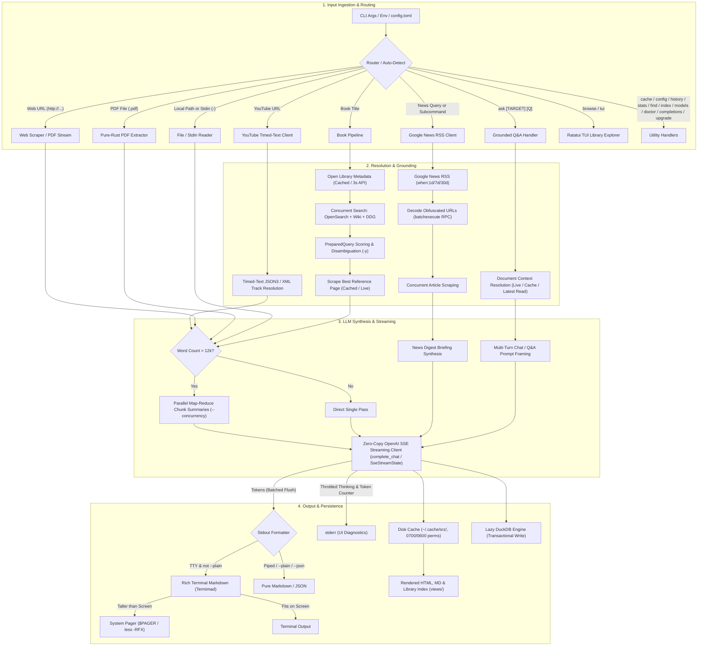
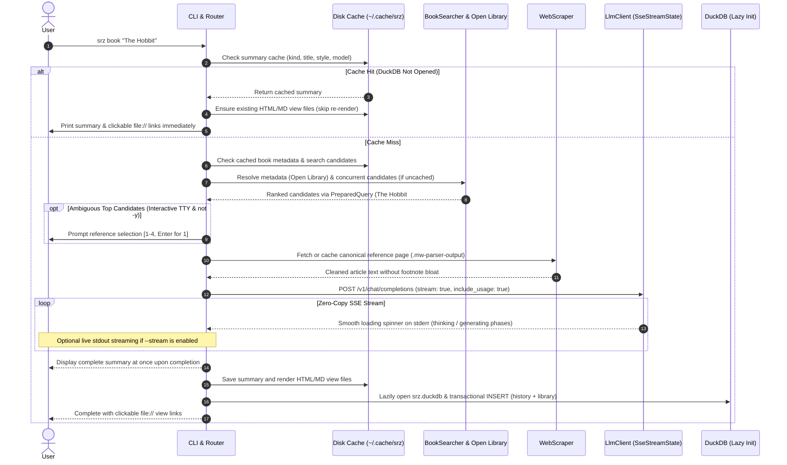
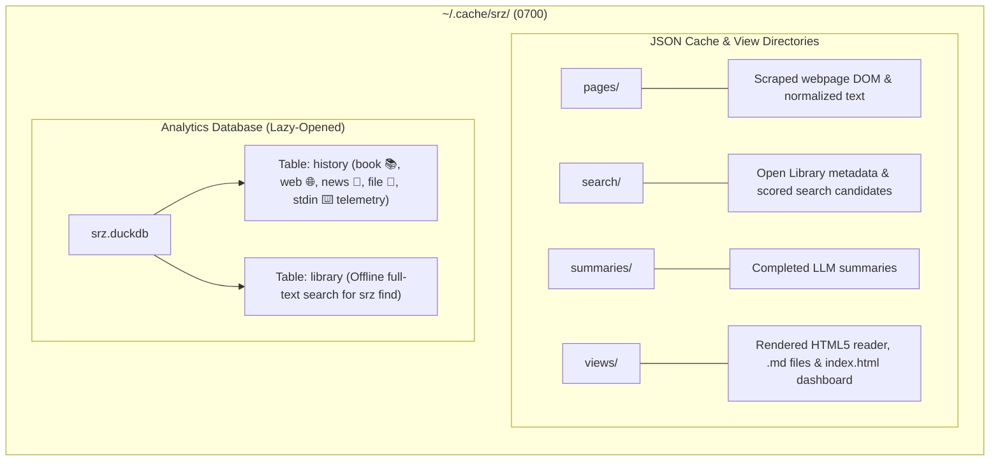

# `srz` Architectural Overview

`srz` (Summarize) is a high-performance, modular Rust CLI tool for extracting and synthesizing structured summaries from **webpages**, **YouTube video transcripts**, **PDF documents & local files**, **Unix stdin streams**, **books**, and **live news digests** using local OpenAI-compliant LLMs (such as llama.cpp, Ollama, LM Studio, or vLLM).


## 1. High-Level Architecture

The diagram below illustrates the end-to-end lifecycle of an `srz` invocation:




## 2. Request & Execution Sequence




## 3. Storage & Cache Architecture

All state is isolated under `~/.cache/srz/` (or `$XDG_CACHE_HOME/srz/`), unified via `Cache::default_cache_dir()`, enforced with `0700`/`0600` owner-only Unix permissions, completely bypassable via `--no-cache`, and resettable via `srz cache clean`:




## 4. Component Directory & Subsystems

The codebase is organized into cohesive functional subgroups within `src/`:

```
src/
├── commands/     # CLI subcommand workflows and action dispatchers
├── config/       # CLI argument parsing, flags, and config file profiles
├── engine/       # LLM streaming client, prompts, and document chunking
├── sources/      # Content ingestion: web scraping, book search, and news RSS
├── storage/      # Local disk caching and embedded DuckDB analytics
├── system/       # Filesystem security helpers and in-place self-updater
├── ui/           # Terminal console formatting, spinners, and HTML reader views
├── lib.rs        # Library crate root and backwards-compatible module exports
└── main.rs       # Binary entry point and CLI orchestration
```

### Module Responsibilities

| Subsystem | File | Module | Primary Responsibility |
| :--- | :--- | :--- | :--- |
| **Entry Points** | [`src/main.rs`](src/main.rs) | `main` | Entry point, CLI lifecycle, profile loading, and subcommand dispatch. |
| | [`src/lib.rs`](src/lib.rs) | `lib` | Root library interface and backward-compatible module re-exports. |
| **Commands** | [`src/commands/summarize.rs`](src/commands/summarize.rs) | `commands::summarize` | Workflows for web articles, YouTube videos, books, local documents, stdin streams, and news digests. |
| | [`src/commands/ask.rs`](src/commands/ask.rs) | `commands::ask` | Grounded question answering, interactive multi-turn chat REPL (`srz ask`), sliding conversational history, and prompt injection defense. |
| | [`src/commands/library.rs`](src/commands/library.rs) | `commands::library` | Handlers for `history`, `stats`, `find`, `index`, and `cache` subcommands. |
| | [`src/commands/diagnostics.rs`](src/commands/diagnostics.rs) | `commands::diagnostics` | Handlers for `doctor`, `models`, and `config` verification. |
| **Configuration** | [`src/config/cli.rs`](src/config/cli.rs) | `config::cli` | `clap` CLI parser, `SummaryStyle` presets, `NewsTimeframe`, paging flags, and target auto-detection. |
| | [`src/config/file.rs`](src/config/file.rs) | `config::file` | `config.toml` file loading, named profile switching, and starter template generation. |
| **Engine** | [`src/engine/llm.rs`](src/engine/llm.rs) | `engine::llm` | Zero-copy SSE client (`complete_chat` / `SseStreamState`), localhost IPv4 fallback, and map-reduce synthesis. |
| | [`src/engine/chunker.rs`](src/engine/chunker.rs) | `engine::chunker` | Zero-copy `Cow` text windowing and paragraph chunking for long documents (> 12k words). |
| **Sources** | [`src/sources/document.rs`](src/sources/document.rs) | `sources::document` | Unified local document ingestion (`DocumentLoader`): file size safety checks (20 MB), PDF extraction, HTML/Markdown normalization, and title fallbacks. |
| | [`src/sources/scraper.rs`](src/sources/scraper.rs) | `sources::scraper` | HTTP client (10 MB cap), streaming body readers (`read_response_bytes_limited`, `read_response_text_limited`), MediaWiki/article DOM extraction, and text cleaning. |
| | [`src/sources/pdf.rs`](src/sources/pdf.rs) | `sources::pdf` | Native pure-Rust PDF text extraction, document info metadata, scanned-PDF detection, and file size security bounds via `pdf-extract`. |
| | [`src/sources/youtube.rs`](src/sources/youtube.rs) | `sources::youtube` | YouTube video ID extraction, public timed-text XML/JSON3 caption resolution, chapter cue grouping via `TimedTranscriptBuilder`, and bounded HTTP streaming. |
| | [`src/sources/search.rs`](src/sources/search.rs) | `sources::search` | Open Library metadata, Wikipedia OpenSearch/fulltext, DDG search, and candidate scoring. |
| | [`src/sources/news.rs`](src/sources/news.rs) | `sources::news` | Google News RSS client, `batchexecute` RPC redirect decoding, and concurrent article fetching. |
| **Storage** | [`src/storage/cache.rs`](src/storage/cache.rs) | `storage::cache` | Local JSON disk caching in `~/.cache/srz/` with compact serialization and private file permissions. |
| | [`src/storage/db.rs`](src/storage/db.rs) | `storage::db` | Lazy DuckDB database for history telemetry and offline library full-text search (`Database::default_path`), using 100% safe UTF-8 snippet formatting. |
| **UI & Render** | [`src/ui/terminal.rs`](src/ui/terminal.rs) | `ui::terminal` | CLI progress spinners (`indicatif`), colored text formatting, and terminal escape/control character sanitization (`sanitize_terminal_text`, `sanitize_title`). |
| | [`src/ui/printer.rs`](src/ui/printer.rs) | `ui::printer` | Tailored `termimad` terminal Markdown styling and automatic `$PAGER` / `less -RFX` integration. |
| | [`src/ui/tui.rs`](src/ui/tui.rs) | `ui::tui` | Interactive `ratatui` + `crossterm` terminal UI library explorer (`srz browse`) with pre-indexed live search. |
| | [`src/ui/render.rs`](src/ui/render.rs) | `ui::render` | Single-pass streaming Markdown-to-HTML converter, CSS styling, index dashboard, and slugify. |
| **System** | [`src/system/fs_util.rs`](src/system/fs_util.rs) | `system::fs_util` | Platform filesystem utilities and private directory/file permissions (`0700`/`0600`). |
| | [`src/system/upgrade.rs`](src/system/upgrade.rs) | `system::upgrade` | In-place self-updater: target detection, GitHub release queries, SHA256 verification, and atomic swap. |


## 5. Performance, Security & Architectural Optimizations

`srz` is engineered for speed, low memory consumption, and local data privacy:

### Performance & Memory Efficiency
- **Lazy Database Initialization**: DuckDB (`srz.duckdb`) is initialized only when recording a new summary or running analytics. Cache hits and shell completions launch instantly with zero database overhead.
- **Zero-Copy Streaming**: SSE chunks deserialize directly from network byte buffers into borrowed string slices (`Cow<str>`), batching terminal flushes per packet to minimize heap allocations.
- **HTTP Connection Pool Sharing**: A single HTTP client connection pool is shared across Open Library metadata queries, DuckDuckGo candidate searches, and webpage scraping, reusing active TLS/HTTP2 keep-alive connections.
- **Unified Bounded HTTP Streaming**: All network fetches (web scraping, news RSS feeds, search APIs, YouTube transcripts, self-updater binary downloads) share chunked streaming with strict byte limits to avoid unbuffered memory spikes.
- **TUI Live Search Pre-Indexing**: Library items pre-compute lowercased search text blobs at startup on `AppState`, completely eliminating repeated string conversions and allocations on every interactive keystroke.
- **Parallel Map-Reduce**: Large documents (> 12,000 words) are split along paragraph boundaries and processed concurrently (`--concurrency`), aggregating token metrics across chunks.
- **Single-Pass Output Streaming**: Markdown-to-HTML conversion and HTML entity escaping stream directly into a pre-allocated output buffer without allocating intermediate strings.
- **In-Place DB Snippet Formatting**: Search snippet extraction pre-allocates exact capacities and normalizes whitespace in place without redundant string allocations.

### Security & Privacy
- **100% Safe Rust Guarantee**: The entire crate strictly enforces `#![forbid(unsafe_code)]` at `src/lib.rs` and `src/main.rs`. Zero `unsafe` blocks are permitted.
- **Strict Local Isolation**: Cache files, configuration, and database files are created with owner-only Unix permissions (`0700` directories, `0600` files atomically created via `O_CREAT | O_EXCL` and `mode(0o600)`).
- **Prompt Injection Defense**: Untrusted source text is enclosed inside tagged XML blocks within the LLM prompt, separating content from system instructions, and neutralizing delimiter collisions (`&lt;/source_document&gt;`).
- **Bounded Resource Limits**: Enforces strict safety limits on network downloads (10 MB), local files (20 MB), standard input streams (10 MB), upgrade archives (50 MB), and decompressed binaries (100 MB) to prevent memory exhaustion.
- **Terminal Escape Sequence Sanitization**: Untrusted document titles, scraped page metadata, and CLI messages are stripped of ANSI CSI sequences, OSC strings (blocking clipboard hijacking and title spoofing), and non-printable control characters.
- **Content Security Policy (CSP)**: Generated HTML reader views include strict CSP headers blocking external network requests and inline script execution.
- **Verified Upgrades & Installers**: `srz upgrade`, `install.sh`, and `install.ps1` enforce mandatory SHA-256 cryptographic checksum validation before executing or installing binaries.
- **Continuous Security CI Auditing**: GitHub Actions workflow (`.github/workflows/ci.yml`) runs `cargo test`, `cargo clippy -- -D warnings`, and automated dependency vulnerability scanning via `rustsec/audit-check` on every commit and PR.

For the complete chronological security audit ledger, CWE classifications, and regression test suites, see [`SECURITY_AUDIT.md`](SECURITY_AUDIT.md).


## 6. Key CLI Features & Commands

| Category | Command / Flag | Description |
| :--- | :--- | :--- |
| **Ingestion** | `srz <URL>` | Summarizes articles, blogs, documentation, or online PDFs. |
| | `srz <YOUTUBE_URL>` | Extracts timed-text transcripts and chapters from YouTube videos. |
| | `srz "Book Title"` | Resolves synopses from Wikipedia and Open Library by title alone. |
| | `srz <FILE>` | Ingests local `.pdf`, `.html`, `.md`, or `.txt` documents (20 MB ceiling). |
| | `cat ... \| srz -` | Reads piped command outputs, logs, or `git diff` streams (10 MB ceiling). |
| | `srz news "topic" [-t week]` | Aggregates and summarizes top stories from Google News RSS. |
| **Styling & Output** | `--style <PRESET>` | 8 summary formats: `concise`, `detailed`, `bullets`, `executive`, `tldr`, `critique`, `eli5`, `flashcards`. |
| | `--open` (`-b`) | Opens the summary in a distraction-free HTML reader with light/dark mode. |
| | `--plain` | Outputs raw Markdown without terminal colors or automatic paging. |
| | `--paging <auto\|always\|never>` | Controls terminal output pager (`--no-pager` disables paging). |
| | `-o <FILE.html\|md>` | Saves the rendered output directly to an HTML or Markdown file. |
| | `--json` | Emits machine-readable JSON on `stdout` for script integration. |
| | `--stream` | Streams LLM output tokens live to `stdout` as they are generated. |
| **Interactive Tools** | `srz ask [TARGET] [Q]` | Grounded Q&A against a document, URL, file, or latest read. |
| | `srz ask -i` | Interactive multi-turn chat REPL grounded on source context. |
| | `srz browse` (alias `tui`) | Interactive TUI dashboard (`[j/k]` navigate, `[/]` filter, `[y]` copy, `[d]` delete, `[Enter]` open). |
| **Library & History** | `srz find "keyword"` | Offline full-text search across all past summaries in DuckDB. |
| | `srz history [--limit N]` | Displays recent reads, word counts, model usage, and generation speeds. |
| | `srz stats` | Telemetry overview: total words read, tokens generated, and throughput. |
| | `srz index [--open]` | Generates and opens an interactive HTML library dashboard. |
| **System & Config** | `--profile <NAME>` | Switches LLM backends defined in `~/.config/srz/config.toml`. |
| | `srz config <init\|show\|path>` | Manages and inspects the local configuration file. |
| | `srz cache <clean\|size\|dir>` | Manages the local disk cache directory and entry storage. |
| | `srz models` | Lists available models reported by the local LLM backend. |
| | `srz doctor` | Tests backend reachability, latency, cache health, and database integrity. |
| | `srz upgrade [--check\|--force]` | Safe, in-place binary self-updater with SHA-256 integrity verification. |
| | `srz completions <SHELL>` | Generates autocomplete scripts for bash, zsh, fish, powershell, and elvish. |
