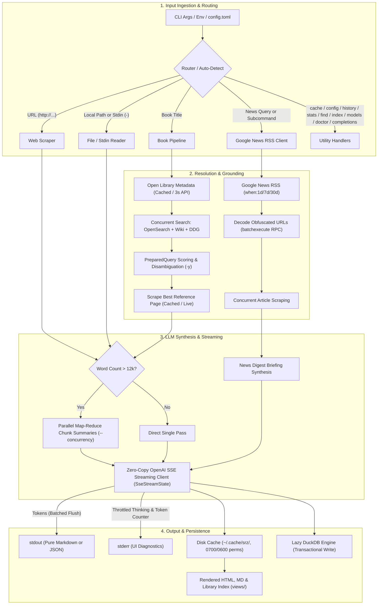
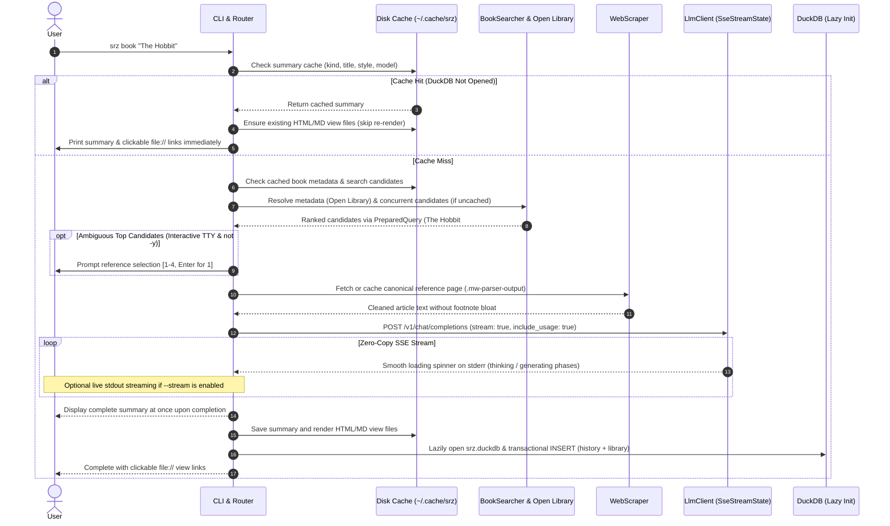
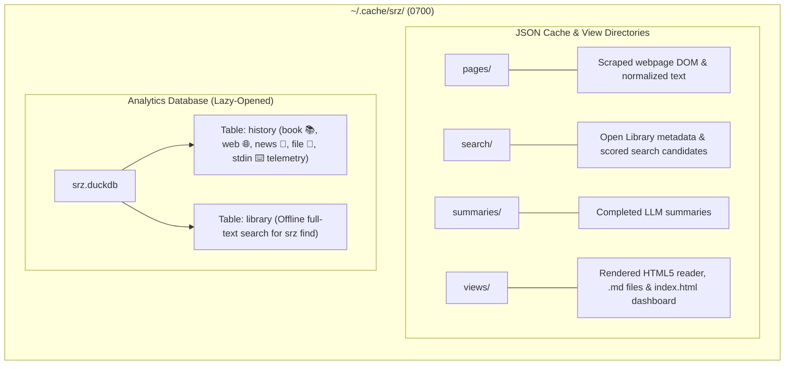

# `srz` Architectural Overview

`srz` (Summarize) is a high-performance, modular Rust CLI tool for extracting and synthesizing structured summaries from **webpages**, **local files**, **Unix stdin streams**, **books**, and **live news digests** using local OpenAI-compliant LLMs (such as llama.cpp, Ollama, LM Studio, or vLLM).

---

## 1. High-Level Architecture

The diagram below illustrates the end-to-end lifecycle of an `srz` invocation:



---

## 2. Request & Execution Sequence



---

## 3. Storage & Cache Architecture

All state is isolated under `~/.cache/srz/` (or `$XDG_CACHE_HOME/srz/`), unified via `Cache::default_cache_dir()`, enforced with `0700`/`0600` owner-only Unix permissions, completely bypassable via `--no-cache`, and resettable via `srz cache clean`:



---

## 4. Component Directory & Subsystems

The codebase is organized into cohesive functional subgroups within `src/`:

```
src/
├── commands/     # CLI subcommand workflows and action dispatchers
├── config/       # CLI argument parsing, flags, and config file profiles
├── engine/       # LLM streaming client, prompts, and document chunking
├── sources/      # Content ingestion: web scraping, book search, and news RSS
├── storage/      # Local disk caching and embedded DuckDB analytics
├── system/       # Filesystem security helpers and in-place self-updater
├── ui/           # Terminal console formatting, spinners, and HTML reader views
├── lib.rs        # Library crate root and backwards-compatible module exports
└── main.rs       # Binary entry point and CLI orchestration
```

### Module Responsibilities

| Subsystem | File | Module | Primary Responsibility |
| :--- | :--- | :--- | :--- |
| **Entry Points** | [`src/main.rs`](src/main.rs) | `main` | Entry point, CLI lifecycle, profile loading, and subcommand dispatch. |
| | [`src/lib.rs`](src/lib.rs) | `lib` | Root library interface and backward-compatible module re-exports. |
| **Commands** | [`src/commands/summarize.rs`](src/commands/summarize.rs) | `commands::summarize` | Workflows for web articles, books, local documents, stdin streams, and news digests. |
| | [`src/commands/library.rs`](src/commands/library.rs) | `commands::library` | Handlers for `history`, `stats`, `find`, `index`, and `cache` subcommands. |
| | [`src/commands/diagnostics.rs`](src/commands/diagnostics.rs) | `commands::diagnostics` | Handlers for `doctor`, `models`, and `config` verification. |
| **Configuration** | [`src/config/cli.rs`](src/config/cli.rs) | `config::cli` | `clap` CLI parser, `SummaryStyle` presets, `NewsTimeframe`, and target auto-detection. |
| | [`src/config/file.rs`](src/config/file.rs) | `config::file` | `config.toml` file loading, named profile switching, and starter template generation. |
| **Engine** | [`src/engine/llm.rs`](src/engine/llm.rs) | `engine::llm` | Zero-copy SSE client (`SseStreamState`), localhost IPv4 fallback, and map-reduce synthesis. |
| | [`src/engine/chunker.rs`](src/engine/chunker.rs) | `engine::chunker` | Zero-copy `Cow` text windowing and paragraph chunking for long documents (> 12k words). |
| **Sources** | [`src/sources/scraper.rs`](src/sources/scraper.rs) | `sources::scraper` | HTTP client (10 MB cap), MediaWiki/article DOM extraction, EPUB reading, and text cleaning. |
| | [`src/sources/search.rs`](src/sources/search.rs) | `sources::search` | Open Library metadata, Wikipedia OpenSearch/fulltext, DDG search, and candidate scoring. |
| | [`src/sources/news.rs`](src/sources/news.rs) | `sources::news` | Google News RSS client, `batchexecute` RPC redirect decoding, and concurrent article fetching. |
| **Storage** | [`src/storage/cache.rs`](src/storage/cache.rs) | `storage::cache` | Local JSON disk caching in `~/.cache/srz/` with compact serialization and private file permissions. |
| | [`src/storage/db.rs`](src/storage/db.rs) | `storage::db` | Lazy DuckDB database for history telemetry and offline library full-text snippet search. |
| **UI & Render** | [`src/ui/terminal.rs`](src/ui/terminal.rs) | `ui::terminal` | CLI progress spinners (`indicatif`), colored text formatting, and quiet/verbose mode handling. |
| | [`src/ui/render.rs`](src/ui/render.rs) | `ui::render` | Single-pass streaming Markdown-to-HTML converter, CSS styling, index dashboard, and slugify. |
| **System** | [`src/system/fs_util.rs`](src/system/fs_util.rs) | `system::fs_util` | Platform filesystem utilities and private directory/file permissions (`0700`/`0600`). |
| | [`src/system/upgrade.rs`](src/system/upgrade.rs) | `system::upgrade` | In-place self-updater: target detection, GitHub release queries, SHA256 verification, and atomic swap. |

---

## 5. Performance, Security & Architectural Optimizations

- **Deferred DuckDB Initialization & View Reuse**: DuckDB (`srz.duckdb`) is opened lazily only when recording a newly generated summary or running `history`, `stats`, `find`, `index`, `doctor`, or `cache clean`. Cache hits and `srz completions` execute with zero database initialization or view-file re-rendering overhead.
- **Zero-Copy SSE Streaming (`SseStreamState`)**: SSE chunks deserialize into borrowed `Cow<'a, str>` slices (`#[serde(borrow)]`), drain network buffers once per chunk via a read cursor, batch `stdout` flushes per network read, and throttle spinner updates.
- **Single-Client Search & Metadata Caching**: Book resolution caches Open Library metadata on disk, reuses a single `BookSearcher` HTTP connection pool across metadata and candidate queries, and hoists query normalization (`PreparedQuery`) with zero-allocation ASCII substring matching.
- **MediaWiki-Aware, Footnote-Free Scraping**: Prioritizes `.mw-parser-output` and `#mw-content-text` selectors and configures `html2text` without hyperlink footnote tables or artificial 100-column line wraps, preserving clean paragraph structure and saving prompt tokens.
- **Defense-in-Depth Security**: Enforces a 10 MB cap on scraped HTTP bodies (`MAX_SCRAPE_BYTES`), isolates untrusted source text inside XML tags with explicit system-role boundaries, embeds strict `Content-Security-Policy` headers in generated HTML views, and sets `0700`/`0600` owner-only permissions on local cache, config, and database files.
- **Transactional Telemetry & Release Hardening**: Dual `history` + `library` inserts execute in a single atomic DuckDB transaction, parallel map-reduce runs aggregate token counts and durations across all chunks, and release builds enable thin LTO, single codegen-unit, symbol stripping, and integer overflow checks.

---

## 6. Key CLI Features & Flags

- **Universal Input**: `srz <URL>`, `srz <BOOK>`, `srz <FILE>` (`.html`, `.md`, `.txt`), `cat ... | srz -`, or `srz news <TOPIC>` (with auto-detection for `"current ... news"`).
- **8 Summary Styles**: `--style` supports `concise`, `detailed`, `bullets`, `executive`, `tldr`, `critique`, `eli5`, and `flashcards`.
- **Profiles & Config Management**: `srz config init|show|path` and `--profile <NAME>` to switch between local and cloud LLM backends.
- **Parallel Map-Reduce**: `--concurrency <N>` controls parallel chunk summarization for documents exceeding 12,000 words.
- **Timeframe Filtering**: `--timeframe` / `-t` (`day`, `week`, `month`, `all`) and `--limit` / `-l` for news digests.
- **Interactive or Automated Disambiguation**: Prompts when book references have close scores, or pass `-y` / `--yes` to auto-select the top candidate.
- **Diagnostics & Model Discovery**: `srz doctor` checks LLM reachability/latency, DuckDB, and cache health; `srz models` lists loaded models on the backend.
- **Telemetry & Stats**: `srz stats` (speeds, total tokens across books, web, news, files, and stdin) and `srz history` (past reads).
- **Offline Search & Dashboard**: `srz find "keyword"` searches past summaries in DuckDB, and `srz index [--open]` opens the interactive library dashboard.
- **Self-Update**: `srz upgrade [--check] [--force] [--dry-run] [--version <TAG>]` safely downloads, verifies, and updates `srz` in-place.
- **Machine-Readable**: Add `--json` to any command for JSON stdout, or `-o summary.html` / `-o summary.md` to save directly to disk.
- **Unix Pipeline Friendly**: Strict separation—summary on `stdout`, diagnostics on `stderr`. Pass `-q` / `--quiet` to mute all stderr notices.
- **Shell Completions**: `srz completions zsh > ~/.zfunc/_srz` (supports bash, zsh, fish, powershell, elvish).
