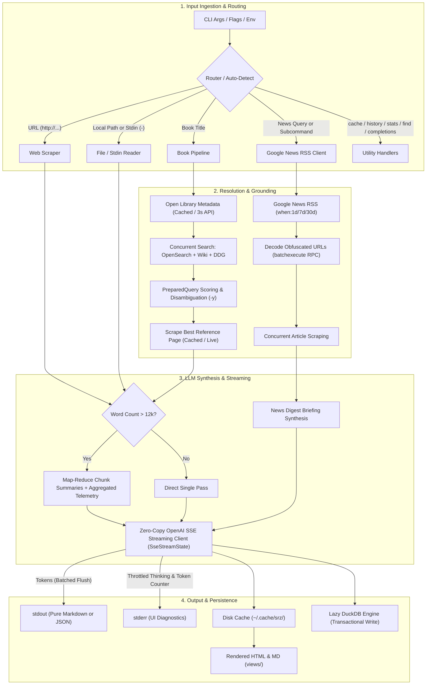
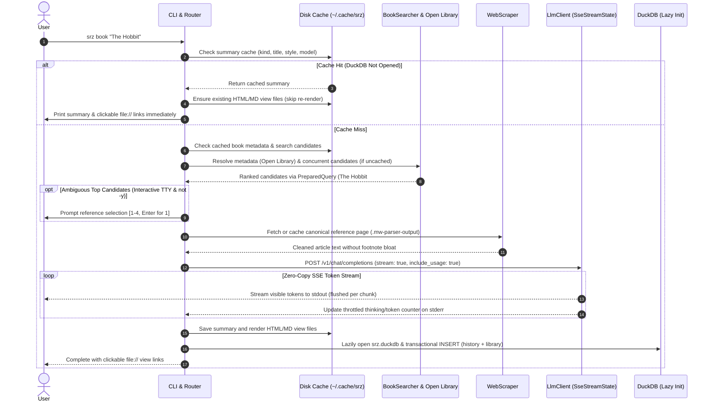
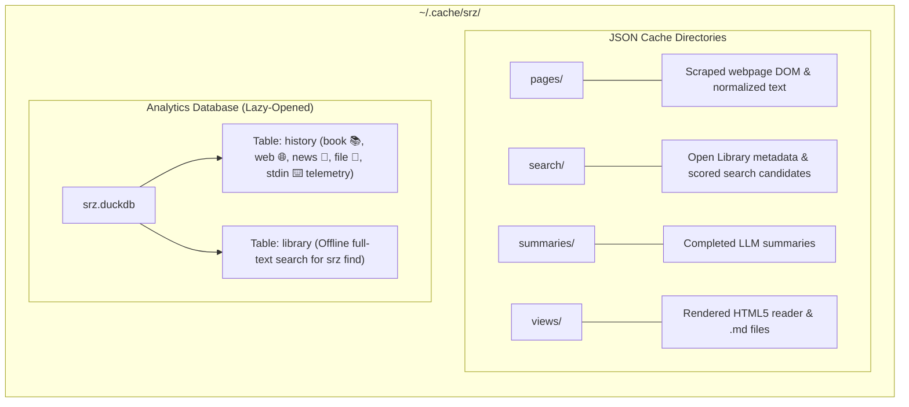

# `srz` Architectural Overview

`srz` (Summarize) is a high-performance, modular Rust CLI tool for extracting and synthesizing structured summaries from **webpages**, **local files**, **Unix stdin streams**, **books**, and **live news digests** using local OpenAI-compliant LLMs (such as llama.cpp, Ollama, LM Studio, or vLLM).

---

## 1. High-Level Architecture

The diagram below illustrates the end-to-end lifecycle of an `srz` invocation:

---

## 2. Request & Execution Sequence

---

## 3. Storage & Cache Architecture

All state is isolated under `~/.cache/srz/` (or `$XDG_CACHE_HOME/srz/`), unified via `Cache::default_cache_dir()`, completely bypassable via `--no-cache`, and resettable via `srz cache clean`:

---

## 4. Component Directory & Responsibilities

| File | Module | Primary Responsibility |
| :--- | :--- | :--- |
| [`src/main.rs`](file:///Users/myoo/Documents/Repo/srz/src/main.rs) | `main` | Entry point, pipeline orchestration, lazy DB opening, candidate disambiguation, and subcommand handlers. |
| [`src/cli.rs`](file:///Users/myoo/Documents/Repo/srz/src/cli.rs) | `cli` | `clap` argument parsing, `SummaryStyle` helpers, `stream_mode` selection, news query routing, and target action resolution. |
| [`src/news.rs`](file:///Users/myoo/Documents/Repo/srz/src/news.rs) | `news` | Google News RSS client, `batchexecute` RPC redirect URL decoding, and concurrent multi-article scraping. |
| [`src/llm.rs`](file:///Users/myoo/Documents/Repo/srz/src/llm.rs) | `llm` | Zero-copy SSE client (`SseStreamState`), localhost IPv4 fallback, map-reduce telemetry aggregation, and prompt crafting. |
| [`src/search.rs`](file:///Users/myoo/Documents/Repo/srz/src/search.rs) | `search` | Open Library metadata, Wikipedia OpenSearch/fulltext, DDG search, and hoisted `PreparedQuery` candidate scoring. |
| [`src/scraper.rs`](file:///Users/myoo/Documents/Repo/srz/src/scraper.rs) | `scraper` | HTTP client, MediaWiki/article DOM extraction, footnote-free `html2text` conversion, and single-pass word counting. |
| [`src/chunker.rs`](file:///Users/myoo/Documents/Repo/srz/src/chunker.rs) | `chunker` | Zero-copy `Cow` text windowing and paragraph chunking for long documents (> 12k words). |
| [`src/cache.rs`](file:///Users/myoo/Documents/Repo/srz/src/cache.rs) | `cache` | Disk caching in `~/.cache/srz/` for pages, metadata, searches, and summaries using zero-allocation `AsciiLower` hashing. |
| [`src/db.rs`](file:///Users/myoo/Documents/Repo/srz/src/db.rs) | `db` | Embedded DuckDB engine with transactional writes, reading telemetry (`book`, `web`, `news`, `file`, `stdin`), and zero-copy snippet search. |
| [`src/render.rs`](file:///Users/myoo/Documents/Repo/srz/src/render.rs) | `render` | Markdown-to-HTML5 reader rendering, standalone library dashboard (`srz index`), cached view-file reuse, and slugification. |
| [`src/ui.rs`](file:///Users/myoo/Documents/Repo/srz/src/ui.rs) | `ui` | Spinners (`indicatif`) and `LazyLock`-cached terminal detection (`is_terminal`) and `NO_COLOR`/`CLICOLOR` hygiene. |

---

## 5. Performance & Architectural Optimizations

- **Deferred DuckDB Initialization & View Reuse**: DuckDB (`srz.duckdb`) is opened lazily only when recording a newly generated summary or running `history`, `stats`, `find`, or `cache clean`. Cache hits and `srz completions` execute with zero database initialization or view-file re-rendering overhead.
- **Zero-Copy SSE Streaming (`SseStreamState`)**: SSE chunks deserialize into borrowed `Cow<'a, str>` slices (`#[serde(borrow)]`), drain network buffers once per chunk via a read cursor, batch `stdout` flushes per network read, and throttle spinner updates.
- **Single-Client Search & Metadata Caching**: Book resolution caches Open Library metadata on disk, reuses a single `BookSearcher` HTTP connection pool across metadata and candidate queries, and hoists query normalization (`PreparedQuery`) with zero-allocation ASCII substring matching.
- **MediaWiki-Aware, Footnote-Free Scraping**: Prioritizes `.mw-parser-output` and `#mw-content-text` selectors and configures `html2text` without hyperlink footnote tables or artificial 100-column line wraps, preserving clean paragraph structure and saving prompt tokens.
- **Transactional Telemetry & Release LTO**: Dual `history` + `library` inserts execute in a single atomic DuckDB transaction, map-reduce runs aggregate token counts and durations across all chunks, and release builds use thin LTO, single codegen-unit, and symbol stripping.

---

## 6. Key CLI Features & Flags

- **Universal Input**: `srz <URL>`, `srz <BOOK>`, `srz <FILE>`, `cat ... | srz -`, or `srz news <TOPIC>` (with auto-detection for `"current ... news"`).
- **Timeframe Filtering**: `--timeframe` / `-t` (`day`, `week`, `month`, `all`) and `--limit` / `-l` for news searches.
- **Interactive or Automated Disambiguation**: Prompts when book references have close scores, or pass `-y` / `--yes` to auto-select the top candidate.
- **Telemetry & Stats**: `srz stats` (speeds, total tokens across books, web, news, files, and stdin) and `srz history` (past reads).
- **Offline Search & Dashboard**: `srz find "keyword"` searches past summaries in DuckDB, and `srz index [--open]` opens the interactive library dashboard.
- **Machine-Readable**: Add `--json` to any command for JSON stdout, or `-o summary.html` / `-o summary.md` to save directly to disk.
- **Unix Pipeline Friendly**: Strict separation—summary on `stdout`, diagnostics on `stderr`. Pass `-q` / `--quiet` to mute all stderr notices.
- **Shell Completions**: `srz completions zsh > ~/.zfunc/_srz` (supports bash, zsh, fish, powershell, elvish).
