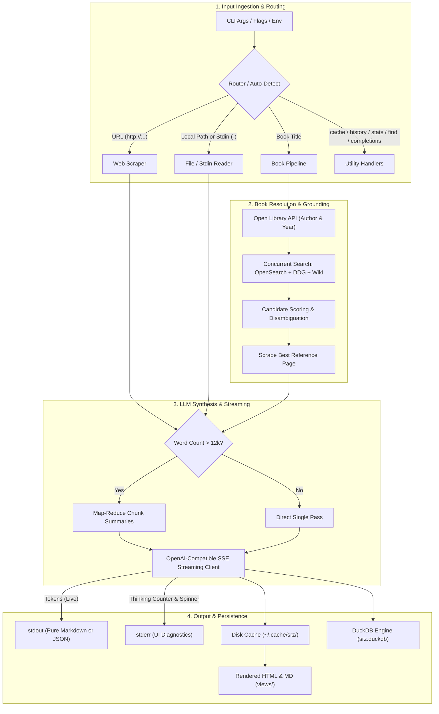
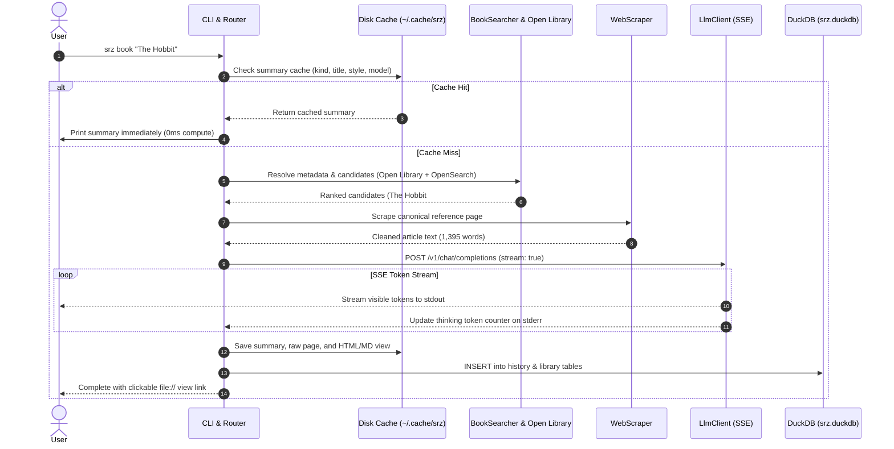
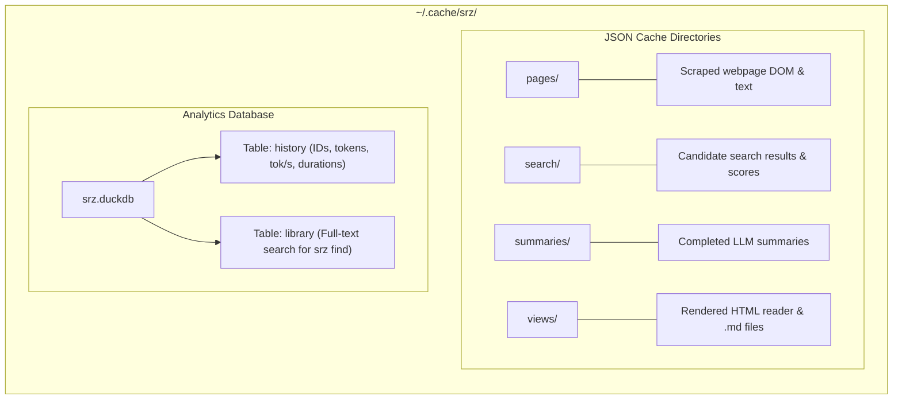

# `srz` Architectural Overview

`srz` (Summarize) is a high-performance, modular Rust CLI tool for extracting and synthesizing structured summaries from **webpages**, **local files**, **Unix stdin streams**, and **books** using local OpenAI-compliant LLMs (such as llama.cpp, Ollama, LM Studio, or vLLM).

---

## 1. High-Level Architecture

The diagram below illustrates the end-to-end lifecycle of an `srz` invocation:

---

## 2. Request & Execution Sequence

---

## 3. Storage & Cache Architecture

All state is isolated under `~/.cache/srz/` (or `$XDG_CACHE_HOME/srz/`), completely bypassable via `--no-cache` and resettable via `srz cache clean`:

---

## 4. Component Directory & Responsibilities

| File | Module | Primary Responsibility |
| :--- | :--- | :--- |
| [`src/main.rs`](file:///Users/myoo/Documents/Repo/srz/src/main.rs) | `main` | Entry point, pipeline orchestration, TTY checking, and subcommand handlers. |
| [`src/cli.rs`](file:///Users/myoo/Documents/Repo/srz/src/cli.rs) | `cli` | `clap` argument parsing, style definitions, and target action resolution. |
| [`src/llm.rs`](file:///Users/myoo/Documents/Repo/srz/src/llm.rs) | `llm` | SSE client, thinking tokens, `stream_options`, and prompt crafting. |
| [`src/search.rs`](file:///Users/myoo/Documents/Repo/srz/src/search.rs) | `search` | Open Library metadata, Wikipedia OpenSearch/fulltext, DDG, and candidate scoring. |
| [`src/scraper.rs`](file:///Users/myoo/Documents/Repo/srz/src/scraper.rs) | `scraper` | HTTP client, DOM parsing, boilerplate removal, and word counting. |
| [`src/chunker.rs`](file:///Users/myoo/Documents/Repo/srz/src/chunker.rs) | `chunker` | Text windowing and paragraph chunking for long articles (> 12k words). |
| [`src/cache.rs`](file:///Users/myoo/Documents/Repo/srz/src/cache.rs) | `cache` | Disk caching in `~/.cache/srz/` with case-insensitive ASCII hashing. |
| [`src/db.rs`](file:///Users/myoo/Documents/Repo/srz/src/db.rs) | `db` | Embedded DuckDB engine tracking telemetry and offline full-text library search. |
| [`src/render.rs`](file:///Users/myoo/Documents/Repo/srz/src/render.rs) | `render` | Markdown-to-HTML typography rendering and slugification. |
| [`src/ui.rs`](file:///Users/myoo/Documents/Repo/srz/src/ui.rs) | `ui` | Spinners (`indicatif`), terminal detection (`is_terminal`), and `NO_COLOR` hygiene. |

---

## 5. Key CLI Features & Flags

- **Universal Input**: `srz <URL>`, `srz <BOOK>`, `srz <FILE>`, or `cat ... | srz -`.
- **Telemetry & Stats**: `srz stats` (speeds, total tokens) and `srz history` (past reads).
- **Offline Search**: `srz find "keyword"` searches past summaries in DuckDB.
- **Machine-Readable**: Add `--json` to any command for JSON stdout.
- **Unix Pipeline Friendly**: Strict separation—summary on `stdout`, diagnostics on `stderr`. Pass `-q` / `--quiet` to mute all stderr notices.
- **Shell Completions**: `srz completions zsh > ~/.zfunc/_srz` (supports bash, zsh, fish, powershell, elvish).
