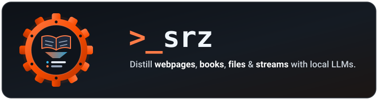

<p align="center">
  
</p>

# `srz` (Summarize)

A fast, modular Rust CLI for distilling **webpages**, **local files**, **stdin streams**, **books**, and **live news digests** into structured summaries using any local OpenAI-compliant LLM (such as **llama.cpp**, **Ollama**, **LM Studio**, or **vLLM**).


## Highlights

- **Summarize anything**: works with web links, book titles, local files, piped text, and news topics.
- **Multi-source news briefings**: aggregates top articles from Google News RSS for any topic, decodes destination publisher URLs, and synthesizes executive briefings.
- **Fact-checked book summaries**: pulls synopses from Wikipedia and Open Library—no ebook files or API keys needed.
- **100% local & private**: runs on your own machine using `llama.cpp`, `Ollama`, `LM Studio`, or `vLLM`.
- **Searchable personal library**: saves every summary locally so you can search past reads offline.
- **Clean reader views**: generates one-click HTML and Markdown pages with automatic light and dark mode.


## Prerequisites: LLM Backend Server

`srz` requires an OpenAI API-compliant LLM server. While cloud provider APIs (OpenAI, Anthropic, Google, Groq, etc.) are supported, running a **local LLM is strongly preferred** for complete privacy, zero subscription fees, and offline capability:

- **macOS**: [Llama-macOS](https://github.com/ggml-org/Llama-macOS) (recommended local default; connects out-of-the-box on port `9931`).
- **Windows**: [Llama-Windows](https://github.com/ggml-org/Llama-Windows) (recommended local default; connects out-of-the-box on port `9931`).
- **Linux**: [llama.cpp](https://github.com/ggml-org/llama.cpp) (recommended local default; run `llama-server`).
- **Other Backends**: Compatible with Ollama, LM Studio, vLLM, or cloud providers (OpenAI, Anthropic, Google Gemini, Groq, etc.).

See [Configuring Your LLM Backend](#configuring-your-llm-backend) below for step-by-step setup instructions and profile templates.


## Installation

### Quick Install

**macOS & Linux**:

```bash
curl -LsSf https://raw.githubusercontent.com/NewGuy012/srz/master/install.sh | sh
```

**Windows**:

```powershell
powershell -ExecutionPolicy ByPass -c "irm https://raw.githubusercontent.com/NewGuy012/srz/master/install.ps1 | iex"
```

### Build from Source (Cargo)

If you prefer building with Rust from source:

```bash
cargo install --path .
```


## Usage

Pass any target directly—`srz` auto-detects URLs, books, files, news, or stdin.

### Summarizing Content

```bash
srz "https://example.com/article"       # Web article
srz "The Hobbit"                        # Book title (Wikipedia + Open Library)
srz "document.md"                       # Local document (Markdown, plain text, HTML)
git diff | srz "-"                      # Standard input
```

### Live News Briefings

```bash
srz news "AI updates"                   # Today's news digest
srz "current AI news" -t "week"         # Auto-detected news query (day/week/month)
```

### Styles & Reader Views

```bash
srz "The Hobbit" --style "tldr"         # Presets: concise, detailed, bullets, tldr...
srz "The Hobbit" --open                 # Open distraction-free reader in browser
```

### Offline Library & Search

```bash
srz find "ecology"                      # Search past summaries offline
srz index --open                        # Interactive HTML library dashboard
srz history                             # View past summaries & token metrics
```

### Self-Update & Maintenance

```bash
srz upgrade                             # Upgrade srz in-place to latest release
srz upgrade --check                     # Check if an update is available
srz upgrade --force                     # Force reinstall or overwrite existing binary
```

Run `srz --help` to see all available subcommands and flags.


## Features

### Content Sources & Ingestion

- **Web Articles & Documents**: Summarizes webpages, text files, markdown, HTML documents, and piped terminal text.
- **Books by Title**: Generates verified overviews from Wikipedia and Open Library without needing an ebook file.
- **Live News Briefings**: Curates and summarizes top stories on any topic or timeframe from Google News.

### LLM Engine & Synthesis

- **8 Summary Styles**: Tailor output with presets like concise, detailed, bullet points, executive, or quick takeaways.
- **Parallel Processing for Long Texts**: Automatically splits and processes long documents in parallel.
- **Visual Feedback & Live Streaming**: Clean progress indicators with optional real-time streaming.

### Offline Library & Storage

- **Offline Full-Text Search**: Search through your entire history of past summaries completely offline.
- **Visual Library Dashboard**: Browse, filter, and review all your saved summaries in an interactive dashboard.
- **Instant Reader Views**: Generates clean, distraction-free reading pages with automatic light and dark mode.

### Configuration & CLI Experience

- **Config File & Profiles**: Save default preferences and switch between different models with ease.
- **One-Command Upgrades**: Safe in-place binary upgrades with SHA256 integrity verification (`srz upgrade`).
- **Health Checks & Diagnostics**: Verify backend connectivity and inspect available models with built-in tools.


## Configuring Your LLM Backend

`srz` connects to any OpenAI-compatible API. Local inference is preferred for privacy and zero cost, but cloud providers are fully supported.

### Local LLMs (Preferred)

- **macOS & Windows (Default)**: Install [Llama-macOS](https://github.com/ggml-org/Llama-macOS) (macOS) or [Llama-Windows](https://github.com/ggml-org/Llama-Windows) (Windows). Launch the app and load a model—`srz` connects automatically to `http://localhost:9931/v1` with zero setup.
- **Linux**: Build or install [llama.cpp](https://github.com/ggml-org/llama.cpp) and launch `llama-server`:
  ```bash
  # Start llama-server on port 9931 for zero configuration:
  llama-server -m model.gguf --port 9931

  # Or on default port 8080:
  llama-server -m model.gguf --port 8080
  export OPENAI_BASE_URL="http://localhost:8080/v1"
  ```
- **Diagnostics**: Run `srz doctor` to test server latency and `srz models` to list loaded models.

### Cloud Providers (Optional)

`srz` works with any OpenAI-compatible provider (OpenAI, Anthropic, Google, Groq, OpenRouter):

```bash
export OPENAI_BASE_URL="https://api.openai.com/v1" OPENAI_MODEL="gpt-4o-mini" OPENAI_API_KEY="sk-..."

# Or on the fly via CLI flag:
srz "1984" --base-url "https://api.openai.com/v1" --model "gpt-4o-mini" --api-key "sk-..."
```

### Profile Switching (`~/.config/srz/config.toml`)

Run `srz config init` to generate a starter config, then configure named profiles for your favorite local or cloud models:

```toml
# Default local backend (runs out-of-the-box with Llama-macOS / Llama-Windows / llama-server)
base_url = "http://localhost:9931/v1"
model = "ggml-org/gemma-4-E4B-it-GGUF:Q8_0"

# Cloud profile: OpenAI
[profiles.openai]
base_url = "https://api.openai.com/v1"
model = "gpt-4o-mini"
api_key = "sk-..."

# Cloud profile: Anthropic Claude
[profiles.anthropic]
base_url = "https://api.anthropic.com/v1"
model = "claude-3-5-sonnet-20241022"
api_key = "sk-ant-..."

# Cloud profile: Google Gemini
[profiles.google]
base_url = "https://generativelanguage.googleapis.com/v1beta/openai"
model = "gemini-2.0-flash"
api_key = "..."
```

Run with your default local model, or switch to any cloud profile seamlessly:

```bash
srz "The Hobbit"                      # Runs 100% locally
srz "The Hobbit" --profile "openai"    # Runs via OpenAI
srz "The Hobbit" --profile "anthropic" # Runs via Anthropic Claude
srz "The Hobbit" --profile "google"    # Runs via Google Gemini
```


## Architecture & Modules

See [`OVERVIEW.md`](OVERVIEW.md) for detailed Mermaid architecture and sequence diagrams.


## Running Tests

```bash
cargo test
```
