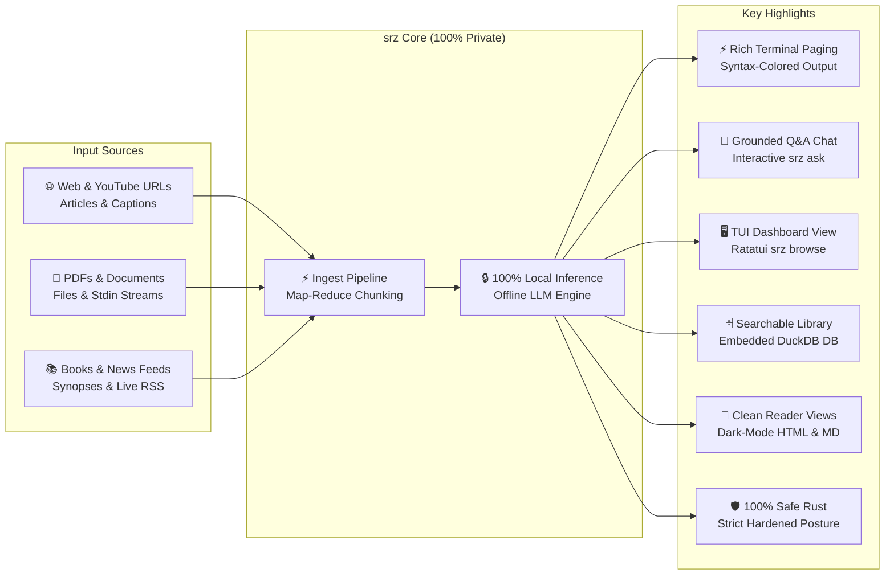

<p align="center">
  
</p>

# `srz` (Summarize)

`srz` (Summarize) is a high-performance, modular Rust CLI tool for extracting and synthesizing structured summaries using local OpenAI-compliant LLMs (such as **llama.cpp**, **Ollama**, **LM Studio**, or **vLLM**) from:

- 🌐 **Webpages**
- 📺 **YouTube video transcripts**
- 📄 **PDF documents & local files**
- ⌨️ **Unix stdin streams**
- 📚 **Books**
- 📰 **Live news digests**


## Highlights



- 🔒 **100% Local & Private**: Runs on your machine with complete privacy, zero subscriptions, and no API keys.
- 🛡️ **100% Safe Rust & Verified Security**: Compiled under `#![forbid(unsafe_code)]`, strict POSIX `0700`/`0600` file isolation, prompt injection defense, and mandatory SHA-256 binary validation.
- 💬 **Interactive Grounded Q&A**: Ask questions grounded on any document or past read via `srz ask`.
- 🖥️ **Interactive TUI Dashboard**: Browse, search, filter, and copy past summaries with `srz browse`.
- 🗄️ **Offline Searchable Library**: Automatically saves and indexes every summary in embedded DuckDB.
- 📖 **Distraction-Free Reader Views**: Generates clean HTML and Markdown pages with dark mode support.
- ⚡ **Rich Terminal Paging**: Syntax-highlighted CLI output with automatic paging for long summaries.


## Prerequisites: LLM Backend Server

`srz` requires an OpenAI API-compliant LLM server. While cloud provider APIs (OpenAI, Anthropic, Google, Groq, etc.) are supported, running a **local LLM is strongly preferred** for complete privacy, zero subscription fees, and offline capability:

- **macOS**: [Llama-macOS](https://github.com/ggml-org/Llama-macOS) (recommended local default; connects out-of-the-box on port `9931`).
- **Windows**: [Llama-Windows](https://github.com/ggml-org/Llama-Windows) (recommended local default; connects out-of-the-box on port `9931`).
- **Linux**: [llama.cpp](https://github.com/ggml-org/llama.cpp) (recommended local default; run `llama-server`).
- **Other Backends**: Compatible with Ollama, LM Studio, vLLM, or cloud providers (OpenAI, Anthropic, Google Gemini, Groq, etc.).

See [Configuring Your LLM Backend](#configuring-your-llm-backend) below for step-by-step setup instructions and profile templates.


## Installation

### Quick Install

**macOS & Linux**:

```bash
curl -LsSf https://raw.githubusercontent.com/NewGuy012/srz/master/install.sh | sh
```

**Windows**:

```powershell
powershell -ExecutionPolicy ByPass -c "irm https://raw.githubusercontent.com/NewGuy012/srz/master/install.ps1 | iex"
```

### Homebrew (macOS & Linux)

```bash
brew install NewGuy012/tap/srz
```

### Build from Source (Cargo)

If you prefer building with Rust from source:

```bash
cargo install --path .
```


## Usage

### Summarize
```bash
srz "https://example.com/article"     # Webpage, blog, or article
srz "https://youtu.be/dQw4w9WgXcQ"    # YouTube video captions & timed transcript
srz document.pdf                      # Local PDF document (pure-Rust extractor)
srz "The Hobbit" --style tldr --open  # Book synopsis & open in browser
srz news "AI updates" -t week         # Live news digest (day, week, month)
git diff | srz -                      # Unix stdin stream
```

### Ask & Chat
```bash
srz ask "What are the main findings?" # Grounded Q&A based on latest read
srz ask document.pdf "Key takeaways?" # Grounded Q&A on a specific document
srz ask -i                            # Interactive multi-turn chat REPL
```

### Library, Search & Telemetry
```bash
srz browse                            # Interactive TUI dashboard (browse, search, copy)
srz find "keyword"                    # Offline full-text search across past summaries
srz history                           # Recent reads, word counts, and generation speeds
srz stats                             # Aggregate telemetry: words read, tokens generated
```

Run `srz --help` to see all available subcommands and flags.


## Features

- **Multi-Source Ingestion**: Webpages, YouTube captions, PDF documents, Markdown/text files, Unix pipes (`-`), book synopses, and Google News RSS.
- **Interactive Q&A (`srz ask`)**: Single-turn and multi-turn REPL chat grounded on full source documents or past reads with delimiter injection defense.
- **TUI Dashboard (`srz browse`)**: Split-pane terminal explorer with live search, telemetry inspection, clipboard copying, and deletion.
- **8 Summary Presets**: `concise`, `detailed`, `bullets`, `executive`, `tldr`, `critique`, `eli5`, and `flashcards`.
- **Offline Storage & Search**: Saves all reads to embedded DuckDB with full-text search (`srz find`) and HTML index dashboard (`srz index`).
- **Reader Views & Paging**: Standalone HTML/Markdown exports with dark mode, plus automatic terminal paging (`less -RFX`) like `bat`.
- **Parallel Map-Reduce**: Automatically splits and synthesizes large documents exceeding token limits in parallel.
- **100% Safe Rust & Hardened Security**: Compiled under `#![forbid(unsafe_code)]`, strict POSIX `0700`/`0600` permissions, bounded streaming, and SHA-256 binary validation.
- **Profiles & Diagnostics**: Named backend profiles in `config.toml`, server health checks (`srz doctor`), and self-updater (`srz upgrade`).


## Configuring Your LLM Backend

`srz` connects to any OpenAI-compatible API. Local inference is preferred for privacy and zero cost, but cloud providers are fully supported.

### Local LLMs (Preferred)

- **macOS & Windows (Default)**: Install [Llama-macOS](https://github.com/ggml-org/Llama-macOS) (macOS) or [Llama-Windows](https://github.com/ggml-org/Llama-Windows) (Windows). Launch the app and load a model—`srz` connects automatically to `http://localhost:9931/v1` with zero setup.
- **Linux**: Build or install [llama.cpp](https://github.com/ggml-org/llama.cpp) and launch `llama-server`:
  ```bash
  # Start llama-server on port 9931 for zero configuration:
  llama-server -m model.gguf --port 9931

  # Or on default port 8080:
  llama-server -m model.gguf --port 8080
  export OPENAI_BASE_URL="http://localhost:8080/v1"
  ```
- **Diagnostics**: Run `srz doctor` to test server latency and `srz models` to list loaded models.

### Cloud Providers (Optional)

`srz` works with any OpenAI-compatible provider (OpenAI, Anthropic, Google, Groq, OpenRouter):

```bash
export OPENAI_BASE_URL="https://api.openai.com/v1" OPENAI_MODEL="gpt-4o-mini" OPENAI_API_KEY="sk-..."

# Or on the fly via CLI flag:
srz "1984" --base-url "https://api.openai.com/v1" --model "gpt-4o-mini" --api-key "sk-..."
```

### Profile Switching (`~/.config/srz/config.toml`)

Run `srz config init` to generate a starter config, then configure named profiles:

```toml
# Default local model
base_url = "http://localhost:9931/v1"
model = "ggml-org/gemma-4-E4B-it-GGUF:Q8_0"

# Cloud profile (e.g. OpenAI or Anthropic)
[profiles.openai]
base_url = "https://api.openai.com/v1"
model = "gpt-4o-mini"
api_key = "sk-..."
```

Switch profiles on the fly with `--profile`:

```bash
srz "The Hobbit"                      # Default local model
srz "The Hobbit" --profile openai     # Named cloud profile
```


## Architecture & Modules

See [`OVERVIEW.md`](OVERVIEW.md) for detailed Mermaid architecture diagrams and execution sequences.


## Running Tests & Static Analysis

```bash
# Run full automated test suite (78 tests)
cargo test

# Strict static analysis (warnings denied)
cargo clippy --all-targets -- -D warnings
```
