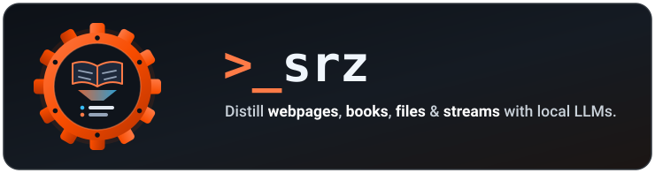
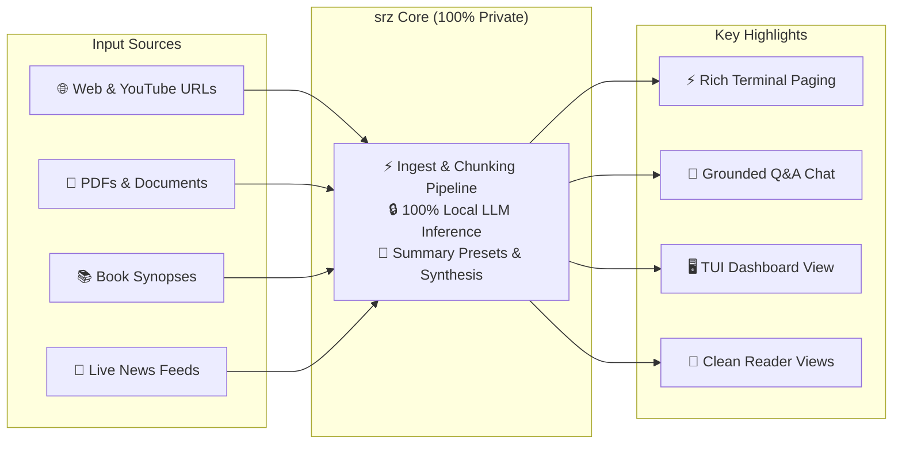

<p align="center">
  
</p>

# `srz` (Summarize)

`srz` (Summarize) is a high-performance, modular Rust CLI tool for extracting and synthesizing structured summaries using local OpenAI-compliant LLMs (such as **llama.cpp**, **Ollama**, **LM Studio**, or **vLLM**) from:

- 🌐 **Webpages & articles**
- 📚 **Books**
- 📰 **Live news digests & universal RSS/Atom feeds**
- 📺 **YouTube video transcripts**
- 📄 **PDF documents & local files**
- ⌨️ **Unix stdin streams**

## Highlights

> 💡 **What makes `srz` different?** Unlike cloud-dependent AI tools that require subscriptions and upload private reading data, `srz` runs 100% locally with zero telemetry—pairing instant streaming synthesis and unified multi-format ingestion with embedded offline DuckDB search.



- 🔒 **100% Local & Private**: Runs on your device with zero fees and no API keys.
- 🎯 **3 Summary Presets**: Choose concise, bulleted, or detailed summaries.
- ⚡ **Zero-Worry Dynamic Sizing**: Automatically probes server context (`n_ctx`) and concurrency slots to size chunks and eliminate OOM crashes.
- 💬 **Interactive Q&A**: Chat and ask questions about any document or read with token-budgeted memory.
- 🖥️ **Terminal Dashboard**: Browse, search, filter, and read past summaries.


## Prerequisites: LLM Backend Server

`srz` requires an OpenAI API-compliant LLM server. While cloud provider APIs (OpenAI, Anthropic, Google, Groq, etc.) are supported, running a **local LLM is strongly preferred** for complete privacy, zero subscription fees, and offline capability:

- **macOS**: [Llama-macOS](https://github.com/ggml-org/Llama-macOS) (recommended local default; connects out-of-the-box on port `9931`).
- **Windows**: [Llama-Windows](https://github.com/ggml-org/Llama-Windows) (recommended local default; connects out-of-the-box on port `9931`).
- **Linux**: [llama.cpp](https://github.com/ggml-org/llama.cpp) (recommended local default; run `llama-server`).
- **Other Backends**: Compatible with Ollama, LM Studio, vLLM, or cloud providers (OpenAI, Anthropic, Google Gemini, Groq, etc.).

See [Configuring Your LLM Backend](#configuring-your-llm-backend) below for step-by-step setup instructions and profile templates.


## Installation

### Quick Install

**macOS & Linux**:

```bash
curl -LsSf https://raw.githubusercontent.com/NewGuy012/srz/master/scripts/install.sh | sh
```

**Windows**:

```powershell
powershell -ExecutionPolicy ByPass -c "irm https://raw.githubusercontent.com/NewGuy012/srz/master/scripts/install.ps1 | iex"
```

### Homebrew (macOS & Linux)

```bash
brew install NewGuy012/tap/srz
```

### Build from Source (Cargo)

If you prefer building with Rust from source:

```bash
cargo install --path .
```


## Usage

### Hardware Recommendation
Run `srz recommend` to inspect your system's RAM/CPU and get the optimal model and context window:
```bash
srz recommend
```

### Summarize
```bash
srz "https://en.wikipedia.org/wiki/Rust_(programming_language)" # Web article
srz "https://youtu.be/5C_HPTJg5ek"          # YouTube video
srz assets/document.pdf                     # PDF document
srz news "Rust language updates"            # Live news digest
```

### Ask & Chat
```bash
srz ask "What are the main findings?"  # Ask latest read
srz ask assets/document.pdf "Summary"  # Ask document
srz ask -i                             # Interactive chat
```

### Library, Search & Telemetry
```bash
srz browse                                      # Terminal dashboard (press 'a' for grounded chat)
srz find "keyword"                              # Search past summaries
srz query "SELECT model, count(*) FROM history GROUP BY model" # SQL analytics
srz export --format markdown ~/Notes/Vault/     # Export vault for Obsidian / Logseq
srz export --format json library.json           # Export as structured JSON
```

### Cache & Storage Maintenance
```bash
srz cache clean    # Clean cache files
srz doctor         # Backend diagnostics
```

Run `srz --help` to see all available subcommands and flags.


## Configuring Your LLM Backend

`srz` connects to any OpenAI-compatible API. Local inference is preferred for privacy and zero cost, but cloud providers are fully supported.

### Local LLMs (Preferred)

- **macOS & Windows (Default)**: Install [Llama-macOS](https://github.com/ggml-org/Llama-macOS) (macOS) or [Llama-Windows](https://github.com/ggml-org/Llama-Windows) (Windows). Launch the app and load the model—`srz` connects automatically to `http://localhost:9931/v1` with zero setup (default model: `ggml-org/gemma-4-E4B-it-GGUF:Q8_0`).
  - In Llama GUI, simply select the simplified model card shown by `srz recommend`:
    - Model: `gemma-4`
    - Badges: `E4B` `Q8_0` (or `26B-A4B` `Q8_0` for 64GB+ workstations)
    - Context: `32k ctx` (or `64k ctx` / `128k ctx`)

### Cloud Providers (Optional)

`srz` works with any OpenAI-compatible provider (OpenAI, Gemini, Groq, Anthropic):

```bash
export OPENAI_BASE_URL="https://api.openai.com/v1" OPENAI_MODEL="gpt-4o-mini" OPENAI_API_KEY="sk-..."
```

### Hardware-Tailored Configuration (`srz config init`)

Run `srz config init` to auto-generate a `~/.config/srz/config.toml` tailored to your machine's hardware:

```toml
base_url = "http://localhost:9931/v1"
model = "ggml-org/gemma-4-E4B-it-GGUF:Q8_0"
context_window = 32768

[profiles.openai]
base_url = "https://api.openai.com/v1"
model = "gpt-4o-mini"
api_key = "sk-..."
```

Switch profiles on the fly with `--profile`:

```bash
srz "The Rust Programming Language" --profile openai
```


## Documentation

For full guides, tutorials, architecture specifications, and complete command references, visit the [**srz Documentation Site**](https://newguy012.github.io/srz/).

