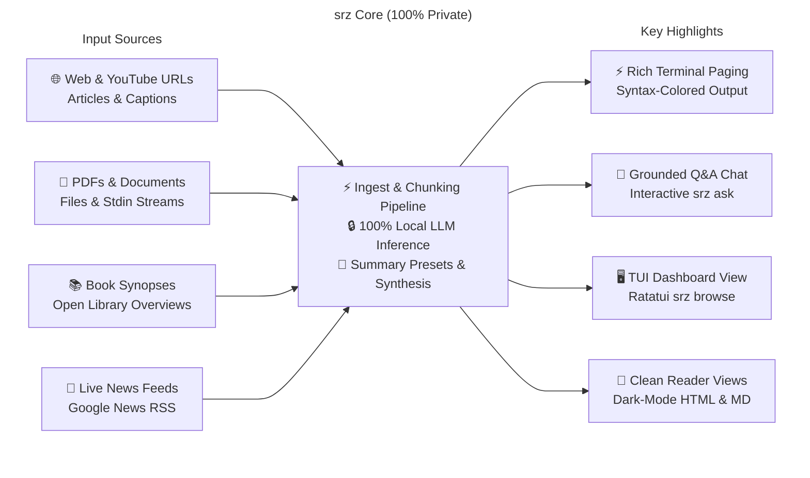

<p align="center">
  
</p>

# `srz` (Summarize)

`srz` (Summarize) is a high-performance, modular Rust CLI tool for extracting and synthesizing structured summaries using local OpenAI-compliant LLMs (such as **llama.cpp**, **Ollama**, **LM Studio**, or **vLLM**) from:

- 🌐 **Webpages**
- 📺 **YouTube video transcripts**
- 📄 **PDF documents & local files**
- ⌨️ **Unix stdin streams**
- 📚 **Books**
- 📰 **Live news digests**


## Highlights



- 🔒 **100% Local & Private**: Runs on your machine with complete privacy, zero subscriptions, and no API keys.
- 🎯 **3 Summary Presets**: Tailor output with `concise` (default), `bullets`, and `detailed`.
- ⚡ **Rich Terminal Paging**: Syntax-highlighted CLI output with automatic paging for long summaries.
- 💬 **Interactive Grounded Q&A**: Ask questions grounded on any document or past read via `srz ask`, with persistent multi-turn chat sessions.
- 🖥️ **Interactive TUI Dashboard**: Browse, search, filter, and copy past summaries with `srz browse`.
- 🔍 **BM25 Full-Text Search**: Embedded DuckDB indexes every read with relevance-scored BM25 search via `srz find`.
- 📊 **Reading Habits & Model Telemetry**: Track reading streaks, time saved, active days, and P50/P95 model generation throughput with `srz stats`.
- 🗄️ **Consolidated Embedded Storage**: High-speed, atomic caching and analytics powered entirely by embedded DuckDB (`cache.duckdb` and `srz.duckdb`).
- 📖 **Distraction-Free Reader Views**: Generates clean HTML and Markdown pages with dark mode support.


## Prerequisites: LLM Backend Server

`srz` requires an OpenAI API-compliant LLM server. While cloud provider APIs (OpenAI, Anthropic, Google, Groq, etc.) are supported, running a **local LLM is strongly preferred** for complete privacy, zero subscription fees, and offline capability:

- **macOS**: [Llama-macOS](https://github.com/ggml-org/Llama-macOS) (recommended local default; connects out-of-the-box on port `9931`).
- **Windows**: [Llama-Windows](https://github.com/ggml-org/Llama-Windows) (recommended local default; connects out-of-the-box on port `9931`).
- **Linux**: [llama.cpp](https://github.com/ggml-org/llama.cpp) (recommended local default; run `llama-server`).
- **Other Backends**: Compatible with Ollama, LM Studio, vLLM, or cloud providers (OpenAI, Anthropic, Google Gemini, Groq, etc.).

See [Configuring Your LLM Backend](#configuring-your-llm-backend) below for step-by-step setup instructions and profile templates.


## Installation

### Quick Install

**macOS & Linux**:

```bash
curl -LsSf https://raw.githubusercontent.com/NewGuy012/srz/master/scripts/install.sh | sh
```

**Windows**:

```powershell
powershell -ExecutionPolicy ByPass -c "irm https://raw.githubusercontent.com/NewGuy012/srz/master/scripts/install.ps1 | iex"
```

### Homebrew (macOS & Linux)

```bash
brew install NewGuy012/tap/srz
```

### Build from Source (Cargo)

If you prefer building with Rust from source:

```bash
cargo install --path .
```


## Usage

### Summarize
```bash
srz "https://en.wikipedia.org/wiki/Rust_(programming_language)" # Webpage, blog, or article
srz "https://youtu.be/5C_HPTJg5ek"    # YouTube video: "Rust in 100 Seconds" (captions & timed transcript)
srz assets/document.pdf               # Local PDF document (pure-Rust extractor)
srz "The Rust Programming Language" --style bullets --open  # Book synopsis & open in browser
srz news "Rust language updates" -t week  # Live news digest (day, week, month)
git diff | srz -                      # Unix stdin stream
```

### Ask & Chat
```bash
srz ask "What are the main findings?"        # Grounded Q&A based on latest read
srz ask assets/document.pdf "Key takeaways?" # Grounded Q&A on a specific document
srz ask -i                                   # Interactive multi-turn chat REPL (persisted session)
srz ask --chats                              # List saved multi-turn chat sessions
srz ask --resume 1                           # Resume conversation from session 1
srz ask --show-chat 1                        # Inspect full conversation transcript
srz ask --delete-chat 1                      # Delete a saved chat session
```

### Library, Search & Telemetry
```bash
srz browse                            # Interactive TUI dashboard (browse, search, copy)
srz find "keyword"                    # Offline BM25 relevance-ranked search across past summaries
srz history                           # Recent reads, word counts, and generation speeds
srz stats                             # Habits (streak, time saved) & model telemetry (P50/P95)
```

### Cache & Storage Maintenance
```bash
srz cache size                        # Total disk usage across pages, search, summaries, and views
srz cache prune --older-than 14d      # Prune entries older than 14 days (or auto-pruned daily)
srz cache prune --max-size 500MB      # LRU eviction to stay within storage budget
srz cache clean                       # Safe cleanup of cache files (preserves DuckDB database)
srz cache clean --reset-db            # Full reset including DuckDB history tables
srz doctor                            # Diagnose LLM backend, database, and cache retention
```

Run `srz --help` to see all available subcommands and flags.


## Features

- [**Universal Ingestion**](docs/OVERVIEW.md#6-key-cli-features--commands): Webpages, YouTube captions, PDFs, local text files, Unix pipes (`-`), book synopses, and live news.
- [**Interactive Q&A (`srz ask`)**](docs/OVERVIEW.md#module-responsibilities): Ask questions or launch an interactive multi-turn chat REPL grounded on any document or past read, with persistent DuckDB session storage (`--chats`, `--resume`).
- [**TUI Dashboard (`srz browse`)**](docs/OVERVIEW.md#performance--memory-efficiency): Browse, search, filter, and copy past summaries in a split-pane terminal UI.
- [**3 Summary Presets**](docs/OVERVIEW.md#6-key-cli-features--commands): Tailor summaries with `concise` (default), `bullets`, or `detailed`.
- [**Offline BM25 Library Search**](docs/OVERVIEW.md#3-storage--cache-architecture): Embedded DuckDB indexes every read with Robertson-Sparck Jones BM25 relevance ranking (`srz find`) and HTML dashboards (`srz index`).
- [**Rich Habit & Model Telemetry**](docs/OVERVIEW.md#6-key-cli-features--commands): Track active reading days, reading streaks, estimated reading time saved, top domains, and P50/P95 token throughput percentiles (`srz stats`).
- [**Consolidated DuckDB Cache**](docs/OVERVIEW.md#3-storage--cache-architecture): Scraped pages, search candidates, and generated summaries are consolidated into embedded DuckDB (`cache.duckdb`) with atomic writes and instant SQL TTL pruning.
- [**Reader Views & Paging**](docs/OVERVIEW.md#module-responsibilities): Standalone dark-mode HTML/Markdown exports, plus automatic terminal paging (`less -RFX`).
- [**Map-Reduce Chunking**](docs/OVERVIEW.md#performance--memory-efficiency): Splits and synthesizes long documents exceeding LLM context windows in parallel.
- [**Private & Secure**](docs/OVERVIEW.md#security--privacy): 100% local inference, zero tracking, safe Rust, private file permissions (`0700`/`0600`), and SHA-256 verified binary updates.
- [**Profiles & Diagnostics**](docs/OVERVIEW.md#6-key-cli-features--commands): Switch backends in `config.toml`, test server health (`srz doctor`), and self-update (`srz upgrade`).

> For architectural diagrams, lifecycle execution sequences, and in-depth subsystem specs, see [**`OVERVIEW.md`**](docs/OVERVIEW.md).


## Configuring Your LLM Backend

`srz` connects to any OpenAI-compatible API. Local inference is preferred for privacy and zero cost, but cloud providers are fully supported.

### Local LLMs (Preferred)

- **macOS & Windows (Default)**: Install [Llama-macOS](https://github.com/ggml-org/Llama-macOS) (macOS) or [Llama-Windows](https://github.com/ggml-org/Llama-Windows) (Windows). Launch the app and load a model—`srz` connects automatically to `http://localhost:9931/v1` with zero setup.
- **Linux**: Build or install [llama.cpp](https://github.com/ggml-org/llama.cpp) and launch `llama-server`:
  ```bash
  # Start llama-server on port 9931 for zero configuration:
  llama-server -m model.gguf --port 9931

  # Or on default port 8080:
  llama-server -m model.gguf --port 8080
  export OPENAI_BASE_URL="http://localhost:8080/v1"
  ```
- **Diagnostics**: Run `srz doctor` to test server latency and `srz models` to list loaded models.

### Cloud Providers (Optional)

`srz` works with any OpenAI-compatible provider (OpenAI, Anthropic, Google, Groq, OpenRouter):

```bash
export OPENAI_BASE_URL="https://api.openai.com/v1" OPENAI_MODEL="gpt-4o-mini" OPENAI_API_KEY="sk-..."

# Or on the fly via CLI flag:
srz "1984" --base-url "https://api.openai.com/v1" --model "gpt-4o-mini" --api-key "sk-..."
```

### Profile Switching (`~/.config/srz/config.toml`)

Run `srz config init` to generate a starter config, then configure named profiles:

```toml
# Default local model
base_url = "http://localhost:9931/v1"
model = "ggml-org/gemma-4-E4B-it-GGUF:Q8_0"

# Storage limits and retention policies
[cache]
max_size_mb = 500         # Disk budget (LRU eviction past threshold)
pages_ttl_days = 7        # Scraped web content & news TTL
search_ttl_days = 14      # Book metadata & search candidates TTL
summaries_ttl_days = 90   # Generated LLM outputs TTL
auto_prune = true         # Opportunistic 24h background pruning

# Cloud profile (e.g. OpenAI or Anthropic)
[profiles.openai]
base_url = "https://api.openai.com/v1"
model = "gpt-4o-mini"
api_key = "sk-..."
```

Switch profiles on the fly with `--profile`:

```bash
srz "The Rust Programming Language"                      # Default local model
srz "The Rust Programming Language" --profile openai     # Named cloud profile
```


## Architecture & Modules

See [`OVERVIEW.md`](docs/OVERVIEW.md) for detailed Mermaid architecture diagrams and execution sequences.


## Running Tests & Static Analysis

```bash
# Run full automated test suite (111 tests)
cargo test

# Strict static analysis (warnings denied)
cargo clippy --all-targets -- -D warnings
```
