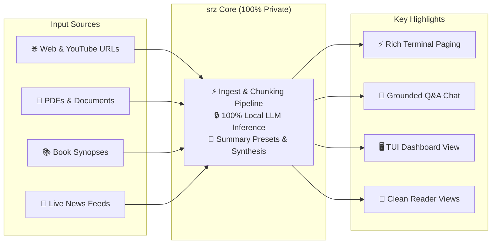

<p align="center">
  
</p>

# `srz` (Summarize)

`srz` (Summarize) is a high-performance, modular Rust CLI tool for extracting and synthesizing structured summaries using local OpenAI-compliant LLMs (such as **llama.cpp**, **Ollama**, **LM Studio**, or **vLLM**) from:

- 🌐 **Webpages & articles** (Mozilla Readability extraction)
- 📺 **YouTube video transcripts**
- 📄 **PDF documents & local files**
- ⌨️ **Unix stdin streams**
- 📚 **Books**
- 📰 **Live news digests & universal RSS/Atom feeds**

> 📖 **Documentation**: Visit the [**srz Documentation Site**](https://newguy012.github.io/srz/) for full guides, tutorials, and command references.


## Highlights



- 🔒 **100% Local & Private**: Runs on your device with zero fees and no API keys.
- 🎯 **3 Summary Presets**: Choose concise, bulleted, or detailed summaries.
- ⚡ **Zero-Worry Dynamic Sizing**: Automatically probes server context (`n_ctx`) and concurrency slots to size chunks and eliminate OOM crashes.
- 💻 **Laptop Hardware Optimization**: Steers towards high-fidelity Google Gemma 4 (`Q8_0`) models matched to your machine's unified memory.
- 🎯 **Exact Server Tokenization**: Queries the local LLM's native `/tokenize` endpoint for 0% tokenizer drift across code and multilingual text.
- 📰 **Google News Feeds**: Summarize top stories and search topics by default.
- ⚡ **Terminal Paging**: Clean CLI output with auto-paging for long summaries.
- 💬 **Interactive Q&A**: Chat and ask questions about any document or read with token-budgeted memory.
- 🖥️ **Terminal Dashboard**: Browse, search, filter, and read past summaries.
- 🔍 **Fast Offline Search**: Find past summaries instantly without internet.
- 🗄️ **Local Smart Cache**: Saves past reads and server capabilities locally for instant offline review.
- 📖 **Clean Reader Views**: Distraction-free HTML and Markdown with dark mode.


## Prerequisites: LLM Backend Server

`srz` requires an OpenAI API-compliant LLM server. While cloud provider APIs (OpenAI, Anthropic, Google, Groq, etc.) are supported, running a **local LLM is strongly preferred** for complete privacy, zero subscription fees, and offline capability:

- **macOS**: [Llama-macOS](https://github.com/ggml-org/Llama-macOS) (recommended local default; connects out-of-the-box on port `9931`).
- **Windows**: [Llama-Windows](https://github.com/ggml-org/Llama-Windows) (recommended local default; connects out-of-the-box on port `9931`).
- **Linux**: [llama.cpp](https://github.com/ggml-org/llama.cpp) (recommended local default; run `llama-server`).
- **Other Backends**: Compatible with Ollama, LM Studio, vLLM, or cloud providers (OpenAI, Anthropic, Google Gemini, Groq, etc.).

See [Configuring Your LLM Backend](#configuring-your-llm-backend) below for step-by-step setup instructions and profile templates.


## Installation

### Quick Install

**macOS & Linux**:

```bash
curl -LsSf https://raw.githubusercontent.com/NewGuy012/srz/master/scripts/install.sh | sh
```

**Windows**:

```powershell
powershell -ExecutionPolicy ByPass -c "irm https://raw.githubusercontent.com/NewGuy012/srz/master/scripts/install.ps1 | iex"
```

### Homebrew (macOS & Linux)

```bash
brew install NewGuy012/tap/srz
```

### Build from Source (Cargo)

If you prefer building with Rust from source:

```bash
cargo install --path .
```


## Usage

### 0. Recommend Model & Context Length for Your Hardware
Before summarizing, run `srz doctor` to inspect your host RAM/CPU and get the recommended model, optimal context window, and exact launch command:
```bash
srz doctor
```
> 💡 **One-Click Decision**: Auto-detects whether your device has 8GB, 16GB, 24–36GB, or 64GB+ unified memory, steers towards high-fidelity Google Gemma 4 (`Q8_0`), selects the optimal context length (8k, 32k, 64k, or 128k), and prints the ready-to-run startup command!

### Summarize
```bash
srz "https://en.wikipedia.org/wiki/Rust_(programming_language)" # Article
srz "https://youtu.be/5C_HPTJg5ek"          # YouTube video
srz assets/document.pdf                     # PDF document
srz "The Rust Programming Language" --open  # Book synopsis
srz news "Rust language updates" -t week    # News digest
git diff | srz -                            # Stdin stream
```

### Ask & Chat
```bash
srz ask "What are the main findings?"  # Ask latest read
srz ask assets/document.pdf "Summary"  # Ask document
srz ask -i                             # Interactive chat
srz ask --chats                        # List saved chats
srz ask --resume 1                     # Resume chat session
srz ask --show-chat 1                  # Show transcript
srz ask --delete-chat 1                # Delete chat session
```

### Library, Search & Telemetry
```bash
srz browse         # Terminal dashboard
srz find "keyword" # Search past summaries
srz history        # View recent reads
srz stats          # Reading statistics
```

### Cache & Storage Maintenance
```bash
srz cache size                   # Check disk usage
srz cache prune --older-than 14d # Prune older cache
srz cache prune --max-size 500MB # Enforce size limit
srz cache clean                  # Clean cache files
srz cache clean --reset-db       # Full database reset
srz doctor                       # Backend diagnostics
```

Run `srz --help` to see all available subcommands and flags.


## Features

- [**Universal Ingestion**](docs/OVERVIEW.md#1-high-level-architecture)
- [**Interactive Q&A (`srz ask`)**](docs/OVERVIEW.md#2-key-cli-features--commands)
- [**TUI Dashboard (`srz browse`)**](docs/OVERVIEW.md#ui--terminal-rendering)
- [**3 Summary Presets**](docs/OVERVIEW.md#2-key-cli-features--commands)
- [**Offline BM25 Library Search**](docs/OVERVIEW.md#database-caching--instant-search)

> For full guides and tutorials, visit the [**Documentation Website**](https://newguy012.github.io/srz/). For architectural diagrams, lifecycle execution sequences, and in-depth subsystem specs, see [**`OVERVIEW.md`**](docs/OVERVIEW.md).


## Configuring Your LLM Backend

`srz` connects to any OpenAI-compatible API. Local inference is preferred for privacy and zero cost, but cloud providers are fully supported.

> 💡 **Not sure which model or context length to choose?**
> Run `srz doctor` in your terminal. It instantly detects your machine's physical RAM, recommends the best high-fidelity Google Gemma 4 model (`Q8_0`), selects the optimal context length, and outputs the exact command to launch it!

### Local LLMs (Preferred)

- **macOS & Windows (Default)**: Install [Llama-macOS](https://github.com/ggml-org/Llama-macOS) (macOS) or [Llama-Windows](https://github.com/ggml-org/Llama-Windows) (Windows). Launch the app and load a model—`srz` connects automatically to `http://localhost:9931/v1` with zero setup.
- **Linux**: Build or install [llama.cpp](https://github.com/ggml-org/llama.cpp) and launch `llama-server`:
  ```bash
  # Start llama-server on port 9931 with recommended Gemma 4 Q8_0 model:
  llama-server -m gemma-4-E4B-it-Q8_0.gguf -c 32768 --port 9931

  # Or on default port 8080:
  llama-server -m gemma-4-E4B-it-Q8_0.gguf -c 32768 --port 8080
  export OPENAI_BASE_URL="http://localhost:8080/v1"
  ```
- **Hardware & Context Diagnostics**: Run `srz doctor` to inspect your host hardware profile, detected server context length (`n_ctx`), native tokenizer status, and recommended launch commands.
- **Manual Context Override**: Override auto-detected context length on the fly via `--context-window <NUM>` (or `context_window` in `config.toml`).

### Cloud Providers (Optional)

`srz` works with any OpenAI-compatible provider (OpenAI, Anthropic, Google, Groq, OpenRouter):

```bash
export OPENAI_BASE_URL="https://api.openai.com/v1" OPENAI_MODEL="gpt-4o-mini" OPENAI_API_KEY="sk-..."

# Or on the fly via CLI flag:
srz "1984" --base-url "https://api.openai.com/v1" --model "gpt-4o-mini" --api-key "sk-..."
```

### Profile Switching (`~/.config/srz/config.toml`)

Run `srz config init` to generate a starter config, then configure named profiles:

```toml
# Default local model
base_url = "http://localhost:9931/v1"
model = "ggml-org/gemma-4-E4B-it-GGUF:Q8_0"

# Storage limits and retention policies
[cache]
max_size_mb = 500         # Disk budget (LRU eviction past threshold)
pages_ttl_days = 7        # Scraped web content & news TTL
search_ttl_days = 14      # Book metadata & search candidates TTL
summaries_ttl_days = 90   # Generated LLM outputs TTL
auto_prune = true         # Opportunistic 24h background pruning

# Cloud profile (e.g. OpenAI or Anthropic)
[profiles.openai]
base_url = "https://api.openai.com/v1"
model = "gpt-4o-mini"
api_key = "sk-..."
```

Switch profiles on the fly with `--profile`:

```bash
srz "The Rust Programming Language"                  # Default model
srz "The Rust Programming Language" --profile openai # Cloud profile
```


## Documentation & Architecture

- 🌐 [**Documentation Website**](https://newguy012.github.io/srz/): Comprehensive mdBook site covering installation, quick start, command reference, and configuration.
- 🏗️ [**Architecture Overview (`OVERVIEW.md`)**](docs/OVERVIEW.md): Detailed Mermaid architecture diagrams, execution sequence flows, storage schemas, and subsystem specifications.
- 🦀 [**Rust Learning Guide (`RUST_LEARNING_GUIDE.md`)**](docs/RUST_LEARNING_GUIDE.md): Hands-on case study exploring Rust systems programming concepts and patterns using real `srz` code.


## Running Tests & Static Analysis

```bash
# Run full automated test suite (120 tests)
cargo test

# Strict static analysis (warnings denied)
cargo clippy --all-targets -- -D warnings
```
