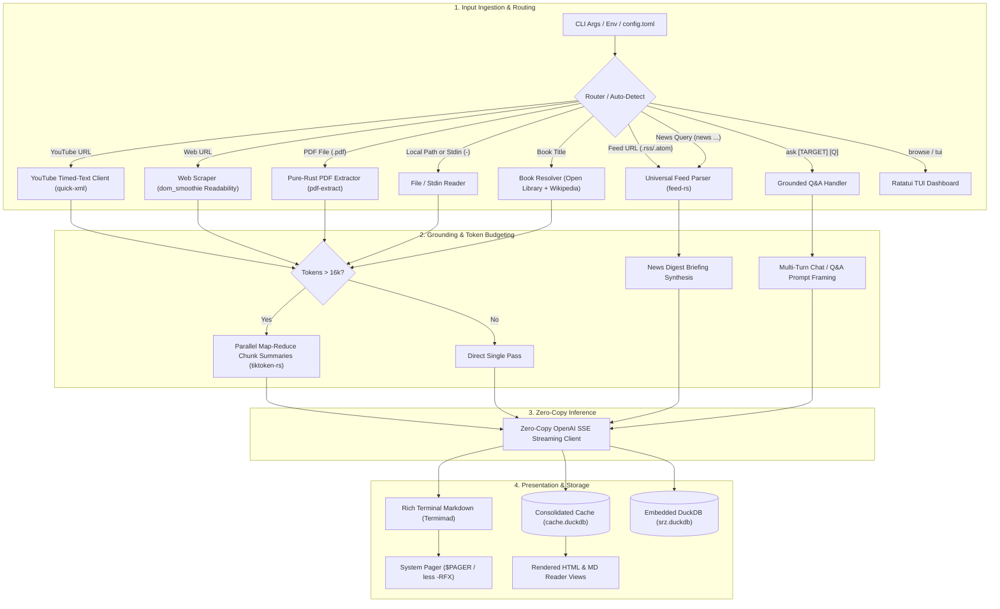
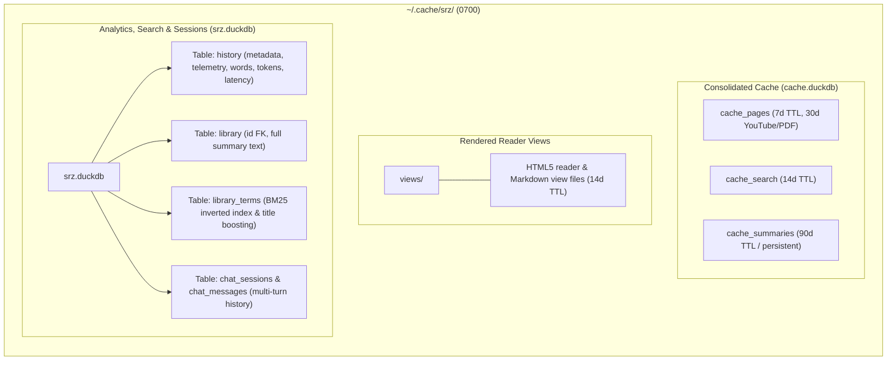

# Architecture & Design

`srz` is built from the ground up for instantaneous responsiveness, low memory overhead, and 100% local privacy.

---

## 1. Modular Subsystem Structure

The repository is organized into cohesive modules within `src/`:

```text
src/
├── commands/     # CLI subcommand workflows and action dispatchers (ask, browse, cache...)
├── config/       # CLI argument parsing, flags, and config file profiles
├── engine/       # LLM streaming client, prompt framing, and BPE token chunking
├── sources/      # Content ingestion: web scraping, book search, YouTube, and news RSS
├── storage/      # Local disk caching and embedded DuckDB analytics
├── system/       # Filesystem security helpers, text utilities, and in-place self-updater
├── ui/           # Terminal console formatting, spinners, and HTML reader views
├── lib.rs        # Library crate root and backwards-compatible module exports
└── main.rs       # Binary entry point and CLI orchestration
```

---

## 2. Ingestion & LLM Streaming Pipeline



---

## 3. Storage & Cache Architecture

All state is stored under `~/.cache/srz/` (or `$XDG_CACHE_HOME/srz/`), secured with owner-only Unix permissions (`0700` directories, `0600` files):



### Retention Policies & Lifecycle Schedule

| Namespace / Asset | Retention Policy (TTL) | Eviction Trigger | Notes |
| :--- | :--- | :--- | :--- |
| **`cache_pages`** | **7 days** | SQL TTL expiration / LRU | Scraped DOM and clean text; YouTube & PDFs retain for 30 days. |
| **`cache_search`** | **14 days** | SQL TTL expiration / LRU | Open Library metadata and search candidates. |
| **`cache_summaries`** | **90 days** | LRU past max budget | Deterministic for `(target, model, style)` to save inference tokens. |
| **`views/`** | **14 days** | TTL expiration / LRU | Ephemeral reader views; lazily regenerated when opened. |
| **Total Cache Budget** | **500 MB** (configurable) | LRU eviction by size & `mtime` | Evicts oldest entries across caches down to 85% headroom. |
| **Library DuckDB (`srz.duckdb`)** | **Permanent (Not a cache)** | Explicit `--reset-db` only | Preserved across `srz cache clean`; contains reading history, habits, BM25 index, and chats. |

---

## 4. Offline BM25 Full-Text Search Algorithm

When executing `srz find <QUERY>`, `srz` computes relevance scores offline across the library using the Robertson-Sparck Jones BM25 formula:

\[
\text{Score}(D, Q) = \sum_{t \in Q} \text{IDF}(t) \cdot \frac{f(t, D) \cdot (k_1 + 1)}{f(t, D) + k_1 \cdot \left(1 - b + b \cdot \frac{|D|}{\text{avgdl}}\right)}
\]

* **$2.5\times$ Title Weighting**: Terms matching document titles receive $2.5\times$ the weight of terms matching summary bodies.
* **Tuned Parameters**: Term frequency saturation $k_1 = 1.2$, document length normalization $b = 0.75$.
* **Snippet Extraction**: Pre-tokenizes query terms to extract high-density preview sentences for fast scanning.
* **Pure SQL Execution**: Runs directly inside DuckDB without requiring external search engine plugins or background daemons.

---

## 5. Security & Privacy Guarantees

* **100% Safe Rust**: The entire crate enforces `#![forbid(unsafe_code)]` at `src/lib.rs` and `src/main.rs`. Zero `unsafe` blocks are permitted.
* **Strict Local Isolation**: All caching, indexing, and chat history remain strictly local on your device. Zero telemetry, tracking, or cloud phone-home requests.
* **Prompt Injection Hardening**: Untrusted source content is strictly quarantined inside tagged XML blocks (`<source_document>`) with automated case-insensitive escaping of closing tags (`escape_closing_tag`).
* **Terminal Escape & Trojan Source Defense**: Document titles and streaming outputs are stripped of ANSI escape sequences, C1 control characters, and Unicode Bidirectional (BiDi) override codepoints to prevent terminal spoofing.
* **Resource Ceilings**: Strict bounded limits prevent memory exhaustion: 10 MB for web responses and stdin, 20 MB for local files, and 50 MB for update binaries.
* **Cryptographically Verified Upgrades**: `srz upgrade` verifies SHA-256 checksums and SLSA provenance attestations before replacing binaries.
