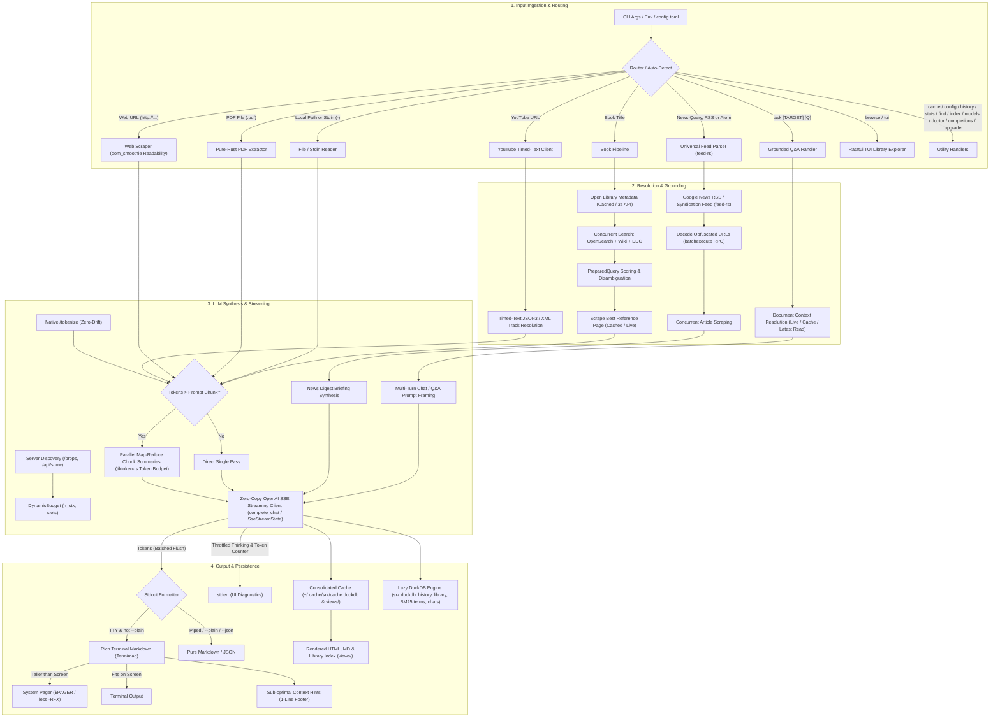
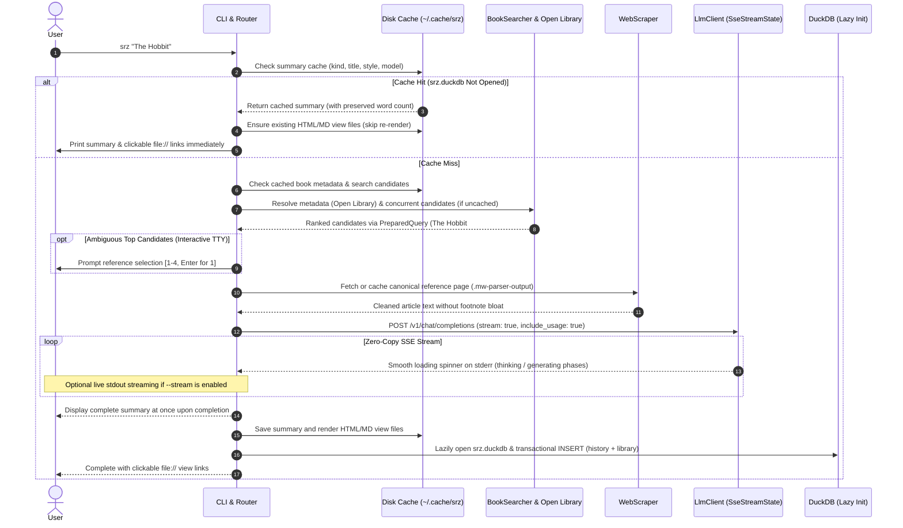
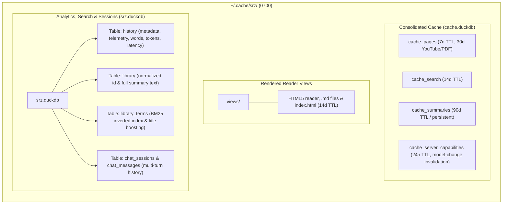

# Architecture & Design

`srz` (Summarize) is a high-performance, modular Rust CLI tool for extracting and synthesizing structured summaries from **webpages**, **YouTube video transcripts**, **PDF documents & local files**, **Unix stdin streams**, **books**, and **live news digests** using local OpenAI-compliant LLMs (such as llama.cpp, Ollama, LM Studio, or vLLM).

It is engineered from the ground up for instantaneous responsiveness, low memory overhead, and 100% local privacy.

---

## 1. High-Level Subsystem Architecture

The diagram below illustrates the end-to-end lifecycle of an `srz` invocation:



### Subsystem Directory Organization

The codebase is organized into cohesive functional subgroups within `src/`:

```text
src/
├── commands/     # CLI subcommand workflows and action dispatchers (ask, browse, cache...)
├── config/       # CLI argument parsing, flags, and config file profiles
├── engine/       # LLM streaming client, server discovery, dynamic budget, and /tokenize
├── sources/      # Content ingestion: web scraping, book search, YouTube, and news RSS
├── storage/      # Local disk caching, DuckDB server capability caching, and analytics
├── system/       # Hardware profiling, Gemma steering, filesystem security, and self-updater
├── ui/           # Terminal console formatting, spinners, footers, and HTML reader views
├── lib.rs        # Library crate root and backwards-compatible module exports
└── main.rs       # Binary entry point and CLI orchestration
```

### Module Responsibilities

| Subsystem | File | Module | Primary Responsibility |
| :--- | :--- | :--- | :--- |
| **Entry Points** | [`src/main.rs`](https://github.com/NewGuy012/srz/blob/master/src/main.rs) | `main` | Entry point, CLI lifecycle, profile loading, and subcommand dispatch. |
| | [`src/lib.rs`](https://github.com/NewGuy012/srz/blob/master/src/lib.rs) | `lib` | Root library interface and backward-compatible module re-exports. |
| **Commands** | [`src/commands/summarize.rs`](https://github.com/NewGuy012/srz/blob/master/src/commands/summarize.rs) | `commands::summarize` | Workflows for web articles, YouTube videos, books, local documents, stdin streams, news/syndication feed digests, and unified page caching (`fetch_or_cache_page_with`). |
| | [`src/commands/ask.rs`](https://github.com/NewGuy012/srz/blob/master/src/commands/ask.rs) | `commands::ask` | Grounded question answering, question-aware chunk retrieval (`select_relevant_context`), full library summary fallback, interactive multi-turn chat REPL (`srz ask`) with `rustyline`, DuckDB session persistence (`--chats`, `--resume`, `--show-chat`, `--delete-chat`), sliding conversational history, and prompt injection defense. |
| | [`src/commands/library.rs`](https://github.com/NewGuy012/srz/blob/master/src/commands/library.rs) | `commands::library` | Handlers for `history`, `stats` (reading habit telemetry, time saved, P50/P95 model throughput), `find` (BM25 relevance scoring), `index`, and `cache` subcommands. |
| | [`src/commands/diagnostics.rs`](https://github.com/NewGuy012/srz/blob/master/src/commands/diagnostics.rs) | `commands::diagnostics` | Handlers for `doctor`, `models`, and `config` verification. |
| **Configuration** | [`src/config/cli.rs`](https://github.com/NewGuy012/srz/blob/master/src/config/cli.rs) | `config::cli` | `clap` CLI parser, `SummaryStyle` presets, `NewsTimeframe`, `--max-tokens` and `--concurrency` flags, paging flags, chat session flags, and zero-allocation target auto-detection (`is_feed_url`, `is_news_query`, `clean_news_query`, `is_probable_question`). |
| | [`src/config/file.rs`](https://github.com/NewGuy012/srz/blob/master/src/config/file.rs) | `config::file` | `config.toml` file loading, named profile switching, and starter template generation. |
| **Engine** | [`src/engine/llm.rs`](https://github.com/NewGuy012/srz/blob/master/src/engine/llm.rs) | `engine::llm` | Zero-copy SSE client (`complete_chat` / `SseStreamState`), server capability discovery (`probe_server_capabilities`), native `/tokenize` queries, wall-clock token rate tracking, and dynamic map-reduce synthesis. |
| | [`src/engine/budget.rs`](https://github.com/NewGuy012/srz/blob/master/src/engine/budget.rs) | `engine::budget` | Dynamic token budgeting math (`DynamicBudget`) and server capability descriptors (`ServerCapabilities`) autoscaling prompt chunks and slot concurrency. |
| | [`src/engine/chunker.rs`](https://github.com/NewGuy012/srz/blob/master/src/engine/chunker.rs) | `engine::chunker` | Accurate BPE token budgeting (`tiktoken-rs` `cl100k_base`), token counting (`count_tokens`), token-safe truncation (`truncate_by_tokens`), \\(O(1)\\) fast-path budget checks, and unified zero-copy `Cow` paragraph chunking (`chunk_with_metric`) for long documents (> 16k tokens). |
| **Sources** | [`src/sources/document.rs`](https://github.com/NewGuy012/srz/blob/master/src/sources/document.rs) | `sources::document` | Unified local document ingestion (`DocumentLoader`): shared file validation (`validate_file`, 20 MB cap), PDF extraction, HTML/Markdown normalization, and title fallbacks. |
| | [`src/sources/scraper.rs`](https://github.com/NewGuy012/srz/blob/master/src/sources/scraper.rs) | `sources::scraper` | HTTP client (10 MB cap), streaming body readers (`read_response_bytes_limited`, `read_response_text_limited`), Mozilla Readability DOM content extraction (`dom_smoothie`) with zero-copy fallback, and text cleaning. |
| | [`src/sources/pdf.rs`](https://github.com/NewGuy012/srz/blob/master/src/sources/pdf.rs) | `sources::pdf` | Single-pass pure-Rust PDF `Document` parsing, text layer & `Info` trailer metadata extraction, and scanned-PDF detection via `pdf-extract`. |
| | [`src/sources/youtube.rs`](https://github.com/NewGuy012/srz/blob/master/src/sources/youtube.rs) | `sources::youtube` | Zero-allocation YouTube video ID extraction, Innertube player client iteration, timed-text XML/JSON3 caption resolution via streaming `quick-xml`, HTML entity decoding via `html-escape`, and chapter cue grouping via `TimedTranscriptBuilder`. |
| | [`src/sources/search.rs`](https://github.com/NewGuy012/srz/blob/master/src/sources/search.rs) | `sources::search` | Open Library metadata, Wikipedia OpenSearch/fulltext, DDG search, and candidate scoring. |
| | [`src/sources/news.rs`](https://github.com/NewGuy012/srz/blob/master/src/sources/news.rs) | `sources::news` | Universal syndication feed client (`feed-rs` for direct RSS 0.9/1.0/2.0, Atom, and JSON feed URLs + Google News queries), bounded `batchexecute` RPC redirect decoding, semaphore-bounded concurrent article fetching, and page caching (`collect_news_articles_with_cache`). |
| **Storage** | [`src/storage/cache.rs`](https://github.com/NewGuy012/srz/blob/master/src/storage/cache.rs) | `storage::cache` | Consolidated single-write DuckDB cache storage (`cache.duckdb`) for pages, search metadata, and LLM summaries (with preserved `word_count`), read-only legacy disk fallback (`read_disk_entry`), and unified SQL + disk TTL/LRU pruning (`prune`). |
| | [`src/storage/db.rs`](https://github.com/NewGuy012/srz/blob/master/src/storage/db.rs) | `storage::db` | Embedded DuckDB database (`srz.duckdb`) with normalized `history` + `library` schema, rich habit/model telemetry, inverted index BM25 search ranking (`library_terms`), pre-tokenized snippet extraction, centralized security lockdown pragmas, and persistent multi-turn chat sessions (`chat_sessions`, `chat_messages`). |
| **UI & Render** | [`src/ui/terminal.rs`](https://github.com/NewGuy012/srz/blob/master/src/ui/terminal.rs) | `ui::terminal` | CLI progress spinners (`indicatif`), colored text formatting, and terminal escape/control character sanitization (`sanitize_terminal_text`, `sanitize_title`). |
| | [`src/ui/printer.rs`](https://github.com/NewGuy012/srz/blob/master/src/ui/printer.rs) | `ui::printer` | Cached `LazyLock<MadSkin>` terminal Markdown styling and automatic `$PAGER` / `less -RFX` integration. |
| | [`src/ui/tui.rs`](https://github.com/NewGuy012/srz/blob/master/src/ui/tui.rs) | `ui::tui` | Interactive `ratatui` + `crossterm` terminal UI library explorer (`srz browse`) with event-driven redraws and pre-indexed live search. |
| | [`src/ui/render.rs`](https://github.com/NewGuy012/srz/blob/master/src/ui/render.rs) | `ui::render` | GitHub Flavored Markdown-to-HTML converter (`pulldown-cmark`), zero-allocation `escape_html_cow` card formatting, CSS styling, index dashboard, unified `target_icon`/`target_badge`, slugify, and cross-platform browser opening (`open`). |
| **System** | [`src/system/hardware.rs`](https://github.com/NewGuy012/srz/blob/master/src/system/hardware.rs) | `system::hardware` | Safe host RAM and chip hardware profiling (`sysctl`/`/proc/meminfo`), tier mapping, and Gemma 4 Q8_0 laptop steering. |
| | [`src/system/text_util.rs`](https://github.com/NewGuy012/srz/blob/master/src/system/text_util.rs) | `system::text_util` | High-performance HTML entity decoding (`html-escape`), ASCII case-insensitive search (`find_ascii_case_insensitive`, `contains_ascii_case_insensitive`, `ends_with_ascii_case_insensitive`), URL scheme checking (`is_http_url`), single-pass `format_hex`, and zero-copy string utilities. |
| | [`src/system/fs_util.rs`](https://github.com/NewGuy012/srz/blob/master/src/system/fs_util.rs) | `system::fs_util` | Platform filesystem utilities and private directory/file permissions (`0700`/`0600`). |
| | [`src/system/upgrade.rs`](https://github.com/NewGuy012/srz/blob/master/src/system/upgrade.rs) | `system::upgrade` | In-place self-updater: target detection, GitHub release queries, bounded archive extraction (`read_bounded_binary`), SHA256 verification, and atomic swap. |

---

## 2. Request & Execution Lifecycle Sequence

The sequence diagram below walks through the end-to-end lifecycle when summarizing a target (illustrated with a book search request):



### Lifecycle Highlights

1. **Fast-Path Cache Hit**: When an identical query `(target, model, style)` has been synthesized before, `srz` returns the cached summary directly from `cache.duckdb` with sub-millisecond latency. `srz.duckdb` is not even initialized, bypassing database locking entirely.
2. **Deterministic Metadata Resolution**: On a cache miss, book and news sources resolve metadata concurrently across Open Library, Wikipedia, and search engines. Ambiguous candidate matches present a polite interactive selection prompt on TTY devices.
3. **Quarantined Content Ingestion**: The chosen canonical content is retrieved using strict 10 MB payload limits, stripped of boilerplate, and enclosed in sanitized `<source_document>` tags.
4. **SSE Streaming Inference**: Summarization requests stream tokens over zero-copy Server-Sent Events (SSE). A smooth progress spinner displays status on `stderr` while token metrics are tracked live.
5. **Atomic Persistence**: Upon completion, the summary is persisted to `cache.duckdb` and the rendered reader views are saved to `views/`. Finally, `srz.duckdb` is opened lazily to record telemetry, BM25 terms, and library history within an ACID transaction.

---

## 3. Storage & Cache Architecture

All state is isolated under `~/.cache/srz/` (or `$XDG_CACHE_HOME/srz/`), unified via `Cache::default_cache_dir()`, enforced with `0700`/`0600` owner-only Unix permissions, completely bypassable via `--no-cache`, and safely maintainable via `srz cache`:



### Retention Policies & Lifecycle Schedule

| Namespace / Asset | Retention Policy (TTL) | Eviction Trigger | Notes |
| :--- | :--- | :--- | :--- |
| **`cache_pages` (in `cache.duckdb`)** | **7 days** | SQL TTL expiration / LRU | Scraped DOM, feed articles, and clean text; YouTube & PDFs retain for 30 days. Read-only fallback to legacy `pages/`. |
| **`cache_search` (in `cache.duckdb`)** | **14 days** | SQL TTL expiration / LRU | Open Library metadata and DDG candidates. Read-only fallback to legacy `search/`. |
| **`cache_summaries` (in `cache.duckdb`)** | **90 days** | LRU past max budget | Deterministic for `(target, model, style)` with preserved `word_count`. Read-only fallback to legacy `summaries/`. |
| **`cache_server_capabilities` (in `cache.duckdb`)** | **24 hours** | TTL / Model change | Probed server `n_ctx`, `total_slots`, and detected model identity. |
| **`views/`** | **14 days** | TTL expiration / LRU | Ephemeral reader views; lazily regenerated via `srz browse` or `srz index`. |
| **Total Cache Budget** | **500 MB** (configurable) | Unified SQL + disk LRU eviction | Evicts oldest entries across `cache.duckdb` tables and `views/` down to 85% headroom. |
| **Auto-Prune Schedule** | **Opportunistic (24h)** | Deferred past fast-exit commands | Throttled via `~/.cache/srz/.last_prune` (sub-millisecond overhead). |
| **Library DuckDB (`srz.duckdb`)** | **Permanent (Not a cache)** | Explicit `--reset-db` only | Preserved across `srz cache clean`; normalized `history` + `library` schema, BM25 index, and chats. |

### Technical Storage Highlights

- **Consolidated Single-Write DuckDB Cache**: Web pages, search metadata, and LLM summaries are stored in a single embedded `cache.duckdb` database without dual-writing individual `.json` files. This eliminates inode exhaustion, speeds up lookups to sub-millisecond scale, and enables atomic SQL byte-size accounting (`strlen`) and timestamp TTL eviction via `epoch_ms(cached_at)::BIGINT`.
- **Lazy Database Initialization & Normalized Schema**: Both `cache.duckdb` and `srz.duckdb` skip schema DDL when already initialized and defer auto-pruning past fast-exit CLI subcommands. In `srz.duckdb`, `library` is normalized (`(id, summary)`) and joined against `history` to eliminate redundant metadata columns.
- **Unified SQL + Disk LRU Pruning**: `Cache::prune` collects surviving database rows and view file metadata in a single pass, executing LRU size-based eviction across both `cache.duckdb` tables and `views/` files to strictly respect the 500 MB cache limit.
- **Transactional Database Safety**: ACID database transactions guarantee complete atomicity and rollback safety across library records and chat histories.

---

## 4. Offline BM25 Full-Text Search Algorithm

When executing `srz find <QUERY>`, `srz` computes relevance scores offline across the library using the Robertson-Sparck Jones BM25 formula:

\\[
\text{Score}(D, Q) = \sum_{t \in Q} \text{IDF}(t) \cdot \frac{f(t, D) \cdot (k_1 + 1)}{f(t, D) + k_1 \cdot \left(1 - b + b \cdot \frac{|D|}{\text{avgdl}}\right)}
\\]

- **\\(2.5\times\\) Title Weighting**: Terms matching document titles receive \\(2.5\times\\) the weight of terms matching summary bodies.
- **Tuned Parameters**: Term frequency saturation \\(k_1 = 1.2\\), document length normalization \\(b = 0.75\\).
- **Snippet Extraction**: Pre-tokenizes query terms to extract high-density preview sentences for fast scanning.
- **Pure SQL Execution**: Runs directly inside DuckDB without requiring external search engine plugins or background daemons.

---

## 5. Hardware-Aware Inference & Zero-Drift Tokenization

To eliminate context length guesswork and prevent Out-of-Memory context truncation, `srz` incorporates intelligent host and server profiling:

### Safe Kernel Probing & Gemma 4 Steering

`srz` auto-detects physical host RAM and CPU architecture across macOS (`sysctl -n hw.memsize`), Linux (`/proc/meminfo`), and Windows (PowerShell WMI) without external C FFI dependencies.

### Hardware Tier Reference Matrix

| Host Memory | Typical Devices | Model Name | Size | Quantization | Context Window (`n_ctx`) | Approximate RAM Usage | Llama GUI Selection | llama.cpp Launch Command | Ollama Launch Command |
| :--- | :--- | :--- | :--- | :--- | :--- | :--- | :--- | :--- | :--- |
| **8 GB RAM** | MacBook Air 8GB, Thin-and-light Laptops | `gemma-4` | `E4B` | **`Q8_0`** | **`8k ctx`** (8,192) | ~5.0 GB total | `gemma-4 \| E4B \| Q8_0 \| 8k ctx` | `llama-server -m gemma-4-E4B-it-Q8_0.gguf -c 8192 --port 9931` | `ollama run gemma2:9b --ctx-size 8192` |
| **16 GB RAM** | MacBook Pro/Air 16GB, Standard PC Laptops | `gemma-4` | `E4B` | **`Q8_0`** | **`32k ctx`** (32,768) | ~6.5 GB total | `gemma-4 \| E4B \| Q8_0 \| 32k ctx` | `llama-server -m gemma-4-E4B-it-Q8_0.gguf -c 32768 --port 9931` | `ollama run gemma2:9b --ctx-size 32768` |
| **24–36 GB RAM** | MacBook Pro M Pro / Max, 32GB PCs | `gemma-4` | `E4B` | **`Q8_0`** | **`64k ctx`** (65,536) | ~8.5 GB total | `gemma-4 \| E4B \| Q8_0 \| 64k ctx` | `llama-server -m gemma-4-E4B-it-Q8_0.gguf -c 65536 --port 9931` | `ollama run gemma2:9b --ctx-size 65536` |
| **64+ GB RAM** | MacBook Pro M Max, Mac Studio, Workstations | `gemma-4` | `26B-A4B` | **`Q8_0`** | **`128k ctx`** (131,072) | ~28–32 GB total | `gemma-4 \| 26B-A4B \| Q8_0 \| 128k ctx` | `llama-server -m gemma-4-26B-A4B-it-Q8_0.gguf -c 131072 --port 9931` | `ollama run gemma2:27b --ctx-size 131072` |

### Why Google Gemma 4 (`Q8_0`) on Laptops?

1. **State-of-the-Art Reasoning Density**: Google's Gemma 4 models offer exceptional summarization accuracy, structured output coherence, and instruction-following per parameter, outperforming earlier generation 7B/8B models while drawing less power.
2. **High-Fidelity `Q8_0` Quantization**: Unlike aggressive 4-bit quantizations (`Q4_K_M`) which introduce loss of nuance, logical drift, and hallucination during long-form synthesis, 8-bit `Q8_0` preserves near FP16 precision with minimal memory overhead.
3. **Deep Context Scaling**: Gemma 4 natively supports up to 128k context windows without positional degradation.
4. **Zero-Drift Tokenizer**: `srz` queries the server's `/tokenize` endpoint directly, ensuring 0% token count discrepancies between client chunking and server KV cache limits.

### Single-Pass Synthesis vs. Map-Reduce Chunking

- **1-Pass Mode (Optimal)**: When document token count \\(\le \sim 70\\%\\) of the server context window (`n_ctx`), `srz` synthesizes the entire document in one LLM call. This preserves narrative continuity and produces the highest-fidelity structured summary.
- **Map-Reduce Mode (Automatic)**: When a document exceeds the single-pass limit (e.g. a 300-page book or 100-page PDF on an 8k context server), `srz` dynamically partitions content into overlapping token windows sized by `DynamicBudget`, summarizes chunks concurrently up to the server's detected slot limit (`total_slots`), and performs a final reduction pass.

### Zero-Drift Server-Native Tokenization

Third-party BPE tokenizers (e.g. OpenAI's `cl100k_base`) drift by 15–25% when measuring tokens intended for Google Gemma or Meta Llama models. `srz` probes and uses the server's native `/tokenize` endpoint (`llama.cpp /tokenize` or `Ollama /api/tokenize`), ensuring 0% token count discrepancies. When the server endpoint is unavailable, it gracefully falls back to `tiktoken-rs` (`cl100k_base`).

### Dynamic Context Budgeting (`DynamicBudget`)

`DynamicBudget` mathematically sizes prompt budgets, chunk overlaps, and completion headroom based on probed server parameters:
- **Prompt Chunks**: Scaled to ~45% of `n_ctx`.
- **Reserve Completion Tokens**: Sized to ~30% of context (capped at 8,192).
- **Safety Headroom**: ~25% margin ensures prompt + completion never exceeds physical server context capacity or triggers OOM errors.
- **Slot-Aware Concurrency**: Probes server worker slots (`total_slots`) to scale parallel map-reduce chunk summarization without congesting the inference queue.
- **Sub-Optimal Context Alerts**: When execution is constrained by small server context windows, `srz` emits a non-intrusive 1-line terminal footer hint, and `srz doctor` provides a full hardware optimization panel.

---

## 6. Performance & Architectural Optimizations

### Optimizations at a Glance

| Subsystem | Core Optimization | User Benefit |
| :--- | :--- | :--- |
| **LLM Inference** | Parallel Map-Reduce + exact BPE token budgeting (`tiktoken-rs`) | Summarizes long documents and books without context window truncation |
| **Streaming Output** | Zero-copy SSE parser with batched terminal flushes | Smooth, real-time typing output with minimal CPU and memory overhead |
| **Content Ingestion** | Mozilla Readability algorithm (`dom_smoothie`) & streaming XML | Clean article text stripped of ads/sidebars; rapid YouTube caption extraction |
| **Storage & Caching** | Consolidated embedded DuckDB (`cache.duckdb`) with SQL TTLs | Sub-millisecond cache hits, zero filesystem clutter, and automatic pruning |
| **Offline Library Search** | Local SQL BM25 ranking with title weighting | Fast, Google-style relevance search across your reading history without network access |
| **Security & Hardening** | `#![forbid(unsafe_code)]`, `0700`/`0600` permissions, XML prompt framing | Complete memory safety, zero telemetry, local file isolation, and injection defense |

---

### Performance & Memory Efficiency Deep Dive

#### LLM Processing & Context Management
- **Zero-Worry Dynamic Token Budgeting (`DynamicBudget`)**: Dynamically queries backend server capabilities (`GET /props` in llama.cpp, `POST /api/show` in Ollama, or `GET /v1/models` in vLLM) to extract the active context window (`n_ctx`) and concurrency capacity (`total_slots`), mathematically sizing prompt budgets, chunk overlaps, and completion headroom without user intervention or OOM crashes.
- **Server-Native Tokenization (`/tokenize`)**: Probes and uses the server's native `/tokenize` endpoint (0% tokenizer drift across multilingual text and code) while seamlessly falling back to OpenAI's `cl100k_base` BPE tokenizer (`tiktoken-rs`).
- **Persistent Capability Caching with Model-Change Invalidation**: Caches probed server operational parameters in `cache.duckdb` (`cache_server_capabilities`) for sub-millisecond startup, automatically invalidating and re-probing whenever a model change or server restart is detected.
- **Laptop Hardware Steering (Gemma 4 Q8_0)**: Automatically inspects host unified memory and chip characteristics without `unsafe` code (`sysctl` on macOS, `/proc/meminfo` on Linux), steering users towards battery-efficient, high-fidelity Google Gemma 4 `Q8_0` setups with optimal context sizing.
- **Autoscaled Map-Reduce Concurrency**: Automatically scales parallel chunk workers to the server's detected slot capacity (`total_slots`), completing map-reduce passes up to \\(4\\times\\) faster out-of-the-box.
- **Question-Aware Q&A Context Selection**: For long documents in `srz ask`, `select_relevant_context_with_budget` ranks document chunks by query term overlap within a dynamic token budget, paired with token-budgeted sliding conversational history.
- **Zero-Copy SSE Streaming**: Server-Sent Events (SSE) stream tokens directly from network byte buffers into borrowed string slices (`Cow<str>`), batching terminal flushes per packet to eliminate redundant string allocations and terminal redraw flicker.
- **Fast-Path Budget Checks**: Unified chunking in `TextChunker` uses an \\(O(1)\\) byte-length check to instantly pass documents that already fit within token limits, completely bypassing tokenizer passes on shorter texts.
- **Subtle Terminal Advisor & Doctor Audit**: Emits a non-intrusive 1-line terminal footer hint when execution was constrained by sub-optimal server context, and provides a full hardware optimization panel in `srz doctor`.

#### High-Speed Ingestion & Parsing
- **High-Fidelity Readability Extraction**: Web articles are parsed via Mozilla's Readability algorithm (`dom_smoothie`), scoring DOM container density to strip navigation headers, sidebars, ad trackers, and cookie notices before prompting the LLM.
- **Universal Syndication Feeds**: Multi-format feed parsing (`feed-rs`) and automatic feed URL detection (`is_feed_url`) seamlessly normalize Google News queries and direct RSS 0.9/1.0/2.0, Atom, and JSON feed URLs into clean article lists with zero regex fragility.
- **Single-Pass PDF Extraction**: `PdfExtractor` parses the in-memory document once for both text layer extraction and document trailer metadata lookup via `pdf-extract`.
- **Streaming XML Parsing**: YouTube timed-text caption ingestion (`quick-xml`) uses a pull-parser event reader to stream captions without loading full XML trees into memory.
- **Bounded & Cached Concurrent Scraping**: Parallel news fetching (`collect_news_articles_with_cache`) bounds concurrent HTTP/RPC tasks via `tokio::sync::Semaphore`, caches scraped article pages in `cache_pages`, and uses `tokio::task::JoinSet::abort_all()` to immediately terminate remaining background requests once the target article count is reached.
- **HTTP Connection Pool Sharing & Byte Limits**: A single shared HTTP client reuses keep-alive connections across metadata lookups, search queries, and scraping, enforcing strict byte limits (10 MB cap) to avoid unbuffered memory spikes.

#### Database, Caching & Instant Search
- **Consolidated Single-Write DuckDB Cache**: Stores web pages, search metadata, and LLM summaries directly in a single embedded `cache.duckdb` without dual-writing `.json` files—eliminating inode exhaustion and enabling sub-millisecond lookups, SQL byte-size accounting (`strlen`), and instantaneous SQL timestamp TTL eviction via `epoch_ms(cached_at)::BIGINT`.
- **Lazy Database Initialization & Normalized Schema**: Both `cache.duckdb` and `srz.duckdb` skip schema DDL when already initialized and defer auto-pruning past fast-exit CLI subcommands. In `srz.duckdb`, `library` is normalized (`(id, summary)`) and joined against `history` to eliminate duplicate metadata columns.
- **Offline BM25 Full-Text Relevance**: Pure SQL Robertson-Sparck Jones BM25 search ranking runs directly inside DuckDB without external extensions, featuring \\(2.5\times\\) title weight boosting, document length normalization (\\(k_1=1.2, b=0.75\\)), and pre-tokenized query vectors for rapid snippet extraction.
- **Unified SQL + Disk LRU Pruning**: `Cache::prune` collects surviving database rows and view file metadata in a single pass, executing LRU size-based eviction across both `cache.duckdb` tables and `views/` files.
- **Transactional Database Safety**: ACID database transactions guarantee complete atomicity and rollback safety across library records and chat histories.

#### UI & Terminal Rendering
- **Cached Terminal Markdown Skin**: Terminal Markdown styles (`MadSkin`) are cached globally in a `LazyLock`, avoiding reallocating theme rules on each render or chat turn.
- **Zero-Allocation TUI Search**: Live searching in `srz browse` matches queries on-the-fly via zero-copy ASCII case-insensitive comparison, short-circuiting on metadata before scanning summary bodies.
- **Fast Chunk-Scanning HTML Escaping**: HTML rendering scans text in multi-byte chunks, returning borrowed slices (`Cow::Borrowed`) with zero allocations when no characters require escaping.
- **GFM Markdown & Non-Blocking Browser Launch**: Generates clean HTML reader views with GitHub Flavored Markdown support (tables, task lists) via `pulldown-cmark` and opens them via detached, non-blocking browser processes (`open::that_detached`).

---

## 7. Security, Privacy & System Hardening

- **100% Safe Rust Guarantee**: The entire crate strictly enforces `#![forbid(unsafe_code)]` at `src/lib.rs` and `src/main.rs`. Zero `unsafe` blocks are permitted.
- **Complete Local Privacy**: All inference, embedding, caching, and chat history remain 100% local on your machine. Zero tracking, zero telemetry, and zero third-party cloud requirements.
- **Strict Local Isolation & Symlink Hardening**: Cache, configuration, and database files are created with owner-only Unix permissions (`0700` directories, `0600` files created atomically via `O_CREAT | O_EXCL` and `mode(0o600)`). Filesystem operations reject pre-planted symlink paths to prevent unauthorized directory traversal.
- **Prompt Injection Defense & Unified Framing**: Untrusted source content is strictly quarantined inside tagged XML blocks (`<source_document>`) via centralized framing, with automated case-insensitive escaping of delimiter tags (`escape_closing_tag`).
- **Terminal Escape Sequence & BiDi Sanitization**: Document titles, scraped metadata, and LLM streaming outputs are stripped of ANSI escape sequences, C1 control characters, and Unicode Bidirectional (BiDi) override codepoints (preventing Trojan Source spoofing and clipboard hijacking).
- **Bounded Resource Limits & Client Timeouts**: Strict safety ceilings prevent denial-of-service from oversized inputs: 10 MB for web responses and stdin, 20 MB for local files, 50 MB for updates, paired with 5-second connection, 30-second scraping, and 300-second LLM streaming timeouts.
- **Media Scraper & SSRF Defense**: YouTube video ingestion strictly validates host authority against official domains (`youtube.com`, `youtu.be`) and pins caption downloads to HTTPS `api/timedtext` endpoints to prevent Server-Side Request Forgery against internal networks.
- **Content Security Policy (CSP)**: Generated HTML reader views enforce strict CSP headers blocking external network calls and inline script execution.
- **Cryptographically Verified Upgrades**: `srz upgrade` and install scripts enforce mandatory SHA-256 cryptographic checksum validation and semver regex checks before executing binaries.
- **Continuous Security CI Auditing**: Automated CI workflows run `cargo test`, `cargo clippy -- -D warnings`, and dependency vulnerability scanning via `cargo-audit` on every commit and PR across Ubuntu and macOS.

---

## 8. Related Technical Guides & Resources

- 🦀 [**Rust Learning Guide**](../../docs/RUST_LEARNING_GUIDE.md): Architectural deep-dive and systems programming concepts using `srz` as a case study.
- 🛡️ [**Security Audit**](../../docs/SECURITY_AUDIT.md): In-depth security analysis, memory safety guarantees, and threat mitigations.
- 📖 [**Command Reference**](commands.md): Complete CLI reference, auto-detection rules, subcommands, and flags.
- ⚙️ [**Configuration Guide**](configuration.md): Config file schema, named profiles, and cache retention tuning.
