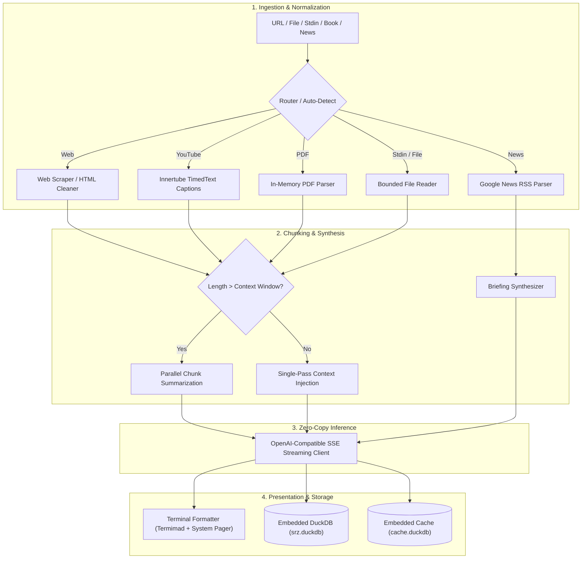

# Architecture & Design

`srz` is built from the ground up for single-binary performance, modularity, and zero cloud dependencies.

---

## 1. Modular Domain Structure

The repository is organized into five clean domains:

```text
src/
├── commands/      # Subcommand CLI handlers (ask, browse, find, stats, cache, upgrade...)
├── sources/       # Ingestion drivers (web, youtube, pdf, news, book)
├── storage/       # Embedded DuckDB database, schema migrations, and cache layer
├── ui/            # Terminal formatting, TUI dashboard, theme, and HTML views
└── system/        # Text decoding, filesystem sandbox, and process utilities
```

---

## 2. Ingestion & LLM Streaming Pipeline



---

## 3. Storage Architecture: Embedded DuckDB

`srz` avoids heavyweight client-server databases or fragmented JSON files for its primary index:

1. **`srz.duckdb` (Persistent Library)**:
   * `library`: Stores all finished summaries, titles, source URLs, word counts, and metadata.
   * `library_terms`: Inverted index mapping unique alphanumeric terms to items for BM25 ranking.
   * `chat_sessions` & `chat_messages`: Multi-turn persistent conversational history for `srz ask`.

2. **`cache.duckdb` (Ephemeral Cache)**:
   * Stores raw scraped pages, book metadata queries, and summary synthesis caches.
   * Provides atomic SQLite/DuckDB transactions with millisecond-accurate TTL pruning via `epoch_ms(cached_at)`.
   * Features transparent fallback to disk files.

---

## 4. Offline BM25 Full-Text Search Algorithm

When executing `srz find <QUERY>`, `srz` computes relevance scores offline using the Robertson-Sparck Jones BM25 formula:

$$\text{Score}(D, Q) = \sum_{t \in Q} \text{IDF}(t) \cdot \frac{f(t, D) \cdot (k_1 + 1)}{f(t, D) + k_1 \cdot \left(1 - b + b \cdot \frac{|D|}{\text{avgdl}}\right)}$$

* **Title Boosting**: Terms matching document titles receive a $2.5\times$ weight boost.
* **Parameters**: Saturation constant $k_1 = 1.2$, document length normalization $b = 0.75$.
* **Zero Dependencies**: Computed directly via pure DuckDB SQL without requiring external ICU or search plugins.
