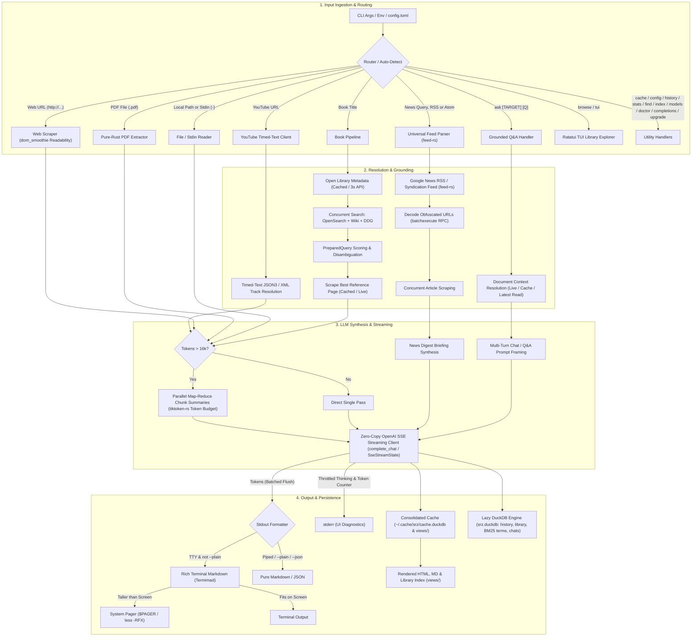
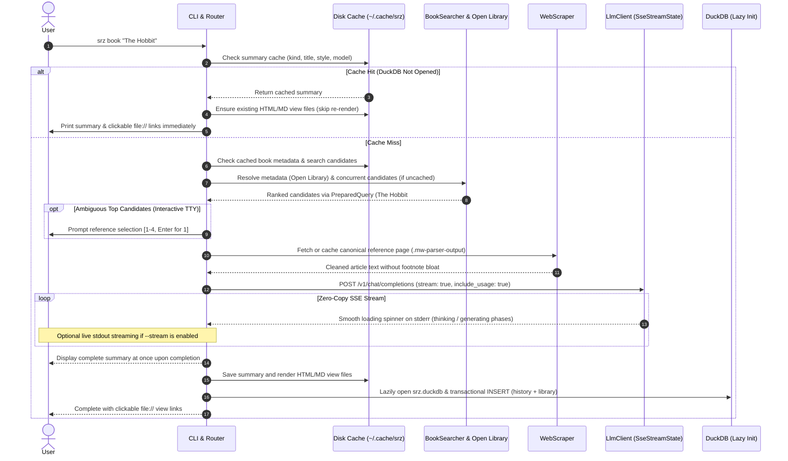
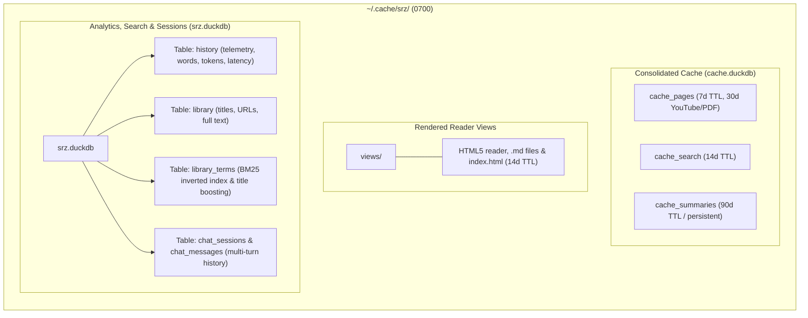

# `srz` Architectural Overview

`srz` (Summarize) is a high-performance, modular Rust CLI tool for extracting and synthesizing structured summaries from **webpages**, **YouTube video transcripts**, **PDF documents & local files**, **Unix stdin streams**, **books**, and **live news digests** using local OpenAI-compliant LLMs (such as llama.cpp, Ollama, LM Studio, or vLLM).


## 1. Key CLI Features & Commands

| Category | Command / Flag | Description |
| :--- | :--- | :--- |
| **Ingestion** | `srz <URL>` | Summarizes articles, blogs, documentation, or online PDFs. |
| | `srz <YOUTUBE_URL>` | Extracts timed-text transcripts and chapters from YouTube videos. |
| | `srz "Book Title"` | Resolves synopses from Wikipedia and Open Library by title alone. |
| | `srz <FILE>` | Ingests local `.pdf`, `.html`, `.md`, or `.txt` documents (20 MB ceiling). |
| | `cat ... \| srz -` | Reads piped command outputs, logs, or `git diff` streams (10 MB ceiling). |
| | `srz news "topic" [-t week]` | Aggregates and summarizes top stories from Google News RSS. |
| **Styling & Output** | `--style <PRESET>` | 3 summary formats: `concise` (default), `bullets`, `detailed`. |
| | `--open` (`-b`) | Opens the summary in a distraction-free HTML reader with light/dark mode. |
| | `--plain` | Outputs raw Markdown without terminal colors or automatic paging. |
| | `--paging <auto\|always\|never>` | Controls terminal output pager (`never` disables paging). |
| | `-o <FILE.html\|md>` | Saves the rendered output directly to an HTML or Markdown file. |
| | `--json` | Emits machine-readable JSON on `stdout` for script integration. |
| | `--stream` | Streams LLM output tokens live to `stdout` as they are generated. |
| **Interactive Tools** | `srz ask [TARGET] [Q]` | Grounded Q&A against a document, URL, file, or latest read. |
| | `srz ask -i` | Interactive multi-turn chat REPL grounded on source context. |
| | `srz ask [--chats\|--resume <ID>]` | Lists saved chat sessions or resumes a previous multi-turn conversation. |
| | `srz ask [--show-chat\|--delete-chat] <ID>` | Inspects or deletes a persisted multi-turn chat session transcript. |
| | `srz browse` (alias `tui`) | Interactive TUI dashboard (`[j/k]` navigate, `[/]` filter, `[y]` copy, `[d]` delete, `[Enter]` open). |
| **Library & History** | `srz find "keyword"` | Offline BM25 relevance-ranked search across past summaries in DuckDB. |
| | `srz history [--limit N]` | Displays recent reads, word counts, model usage, and generation speeds. |
| | `srz stats` | Telemetry overview: reading streaks, days active, time saved, top domains, and model throughput percentiles (P50/P95). |
| | `srz index [--open]` | Generates and opens an interactive HTML library dashboard. |
| **System & Config** | `--profile <NAME>` | Switches LLM backends defined in `~/.config/srz/config.toml`. |
| | `srz config <init\|show\|path>` | Manages and inspects the local configuration file. |
| | `srz cache <dir\|size\|clean\|prune>` | Cache inspection, TTL/LRU pruning (`--older-than`, `--max-size`), and safe clean (`--reset-db`). |
| | `srz models` | Lists available models reported by the local LLM backend. |
| | `srz doctor` | Tests backend reachability, latency, cache health, and database integrity. |
| | `srz upgrade [--check\|--force]` | Safe, in-place binary self-updater with SHA-256 integrity verification. |
| | `srz completions <SHELL>` | Generates autocomplete scripts for bash, zsh, fish, powershell, and elvish. |


## 2. High-Level Architecture

The diagram below illustrates the end-to-end lifecycle of an `srz` invocation:




## 3. Request & Execution Sequence




## 4. Storage & Cache Architecture

All state is isolated under `~/.cache/srz/` (or `$XDG_CACHE_HOME/srz/`), unified via `Cache::default_cache_dir()`, enforced with `0700`/`0600` owner-only Unix permissions, completely bypassable via `--no-cache`, and safely maintainable via `srz cache`:



### Retention Policies & Lifecycle Schedule

| Namespace / Asset | Retention Policy (TTL) | Eviction Trigger | Notes |
| :--- | :--- | :--- | :--- |
| **`cache_pages` (in `cache.duckdb`)** | **7 days** | SQL TTL expiration / LRU | Scraped DOM and clean text; YouTube & PDFs retain for 30 days. Transparent fallback to legacy `pages/`. |
| **`cache_search` (in `cache.duckdb`)** | **14 days** | SQL TTL expiration / LRU | Open Library metadata and DDG candidates. Transparent fallback to legacy `search/`. |
| **`cache_summaries` (in `cache.duckdb`)** | **90 days** | LRU past max budget | Deterministic for `(target, model, style)`. Longest TTL to save inference tokens. Fallback to `summaries/`. |
| **`views/`** | **14 days** | TTL expiration / LRU | Ephemeral reader views; lazily regenerated via `srz browse` or `srz index`. |
| **Total Cache Budget** | **500 MB** (configurable) | LRU eviction by size & `mtime` | Evicts oldest entries across caches down to 85% headroom. |
| **Auto-Prune Schedule** | **Opportunistic (24h)** | Daily CLI invocation check | Throttled via `~/.cache/srz/.last_prune` (sub-millisecond overhead). |
| **Library DuckDB (`srz.duckdb`)** | **Permanent (Not a cache)** | Explicit `--reset-db` only | Preserved across `srz cache clean`; contains reading history, habits, BM25 index, and chats. |


## 5. Performance, Security & Architectural Optimizations

`srz` is engineered from the ground up for instantaneous responsiveness, low memory overhead, and absolute local privacy.

### Optimizations at a Glance

| Subsystem | Core Optimization | User Benefit |
| :--- | :--- | :--- |
| **LLM Inference** | Parallel Map-Reduce + exact BPE token budgeting (`tiktoken-rs`) | Summarizes long documents and books without context window truncation |
| **Streaming Output** | Zero-copy SSE parser with batched terminal flushes | Smooth, real-time typing output with minimal CPU and memory overhead |
| **Content Ingestion** | Mozilla Readability algorithm (`dom_smoothie`) & streaming XML | Clean article text stripped of ads/sidebars; rapid YouTube caption extraction |
| **Storage & Caching** | Consolidated embedded DuckDB (`cache.duckdb`) with SQL TTLs | Sub-millisecond cache hits, zero filesystem clutter, and automatic pruning |
| **Offline Library Search** | Local SQL BM25 ranking with title weighting | Fast, Google-style relevance search across your reading history without network access |
| **Security & Hardening** | `#![forbid(unsafe_code)]`, `0700`/`0600` permissions, XML prompt framing | Complete memory safety, zero telemetry, local file isolation, and injection defense |

---

### Performance & Memory Efficiency

#### LLM Processing & Context Management
- **Exact BPE Token Budgeting**: Replaces rough word-counting heuristics with OpenAI's `cl100k_base` BPE tokenizer (`tiktoken-rs`), precisely calculating token counts (`TextChunker::count_tokens`) and boundaries (`chunk_by_tokens`) so long prompts stay strictly within model context limits.
- **Parallel Map-Reduce**: Large documents (> 12,000 words) are automatically split along paragraph boundaries and summarized concurrently across threads, sharing immutable metadata (`Arc<str>`) and consolidating token metrics.
- **Zero-Copy SSE Streaming**: Server-Sent Events (SSE) stream tokens directly from network byte buffers into borrowed string slices (`Cow<str>`), batching terminal flushes per packet to eliminate redundant string allocations and terminal redraw flicker.
- **Fast-Path Budget Checks**: Unified chunking in `TextChunker` uses an $O(1)$ byte-length check to instantly pass documents that already fit within token limits, completely bypassing tokenizer passes on shorter texts.

#### High-Speed Ingestion & Parsing
- **High-Fidelity Readability Extraction**: Web articles are parsed via Mozilla's Readability algorithm (`dom_smoothie`), scoring DOM container density to strip navigation headers, sidebars, ad trackers, and cookie notices before prompting the LLM.
- **Universal Syndication Feeds**: Multi-format feed parsing (`feed-rs`) seamlessly normalizes Google News, RSS 0.9/1.0/2.0, Atom, and JSON feeds into clean article lists with zero regex fragility.
- **Single-Pass PDF Extraction**: `PdfExtractor` parses the in-memory document once for both text layer extraction and document trailer metadata lookup via `pdf-extract`.
- **Streaming XML Parsing**: YouTube timed-text caption ingestion (`quick-xml`) uses a pull-parser event reader to stream captions without loading full XML trees into memory.
- **Early-Abort Concurrent Scraping**: Parallel news fetching uses `tokio::task::JoinSet` with `abort_all()` to immediately terminate remaining background network requests as soon as the target article count is reached.
- **HTTP Connection Pool Sharing & Byte Limits**: A single shared HTTP client reuses keep-alive connections across metadata lookups, search queries, and scraping, enforcing strict byte limits (10 MB cap) to avoid unbuffered memory spikes.

#### Database, Caching & Instant Search
- **Consolidated DuckDB Cache**: Stores web pages, search metadata, and LLM summaries in a single embedded `cache.duckdb` instead of thousands of disk files—eliminating inode exhaustion and enabling sub-millisecond lookups and instantaneous SQL timestamp TTL eviction via `epoch_ms(cached_at)::BIGINT`.
- **Lazy Database Initialization**: The analytics database (`srz.duckdb`) is initialized lazily only when recording a new summary or running stats. Cache hits and shell completions launch instantly with zero database startup latency.
- **Offline BM25 Full-Text Relevance**: Pure SQL Robertson-Sparck Jones BM25 search ranking runs directly inside DuckDB without external extensions, featuring $2.5\times$ title weight boosting, document length normalization ($k_1=1.2, b=0.75$), and pre-tokenized query vectors for rapid snippet extraction.
- **Single-Pass Cache Pruning & In-Memory LRU**: `Cache::prune` collects surviving file metadata during the initial expiration pass, computing LRU size-based eviction entirely in memory without redundant filesystem rescans.
- **Transactional Database Safety**: ACID database transactions guarantee complete atomicity and rollback safety across library records and chat histories.

#### UI & Terminal Rendering
- **Cached Terminal Markdown Skin**: Terminal Markdown styles (`MadSkin`) are cached globally in a `LazyLock`, avoiding reallocating theme rules on each render or chat turn.
- **Zero-Allocation TUI Search**: Live searching in `srz browse` matches queries on-the-fly via zero-copy ASCII case-insensitive comparison, short-circuiting on metadata before scanning summary bodies.
- **Fast Chunk-Scanning HTML Escaping**: HTML rendering scans text in multi-byte chunks, returning borrowed slices (`Cow::Borrowed`) with zero allocations when no characters require escaping.
- **GFM Markdown & Non-Blocking Browser Launch**: Generates clean HTML reader views with GitHub Flavored Markdown support (tables, task lists) via `pulldown-cmark` and opens them via detached, non-blocking browser processes (`open::that_detached`).

---

### Security & Privacy

- **100% Safe Rust Guarantee**: The entire crate strictly enforces `#![forbid(unsafe_code)]` at `src/lib.rs` and `src/main.rs`. Zero `unsafe` blocks are permitted.
- **Complete Local Privacy**: All inference, embedding, caching, and chat history remain 100% local on your machine. Zero tracking, zero telemetry, and zero third-party cloud requirements.
- **Strict Local Isolation & Symlink Hardening**: Cache, configuration, and database files are created with owner-only Unix permissions (`0700` directories, `0600` files created atomically via `O_CREAT | O_EXCL` and `mode(0o600)`). Filesystem operations reject pre-planted symlink paths to prevent unauthorized directory traversal.
- **Prompt Injection Defense & Unified Framing**: Untrusted source content is strictly quarantined inside tagged XML blocks (`<source_document>`) via centralized framing, with automated case-insensitive escaping of delimiter tags (`escape_closing_tag`).
- **Terminal Escape Sequence & BiDi Sanitization**: Document titles, scraped metadata, and LLM streaming outputs are stripped of ANSI escape sequences, C1 control characters, and Unicode Bidirectional (BiDi) override codepoints (preventing Trojan Source spoofing and clipboard hijacking).
- **Bounded Resource Limits & Client Timeouts**: Strict safety ceilings prevent denial-of-service from oversized inputs: 10 MB for web responses and stdin, 20 MB for local files, 50 MB for updates, paired with 5-second connection and 60-second request timeouts.
- **Media Scraper & SSRF Defense**: YouTube video ingestion strictly validates host authority against official domains (`youtube.com`, `youtu.be`) and pins caption downloads to HTTPS `api/timedtext` endpoints to prevent Server-Side Request Forgery against internal networks.
- **Content Security Policy (CSP)**: Generated HTML reader views enforce strict CSP headers blocking external network calls and inline script execution.
- **Cryptographically Verified Upgrades**: `srz upgrade` and install scripts enforce mandatory SHA-256 cryptographic checksum validation and semver regex checks before executing binaries.
- **Continuous Security CI Auditing**: Automated CI workflows run `cargo test`, `cargo clippy -- -D warnings`, and dependency vulnerability scanning via `cargo-audit` on every commit and PR across Ubuntu and macOS.


## 6. Component Directory & Subsystems

The codebase is organized into cohesive functional subgroups within `src/`:

```
src/
├── commands/     # CLI subcommand workflows and action dispatchers
├── config/       # CLI argument parsing, flags, and config file profiles
├── engine/       # LLM streaming client, prompts, and document chunking
├── sources/      # Content ingestion: web scraping, book search, and news RSS
├── storage/      # Local disk caching and embedded DuckDB analytics
├── system/       # Filesystem security helpers, text utilities, and in-place self-updater
├── ui/           # Terminal console formatting, spinners, and HTML reader views
├── lib.rs        # Library crate root and backwards-compatible module exports
└── main.rs       # Binary entry point and CLI orchestration
```

### Module Responsibilities

| Subsystem | File | Module | Primary Responsibility |
| :--- | :--- | :--- | :--- |
| **Entry Points** | [`src/main.rs`](../src/main.rs) | `main` | Entry point, CLI lifecycle, profile loading, and subcommand dispatch. |
| | [`src/lib.rs`](../src/lib.rs) | `lib` | Root library interface and backward-compatible module re-exports. |
| **Commands** | [`src/commands/summarize.rs`](../src/commands/summarize.rs) | `commands::summarize` | Workflows for web articles, YouTube videos, books, local documents, stdin streams, news digests, and unified page caching (`fetch_or_cache_page_with`). |
| | [`src/commands/ask.rs`](../src/commands/ask.rs) | `commands::ask` | Grounded question answering, interactive multi-turn chat REPL (`srz ask`) with in-line editing and history navigation (`rustyline`), DuckDB session persistence (`--chats`, `--resume`, `--show-chat`, `--delete-chat`), sliding conversational history, and prompt injection defense. |
| | [`src/commands/library.rs`](../src/commands/library.rs) | `commands::library` | Handlers for `history`, `stats` (reading habit telemetry, time saved, P50/P95 model throughput), `find` (BM25 relevance scoring), `index`, and `cache` subcommands. |
| | [`src/commands/diagnostics.rs`](../src/commands/diagnostics.rs) | `commands::diagnostics` | Handlers for `doctor`, `models`, and `config` verification. |
| **Configuration** | [`src/config/cli.rs`](../src/config/cli.rs) | `config::cli` | `clap` CLI parser, `SummaryStyle` presets, `NewsTimeframe`, paging flags, chat session flags, and zero-allocation target auto-detection (`is_news_query`, `clean_news_query`, `is_probable_question`). |
| | [`src/config/file.rs`](../src/config/file.rs) | `config::file` | `config.toml` file loading, named profile switching, and starter template generation. |
| **Engine** | [`src/engine/llm.rs`](../src/engine/llm.rs) | `engine::llm` | Zero-copy SSE client (`complete_chat` / `SseStreamState`), deduplicated token rate tracking via `compute_tokens_per_second`, `send_with_fallback` IPv4 retry, zero-copy XML delimiter escaping (`escape_closing_tag`), and map-reduce synthesis. |
| | [`src/engine/chunker.rs`](../src/engine/chunker.rs) | `engine::chunker` | Accurate BPE token budgeting (`tiktoken-rs` `cl100k_base`), token counting (`count_tokens`), $O(1)$ fast-path budget checks, and unified zero-copy `Cow` paragraph chunking (`chunk_with_metric`) for long documents (> 16k tokens). |
| **Sources** | [`src/sources/document.rs`](../src/sources/document.rs) | `sources::document` | Unified local document ingestion (`DocumentLoader`): shared file validation (`validate_file`, 20 MB cap), PDF extraction, HTML/Markdown normalization, and title fallbacks. |
| | [`src/sources/scraper.rs`](../src/sources/scraper.rs) | `sources::scraper` | HTTP client (10 MB cap), streaming body readers (`read_response_bytes_limited`, `read_response_text_limited`), Mozilla Readability DOM content extraction (`dom_smoothie`) with zero-copy fallback, and text cleaning. |
| | [`src/sources/pdf.rs`](../src/sources/pdf.rs) | `sources::pdf` | Single-pass pure-Rust PDF `Document` parsing, text layer & `Info` trailer metadata extraction, and scanned-PDF detection via `pdf-extract`. |
| | [`src/sources/youtube.rs`](../src/sources/youtube.rs) | `sources::youtube` | Zero-allocation YouTube video ID extraction, Innertube player client iteration, timed-text XML/JSON3 caption resolution via streaming `quick-xml`, HTML entity decoding via `html-escape`, and chapter cue grouping via `TimedTranscriptBuilder`. |
| | [`src/sources/search.rs`](../src/sources/search.rs) | `sources::search` | Open Library metadata, Wikipedia OpenSearch/fulltext, DDG search, and candidate scoring. |
| | [`src/sources/news.rs`](../src/sources/news.rs) | `sources::news` | Universal syndication feed client (`feed-rs` for RSS 0.9/1.0/2.0, Atom, and JSON feeds), Google News query resolution, bounded `batchexecute` RPC redirect decoding, and concurrent article fetching. |
| **Storage** | [`src/storage/cache.rs`](../src/storage/cache.rs) | `storage::cache` | Consolidated DuckDB cache storage (`cache.duckdb`) for pages, search metadata, and LLM summaries with dedicated disk fallback routines (`read_disk_entry`, `write_disk_entry`), single-pass metadata collection in `prune()`, atomic transactions, and SQL-powered TTL pruning. |
| | [`src/storage/db.rs`](../src/storage/db.rs) | `storage::db` | Embedded DuckDB database (`srz.duckdb`) for reading history, rich habit/model telemetry, inverted index BM25 search ranking (`library_terms`), pre-tokenized snippet extraction, centralized security lockdown pragmas, and persistent multi-turn chat sessions (`chat_sessions`, `chat_messages`). |
| **UI & Render** | [`src/ui/terminal.rs`](../src/ui/terminal.rs) | `ui::terminal` | CLI progress spinners (`indicatif`), colored text formatting, and terminal escape/control character sanitization (`sanitize_terminal_text`, `sanitize_title`). |
| | [`src/ui/printer.rs`](../src/ui/printer.rs) | `ui::printer` | Cached `LazyLock<MadSkin>` terminal Markdown styling and automatic `$PAGER` / `less -RFX` integration. |
| | [`src/ui/tui.rs`](../src/ui/tui.rs) | `ui::tui` | Interactive `ratatui` + `crossterm` terminal UI library explorer (`srz browse`) with event-driven redraws and pre-indexed live search. |
| | [`src/ui/render.rs`](../src/ui/render.rs) | `ui::render` | GitHub Flavored Markdown-to-HTML converter (`pulldown-cmark`), zero-allocation `escape_html_cow` card formatting, CSS styling, index dashboard, unified `target_icon`/`target_badge`, slugify, and cross-platform browser opening (`open`). |
| **System** | [`src/system/text_util.rs`](../src/system/text_util.rs) | `system::text_util` | High-performance HTML entity decoding (`html-escape`), ASCII case-insensitive search (`find_ascii_case_insensitive`, `contains_ascii_case_insensitive`), single-pass `format_hex`, and zero-copy string utilities. |
| | [`src/system/fs_util.rs`](../src/system/fs_util.rs) | `system::fs_util` | Platform filesystem utilities and private directory/file permissions (`0700`/`0600`). |
| | [`src/system/upgrade.rs`](../src/system/upgrade.rs) | `system::upgrade` | In-place self-updater: target detection, GitHub release queries, bounded archive extraction (`read_bounded_binary`), SHA256 verification, and atomic swap. |
