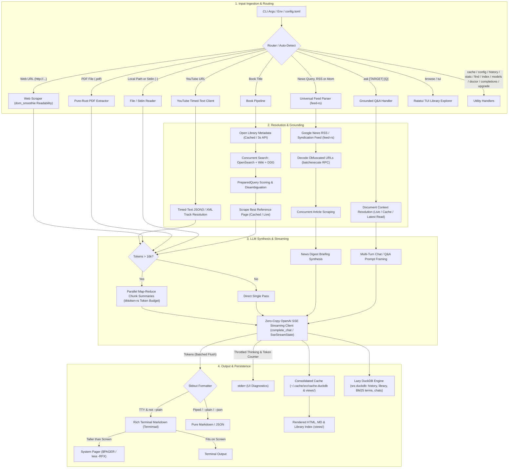
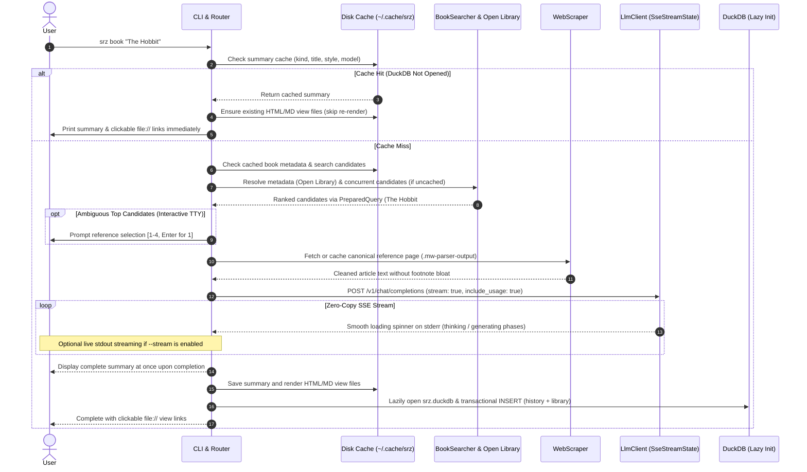
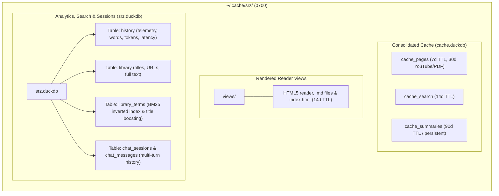

# `srz` Architectural Overview

`srz` (Summarize) is a high-performance, modular Rust CLI tool for extracting and synthesizing structured summaries from **webpages**, **YouTube video transcripts**, **PDF documents & local files**, **Unix stdin streams**, **books**, and **live news digests** using local OpenAI-compliant LLMs (such as llama.cpp, Ollama, LM Studio, or vLLM).


## 1. High-Level Architecture

The diagram below illustrates the end-to-end lifecycle of an `srz` invocation:




## 2. Request & Execution Sequence




## 3. Storage & Cache Architecture

All state is isolated under `~/.cache/srz/` (or `$XDG_CACHE_HOME/srz/`), unified via `Cache::default_cache_dir()`, enforced with `0700`/`0600` owner-only Unix permissions, completely bypassable via `--no-cache`, and safely maintainable via `srz cache`:



### Retention Policies & Lifecycle Schedule

| Namespace / Asset | Retention Policy (TTL) | Eviction Trigger | Notes |
| :--- | :--- | :--- | :--- |
| **`cache_pages` (in `cache.duckdb`)** | **7 days** | SQL TTL expiration / LRU | Scraped DOM and clean text; YouTube & PDFs retain for 30 days. Transparent fallback to legacy `pages/`. |
| **`cache_search` (in `cache.duckdb`)** | **14 days** | SQL TTL expiration / LRU | Open Library metadata and DDG candidates. Transparent fallback to legacy `search/`. |
| **`cache_summaries` (in `cache.duckdb`)** | **90 days** | LRU past max budget | Deterministic for `(target, model, style)`. Longest TTL to save inference tokens. Fallback to `summaries/`. |
| **`views/`** | **14 days** | TTL expiration / LRU | Ephemeral reader views; lazily regenerated via `srz browse` or `srz index`. |
| **Total Cache Budget** | **500 MB** (configurable) | LRU eviction by size & `mtime` | Evicts oldest entries across caches down to 85% headroom. |
| **Auto-Prune Schedule** | **Opportunistic (24h)** | Daily CLI invocation check | Throttled via `~/.cache/srz/.last_prune` (sub-millisecond overhead). |
| **Library DuckDB (`srz.duckdb`)** | **Permanent (Not a cache)** | Explicit `--reset-db` only | Preserved across `srz cache clean`; contains reading history, habits, BM25 index, and chats. |


## 4. Component Directory & Subsystems

The codebase is organized into cohesive functional subgroups within `src/`:

```
src/
├── commands/     # CLI subcommand workflows and action dispatchers
├── config/       # CLI argument parsing, flags, and config file profiles
├── engine/       # LLM streaming client, prompts, and document chunking
├── sources/      # Content ingestion: web scraping, book search, and news RSS
├── storage/      # Local disk caching and embedded DuckDB analytics
├── system/       # Filesystem security helpers, text utilities, and in-place self-updater
├── ui/           # Terminal console formatting, spinners, and HTML reader views
├── lib.rs        # Library crate root and backwards-compatible module exports
└── main.rs       # Binary entry point and CLI orchestration
```

### Module Responsibilities

| Subsystem | File | Module | Primary Responsibility |
| :--- | :--- | :--- | :--- |
| **Entry Points** | [`src/main.rs`](src/main.rs) | `main` | Entry point, CLI lifecycle, profile loading, and subcommand dispatch. |
| | [`src/lib.rs`](src/lib.rs) | `lib` | Root library interface and backward-compatible module re-exports. |
| **Commands** | [`src/commands/summarize.rs`](src/commands/summarize.rs) | `commands::summarize` | Workflows for web articles, YouTube videos, books, local documents, stdin streams, news digests, and unified page caching (`fetch_or_cache_page_with`). |
| | [`src/commands/ask.rs`](src/commands/ask.rs) | `commands::ask` | Grounded question answering, interactive multi-turn chat REPL (`srz ask`), DuckDB session persistence (`--chats`, `--resume`, `--show-chat`, `--delete-chat`), sliding conversational history, and prompt injection defense. |
| | [`src/commands/library.rs`](src/commands/library.rs) | `commands::library` | Handlers for `history`, `stats` (reading habit telemetry, time saved, P50/P95 model throughput), `find` (BM25 relevance scoring), `index`, and `cache` subcommands. |
| | [`src/commands/diagnostics.rs`](src/commands/diagnostics.rs) | `commands::diagnostics` | Handlers for `doctor`, `models`, and `config` verification. |
| **Configuration** | [`src/config/cli.rs`](src/config/cli.rs) | `config::cli` | `clap` CLI parser, `SummaryStyle` presets, `NewsTimeframe`, paging flags, chat session flags, and target auto-detection. |
| | [`src/config/file.rs`](src/config/file.rs) | `config::file` | `config.toml` file loading, named profile switching, and starter template generation. |
| **Engine** | [`src/engine/llm.rs`](src/engine/llm.rs) | `engine::llm` | Zero-copy SSE client (`complete_chat` / `SseStreamState`), `send_with_fallback` IPv4 retry, zero-copy XML delimiter escaping (`escape_closing_tag`), and map-reduce synthesis. |
| | [`src/engine/chunker.rs`](src/engine/chunker.rs) | `engine::chunker` | Accurate BPE token budgeting (`tiktoken-rs` `cl100k_base`), token counting (`count_tokens`), and zero-copy `Cow` paragraph chunking for long documents (> 16k tokens). |
| **Sources** | [`src/sources/document.rs`](src/sources/document.rs) | `sources::document` | Unified local document ingestion (`DocumentLoader`): shared file validation (`validate_file`, 20 MB cap), PDF extraction, HTML/Markdown normalization, and title fallbacks. |
| | [`src/sources/scraper.rs`](src/sources/scraper.rs) | `sources::scraper` | HTTP client (10 MB cap), streaming body readers (`read_response_bytes_limited`, `read_response_text_limited`), Mozilla Readability DOM content extraction (`dom_smoothie`) with zero-copy fallback, and text cleaning. |
| | [`src/sources/pdf.rs`](src/sources/pdf.rs) | `sources::pdf` | Single-pass pure-Rust PDF `Document` parsing, text layer & `Info` trailer metadata extraction, and scanned-PDF detection via `pdf-extract`. |
| | [`src/sources/youtube.rs`](src/sources/youtube.rs) | `sources::youtube` | YouTube video ID extraction, timed-text XML/JSON3 caption resolution, single-pass zero-copy HTML entity decoding, and chapter cue grouping via `TimedTranscriptBuilder`. |
| | [`src/sources/search.rs`](src/sources/search.rs) | `sources::search` | Open Library metadata, Wikipedia OpenSearch/fulltext, DDG search, and candidate scoring. |
| | [`src/sources/news.rs`](src/sources/news.rs) | `sources::news` | Universal syndication feed client (`feed-rs` for RSS 0.9/1.0/2.0, Atom, and JSON feeds), Google News query resolution, bounded `batchexecute` RPC redirect decoding, and concurrent article fetching. |
| **Storage** | [`src/storage/cache.rs`](src/storage/cache.rs) | `storage::cache` | Consolidated DuckDB cache storage (`cache.duckdb`) for pages, search metadata, and LLM summaries with fallback to legacy JSON files, atomic transactions, and SQL-powered TTL pruning. |
| | [`src/storage/db.rs`](src/storage/db.rs) | `storage::db` | Embedded DuckDB database (`srz.duckdb`) for reading history, rich habit/model telemetry, inverted index BM25 search ranking (`library_terms`), and persistent multi-turn chat sessions (`chat_sessions`, `chat_messages`). |
| **UI & Render** | [`src/ui/terminal.rs`](src/ui/terminal.rs) | `ui::terminal` | CLI progress spinners (`indicatif`), colored text formatting, and terminal escape/control character sanitization (`sanitize_terminal_text`, `sanitize_title`). |
| | [`src/ui/printer.rs`](src/ui/printer.rs) | `ui::printer` | Cached `LazyLock<MadSkin>` terminal Markdown styling and automatic `$PAGER` / `less -RFX` integration. |
| | [`src/ui/tui.rs`](src/ui/tui.rs) | `ui::tui` | Interactive `ratatui` + `crossterm` terminal UI library explorer (`srz browse`) with event-driven redraws and pre-indexed live search. |
| | [`src/ui/render.rs`](src/ui/render.rs) | `ui::render` | Single-pass streaming Markdown-to-HTML converter, CSS styling, index dashboard, unified `target_icon`/`target_badge`, and slugify. |
| **System** | [`src/system/text_util.rs`](src/system/text_util.rs) | `system::text_util` | Centralized HTML entity decoding (`decode_html_entities`), ASCII case-insensitive search (`find_ascii_case_insensitive`, `contains_ascii_case_insensitive`), and zero-copy string utilities. |
| | [`src/system/fs_util.rs`](src/system/fs_util.rs) | `system::fs_util` | Platform filesystem utilities and private directory/file permissions (`0700`/`0600`). |
| | [`src/system/upgrade.rs`](src/system/upgrade.rs) | `system::upgrade` | In-place self-updater: target detection, GitHub release queries, bounded archive extraction (`read_bounded_binary`), SHA256 verification, and atomic swap. |


## 5. Performance, Security & Architectural Optimizations

`srz` is engineered for speed, low memory consumption, and local data privacy:

### Performance & Memory Efficiency
- **Exact BPE Token Budgeting**: Replaces word-counting heuristics with the OpenAI `cl100k_base` BPE tokenizer (`tiktoken-rs`), providing exact token measurement (`TextChunker::count_tokens`) and budgeting chunk boundaries (`chunk_by_tokens`) to ensure map-reduce chunk sizes strictly fit local model context windows without risk of truncation.
- **High-Fidelity Mozilla Readability Extraction**: Web articles are parsed through Mozilla's Readability algorithm via `dom_smoothie`, scoring DOM container density to strip navigation headers, sidebars, tracking wrappers, and cookie notices before converting text for LLM prompts.
- **Universal Syndication Feed Normalization**: Multi-format feed parsing (`feed-rs`) unifies RSS 0.9/1.0/2.0, Atom, and JSON Feed formats into clean article lists, parsing dates and links with zero fragile regex or manual byte scanning.
- **Lazy Database Initialization**: DuckDB (`srz.duckdb`) is initialized only when recording a new summary or running analytics. Cache hits and shell completions launch instantly with zero database overhead.
- **Zero-Copy Streaming**: SSE chunks deserialize directly from network byte buffers into borrowed string slices (`Cow<str>`), batching terminal flushes per packet to minimize heap allocations.
- **HTTP Connection Pool Sharing**: A single HTTP client connection pool is shared across Open Library metadata queries, DuckDuckGo candidate searches, Google News RSS resolution, and webpage scraping, reusing active TLS/HTTP2 keep-alive connections.
- **Unified Bounded HTTP Streaming**: All network fetches (web scraping, news RSS feeds and RPC redirects, search APIs, YouTube transcripts, self-updater binary downloads and checksums) share chunked streaming with strict byte limits to avoid unbuffered memory spikes.
- **Single-Pass PDF Parsing**: `PdfExtractor` parses the in-memory `pdf_extract::Document` structure once for both text layer extraction and `Info` trailer dictionary metadata lookup.
- **Zero-Copy HTML Fallback & Entity Decoding**: `WebScraper` borrows raw HTML zero-copy when no main article container matches, and YouTube caption parsing uses single-pass `Cow::Borrowed` HTML entity decoding and segment buffer reuse.
- **Zero-Allocation TUI Search & Short-Circuit Query Matching**: `AppState` searches across library items on-the-fly via zero-copy ASCII case-insensitive matching (`LibraryItem::matches_query`), short-circuiting on metadata fields (`title`, `author`, `target_type`, `url`) before scanning full summary texts and eliminating allocations for non-ASCII queries against ASCII metadata.
- **Fast Chunk-Scanning HTML Escaping**: HTML escaping in `escape_html_to` scans text in multi-byte chunks using `Pattern` matching (`find(['&', '<', '>', '"', '\''])`), with `escape_html_cow` returning `Cow::Borrowed` with zero allocations when no characters require escaping.
- **JoinSet Early-Abort Concurrent Scraping**: Google News parallel article fetching uses `tokio::task::JoinSet` with `abort_all()` to immediately terminate excess background network requests once the target article limit is reached.
- **Single-Allocation Checksum Computation**: Upgrade verification and testing format SHA-256 digests in a single pre-allocated string pass (`compute_sha256_hex`), eliminating intermediate heap allocations.
- **Direct File Handle Permissions**: Files created with private owner-only permissions (`0600`) enforce security directly on open file descriptors (`fchmod`), eliminating redundant filesystem path traversals.
- **Cached Terminal Markdown Skin**: Terminal Markdown rendering caches `MadSkin` in a global `LazyLock` rather than reconstructing style rules on each render or interactive chat turn.
- **Parallel Map-Reduce**: Large documents (> 12,000 words) are split along paragraph boundaries and processed concurrently (configurable via `config.toml`), sharing `Arc<str>` metadata and aggregating token metrics across chunks.
- **Single-Pass Output Streaming & Unified Cache Pruning**: Markdown-to-HTML conversion streams directly into pre-allocated output buffers, and `Cache::prune` performs a single-pass traversal over cache namespaces for both age and size limits.
- **Transactional Database Safety**: DuckDB operations (`record_summary`, `delete_library_item`, chat session mutations) use `Database::with_transaction` to guarantee ACID atomicity and rollback on failure.
- **Offline BM25 Full-Text Relevance**: Pure SQL Robertson-Sparck Jones BM25 ranking algorithm implemented in DuckDB without network-downloaded extensions (`fts`), utilizing an inverted index table (`library_terms`), $2.5\times$ title weight boosting, and document length normalization ($k_1=1.2, b=0.75$).
- **Rich Telemetry & Habit Aggregation**: Pure DuckDB SQL analytics calculating active reading days, reading streaks, estimated reading time saved (at 225 wpm), top source domains, and P50/P95 token throughput percentiles (`quantile_cont`) using civil calendar arithmetic without requiring external ICU extensions.
- **Persistent Chat Sessions**: ACID-compliant DuckDB session persistence (`chat_sessions` and `chat_messages`) enabling multi-turn conversation resumption (`--resume`), transcript review (`--show-chat`), and safe cascading cleanup.
- **Consolidated DuckDB Cache**: Replaces thousands of small individual JSON files with an embedded `cache.duckdb` database, drastically decreasing inode pressure and file descriptor thrashing while enabling sub-millisecond atomic lookups and instantaneous SQL timestamp TTL eviction via DuckDB-native `epoch_ms(cached_at)::BIGINT`.
- **In-Place DB Snippet Formatting**: Search snippet extraction pre-allocates exact capacities and normalizes whitespace in place without redundant string allocations.

### Security & Privacy
- **100% Safe Rust Guarantee**: The entire crate strictly enforces `#![forbid(unsafe_code)]` at `src/lib.rs` and `src/main.rs`. Zero `unsafe` blocks are permitted.
- **Strict Local Isolation & Symlink Hardening**: Cache files, configuration, and database files are created with owner-only Unix permissions (`0700` directories, `0600` files atomically created via `O_CREAT | O_EXCL` and `mode(0o600)`). Filesystem operations reject pre-planted symlink paths to prevent unauthorized file manipulation across directory boundaries.
- **Cryptographic SHA-256 Cache Hashing**: Cache keys across all namespaces (`pages`, `search`, `summaries`) are hashed via 256-bit SHA-256 (`Sha256Hasher`), providing collision-free, persistent, and toolchain-independent cache indexing.
- **Prompt Injection Defense & Unified Framing**: Untrusted source text is enclosed inside tagged XML blocks (`<source_document>`, `<source_section>`, `<reference_context>`, `<news_articles>`, `<section_summaries>`) via centralized `format_untrusted_section`. Neutralizes delimiter collision bypasses via case-insensitive, whitespace-tolerant tag escaping (`escape_closing_tag`) and defensive prompt metadata sanitization.
- **Bounded Resource Limits & Client Timeouts**: Enforces strict safety limits on network downloads (10 MB), local files (20 MB), standard input streams (10 MB), SSE streaming line buffers (1 MB), total LLM content buffers (10 MB), upgrade archives (50 MB), and decompressed binaries (100 MB), accompanied by 5-second connect and 60-second request timeouts.
- **Terminal Escape Sequence & BiDi Sanitization**: Untrusted document titles, scraped page metadata, LLM streaming output, and CLI messages are stripped of 7-bit ANSI CSI/OSC sequences, 8-bit C1 controls (`U+0080`..=`U+009F`), string-type sequences (DCS, SOS, PM, APC), and Unicode Bidirectional (BiDi) override codepoints (preventing Trojan Source spoofing and clipboard hijacking).
- **Media Scraper & SSRF Defense**: YouTube video ingestion strictly validates host authority against official domains (`youtube.com`, `*.youtube.com`, `youtu.be`). Caption downloads are pinned to HTTPS `api/timedtext` endpoints, preventing SSRF against internal services or cloud metadata.
- **Content Security Policy (CSP)**: Generated HTML reader views include strict CSP headers blocking external network requests and inline script execution.
- **Verified Upgrades & Installers**: `srz upgrade`, `install.sh`, and `install.ps1` enforce mandatory SHA-256 cryptographic checksum validation and semver regex checks before executing or installing binaries.
- **Continuous Security CI Auditing**: GitHub Actions workflow (`.github/workflows/ci.yml`) runs `cargo test`, `cargo clippy -- -D warnings`, and automated dependency vulnerability scanning via `cargo-audit` on every commit and PR across Ubuntu and macOS.


## 6. Key CLI Features & Commands

| Category | Command / Flag | Description |
| :--- | :--- | :--- |
| **Ingestion** | `srz <URL>` | Summarizes articles, blogs, documentation, or online PDFs. |
| | `srz <YOUTUBE_URL>` | Extracts timed-text transcripts and chapters from YouTube videos. |
| | `srz "Book Title"` | Resolves synopses from Wikipedia and Open Library by title alone. |
| | `srz <FILE>` | Ingests local `.pdf`, `.html`, `.md`, or `.txt` documents (20 MB ceiling). |
| | `cat ... \| srz -` | Reads piped command outputs, logs, or `git diff` streams (10 MB ceiling). |
| | `srz news "topic" [-t week]` | Aggregates and summarizes top stories from Google News RSS. |
| **Styling & Output** | `--style <PRESET>` | 3 summary formats: `concise` (default), `bullets`, `detailed`. |
| | `--open` (`-b`) | Opens the summary in a distraction-free HTML reader with light/dark mode. |
| | `--plain` | Outputs raw Markdown without terminal colors or automatic paging. |
| | `--paging <auto\|always\|never>` | Controls terminal output pager (`never` disables paging). |
| | `-o <FILE.html\|md>` | Saves the rendered output directly to an HTML or Markdown file. |
| | `--json` | Emits machine-readable JSON on `stdout` for script integration. |
| | `--stream` | Streams LLM output tokens live to `stdout` as they are generated. |
| **Interactive Tools** | `srz ask [TARGET] [Q]` | Grounded Q&A against a document, URL, file, or latest read. |
| | `srz ask -i` | Interactive multi-turn chat REPL grounded on source context. |
| | `srz ask [--chats\|--resume <ID>]` | Lists saved chat sessions or resumes a previous multi-turn conversation. |
| | `srz ask [--show-chat\|--delete-chat] <ID>` | Inspects or deletes a persisted multi-turn chat session transcript. |
| | `srz browse` (alias `tui`) | Interactive TUI dashboard (`[j/k]` navigate, `[/]` filter, `[y]` copy, `[d]` delete, `[Enter]` open). |
| **Library & History** | `srz find "keyword"` | Offline BM25 relevance-ranked search across past summaries in DuckDB. |
| | `srz history [--limit N]` | Displays recent reads, word counts, model usage, and generation speeds. |
| | `srz stats` | Telemetry overview: reading streaks, days active, time saved, top domains, and model throughput percentiles (P50/P95). |
| | `srz index [--open]` | Generates and opens an interactive HTML library dashboard. |
| **System & Config** | `--profile <NAME>` | Switches LLM backends defined in `~/.config/srz/config.toml`. |
| | `srz config <init\|show\|path>` | Manages and inspects the local configuration file. |
| | `srz cache <dir\|size\|clean\|prune>` | Cache inspection, TTL/LRU pruning (`--older-than`, `--max-size`), and safe clean (`--reset-db`). |
| | `srz models` | Lists available models reported by the local LLM backend. |
| | `srz doctor` | Tests backend reachability, latency, cache health, and database integrity. |
| | `srz upgrade [--check\|--force]` | Safe, in-place binary self-updater with SHA-256 integrity verification. |
| | `srz completions <SHELL>` | Generates autocomplete scripts for bash, zsh, fish, powershell, and elvish. |
