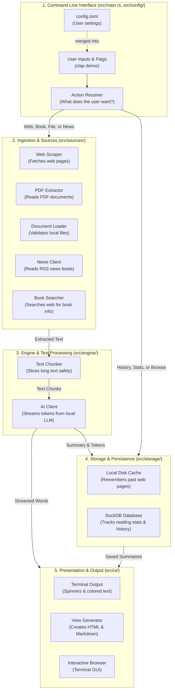
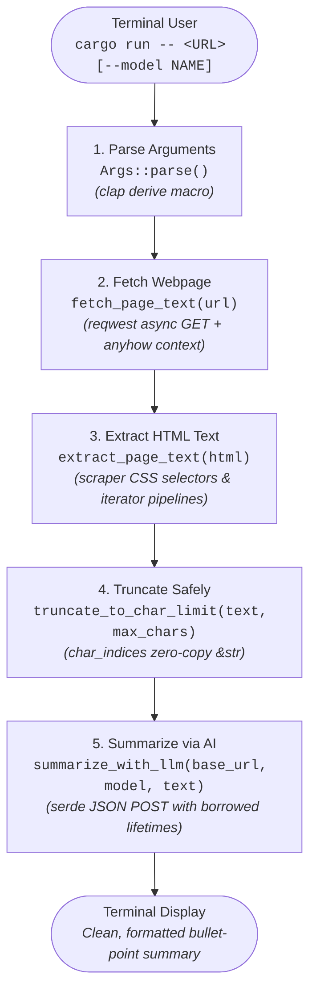
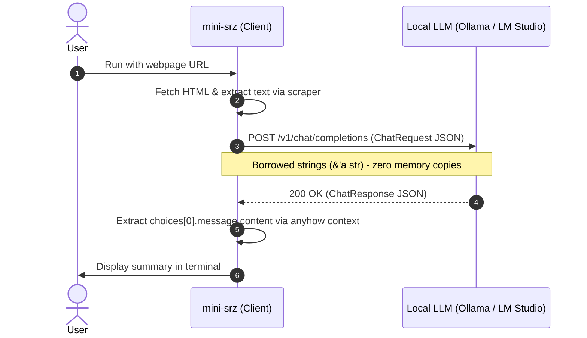

# Learning Rust Through Real-World Code: The `srz` Architecture & Concepts Guide

> 🎯 **Primary Purpose**: This guide uses `srz` (a fast, modular AI CLI tool) as a practical case study to help you **learn and understand Rust better**. Instead of memorizing abstract language rules in isolation, you will see how production-grade Rust concepts—ownership, borrowing, enums, lifetimes, state machines, and concurrency—are applied in real-world systems code.

Welcome to `srz`! This guide explains the architecture of the codebase and highlights the **hows and whys** of coding in Rust.

Whether you are a **beginner**, **non-technical learner**, or an **experienced developer coming from Python, JavaScript, Go, or C++**, this guide uses simple real-world analogies, visual diagrams, and direct chapter connections to [The Rust Programming Language](https://doc.rust-lang.org/book/) book to make Rust concepts intuitive, memorable, and practical.

### Why Learn Rust with `srz`?
1. **Real-World Patterns**: See how memory safety works without garbage collection pauses or manual `malloc`/`free` calls.
2. **Zero-Cost Abstractions**: Observe how iterators, lifetimes, and zero-copy slices (`Cow`, `&str`) deliver speed without wasting RAM.
3. **From Theory to Practice**: Explore the full architecture first, then follow a hands-on tutorial to build your own practical CLI tool using core ecosystem crates (`clap`, `scraper`, `anyhow`).

---

## 1. System Architecture Diagram

At its core, `srz` takes an input target (a web link, a book title, or a document), extracts its text, condenses it with an AI model, and presents the summary in clean formats.



---

## 2. Key Components & Core Rust Concepts (Explained Simply)

### 💡 The Core Rust Mental Model (How to Think in Rust)

If you are coming from Python, JavaScript, Java, Go, or C++, here is the mental shift that makes Rust click:

| Rust Syntax | What it Means | Everyday Mental Picture |
| :--- | :--- | :--- |
| `let x = ...` | **Immutable by default** | Locked in solid glass; cannot be changed unless declared `mut`. |
| `x` (no `&`) | **Ownership Move** | Handing your keys to a friend. You don't have them anymore. |
| `&x` | **Shared Read-Only Borrow** | Letting multiple friends read a book over your shoulder. Many can look; none can write. |
| `&mut x` | **Exclusive Mutable Borrow** | Handing your car to a mechanic. *Only ONE* person can work on it, and nobody else can drive it. |
| `Option<T>` | **Explicit Presence / Absence** | A wrapped gift box: either has `Some(gift)` or is `None` (empty). No hidden `null` crashes! |
| `Result<T, E>` | **Explicit Success / Failure** | A wrapped parcel: either has `Ok(item)` or `Err(return slip)`. No uncaught exceptions! |
| `'a` (Lifetime) | **Loan Duration Guarantee** | An expiring security badge: guarantees you leave before your host goes home. |
| `Cow<'a, T>` | **Clone-on-Write** | Read the original text for free; make a photocopy only if you need to edit it. |

---

### 2.1 The Entry Point & Safety Baseline (`src/main.rs`, `src/lib.rs`)

#### What this section does
`main.rs` is the conductor of the orchestra. It reads your command, decides what needs to happen, calls the right tools, and handles the output.

#### Core Rust Concepts

#### 1. `#![forbid(unsafe_code)]`
- 💡 **Simple Analogy:** A sealed airplane cockpit door. The flight rules strictly forbid opening it during flight, guaranteeing that nobody can accidentally bump an emergency switch.
- 💡 **The "Click" Moment: Mathematical Safety Proof:** Rust gives developers an `unsafe { ... }` escape hatch for writing low-level device drivers or C bindings. Writing `#![forbid(unsafe_code)]` on line 1 mathematically proves at compile time that the entire binary contains zero null-pointer dereferences, zero buffer overflows, and zero data races.
- 🔍 **Real Code in `srz` ([src/main.rs](file:///Users/myoo/Documents/Repo/srz/src/main.rs#L1) and [src/lib.rs](file:///Users/myoo/Documents/Repo/srz/src/lib.rs#L1)):**
  ```rust
  #![forbid(unsafe_code)]
  ```
- 🔄 **If you know other languages:** In C or C++, memory safety depends on programmer discipline (which routinely fails). In Rust, the compiler guarantees safety by default, and this directive ensures no backdoor `unsafe` blocks bypass that guarantee.
- 📖 **The Rust Book Reference:** [Chapter 19.1: Unsafe Rust](https://doc.rust-lang.org/book/ch19-01-unsafe-rust.html)

#### 2. Async Entry Point (`#[tokio::main]`)
- 💡 **Simple Analogy:** A busy restaurant waiter serving 10 tables at once. Instead of standing idle in the kitchen waiting for a steak to grill (blocking), the waiter delivers drinks to table 2, takes an order from table 3, and returns the second the steak is ready (non-blocking).
- 💡 **The "Click" Moment: Work-Stealing Without Thread Bloat:** Operating systems only understand synchronous `fn main()`. The `#[tokio::main]` macro expands your `async fn main()` into a standard OS entry point that initializes a multi-threaded work-stealing thread pool. When waiting on LLM streaming or web network packets, threads don't sleep—they immediately pick up another pending task.
- 🔍 **Real Code in `srz` ([src/main.rs](file:///Users/myoo/Documents/Repo/srz/src/main.rs#L14-L18)):**
  ```rust
  #[tokio::main]
  async fn main() -> Result<()> {
      let cmd = Cli::command();
      let matches = cmd.get_matches();
      // ...
  ```
- 🔄 **If you know other languages:** In Node.js, async runs on a single event-loop thread. In Go, goroutines use a hidden runtime scheduler. In Rust, async is zero-cost: you only include a runtime (Tokio) when you need fast, asynchronous network I/O.
- 📖 **The Rust Book Reference:** [Chapter 17: Async and Await](https://doc.rust-lang.org/book/ch17-00-async-await.html)

#### 3. Modern Let-Chains (`if let ... && ...`)
- 💡 **Simple Analogy:** An airport boarding gate check: *"If your boarding pass is valid AND your passport is unexpired, please board the plane."*
- 💡 **The "Click" Moment: Eliminating the Pyramid of Doom:** In older Rust (or languages like Go/Python), combining condition checks and value extractions required deeply nested `if` statements. Let-chains combine boolean conditions (`!outcome.cached`) and pattern-matching variable extractions (`let Some(db) = ...`) into a single guard condition without indentation drift.
- 🔍 **Real Code in `srz` ([src/main.rs](file:///Users/myoo/Documents/Repo/srz/src/main.rs#L214-L217)):**
  ```rust
  // Record newly generated summaries in DuckDB history & library (lazily opened)
  if !outcome.cached
      && let Some(db) = commands::open_db_or_warn()
  {
      let record = NewSummaryRecord { /* ... */ };
      let _ = db.record_summary(&record);
  }
  ```
- 📖 **The Rust Book Reference:** [Chapter 6.3: Concise Control Flow with `if let`](https://doc.rust-lang.org/book/ch06-03-if-let.html)

#### 4. The "Move vs. Borrow" Trap in Real Code (`src/main.rs`)
- 💡 **Simple Analogy:** Handing someone a physical book vs. letting them read over your shoulder. If you hand it to them (move), you no longer have it. If they look over your shoulder (borrow `&`), you both still have access to the book.
- 💡 **The "Click" Moment: Ownership is Linear:** In Rust, every value has exactly *one* owner at any given moment. Moving a variable gives away ownership permanently. If you need to use the variable again, you must **borrow** it (`&`) rather than moving it.
- 🔍 **Real Code in `srz` ([src/main.rs](file:///Users/myoo/Documents/Repo/srz/src/main.rs#L23-L30)):**
  ```rust
  let (config, config_path) = match &args.config {
      Some(p) => {
          let cfg = Config::load_from_path(p)?;
          (cfg, Some(p.clone()))
      }
      None => Config::load_default(),
  };
  args.apply_config(&config, Some(&matches)); // 👈 `args` is used again here!
  ```
- 💥 **The Common Beginner Trap:** What happens if you remove that tiny ampersand (`match args.config`)?
  In other languages like Python, passing an object just passes another reference. In Rust, `args.config` would be **moved** out of `args`. Seven lines later, `args.apply_config(...)` would crash at compile time with:
  ```text
  error[E0382]: borrow of partially moved value: `args`
  ```
  Adding the `&` (`match &args.config`) **borrows** the config path, leaving `args` completely valid for the rest of `main()`.
- 🔄 **If you know other languages:** Python and JS pass references automatically. In Rust, values move by default unless you explicitly add `&` to borrow.
- 📖 **The Rust Book Reference:** [Chapter 4.2: References and Borrowing](https://doc.rust-lang.org/book/ch04-02-references-and-borrowing.html)

---

### 2.2 CLI Parsing & Configuration (`src/config/cli.rs`, `src/config/file.rs`)

#### What this section does
Converts raw command-line text typed by the user (like `srz https://example.com --model llama3`) into strongly-typed Rust variables.

#### Core Rust Concepts

#### 1. Derive Macros (`clap` & `serde`)
- 💡 **Simple Analogy:** Drawing a simple floor plan on paper, and having an automated robot 3D-print the entire furnished house overnight with all wiring and plumbing included.
- 💡 **The "Click" Moment: Zero-Cost Compile-Time Code Generation:** In Python or Ruby, command-line arguments and serialization require runtime inspection (reflection) which slows down boot time. In Rust, `#[derive(...)]` tells the compiler to write hundreds of lines of parsing, validation, and documentation code *at compile time*. The doc-comments (`/// Concise summary...`) become the actual `--help` manual!
- 🔍 **Real Code in `srz` ([src/config/cli.rs](file:///Users/myoo/Documents/Repo/srz/src/config/cli.rs#L5-L14)):**
  ```rust
  #[derive(ValueEnum, Clone, Copy, Debug, PartialEq, Eq, Hash, Serialize, Deserialize)]
  #[serde(rename_all = "lowercase")]
  pub enum SummaryStyle {
      /// Concise summary with key takeaways
      Concise,
      /// Detailed comprehensive summary
      Detailed,
      /// Bulleted key points
      Bullets,
  }
  ```
- 🔄 **If you know other languages:** In Python (`argparse`) or JavaScript, command-line arguments are checked while the program runs. In Rust, the parser is verified at compile time, eliminating runtime crashes and startup lag.
- 📖 **The Rust Book Reference:** [Chapter 10.2: Traits](https://doc.rust-lang.org/book/ch10-02-traits.html) and [Chapter 19.5: Macros (Derive Macros)](https://doc.rust-lang.org/book/ch19-06-macros.html#how-to-write-a-custom-derive-macro)

#### 2. Enums with Payloads (Tagged Unions)
- 💡 **Simple Analogy:** A Swiss Army knife where each fold-out tool holds its own specific accessories. The screwdriver slot carries screwdriver bits; the scissors slot carries replacement springs. You can never accidentally put a screwdriver bit into the scissors.
- 💡 **The "Click" Moment: Make Invalid States Unrepresentable:** In OOP, you might build an `Action` class with `url`, `title`, and `limit` fields—all nullable (`None`/`null`). You have to remember: *"If action is WEB, make sure `url` isn't null, but ignore `limit`."* In Rust, each enum variant holds *only* the specific data it needs. An invalid state cannot even exist in memory.
- 🔍 **Real Code in `srz` ([src/config/cli.rs](file:///Users/myoo/Documents/Repo/srz/src/config/cli.rs#L337-L358)):**
  ```rust
  #[derive(Debug, PartialEq, Eq)]
  pub enum ResolvedAction<'a> {
      Web { url: &'a str },
      Book { title: &'a str },
      History { limit: usize },
      Stats, // Holds no data at all!
  }
  ```
  A `Web` command *only* holds a URL slice; a `History` command *only* holds a limit; `Stats` holds no data at all.
- 🔄 **If you know other languages:** In C, Java, or TypeScript, enums are usually just numbers or string labels. In Rust, each enum variant can carry unique data payloads, making invalid combinations impossible to construct.
- 📖 **The Rust Book Reference:** [Chapter 6.1: Defining an Enum](https://doc.rust-lang.org/book/ch06-01-defining-an-enum.html)

#### 3. Exhaustive Pattern Matching (`match`)
- 💡 **Simple Analogy:** A strict postal sorting room with a designated bin for every single zip code. If a new zip code is introduced and there isn't a bin for it, the conveyor belt stops immediately until a bin is built.
- 💡 **The "Click" Moment: The Compiler as a Co-Pilot:** Unlike `switch` in C/Java where forgetting a `break` or omitting a case causes silent runtime bugs, Rust's `match` is strictly exhaustive. If you add a new action variant (e.g. `Podcast`), the Rust compiler will flag every single `match` statement across your codebase that hasn't handled it yet.
- 🔍 **Real Code in `srz` ([src/main.rs](file:///Users/myoo/Documents/Repo/srz/src/main.rs#L55-L75)):**
  ```rust
  match action {
      ResolvedAction::Cache(cache_cmd) => {
          commands::handle_cache(cache_cmd, &cache)?;
          return Ok(());
      }
      ResolvedAction::History { limit } => {
          return with_db(|db| commands::handle_history(db, limit, args.json));
      }
      ResolvedAction::Stats => {
          return with_db(|db| commands::handle_stats(db, args.json));
      }
      ResolvedAction::Find { query } => {
          return with_db(|db| commands::handle_find(db, query, &cache, args.json));
      }
      // ... every single variant must be handled!
  }
  ```
- 🔄 **If you know other languages:** Unlike `switch` in C/Java where a missing `case` can silently cause bugs, Rust guarantees all possibilities are covered before compiling.
- 📖 **The Rust Book Reference:** [Chapter 6.2: The `match` Control Flow Construct](https://doc.rust-lang.org/book/ch06-02-match.html)

---

### 2.3 Web Scraping & Ingestion (`src/sources/`)

#### What this section does
Pulls data from web pages, PDFs, YouTube transcripts, and RSS feeds, stripping out unwanted advertisements and formatting.

#### Core Rust Concepts

#### 1. Lazy Initialization (`std::sync::LazyLock`)
- 💡 **Simple Analogy:** A motion-activated light. It draws zero electricity until someone steps into the room for the very first time, turns on smoothly, and stays on for everyone else safely.
- 💡 **The "Click" Moment: Zero Startup Lag & No Static Fiascos:** Parsing CSS selectors (like finding `<meta property="og:title">`) takes noticeable CPU time. In C++, static globals risk undefined initialization order ("Static Initialization Order Fiasco"). In Python, heavy imports slow down CLI startup. `LazyLock` defers parsing CSS selectors until the exact millisecond they are first queried, and caches them thread-safely with zero ongoing lock overhead.
- 🔍 **Real Code in `srz` ([src/sources/scraper.rs](file:///Users/myoo/Documents/Repo/srz/src/sources/scraper.rs#L8-L12)):**
  ```rust
  static OG_TITLE_SEL: LazyLock<Selector> =
      LazyLock::new(|| Selector::parse("meta[property='og:title']").unwrap());
  static TITLE_SEL: LazyLock<Selector> =
      LazyLock::new(|| Selector::parse("title").unwrap());
  ```
- 📖 **The Rust Book Reference:** [Chapter 16.3: Shared-State Concurrency](https://doc.rust-lang.org/book/ch16-03-shared-state.html)

#### 2. Defensive Streaming & Limits
- 💡 **Simple Analogy:** A fuel tank nozzle with an automatic shutoff valve. If a pump tries to dump 1,000 gallons into a 10-gallon tank, the valve snaps shut before the tank overflows.
- 💡 **The "Click" Moment: Defending Against Out-Of-Memory (OOM) Attacks:** Calling `response.bytes().await` blindly buffers an entire web page into RAM. If a malicious web server returns an infinite 10GB stream ("decompression bomb"), your app crashes. `srz` inspects HTTP headers first, streams chunk by chunk, and terminates the connection if bytes exceed `max_bytes`.
- 🔍 **Real Code in `srz` ([src/sources/scraper.rs](file:///Users/myoo/Documents/Repo/srz/src/sources/scraper.rs#L58-L86)):**
  ```rust
  pub async fn read_response_bytes_limited(
      mut response: reqwest::Response,
      max_bytes: usize,
  ) -> Result<Vec<u8>> {
      // 1. Check Content-Length header upfront
      if let Some(content_len) = response.content_length()
          && content_len as usize > max_bytes
      {
          anyhow::bail!("Response content length exceeds limit of {} MB", max_bytes / (1024 * 1024));
      }
      let mut bytes = Vec::new();
      // 2. Stream chunk-by-chunk and abort if total bytes exceed limit
      while let Some(chunk) = response.chunk().await.context("Failed to read chunk")? {
          if bytes.len() + chunk.len() > max_bytes {
              anyhow::bail!("Response body exceeded limit of {} MB", max_bytes / (1024 * 1024));
          }
          bytes.extend_from_slice(&chunk);
      }
      Ok(bytes)
  }
  ```
- 📖 **The Rust Book Reference:** [Chapter 4.1: What is Ownership?](https://doc.rust-lang.org/book/ch04-01-what-is-ownership.html)

#### 3. Ergonomic Error Handling (`Result` and `?`)
- 💡 **Simple Analogy:** A relay race baton. If a runner trips, they hand the "error baton" straight back out of the race to the team captain, rather than tumbling down the track and breaking other equipment.
- 💡 **The "Click" Moment: The Gift Box Mental Model:**
  - `Option<T>` is a gift box that holds either a present (`Some(value)`) or is empty (`None`).
  - `Result<T, E>` is a parcel that holds either a present (`Ok(value)`) or a return slip (`Err(error)`).
  - The `?` operator unboxes the parcel: if it's `Ok`, it hands you the inner value; if it's `Err`, it stops the function immediately and returns the error to the caller. No hidden exceptions, no surprise crashes!
- 🔍 **Real Code in `srz` ([src/main.rs](file:///Users/myoo/Documents/Repo/srz/src/main.rs#L25-L27) & [src/system/fs_util.rs](file:///Users/myoo/Documents/Repo/srz/src/system/fs_util.rs#L39-L49)):**
  ```rust
  // In src/main.rs: unwrap with ? or return early on failure
  let cfg = Config::load_from_path(p)?;

  // In src/system/fs_util.rs: returning an explicit io::Error
  if let Ok(meta) = fs::symlink_metadata(path) && meta.file_type().is_symlink() {
      return Err(std::io::Error::new(
          std::io::ErrorKind::InvalidInput,
          format!("Refusing to create directory at symlink path: {}", path.display()),
      ));
  }
  ```
- 🔄 **If you know other languages:** Python, Java, and C++ use exceptions (`try/catch`), which can be thrown invisibly from anywhere. Rust treats errors as explicit return values, making potential failures obvious in the code.
- 📖 **The Rust Book Reference:** [Chapter 9.2: Recoverable Errors with `Result`](https://doc.rust-lang.org/book/ch09-02-recoverable-errors-with-result.html)

---

### 2.4 Text Engine & LLM Client (`src/engine/`)

#### What this section does
Slices long text into manageable sections that fit into an AI's memory window, streams the text to a local LLM, and captures the generated response.

#### Core Rust Concepts

#### 1. Zero-Copy Deserialization (`#[serde(borrow)]`)
- 💡 **Simple Analogy:** Highlighting words directly in a physical letter mailed to you, instead of manually re-copying the entire letter word-for-word onto a separate notepad.
- 💡 **The "Click" Moment: Eliminating the Heap Allocation Tax:** When streaming AI responses at 80 tokens per second, creating 80 new heap `String`s every second causes constant memory allocation churn. With `#[serde(borrow)]`, Rust deserializes JSON strings by pointing `Cow<'a, str>` directly to the slice inside Tokio's network buffer—allocating **0 bytes** of extra heap memory!
- 🔍 **Real Code in `srz` ([src/engine/llm.rs](file:///Users/myoo/Documents/Repo/srz/src/engine/llm.rs#L33-L55)):**
  ```rust
  #[derive(Deserialize)]
  struct ChatCompletionChunk<'a> {
      #[serde(default, borrow)]
      choices: Vec<ChunkChoice<'a>>,
  }

  #[derive(Deserialize)]
  struct ChunkChoice<'a> {
      #[serde(borrow)]
      delta: ChunkDelta<'a>,
  }

  #[derive(Deserialize, Default)]
  struct ChunkDelta<'a> {
      #[serde(borrow)]
      content: Option<Cow<'a, str>>, // 👈 Borrows directly from incoming network buffer!
  }
  ```
- 🔄 **If you know other languages:** In Python or Go, parsing JSON allocates new strings in memory for every key and value. Rust allows "borrowing" directly from the raw incoming buffer, saving CPU and RAM.
- 📖 **The Rust Book Reference:** [Chapter 10.3: Validating References with Lifetimes](https://doc.rust-lang.org/book/ch10-03-lifetime-syntax.html)

#### 2. Clone-on-Write in Action (`std::borrow::Cow<'a, str>`)
- 💡 **Simple Analogy:** Reading a library book with transparent sticky notes. You read the original text for free (borrowed). Only if you need to rewrite or reformat a sentence do you photocopy that page and write on your copy (owned/cloned).
- 💡 **The "Click" Moment: Borrow by Default, Allocate on Demand:** If a function only needs to modify data occasionally, returning `String` forces an allocation every time. `Cow<'a, str>` acts as a smart enum: it holds `Cow::Borrowed(&'a str)` when reading existing data, and seamlessly converts to `Cow::Owned(String)` only when edits are needed.
- 🔍 **Real Code in `srz` ([src/main.rs](file:///Users/myoo/Documents/Repo/srz/src/main.rs#L164-L171)):**
  ```rust
  let content = if render::is_html_path(output_path) {
      // 1. User wants HTML: Allocate a brand-new styled HTML document string
      std::borrow::Cow::Owned(render::render_html_document(&outcome.title, &outcome.summary))
  } else {
      // 2. User wants Markdown: Borrow the existing summary with ZERO allocations!
      std::borrow::Cow::Borrowed(outcome.summary.as_str())
  };

  srz::fs_util::write_private_file(output_path, content.as_bytes())?;
  ```
  If a user saves a 20,000-word summary as Markdown, `srz` does not duplicate a single byte. `Cow::Borrowed` wraps the existing slice. Both branches implement `Deref`, so `content.as_bytes()` works seamlessly without caring whether the data is owned or borrowed!
- 📖 **The Rust Book Reference:** [Chapter 4.3: The Slice Type](https://doc.rust-lang.org/book/ch04-03-slices.html) and [Chapter 8.2: Strings](https://doc.rust-lang.org/book/ch08-02-strings.html)

#### 3. Higher-Order Functions & Closures (`FnMut`)
- 💡 **Simple Analogy:** A universal bread-slicing machine where you can swap out the slicing blade. You can insert a blade that cuts by number of slices, or a blade that cuts by weight, without rebuilding the whole machine.
- 💡 **The "Click" Moment: Zero-Cost Monomorphization:** In Python or JS, passing callback functions creates heap-allocated closures and dynamic dispatch overhead. In Rust, generic closures (`fn chunk_with_metric<F>(..., mut count_fn: F) where F: FnMut(&str) -> usize`) use static dispatch: the compiler generates separate, highly-optimized machine-code functions with zero runtime function-call overhead.
- 🔍 **Real Code in `srz` ([src/engine/chunker.rs](file:///Users/myoo/Documents/Repo/srz/src/engine/chunker.rs#L29-L48)):**
  ```rust
  // In src/engine/chunker.rs:
  // 1. Chunking by BPE AI tokens passes a function pointer
  Self::chunk_with_metric(text, max_tokens, overlap_tokens, Self::count_tokens)

  // 2. Chunking by word count passes an inline closure
  Self::chunk_with_metric(text, max_words, overlap_words, |s| {
      s.split_whitespace().count()
  })

  // 3. The generic chunking engine accepts any closure implementing FnMut(&str) -> usize
  fn chunk_with_metric<'a, F>(
      text: &'a str,
      max_limit: usize,
      overlap_limit: usize,
      mut count_fn: F,
  ) -> Vec<Cow<'a, str>>
  where
      F: FnMut(&str) -> usize,
  ```
- 📖 **The Rust Book Reference:** [Chapter 13.1: Closures](https://doc.rust-lang.org/book/ch13-01-closures.html)

---

### 2.5 Storage, Database, & Cache (`src/storage/`)

#### What this section does
Saves summaries on disk so you don't have to re-summarize the same article twice, and tracks reading history and token performance in an embedded DuckDB database.

#### Core Rust Concepts

#### 1. Lifetimes in Structs (`NewSummaryRecord<'a>`)
- 💡 **Simple Analogy:** A visitor security badge that expires at 5:00 PM when your host leaves the office. The badge guarantees you cannot roam the building after your host has gone home.
- 💡 **The "Click" Moment: Lifetimes are Rulers, Not Timers:** A common beginner misconception is that lifetimes (`'a`) make variables live longer. They do not. A lifetime annotation is just a ruler that the Rust compiler holds up to verify that a borrowed loan does not outlive its owner.
- 🔍 **Real Code in `srz` ([src/storage/db.rs](file:///Users/myoo/Documents/Repo/srz/src/storage/db.rs#L11-L24) and [src/main.rs](file:///Users/myoo/Documents/Repo/srz/src/main.rs#L217-L231)):**
  ```rust
  // In src/storage/db.rs
  pub struct NewSummaryRecord<'a> {
      pub target_type: &'a str,
      pub title: &'a str,
      pub author: Option<&'a str>,
      pub url: Option<&'a str>,
      pub style: &'a str,
      pub model: &'a str,
      pub word_count: usize,
      pub summary: &'a str, // 👈 Borrows reference instead of cloning a 50KB string!
      // ...
  }
  ```
  ```rust
  // In src/main.rs
  let record = NewSummaryRecord {
      target_type: outcome.target_type,
      title: &outcome.title,
      author: outcome.author.as_deref(),
      url: outcome.url.as_deref(),
      style: args.style.as_str(),
      model: &args.model,
      word_count: outcome.word_count,
      // ...
      summary: &outcome.summary, // 👈 Pure zero-copy loan
  };
  let _ = db.record_summary(&record);
  ```
  Why not make `summary: String`? If a summary is 50KB long, having `String` fields forces Rust to duplicate all 50,000 characters on the heap just to insert it into DuckDB. By annotating the struct with `'a`, `NewSummaryRecord` borrows existing strings in memory. The Rust compiler guarantees at compile time that the record cannot outlive the strings it borrows, preventing dangling pointers with **zero allocations**.
- 🔄 **If you know other languages:** In C++, storing raw pointers (`const char*`) in a struct is risky because if the original string is freed, you get a segfault. In Go or Python, structs hold pointers with garbage collection overhead. Rust gives you raw pointer performance with compile-time memory safety.
- 📖 **The Rust Book Reference:** [Chapter 10.3: Lifetime Annotations in Struct Definitions](https://doc.rust-lang.org/book/ch10-03-lifetime-syntax.html#lifetime-annotations-in-struct-definitions)

#### 2. The Closure Loan Pattern (`with_db`)
- 💡 **Simple Analogy:** A safe deposit box at a bank. The vault manager unlocks the door for you, lends you access to your box, waits until you are done with your transaction, and locks the heavy vault door behind you the moment you leave.
- 💡 **The "Click" Moment: Scoped RAII Lending:** Instead of forcing callers to remember `db.close()`, `with_db` enforces a strict lexical lifetime. The database connection cannot leak outside the closure because the borrow `&Database` is invalid once the closure returns.
- 🔍 **Real Code in `srz` ([src/commands/mod.rs](file:///Users/myoo/Documents/Repo/srz/src/commands/mod.rs#L47-L54) and [src/main.rs](file:///Users/myoo/Documents/Repo/srz/src/main.rs#L64-L72)):**
  ```rust
  // In src/commands/mod.rs
  pub fn with_db(f: impl FnOnce(&Database) -> Result<()>) -> Result<()> {
      if let Some(db) = open_db_or_warn() {
          f(&db)?; // 👈 Lends temporary borrowed reference &db to caller closure
      } else {
          Ui::error("DuckDB database unavailable.");
      }
      Ok(())
  }
  ```
  ```rust
  // In src/main.rs
  ResolvedAction::History { limit } => {
      return with_db(|db| commands::handle_history(db, limit, args.json));
  }
  ResolvedAction::Stats => {
      return with_db(|db| commands::handle_stats(db, args.json));
  }
  ResolvedAction::Find { query } => {
      return with_db(|db| commands::handle_find(db, query, &cache, args.json));
  }
  ```
  Instead of each command manually opening connections, checking for missing databases, handling locks, and remembering to close connections, `with_db` acts as an RAII loan manager. `impl FnOnce(&Database)` means: "Give me any closure that accepts a borrowed `&Database` once." When the closure returns, `db` is dropped and the DuckDB connection is cleanly closed.
- 🔄 **If you know other languages:** This is Rust's idiomatic replacement for Python's `with open(...) as f:` context managers or Java's `try-with-resources`. Rather than adding special language syntax, Rust achieves this cleanly using higher-order closures and borrowing.
- 📖 **The Rust Book Reference:** [Chapter 13.1: Closures](https://doc.rust-lang.org/book/ch13-01-closures.html) and [Chapter 15.3: The `Drop` Trait](https://doc.rust-lang.org/book/ch15-03-drop.html)

---

### 2.6 User Interface & Presentation (`src/ui/`)

#### What this section does
Prints colored terminal output, displays animated spinners, and provides a full-screen interactive library browser.

#### Core Rust Concepts

#### 1. Crash-Safe Terminals via RAII (`Drop`)
- 💡 **Simple Analogy:** A hotel room keycard that turns on the lights when inserted and turns off all electricity automatically when you remove the card and step outside.
- 💡 **The "Click" Moment: Deterministic Destruction:** In other languages, if an interactive terminal program panics or crashes, your terminal is left in "raw mode" (keys don't echo, cursor is invisible, typing `Enter` doesn't work). In Rust, types implementing `Drop` are guaranteed to run cleanup when unwinding the stack, automatically restoring your terminal even if the code panics.
- 🔍 **Real Code in `srz` ([src/ui/tui.rs](file:///Users/myoo/Documents/Repo/srz/src/ui/tui.rs#L130-L147)):**
  ```rust
  pub fn run_tui(db: &Database, cache: &Cache) -> Result<()> {
      enable_raw_mode()?;
      let mut stdout = stdout();
      execute!(stdout, EnterAlternateScreen)?;
      let backend = CrosstermBackend::new(stdout);
      let mut terminal = Terminal::new(backend)?;

      let res = run_loop(&mut terminal, &mut state, db);

      // Terminal restoration is guaranteed on exit
      disable_raw_mode()?;
      execute!(terminal.backend_mut(), LeaveAlternateScreen)?;
      terminal.show_cursor()?;

      res
  }
  ```
- 🔄 **If you know other languages:** In Python or C, an uncaught crash during a terminal GUI session often leaves the user's terminal scrambled and unresponsive. Rust's deterministic destructors prevent this.
- 📖 **The Rust Book Reference:** [Chapter 15.3: Running Code on Cleanup with the `Drop` Trait](https://doc.rust-lang.org/book/ch15-03-drop.html)

#### 2. Pre-allocating Capacity (`String::with_capacity`)
- 💡 **Simple Analogy:** Booking a bus for 30 passengers upfront, instead of hailing a 4-seater taxi, discovering it is full, hailing an 8-seater, and transferring luggage again and again.
- 💡 **The "Click" Moment: The Hidden Cost of Dynamic Resizing:** A `String` or `Vec` stores data on the heap. When it fills up, the OS must allocate a new chunk of memory twice as big, copy *every single existing byte* over, and free the old buffer. When rendering Markdown to HTML, `srz` knows the text will expand by roughly 50%, so it pre-allocates `md.len() * 3 / 2` upfront in a single allocation.
- 🔍 **Real Code in `srz` ([src/ui/render.rs](file:///Users/myoo/Documents/Repo/srz/src/ui/render.rs#L241-L244)):**
  ```rust
  // Pre-allocate buffer: Markdown -> HTML expands text by ~50%
  let mut html_output = String::with_capacity(md.len() * 3 / 2);
  pulldown_cmark::html::push_html(&mut html_output, parser);
  ```
- 📖 **The Rust Book Reference:** [Chapter 8.2: Storing UTF-8 Encoded Text with Strings](https://doc.rust-lang.org/book/ch08-02-strings.html#updating-a-string)

---

### 2.7 System & OS Security (`src/system/`)

#### What this section does
Manages files, restricts folder permissions, and performs self-upgrades safely.

#### Core Rust Concepts

#### 1. Compile-Time OS Switches (`#[cfg(unix)]`)
- 💡 **Simple Analogy:** Packing winter coats for an Alaska trip and light shorts for a Hawaii trip *before* you leave, rather than carrying both outfits everywhere.
- 💡 **The "Click" Moment: Zero-Cost Portability:** In Python (`if sys.platform == 'win32':`) or C, platform checks happen at runtime or through complex build files. In Rust, `#[cfg(unix)]` tells the compiler: "Only compile this block when targeting macOS or Linux." On Windows, the Unix-specific `std::os::unix::fs::PermissionsExt` trait isn't even compiled, avoiding missing symbol errors completely.
- 🔍 **Real Code in `srz` ([src/system/fs_util.rs](file:///Users/myoo/Documents/Repo/srz/src/system/fs_util.rs#L27-L35)):**
  ```rust
  pub fn set_private_file_perms(path: &Path) {
      #[cfg(unix)]
      {
          use std::os::unix::fs::PermissionsExt;
          let _ = fs::set_permissions(path, fs::Permissions::from_mode(0o600));
      }
      #[cfg(not(unix))]
      let _ = path; // Silences unused variable warnings on Windows
  }
  ```
- 📖 **The Rust Book Reference:** [Chapter 14.1: Customizing Builds with Release Profiles](https://doc.rust-lang.org/book/ch14-01-release-profiles.html)

---

## 3. Quick Reference: Rust Concepts in `srz`

| Concept | File Location | Real-World Analogy & Mental Model | The Rust Book Reference |
| :--- | :--- | :--- | :--- |
| **`#![forbid(unsafe_code)]`** | [`src/main.rs#L1`](file:///Users/myoo/Documents/Repo/srz/src/main.rs#L1), [`src/lib.rs#L1`](file:///Users/myoo/Documents/Repo/srz/src/lib.rs#L1) | **Sealed cockpit door**: Mathematical compile-time guarantee of zero memory corruption or segfaults. | [Ch 19.1: Unsafe Rust](https://doc.rust-lang.org/book/ch19-01-unsafe-rust.html) |
| **`#[tokio::main]`** | [`src/main.rs#L14-L18`](file:///Users/myoo/Documents/Repo/srz/src/main.rs#L14-L18) | **Restaurant waiter**: Non-blocking work-stealing thread pool for high-throughput network I/O. | [Ch 17: Async/Await](https://doc.rust-lang.org/book/ch17-00-async-await.html) |
| **Move vs. Borrow (`&`)** | [`src/main.rs#L23-L30`](file:///Users/myoo/Documents/Repo/srz/src/main.rs#L23-L30) | **Reading over a shoulder**: Borrowing with `&` avoids transferring ownership and triggering error `E0382`. | [Ch 4.2: References & Borrowing](https://doc.rust-lang.org/book/ch04-02-references-and-borrowing.html) |
| **Derive Macros** | [`src/config/cli.rs#L5-L14`](file:///Users/myoo/Documents/Repo/srz/src/config/cli.rs#L5-L14) | **3D architectural printer**: Generates hundreds of lines of type validation and `--help` CLI text at compile time. | [Ch 19.5: Macros](https://doc.rust-lang.org/book/ch19-06-macros.html#how-to-write-a-custom-derive-macro) |
| **Enums with Payloads** | [`src/config/cli.rs#L337-L358`](file:///Users/myoo/Documents/Repo/srz/src/config/cli.rs#L337-L358) | **Swiss Army Knife**: Makes invalid states unrepresentable; each variant holds only the fields it requires. | [Ch 6.1: Defining an Enum](https://doc.rust-lang.org/book/ch06-01-defining-an-enum.html) |
| **Exhaustive `match`** | [`src/main.rs#L55-L75`](file:///Users/myoo/Documents/Repo/srz/src/main.rs#L55-L75) | **Postal sorting bins**: The compiler flags missing variants if new commands are introduced. | [Ch 6.2: Pattern Matching](https://doc.rust-lang.org/book/ch06-02-match.html) |
| **`LazyLock<T>`** | [`src/sources/scraper.rs#L8-L12`](file:///Users/myoo/Documents/Repo/srz/src/sources/scraper.rs#L8-L12) | **Motion-sensor light**: Safe, one-time, thread-safe initialization on demand with zero ongoing lock cost. | [Ch 16.3: Concurrency](https://doc.rust-lang.org/book/ch16-03-shared-state.html) |
| **Defensive Streaming** | [`src/sources/scraper.rs#L58-L86`](file:///Users/myoo/Documents/Repo/srz/src/sources/scraper.rs#L58-L86) | **Fuel pump auto-shutoff**: Streaming chunks with hard byte limits protects against Out-of-Memory DOS attacks. | [Ch 4.1: Ownership](https://doc.rust-lang.org/book/ch04-01-what-is-ownership.html) |
| **`Result`, `Option`, & `?`** | [`src/main.rs#L25-L27`](file:///Users/myoo/Documents/Repo/srz/src/main.rs#L25-L27) | **Gift box & return receipt**: Explicit type-based errors that propagate cleanly without hidden crashes. | [Ch 9.2: Result](https://doc.rust-lang.org/book/ch09-02-recoverable-errors-with-result.html) |
| **`#[serde(borrow)]`** | [`src/engine/llm.rs#L33-L55`](file:///Users/myoo/Documents/Repo/srz/src/engine/llm.rs#L33-L55) | **Highlighting original letter**: Deserializes streaming LLM JSON directly from network buffers with **0B allocations**. | [Ch 10.3: Lifetimes](https://doc.rust-lang.org/book/ch10-03-lifetime-syntax.html) |
| **`Cow<'a, str>`** | [`src/main.rs#L164-L171`](file:///Users/myoo/Documents/Repo/srz/src/main.rs#L164-L171) | **Reading with sticky notes**: Zero-copy borrowing by default, lazily allocating `String` only when edits occur. | [Ch 4.3: Slices](https://doc.rust-lang.org/book/ch04-03-slices.html) |
| **Closures & `FnMut`** | [`src/engine/chunker.rs#L29-L48`](file:///Users/myoo/Documents/Repo/srz/src/engine/chunker.rs#L29-L48) | **Swappable bread-slicing blades**: Zero-cost monomorphization allowing flexible metric counting. | [Ch 13.1: Closures](https://doc.rust-lang.org/book/ch13-01-closures.html) |
| **Lifetimes in Structs (`'a`)** | [`src/storage/db.rs#L11-L24`](file:///Users/myoo/Documents/Repo/srz/src/storage/db.rs#L11-L24) | **Expiring visitor pass**: Lets database records borrow 50KB strings without duplicating memory on the heap. | [Ch 10.3: Struct Lifetimes](https://doc.rust-lang.org/book/ch10-03-lifetime-syntax.html#lifetime-annotations-in-struct-definitions) |
| **Closure Loan Pattern** | [`src/commands/mod.rs#L47-L54`](file:///Users/myoo/Documents/Repo/srz/src/commands/mod.rs#L47-L54) | **Bank vault attendant**: Enforces strict lexical database access boundaries and automatic RAII lock release. | [Ch 15.3: Drop Trait](https://doc.rust-lang.org/book/ch15-03-drop.html) |
| **Crash-Safe Terminal (RAII)** | [`src/ui/tui.rs#L130-L147`](file:///Users/myoo/Documents/Repo/srz/src/ui/tui.rs#L130-L147) | **Hotel keycard light switch**: Restores normal terminal modes upon function exit, even after panics. | [Ch 15.3: Drop Trait](https://doc.rust-lang.org/book/ch15-03-drop.html) |
| **Capacity Pre-allocation** | [`src/ui/render.rs#L241-L244`](file:///Users/myoo/Documents/Repo/srz/src/ui/render.rs#L241-L244) | **Booking bus upfront**: Eliminates multiple heap reallocations during Markdown-to-HTML conversions. | [Ch 8.2: Strings](https://doc.rust-lang.org/book/ch08-02-strings.html#updating-a-string) |
| **`#[cfg(unix)]`** | [`src/system/fs_util.rs#L27-L35`](file:///Users/myoo/Documents/Repo/srz/src/system/fs_util.rs#L27-L35) | **Packing for the weather**: Zero-overhead platform-specific file permissions compiled without runtime checks. | [Ch 14.1: Profiles](https://doc.rust-lang.org/book/ch14-01-release-profiles.html) |

---

## 4. Hands-On Tutorial: Build "Mini-Srz" with Clap, Scraper, and Anyhow

In this tutorial, you will build a standalone, working Rust CLI tool from scratch that implements the core pipeline of `srz`:
1. **Command-Line Parsing**: Accepts a URL and optional flags (`--model`, `--base-url`, `--max-chars`) using declarative derive macros.
2. **Web Scraping & Cleaning**: Fetches the webpage and extracts readable text using CSS selectors.
3. **Safe Text Truncation**: Slices text on Unicode boundaries with zero memory copies.
4. **Local LLM Summarization**: Sends an OpenAI-compatible JSON request to a local model (Ollama, LM Studio, etc.) and prints the summary.

---

### 🗺️ High-Level Project Overview: What You Are Building

Here is the visual roadmap of data flow through `mini-srz`:



---

### 🎯 The Educational Goal: Idiomatic Rust with the Standard Trio

In real-world Rust development, you don't reinvent CLI parsers, HTML tokenizers, or error trait objects by hand. Production tools like `srz` leverage the industry-standard trio to keep code concise, expressive, and resilient:

- **`clap` (derive)**: Transforms a simple Rust `struct` into a production-grade CLI parser with auto-generated `--help`, type validation, and default values.
- **`scraper`**: Replaces fragile character-by-character tag-stripping with robust CSS selector queries (`h1, h2, h3, p, li`) powered by the Servo browser engine.
- **`anyhow`**: Delivers ergonomic, application-level error handling with `anyhow::Result<T>`, contextual breadcrumbs (`.context(...)`), and clean early returns (`bail!`).

By building `mini-srz` with this trio, you will directly practice:
- **Derive Macros (`#[derive(Parser)]`)** ([Ch 19.5](https://doc.rust-lang.org/book/ch19-06-macros.html#how-to-write-a-custom-derive-macro))
- **CSS Selectors & DOM Traversal (`scraper`)**
- **Ergonomic Application Error Handling (`anyhow::Result`, `.context()`, `bail!`)** ([Ch 9.2](https://doc.rust-lang.org/book/ch09-02-recoverable-errors-with-result.html))
- **Iterator Pipelines & Combinators (`select`, `map`, `filter`, `collect`, `join`)** ([Ch 13.2](https://doc.rust-lang.org/book/ch13-02-iterators.html))
- **Safe UTF-8 Slicing & Zero-Copy Memory (`&str`, `char_indices`)** ([Ch 8.2](https://doc.rust-lang.org/book/ch08-02-strings.html) & [Ch 4.3](https://doc.rust-lang.org/book/ch04-03-slices.html))
- **Lifetimes in Data Models (`Message<'a>`)** ([Ch 10.3](https://doc.rust-lang.org/book/ch10-03-lifetime-syntax.html))
- **Async/Await Non-Blocking I/O (`tokio`, `reqwest`)** ([Ch 17](https://doc.rust-lang.org/book/ch17-00-async-await.html))

---

### Step 1: Initialize a New Cargo Project

Open your terminal and run:

```bash
cargo new mini-srz
cd mini-srz
```

Cargo generates:
- `Cargo.toml`: Project manifest defining dependencies and compiler settings.
- `src/main.rs`: The binary entry point.

> 📖 **The Rust Book Connection**: [Chapter 1.3: Hello, Cargo!](https://doc.rust-lang.org/book/ch01-03-hello-cargo.html) and [Chapter 14: More About Cargo](https://doc.rust-lang.org/book/ch14-00-more-about-cargo.html)

---

### Step 2: Dependencies (`Cargo.toml`)

Open `Cargo.toml` and add the dependencies to match `srz`'s modern stack:

```toml
[package]
name = "mini-srz"
version = "0.1.0"
edition = "2021"

[dependencies]
# 1. Declarative CLI parsing with derive macros
clap = { version = "4", features = ["derive"] }

# 2. HTML parsing with CSS selectors
scraper = "0.29"

# 3. Ergonomic application-level error handling
anyhow = "1.0"

# 4. Async runtime for non-blocking I/O
tokio = { version = "1", features = ["macros", "rt-multi-thread"] }

# 5. HTTP client to fetch web pages and send LLM requests
reqwest = { version = "0.13", features = ["json"] }

# 6. JSON serialization and deserialization
serde = { version = "1.0", features = ["derive"] }
serde_json = "1.0"
```

> 💡 **Why These Three Crates Simplify Everything:**
> - **`clap`**: Replaces 60+ lines of manual `std::env::args()` loops with a 15-line annotated struct. (See `srz`'s CLI in [`src/config/cli.rs`](file:///Users/myoo/Documents/Repo/srz/src/config/cli.rs#L5)).
> - **`scraper`**: Eliminates custom regex and state machines for HTML parsing by querying the DOM with standard CSS selectors. (See `srz`'s web scraper in [`src/sources/scraper.rs`](file:///Users/myoo/Documents/Repo/srz/src/sources/scraper.rs#L8)).
> - **`anyhow`**: Replaces verbose `Box<dyn std::error::Error>` trait objects with a clean `Result<T>` and rich contextual failure messages. (See `srz`'s error handling in [`src/sources/scraper.rs`](file:///Users/myoo/Documents/Repo/srz/src/sources/scraper.rs#L1)).
>
> 📖 **The Rust Book Connection**: [Chapter 7.1: Packages and Crates](https://doc.rust-lang.org/book/ch07-01-packages-and-crates.html)

---

### Step 3: Declarative CLI Parsing with `clap` Derive

Instead of manually reading command-line arguments using `std::env::args()`, matching hyphens, and handling string conversions, we define our command-line interface declaratively with `clap`:

```rust
use clap::Parser;

#[derive(Parser, Debug)]
#[command(name = "mini-srz", about = "Summarize web pages with a local LLM")]
struct Args {
    /// URL of the webpage to summarize
    url: String,

    /// LLM API base URL
    #[arg(long, default_value = "http://localhost:11434/v1")]
    base_url: String,

    /// Model name to use for summarization
    #[arg(long, default_value = "llama3")]
    model: String,

    /// Maximum characters of webpage text to send to the LLM
    #[arg(long, default_value_t = 8000)]
    max_chars: usize,
}
```

#### How `clap` Works Under the Hood:
```
User command: mini-srz https://example.com --model llama3 --max-chars 5000

Args::parse() automatically:
  1. Captures positional argument "https://example.com" -> args.url
  2. Parses "--model llama3"                           -> args.model = "llama3"
  3. Parses and validates "--max-chars 5000"           -> args.max_chars: usize = 5000
  4. Generates formatted --help screen from doc-comments (/// ...)
```

> 💡 **Rust Concepts Learned Here:**
> 1. **Derive Macros (`#[derive(Parser)]`)**: Zero-boilerplate code generation at compile time. The compiler generates all argument checking, validation, and help formatting.
> 2. **Doc Comments as Help Text**: The three slashes `/// URL of the webpage...` are parsed by `clap` into the CLI `--help` text.
> 3. **Type-Safe Parsing**: Fields like `max_chars: usize` are automatically parsed into numeric types with compile-time type safety; passing invalid text like `--max-chars foo` triggers a user-friendly error message automatically.
>
> 📖 **The Rust Book Connection**: [Chapter 10.2: Traits](https://doc.rust-lang.org/book/ch10-02-traits.html) and [Chapter 19.5: Macros (Derive Macros)](https://doc.rust-lang.org/book/ch19-06-macros.html#how-to-write-a-custom-derive-macro)

---

### Step 4: HTML Text Extraction with `scraper` and CSS Selectors

Webpages contain boilerplate headers, navigation bars, `<script>`, and `<style>` blocks. With `scraper`, we parse the HTML into a DOM tree and use CSS selectors to extract only meaningful content elements:

```rust
use scraper::{Html, Selector};

fn extract_page_text(html: &str) -> String {
    let document = Html::parse_document(html);
    let selector = Selector::parse("h1, h2, h3, p, li").unwrap();

    document
        .select(&selector)
        .map(|el| el.text().collect::<Vec<_>>().join(" "))
        .map(|s| s.trim().to_string())
        .filter(|s| !s.is_empty())
        .collect::<Vec<_>>()
        .join("\n\n")
}
```

#### Sample Transformation:
```html
<!-- Input HTML: -->
<html>
  <head><style>body { color: red; }</style></head>
  <body>
    <header><nav><a href="/">Home</a></nav></header>
    <h1>Rust in 2026</h1>
    <p>Rust is <b>safe</b> and fast.</p>
    <script>analytics.track();</script>
    <p>It provides memory safety without garbage collection.</p>
  </body>
</html>

<!-- Output Text: -->
Rust in 2026

Rust is safe and fast.

It provides memory safety without garbage collection.
```

> 💡 **Rust Concepts Learned Here:**
> 1. **DOM Tree Traversal (`Html::parse_document`)**: Parses the raw HTML into a structured node hierarchy.
> 2. **Targeted CSS Selectors (`Selector::parse`)**: Targets `h1, h2, h3, p, li` directly, naturally ignoring `<script>`, `<style>`, and navigation clutter without complex regex or fragile state machines.
> 3. **Functional Iterator Pipelines**:
>    - `.select(&selector)` yields matching element nodes.
>    - `.map(|el| el.text().collect::<Vec<_>>().join(" "))` flattens inner text (including inline tags like `<b>`).
>    - `.filter(|s| !s.is_empty())` removes blank nodes.
>    - `.collect::<Vec<_>>().join("\n\n")` joins paragraphs cleanly.
>
> 📖 **The Rust Book Connection**: [Chapter 13.2: Processing a Series of Items with Iterators](https://doc.rust-lang.org/book/ch13-02-iterators.html)

---

### Step 5: Safe Text Processing (UTF-8 Slicing)

In Rust, strings are stored as **UTF-8 bytes**. If you slice raw bytes (`&text[..5000]`), your program will panic if index 5000 splits a multi-byte character (like an emoji or foreign letter) in half!

#### Visualizing UTF-8 Memory Layout vs. Byte Slicing:
```
Text: "Hi 🦀" (4 characters, 7 bytes total in memory)

Character:   'H'      'i'      ' '     🦀 (Ferris the Crab emoji)
Byte Index:   0        1        2       3     4     5     6
Byte Value:  [72]    [105]     [32]    [240, 159, 166, 128]

❌ text[..5]                --> CRASH: Byte 5 is in the middle of 🦀!
✅ char_indices().nth(3)    --> byte 3: "Hi "
✅ char_indices().nth(4)    --> byte 7: "Hi 🦀" (safe, zero-copy slice!)
```

Here is the safe way to truncate text in Rust without memory allocations:

```rust
fn truncate_to_char_limit(text: &str, max_chars: usize) -> &str {
    match text.char_indices().nth(max_chars) {
        Some((byte_idx, _)) => &text[..byte_idx],
        None => text, // Text is shorter than max_chars
    }
}
```

> 💡 **Rust Concepts Learned Here:**
> - `&str` is a borrowed string slice (a pointer and a length).
> - `char_indices()` iterates over Unicode scalar values and gives their exact byte positions.
> - Returning `&text[..byte_idx]` creates a borrowed slice with **zero heap memory allocations**.
>
> 📖 **The Rust Book Connection**: [Chapter 8.2: Strings (Slicing Strings)](https://doc.rust-lang.org/book/ch08-02-strings.html#slicing-strings) and [Chapter 4.3: The Slice Type](https://doc.rust-lang.org/book/ch04-03-slices.html)

---

### Step 6: Calling the Local LLM with `anyhow` & Zero-Copy Lifetimes

#### API Request/Response Flow:


Define the request and response shapes matching OpenAI's `/v1/chat/completions` API:

```rust
use anyhow::{bail, Context, Result};
use serde::{Deserialize, Serialize};

#[derive(Serialize)]
struct Message<'a> {
    role: &'a str,
    content: &'a str,
}

#[derive(Serialize)]
struct ChatRequest<'a> {
    model: &'a str,
    messages: Vec<Message<'a>>,
    temperature: f32,
}

#[derive(Deserialize)]
struct ChatResponse {
    choices: Vec<ChatChoice>,
}

#[derive(Deserialize)]
struct ChatChoice {
    message: ResponseMessage,
}

#[derive(Deserialize)]
struct ResponseMessage {
    content: String,
}

async fn fetch_page_text(url: &str) -> Result<String> {
    let client = reqwest::Client::builder()
        .user_agent("mini-srz/0.1")
        .build()
        .context("Failed to build HTTP client")?;

    let html = client
        .get(url)
        .send()
        .await
        .with_context(|| format!("Failed to fetch URL: {}", url))?
        .error_for_status()
        .context("Web server returned an HTTP error status")?
        .text()
        .await
        .context("Failed to decode webpage response body")?;

    let text = extract_page_text(&html);

    if text.trim().is_empty() {
        bail!("No readable text content found on the webpage: {}", url);
    }

    Ok(text)
}

async fn summarize_with_llm(base_url: &str, model: &str, text: &str) -> Result<String> {
    let client = reqwest::Client::new();
    let prompt = format!(
        "Please provide a concise summary with key bullet points for the following text:\n\n{}",
        text
    );

    let request_payload = ChatRequest {
        model,
        messages: vec![
            Message {
                role: "system",
                content: "You are a concise, helpful assistant.",
            },
            Message {
                role: "user",
                content: &prompt,
            },
        ],
        temperature: 0.3,
    };

    let endpoint = format!("{}/chat/completions", base_url.trim_end_matches('/'));

    let response: ChatResponse = client
        .post(&endpoint)
        .json(&request_payload)
        .send()
        .await
        .with_context(|| format!("Failed to reach LLM endpoint at {}", endpoint))?
        .error_for_status()
        .context("LLM server returned an error status")?
        .json()
        .await
        .context("Failed to parse LLM JSON response")?;

    let summary = response
        .choices
        .first()
        .map(|c| c.message.content.clone())
        .context("LLM returned an empty choice list")?;

    Ok(summary)
}
```

> 💡 **Rust Concepts Learned Here:**
> 1. **`anyhow::Result<T>`**: Eliminates verbose error types while allowing any error implementing `std::error::Error` to propagate with `?`.
> 2. **Contextual Errors (`.context(...)` & `.with_context(...)`)**: Chains human-readable context to errors so users know *what failed and why*.
> 3. **Early Exits with `bail!`**: Returns an error immediately without verbose `return Err(...)` boilerplate.
> 4. **Lifetimes in Structs (`Message<'a>`)**: Borrows string slices (`&'a str`) directly from memory without allocating new `String` objects on the heap.
>
> 📖 **The Rust Book Connection**: [Chapter 9.2: Recoverable Errors with `Result`](https://doc.rust-lang.org/book/ch09-02-recoverable-errors-with-result.html) and [Chapter 10.3: Lifetimes](https://doc.rust-lang.org/book/ch10-03-lifetime-syntax.html)

---

### Step 7: Complete, Self-Contained `src/main.rs`

Replace `src/main.rs` with the complete, cohesive program:

```rust
use anyhow::{bail, Context, Result};
use clap::Parser;
use scraper::{Html, Selector};
use serde::{Deserialize, Serialize};

// ============================================================================
// 1. CLI Configuration (clap derive)
// ============================================================================

#[derive(Parser, Debug)]
#[command(name = "mini-srz", about = "Summarize web pages with a local LLM")]
struct Args {
    /// URL of the webpage to summarize
    url: String,

    /// LLM API base URL
    #[arg(long, default_value = "http://localhost:11434/v1")]
    base_url: String,

    /// Model name to use for summarization
    #[arg(long, default_value = "llama3")]
    model: String,

    /// Maximum characters of webpage text to send to the LLM
    #[arg(long, default_value_t = 8000)]
    max_chars: usize,
}

// ============================================================================
// 2. HTML Text Extraction (scraper CSS Selectors)
// ============================================================================

fn extract_page_text(html: &str) -> String {
    let document = Html::parse_document(html);
    let selector = Selector::parse("h1, h2, h3, p, li").unwrap();

    document
        .select(&selector)
        .map(|el| el.text().collect::<Vec<_>>().join(" "))
        .map(|s| s.trim().to_string())
        .filter(|s| !s.is_empty())
        .collect::<Vec<_>>()
        .join("\n\n")
}

// ============================================================================
// 3. UTF-8 Safe Text Truncation
// ============================================================================

fn truncate_to_char_limit(text: &str, max_chars: usize) -> &str {
    match text.char_indices().nth(max_chars) {
        Some((byte_idx, _)) => &text[..byte_idx],
        None => text,
    }
}

// ============================================================================
// 4. Local LLM Request & Response Models (Zero-Copy Lifetimes)
// ============================================================================

#[derive(Serialize)]
struct Message<'a> {
    role: &'a str,
    content: &'a str,
}

#[derive(Serialize)]
struct ChatRequest<'a> {
    model: &'a str,
    messages: Vec<Message<'a>>,
    temperature: f32,
}

#[derive(Deserialize)]
struct ChatResponse {
    choices: Vec<ChatChoice>,
}

#[derive(Deserialize)]
struct ChatChoice {
    message: ResponseMessage,
}

#[derive(Deserialize)]
struct ResponseMessage {
    content: String,
}

// ============================================================================
// 5. Network Pipelines (reqwest + anyhow)
// ============================================================================

async fn fetch_page_text(url: &str) -> Result<String> {
    let client = reqwest::Client::builder()
        .user_agent("mini-srz/0.1")
        .build()
        .context("Failed to build HTTP client")?;

    let html = client
        .get(url)
        .send()
        .await
        .with_context(|| format!("Failed to fetch URL: {}", url))?
        .error_for_status()
        .context("Web server returned an HTTP error status")?
        .text()
        .await
        .context("Failed to decode webpage response body")?;

    let text = extract_page_text(&html);

    if text.trim().is_empty() {
        bail!("No readable text content found on the webpage: {}", url);
    }

    Ok(text)
}

async fn summarize_with_llm(base_url: &str, model: &str, text: &str) -> Result<String> {
    let client = reqwest::Client::new();
    let prompt = format!(
        "Please provide a concise summary with key bullet points for the following text:\n\n{}",
        text
    );

    let request_payload = ChatRequest {
        model,
        messages: vec![
            Message {
                role: "system",
                content: "You are a concise, helpful assistant.",
            },
            Message {
                role: "user",
                content: &prompt,
            },
        ],
        temperature: 0.3,
    };

    let endpoint = format!("{}/chat/completions", base_url.trim_end_matches('/'));

    let response: ChatResponse = client
        .post(&endpoint)
        .json(&request_payload)
        .send()
        .await
        .with_context(|| format!("Failed to reach LLM endpoint at {}", endpoint))?
        .error_for_status()
        .context("LLM server returned an error status")?
        .json()
        .await
        .context("Failed to parse LLM JSON response")?;

    let summary = response
        .choices
        .first()
        .map(|c| c.message.content.clone())
        .context("LLM returned an empty choice list")?;

    Ok(summary)
}

// ============================================================================
// 6. Application Entry Point
// ============================================================================

#[tokio::main]
async fn main() -> Result<()> {
    let args = Args::parse();

    println!("🌐 Scraping: {}", args.url);
    let page_text = fetch_page_text(&args.url)
        .await
        .with_context(|| format!("Failed to retrieve content from {}", args.url))?;

    let char_count = page_text.chars().count();
    println!("📄 Extracted {} characters of text.", char_count);

    let processed_text = truncate_to_char_limit(&page_text, args.max_chars);

    println!("🤖 Generating summary with model '{}'...", args.model);
    let summary = summarize_with_llm(&args.base_url, &args.model, processed_text)
        .await
        .context("LLM summarization pipeline failed")?;

    println!("\n{}", "=".repeat(50));
    println!("SUMMARY");
    println!("{}\n", "=".repeat(50));
    println!("{}", summary.trim());

    Ok(())
}
```

---

### Step 8: Build and Run

1. **Check code compilation:**
   ```bash
   cargo check
   ```

2. **Test help message (generated automatically by `clap`):**
   ```bash
   cargo run -- --help
   ```

   Output:
   ```text
   Summarize web pages with a local LLM

   Usage: mini-srz [OPTIONS] <URL>

   Arguments:
     <URL>  URL of the webpage to summarize

   Options:
         --base-url <BASE_URL>    LLM API base URL [default: http://localhost:11434/v1]
         --model <MODEL>          Model name to use for summarization [default: llama3]
         --max-chars <MAX_CHARS>  Maximum characters of webpage text to send to the LLM [default: 8000]
     -h, --help                   Print help
   ```

3. **Run against any website using your local model (e.g. Ollama with `llama3`):**
   ```bash
   cargo run -- https://en.wikipedia.org/wiki/Rust_(programming_language) --model llama3
   ```

#### Sample Terminal Output:
```text
🌐 Scraping: https://en.wikipedia.org/wiki/Rust_(programming_language)
📄 Extracted 42,108 characters of text.
🤖 Generating summary with model 'llama3'...

==================================================
SUMMARY
==================================================
• Core Philosophy: Rust is a multi-paradigm, systems language emphasizing performance, type safety, and memory safety without a garbage collector.
• Memory Safety: Employs an ownership system with compile-time borrow checking, eliminating data races, dangling pointers, and buffer overflows.
• Tooling Ecosystem: Bundled with Cargo for package management, automated builds, testing, and dependency resolution.
• Adoption: Extensively utilized in production by Google (Android/Chromium), Microsoft (Windows kernel), Amazon (AWS), and the Linux kernel.
```

---

### 📋 Concepts Mastered in This Tutorial

| Concept | Where It Was Used in Mini-Srz | What It Achieved |
| :--- | :--- | :--- |
| **`clap` Derive Macros** | `#[derive(Parser)] struct Args` | Declarative, type-safe CLI flag & positional argument parsing with automatic `--help` |
| **`scraper` DOM Parsing** | `Html::parse_document` & `Selector::parse` | Clean text extraction using CSS selectors (`h1, h2, h3, p, li`) without manual tag parsing |
| **`anyhow` Error Handling** | `Result<T>`, `.context(...)`, `bail!` | Rich, readable error chains with human context and effortless error propagation |
| **Iterator Combinators** | `.select().map().filter().collect().join()` | Expressive, functional element transformation without manual loops or indices |
| **Safe UTF-8 Slicing** | `char_indices().nth()` | Prevented slicing in the middle of multi-byte Unicode characters |
| **Borrowing & Lifetimes** | `struct Message<'a> { content: &'a str }` | Passed string slices to JSON serializers without duplicating memory on the heap |
| **Async/Await** | `async fn fetch_page_text()`, `tokio` | Handled non-blocking HTTP network I/O with zero thread overhead |

