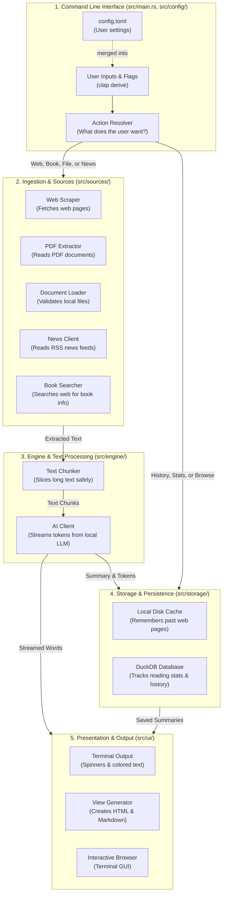

# Rust Architecture & Concepts Guide: `srz`

Welcome to `srz`! This guide explains the architecture of the codebase and highlights the **hows and whys** of coding in Rust.

Whether you are a **beginner**, **non-technical learner**, or an **experienced developer coming from Python, JavaScript, Go, or C++**, this guide uses simple real-world analogies, code snippets, and direct connections to [The Rust Programming Language](https://doc.rust-lang.org/book/) book to make Rust concepts easy to grasp.

---

## 1. System Architecture Diagram

At its core, `srz` takes an input target (a web link, a book title, or a document), extracts its text, condenses it with an AI model, and presents the summary in clean formats.



---

## 2. Key Components & Core Rust Concepts (Explained Simply)

### 2.1 The Entry Point & Safety Baseline (`src/main.rs`, `src/lib.rs`)

#### What this section does
`main.rs` is the conductor of the orchestra. It reads your command, decides what needs to happen, calls the right tools, and handles the output.

#### Core Rust Concepts

#### 1. `#![forbid(unsafe_code)]`
- 💡 **Simple Analogy:** A sealed airplane cockpit door. The flight rules strictly forbid opening it during flight, guaranteeing that nobody can accidentally bump an emergency switch.
- 🔍 **How it works:** Placed at the top of the codebase. It tells the compiler to reject any code that tries to use the `unsafe` keyword.
- 🔄 **If you know other languages:** In C or C++, any pointer mistake can crash your app (segmentation fault) or create security holes. Rust guarantees memory safety by default; this setting guarantees that no backdoor `unsafe` code can bypass that protection.
- 📖 **The Rust Book Reference:** [Chapter 19.1: Unsafe Rust](https://doc.rust-lang.org/book/ch19-01-unsafe-rust.html)

#### 2. Async Entry Point (`#[tokio::main]`)
- 💡 **Simple Analogy:** A busy restaurant waiter serving 10 tables at once. Instead of standing idle in the kitchen waiting for a steak to grill (blocking), the waiter delivers drinks to table 2, takes an order from table 3, and returns the second the steak is ready (non-blocking).
- 🔍 **How it works:**
  ```rust
  #[tokio::main]
  async fn main() -> Result<()> { ... }
  ```
- 🔄 **If you know other languages:** Similar to JavaScript's event loop (`async/await`) or Go's goroutines. In Rust, async is zero-cost—you only include an async runtime (like Tokio) when you need high-speed network I/O.
- 📖 **The Rust Book Reference:** [Chapter 17: Async and Await](https://doc.rust-lang.org/book/ch17-00-async-await.html)

#### 3. Modern Let-Chains (`if let ... && ...`)
- 💡 **Simple Analogy:** An airport boarding gate check: *"If your boarding pass is valid AND your passport is unexpired, please board the plane."*
- 🔍 **How it works:** Combines pattern matching and condition checks into a single line, avoiding nested "pyramids" of `if` statements.
- 📖 **The Rust Book Reference:** [Chapter 6.3: Concise Control Flow with `if let`](https://doc.rust-lang.org/book/ch06-03-if-let.html)

---

### 2.2 CLI Parsing & Configuration (`src/config/cli.rs`, `src/config/file.rs`)

#### What this section does
Converts raw command-line text typed by the user (like `srz https://example.com --model llama3`) into strongly-typed Rust variables.

#### Core Rust Concepts

#### 1. Derive Macros (`clap` & `serde`)
- 💡 **Simple Analogy:** Drawing a simple floor plan on paper, and having an automated robot 3D-print the entire furnished house overnight with all wiring and plumbing included.
- 🔍 **How it works:** You write a simple `struct` with field names and comments. Rust macros generate all the argument parsing, validation, and `--help` text at compile time.
- 🔄 **If you know other languages:** In Python (`argparse`) or JavaScript, command-line arguments are checked while the program runs. In Rust, the parser is verified at compile time, eliminating runtime crashes and startup lag.
- 📖 **The Rust Book Reference:** [Chapter 10.2: Traits](https://doc.rust-lang.org/book/ch10-02-traits.html) and [Chapter 19.5: Macros (Derive Macros)](https://doc.rust-lang.org/book/ch19-06-macros.html#how-to-write-a-custom-derive-macro)

#### 2. Enums with Payloads (Tagged Unions)
- 💡 **Simple Analogy:** A Swiss Army knife where each fold-out tool holds its own specific accessories. The screwdriver slot carries screwdriver bits; the scissors slot carries replacement springs. You can never accidentally put a screwdriver bit into the scissors.
- 🔍 **How it works:**
  ```rust
  pub enum ResolvedAction {
      Web { url: String },
      Book { title: String },
      History { limit: usize },
  }
  ```
  A `Web` command *only* holds a URL; a `History` command *only* holds a limit.
- 🔄 **If you know other languages:** In C, Java, or TypeScript, enums are usually just numbers or string labels. In Rust, each enum variant can carry unique data, making invalid combinations impossible to construct.
- 📖 **The Rust Book Reference:** [Chapter 6.1: Defining an Enum](https://doc.rust-lang.org/book/ch06-01-defining-an-enum.html)

#### 3. Exhaustive Pattern Matching (`match`)
- 💡 **Simple Analogy:** A strict postal sorting room with a designated bin for every single zip code. If a new zip code is introduced and there isn't a bin for it, the conveyor belt stops immediately until a bin is built.
- 🔍 **How it works:** If you add a new command variant, the Rust compiler refuses to compile until you explicitly handle it in every `match` statement.
- 🔄 **If you know other languages:** Unlike `switch` in C/Java where a missing `case` can silently cause bugs, Rust guarantees all possibilities are covered.
- 📖 **The Rust Book Reference:** [Chapter 6.2: The `match` Control Flow Construct](https://doc.rust-lang.org/book/ch06-02-match.html)

---

### 2.3 Web Scraping & Ingestion (`src/sources/`)

#### What this section does
Pulls data from web pages, PDFs, YouTube transcripts, and RSS feeds, stripping out unwanted advertisements and formatting.

#### Core Rust Concepts

#### 1. Lazy Initialization (`std::sync::LazyLock`)
- 💡 **Simple Analogy:** A motion-activated light. It draws zero electricity until someone steps into the room for the very first time, turns on smoothly, and stays on for everyone else safely.
- 🔍 **How it works:** Compiling HTML selectors is heavy on CPU. `LazyLock` compiles them once on first use, keeping them available across threads safely without complex locks.
- 📖 **The Rust Book Reference:** [Chapter 16.3: Shared-State Concurrency](https://doc.rust-lang.org/book/ch16-03-shared-state.html)

#### 2. Defensive Streaming & Limits
- 💡 **Simple Analogy:** A fuel tank nozzle with an automatic shutoff valve. If a pump tries to dump 1,000 gallons into a 10-gallon tank, the valve snaps shut before the tank overflows.
- 🔍 **How it works:** `read_response_bytes_limited` streams web data and aborts if the size exceeds safety limits, protecting the machine from crashing out of memory.
- 📖 **The Rust Book Reference:** [Chapter 4.1: What is Ownership?](https://doc.rust-lang.org/book/ch04-01-what-is-ownership.html)

#### 3. Ergonomic Error Handling (`Result` and `?`)
- 💡 **Simple Analogy:** A relay race baton. If a runner trips, they hand the "error baton" straight back out of the race to the team captain, rather than tumbling down the track and breaking other equipment.
- 🔍 **How it works:**
  ```rust
  let bytes = fs::read(path).context("Failed to read file")?;
  ```
  The `?` operator unwraps the success value or returns the error immediately.
- 🔄 **If you know other languages:** Python, Java, and C++ use exceptions (`try/catch`), which can be thrown invisibly from anywhere. Rust treats errors as explicit return values, making potential failures obvious in the code.
- 📖 **The Rust Book Reference:** [Chapter 9.2: Recoverable Errors with `Result`](https://doc.rust-lang.org/book/ch09-02-recoverable-errors-with-result.html)

---

### 2.4 Text Engine & LLM Client (`src/engine/`)

#### What this section does
Slices long text into manageable sections that fit into an AI's memory window, streams the text to a local LLM, and captures the generated response.

#### Core Rust Concepts

#### 1. Zero-Copy Deserialization (`#[serde(borrow)]`)
- 💡 **Simple Analogy:** Highlighting words directly in a physical letter mailed to you, instead of manually re-copying the entire letter word-for-word onto a separate notepad.
- 🔍 **How it works:** When an LLM sends 50 words per second, Rust reads strings by pointing directly into the network buffer (`&'a str`), copying zero bytes into heap memory.
- 🔄 **If you know other languages:** In Python or Go, parsing JSON allocates new strings in memory for every key and value. Rust allows "borrowing" directly from the raw incoming buffer, saving CPU and RAM.
- 📖 **The Rust Book Reference:** [Chapter 10.3: Validating References with Lifetimes](https://doc.rust-lang.org/book/ch10-03-lifetime-syntax.html)

#### 2. Clone-on-Write (`std::borrow::Cow<'a, str>`)
- 💡 **Simple Analogy:** Reading a library book with transparent sticky notes. You read the original text for free (borrowed). Only if you need to rewrite or reformat a sentence do you photocopy that page and write on your copy (owned/cloned).
- 🔍 **How it works:** If text needs no changes, `Cow::Borrowed` uses the original slice. If it requires trimming or edits, `Cow::Owned` lazily creates a new `String`.
- 📖 **The Rust Book Reference:** [Chapter 4.3: The Slice Type](https://doc.rust-lang.org/book/ch04-03-slices.html) and [Chapter 8.2: Strings](https://doc.rust-lang.org/book/ch08-02-strings.html)

#### 3. Higher-Order Functions & Closures (`FnMut`)
- 💡 **Simple Analogy:** A universal bread-slicing machine where you can swap out the slicing blade. You can insert a blade that cuts by number of slices, or a blade that cuts by weight, without rebuilding the whole machine.
- 🔍 **How it works:** The chunker accepts a counting function (`F: FnMut(&str) -> usize`), allowing the same logic to chunk text by word count or BPE tokens.
- 📖 **The Rust Book Reference:** [Chapter 13.1: Closures](https://doc.rust-lang.org/book/ch13-01-closures.html)

---

### 2.5 Storage, Database, & Cache (`src/storage/`)

#### What this section does
Saves summaries on disk so you don't have to re-summarize the same article twice, and tracks reading history and token performance in an embedded DuckDB database.

#### Core Rust Concepts

#### 1. Lifetimes in Structs (`NewSummaryRecord<'a>`)
- 💡 **Simple Analogy:** A visitor security badge that expires at 5:00 PM when your host leaves the office. The badge guarantees you cannot roam the building after your host has gone home.
- 🔍 **How it works:** The `'a` annotation ensures the record cannot outlive the strings it borrows, preventing "dangling pointers" (looking at memory that has already been erased).
- 📖 **The Rust Book Reference:** [Chapter 10.3: Lifetime Annotations in Struct Definitions](https://doc.rust-lang.org/book/ch10-03-lifetime-syntax.html#lifetime-annotations-in-struct-definitions)

#### 2. The Closure Loan Pattern (`with_db`)
- 💡 **Simple Analogy:** A safe deposit box at a bank. The vault manager unlocks the door for you, lets you store your envelope, and locks the heavy door behind you the moment you leave.
- 🔍 **How it works:**
  ```rust
  pub fn with_db(f: impl FnOnce(&Database) -> Result<()>) -> Result<()>
  ```
  Instead of each command opening and closing database connections manually, `with_db` handles connection setup, lends the database safely, and cleans it up.
- 📖 **The Rust Book Reference:** [Chapter 13.1: Closures](https://doc.rust-lang.org/book/ch13-01-closures.html) and [Chapter 15.3: The `Drop` Trait](https://doc.rust-lang.org/book/ch15-03-drop.html)

---

### 2.6 User Interface & Presentation (`src/ui/`)

#### What this section does
Prints colored terminal output, displays animated spinners, and provides a full-screen interactive library browser.

#### Core Rust Concepts

#### 1. Crash-Safe Terminals via RAII (`Drop`)
- 💡 **Simple Analogy:** A hotel room keycard that turns on the lights when inserted and turns off all electricity automatically when you remove the card and step outside.
- 🔍 **How it works:** Entering raw mode for a terminal UI changes terminal behavior. In Rust, the `Drop` trait automatically restores your normal terminal settings when the app exits—even if the app crashes or panics.
- 🔄 **If you know other languages:** In Python or C, an uncaught crash during a terminal GUI session often leaves the user's terminal scrambled and unresponsive. Rust's deterministic destructors prevent this.
- 📖 **The Rust Book Reference:** [Chapter 15.3: Running Code on Cleanup with the `Drop` Trait](https://doc.rust-lang.org/book/ch15-03-drop.html)

#### 2. Pre-allocating Capacity (`String::with_capacity`)
- 💡 **Simple Analogy:** Booking a bus for 30 passengers upfront, instead of hailing a 4-seater taxi, discovering it is full, hailing an 8-seater, and transferring luggage again and again.
- 🔍 **How it works:** Providing a capacity hint (`String::with_capacity(title.len())`) allocates the required memory once upfront, speeding up execution.
- 📖 **The Rust Book Reference:** [Chapter 8.2: Storing UTF-8 Encoded Text with Strings](https://doc.rust-lang.org/book/ch08-02-strings.html#updating-a-string)

---

### 2.7 System & OS Security (`src/system/`)

#### What this section does
Manages files, restricts folder permissions, and performs self-upgrades safely.

#### Core Rust Concepts

#### 1. Compile-Time OS Switches (`#[cfg(unix)]`)
- 💡 **Simple Analogy:** Packing winter coats for an Alaska trip and light shorts for a Hawaii trip *before* you leave, rather than carrying both outfits everywhere.
- 🔍 **How it works:** Unix-specific permissions (`0o600`) are compiled only on macOS/Linux. On Windows, that code is excluded at compile time, eliminating runtime errors.
- 📖 **The Rust Book Reference:** [Chapter 14.1: Customizing Builds with Release Profiles](https://doc.rust-lang.org/book/ch14-01-release-profiles.html)

---

## 3. Quick Reference: Rust Concepts in `srz`

| Concept | File Location | Real-World Analogy & Benefit | The Rust Book Reference |
| :--- | :--- | :--- | :--- |
| **`#![forbid(unsafe_code)]`** | `src/main.rs`, `src/lib.rs` | **Sealed cockpit door**: Guarantees zero memory corruption or crashes. | [Ch 19.1: Unsafe Rust](https://doc.rust-lang.org/book/ch19-01-unsafe-rust.html) |
| **`LazyLock<T>`** | `src/sources/scraper.rs` | **Motion-sensor light**: Safe, one-time, thread-safe initialization on demand. | [Ch 16.3: Shared-State Concurrency](https://doc.rust-lang.org/book/ch16-03-shared-state.html) |
| **`Cow<'a, str>`** | `src/engine/chunker.rs` | **Reading with sticky notes**: Avoids copying text until you actually edit it. | [Ch 4.3: Slices](https://doc.rust-lang.org/book/ch04-03-slices.html) & [Ch 8.2: Strings](https://doc.rust-lang.org/book/ch08-02-strings.html) |
| **`#[serde(borrow)]`** | `src/engine/llm.rs` | **Pointing directly at the letter**: Zero-copy JSON parsing from raw network buffers. | [Ch 10.3: Lifetimes](https://doc.rust-lang.org/book/ch10-03-lifetime-syntax.html) |
| **Enums with Payloads** | `src/config/cli.rs` | **Swiss Army Knife**: Each command carries only its specific tools and data. | [Ch 6.1: Defining an Enum](https://doc.rust-lang.org/book/ch06-01-defining-an-enum.html) |
| **Lifetimes (`'a`)** | `src/storage/db.rs` | **Expiring visitor pass**: Lets structs reference data without cloning, safely. | [Ch 10.3: Lifetimes in Structs](https://doc.rust-lang.org/book/ch10-03-lifetime-syntax.html#lifetime-annotations-in-struct-definitions) |
| **Closure Loan (`with_db`)** | `src/commands/mod.rs` | **Bank vault attendant**: Centralized connection acquisition and automatic cleanup. | [Ch 13.1: Closures](https://doc.rust-lang.org/book/ch13-01-closures.html) |
| **`#[cfg(unix)]`** | `src/system/fs_util.rs` | **Packing for the weather**: Zero-overhead platform-specific permissions. | [Ch 14.1: Release Profiles](https://doc.rust-lang.org/book/ch14-01-release-profiles.html) |

---

## 4. Hands-On Tutorial: Build "Mini-Srz" with Minimal Packages

In this tutorial, you will build a standalone, working Rust CLI tool from scratch that implements the core pipeline of `srz`:
1. **Command-Line Parsing**: Accepts a URL and optional flags (`--model`, `--base-url`, `--max-chars`).
2. **Web Scraping & Cleaning**: Fetches the webpage and extracts readable text by stripping HTML.
3. **Safe Text Truncation**: Slices text on Unicode boundaries with zero memory copies.
4. **Local LLM Summarization**: Sends an OpenAI-compatible JSON request to a local model (Ollama, LM Studio, etc.) and prints the summary.

---

### 🎯 The Educational Goal: Maximum Concepts, Minimum Packages

Rather than relying on heavy third-party frameworks for CLI parsing (`clap`), HTML DOM parsing (`scraper`), and error handling (`anyhow`), we keep external dependencies to the **absolute bare minimum** (just an async HTTP client and JSON serializer).

By leveraging the **Rust Standard Library**, you will directly practice:
- **Structs & Constructor Methods (`impl`)** ([Ch 5.3](https://doc.rust-lang.org/book/ch05-03-method-syntax.html))
- **Enums as State Machines** ([Ch 6.1](https://doc.rust-lang.org/book/ch06-01-defining-an-enum.html))
- **Pattern Matching with Match Guards** ([Ch 6.2](https://doc.rust-lang.org/book/ch06-02-match.html) & [Ch 18.3](https://doc.rust-lang.org/book/ch18-03-pattern-syntax.html#extra-conditionals-with-match-guards))
- **Iterators & Combinators (`lines`, `map`, `filter`, `collect`)** ([Ch 13.2](https://doc.rust-lang.org/book/ch13-02-iterators.html))
- **Trait Objects for Error Handling (`Box<dyn std::error::Error>`)** ([Ch 9.2](https://doc.rust-lang.org/book/ch09-02-recoverable-errors-with-result.html) & [Ch 12.3](https://doc.rust-lang.org/book/ch12-03-improving-error-handling-and-modularity.html))
- **Safe UTF-8 Slicing & Zero-Copy Memory (`&str`)** ([Ch 8.2](https://doc.rust-lang.org/book/ch08-02-strings.html) & [Ch 4.3](https://doc.rust-lang.org/book/ch04-03-slices.html))
- **Lifetimes in Data Models (`Message<'a>`)** ([Ch 10.3](https://doc.rust-lang.org/book/ch10-03-lifetime-syntax.html))
- **Null Safety with `Option` Combinators** ([Ch 6.1](https://doc.rust-lang.org/book/ch06-01-defining-an-enum.html#the-option-enum-and-its-advantages-over-null-values))
- **Async/Await I/O** ([Ch 17](https://doc.rust-lang.org/book/ch17-00-async-await.html))

---

### Step 1: Initialize a New Cargo Project

Open your terminal and run:

```bash
cargo new mini-srz
cd mini-srz
```

Cargo generates:
- `Cargo.toml`: Project manifest defining dependencies and compiler settings.
- `src/main.rs`: The binary entry point.

> 📖 **The Rust Book Connection**: [Chapter 1.3: Hello, Cargo!](https://doc.rust-lang.org/book/ch01-03-hello-cargo.html) and [Chapter 14: More About Cargo](https://doc.rust-lang.org/book/ch14-00-more-about-cargo.html)

---

### Step 2: Minimal Dependencies (`Cargo.toml`)

Open `Cargo.toml` and replace `[dependencies]` with only what is strictly necessary:

```toml
[package]
name = "mini-srz"
version = "0.1.0"
edition = "2021"

[dependencies]
# 1. Async runtime for non-blocking I/O
tokio = { version = "1", features = ["macros", "rt-multi-thread"] }

# 2. HTTP client to fetch web pages and send LLM requests
reqwest = { version = "0.12", features = ["json"] }

# 3. JSON serialization and deserialization
serde = { version = "1.0", features = ["derive"] }
serde_json = "1.0"
```

> 💡 **Notice what is missing!**
> - **No `clap`**: We parse CLI arguments using the standard library's `std::env::args()` iterator.
> - **No `scraper`**: We build an elegant 20-line HTML text stripper using a Rust `enum` state machine.
> - **No `anyhow`**: We use Rust's built-in `Box<dyn std::error::Error>` trait object.
>
> 📖 **The Rust Book Connection**: [Chapter 7.1: Packages and Crates](https://doc.rust-lang.org/book/ch07-01-packages-and-crates.html)

---

### Step 3: CLI Parsing with `std::env::args()` and Match Guards

Instead of pulling in a 50,000-line external CLI crate, we model our configuration with a `struct` and parse arguments directly using Rust's standard iterator methods:

```rust
struct Config {
    url: String,
    base_url: String,
    model: String,
    max_chars: usize,
}

impl Config {
    fn from_args(mut args: impl Iterator<Item = String>) -> Result<Self, String> {
        args.next(); // Skip executable path (argv[0])

        let mut url = None;
        let mut base_url = "http://localhost:11434/v1".to_string();
        let mut model = "llama3".to_string();
        let mut max_chars = 8000;

        while let Some(arg) = args.next() {
            match arg.as_str() {
                "--help" | "-h" => {
                    return Err(
                        "Usage: mini-srz <URL> [--base-url <URL>] [--model <NAME>] [--max-chars <NUM>]"
                            .to_string(),
                    );
                }
                "--base-url" => {
                    base_url = args
                        .next()
                        .ok_or_else(|| "Missing value for --base-url".to_string())?;
                }
                "--model" => {
                    model = args
                        .next()
                        .ok_or_else(|| "Missing value for --model".to_string())?;
                }
                "--max-chars" => {
                    let val = args
                        .next()
                        .ok_or_else(|| "Missing value for --max-chars".to_string())?;
                    max_chars = val
                        .parse::<usize>()
                        .map_err(|_| "Invalid number for --max-chars".to_string())?;
                }
                // Match guard: captures positional URL without leading hyphens
                val if !val.starts_with('-') && url.is_none() => {
                    url = Some(val.to_string());
                }
                unknown => {
                    return Err(format!("Unknown option: {}", unknown));
                }
            }
        }

        let url = url.ok_or_else(|| {
            "Error: Please provide a webpage URL as the first argument.\nRun with --help for usage instructions."
                .to_string()
        })?;

        Ok(Self {
            url,
            base_url,
            model,
            max_chars,
        })
    }
}
```

> 💡 **Rust Concepts Learned Here:**
> 1. **`impl Iterator<Item = String>`**: Accepts any iterator yielding strings (demonstrating trait-based abstraction without concrete types).
> 2. **Match Guard (`val if !val.starts_with('-')`)**: Adds extra conditional logic to pattern matching variants.
> 3. **`Option::ok_or_else`**: Smoothly converts an `Option<T>` into a `Result<T, E>`.
>
> 📖 **The Rust Book Connection**: [Chapter 12.1: Accepting Command Line Arguments](https://doc.rust-lang.org/book/ch12-01-accepting-command-line-arguments.html) and [Chapter 18.3: Match Guards](https://doc.rust-lang.org/book/ch18-03-pattern-syntax.html#extra-conditionals-with-match-guards)

---

### Step 4: HTML Stripping with a Pure Rust State Machine

Webpages contain HTML tags (`<p>`, `<div>`) and JavaScript/CSS blocks (`<script>`, `<style>`). We can strip them cleanly in pure Rust using an `enum` state machine:

```rust
enum HtmlState {
    Text,
    InsideTag,
    InsideScriptOrStyle,
}

fn strip_html_tags(html: &str) -> String {
    let mut state = HtmlState::Text;
    let mut clean_text = String::with_capacity(html.len() / 2);
    let mut current_tag = String::new();

    for ch in html.chars() {
        match state {
            HtmlState::Text => {
                if ch == '<' {
                    state = HtmlState::InsideTag;
                    current_tag.clear();
                } else {
                    clean_text.push(ch);
                }
            }
            HtmlState::InsideTag => {
                if ch == '>' {
                    let tag = current_tag.trim().to_lowercase();
                    if tag.starts_with("script") || tag.starts_with("style") {
                        state = HtmlState::InsideScriptOrStyle;
                    } else if tag == "p" || tag == "br" || tag == "div" || tag == "h1" || tag == "h2" || tag == "h3" {
                        clean_text.push('\n');
                        state = HtmlState::Text;
                    } else {
                        state = HtmlState::Text;
                    }
                } else {
                    current_tag.push(ch);
                }
            }
            HtmlState::InsideScriptOrStyle => {
                if ch == '<' {
                    current_tag.clear();
                } else if ch == '>' {
                    let tag = current_tag.trim().to_lowercase();
                    if tag.starts_with("/script") || tag.starts_with("/style") {
                        state = HtmlState::Text;
                    }
                } else {
                    current_tag.push(ch);
                }
            }
        }
    }

    // Clean up blank lines using iterator chaining
    clean_text
        .lines()
        .map(|line| line.trim())
        .filter(|line| !line.is_empty())
        .collect::<Vec<_>>()
        .join("\n\n")
}
```

> 💡 **Rust Concepts Learned Here:**
> 1. **Enums as State Machines (`enum HtmlState`)**: Tracks whether the parser is currently reading visible text, reading inside a tag, or ignoring script contents.
> 2. **Pre-allocating Buffers (`String::with_capacity`)**: Estimates memory size upfront to avoid repeated heap reallocations.
> 3. **Iterator Chaining (`.lines().map(...).filter(...).collect(...).join(...)`)**: Pure functional data transformation without explicit loop counters or indices.
>
> 📖 **The Rust Book Connection**: [Chapter 6.1: Defining an Enum](https://doc.rust-lang.org/book/ch06-01-defining-an-enum.html) and [Chapter 13.2: Processing a Series of Items with Iterators](https://doc.rust-lang.org/book/ch13-02-iterators.html)

---

### Step 5: Safe Text Processing (UTF-8 Slicing)

In Rust, strings are stored as **UTF-8 bytes**. If you slice raw bytes (`&text[..5000]`), your program will panic if index 5000 splits a multi-byte character (like an emoji or foreign letter) in half!

Here is the safe way to truncate text in Rust without memory allocations:

```rust
fn truncate_to_char_limit(text: &str, max_chars: usize) -> &str {
    match text.char_indices().nth(max_chars) {
        Some((byte_idx, _)) => &text[..byte_idx],
        None => text, // Text is shorter than max_chars
    }
}
```

> 💡 **Rust Concepts Learned Here:**
> - `&str` is a borrowed string slice (a pointer and a length).
> - `char_indices()` iterates over Unicode scalar values and gives their exact byte positions.
> - Returning `&text[..byte_idx]` creates a borrowed slice with **zero heap memory allocations**.
>
> 📖 **The Rust Book Connection**: [Chapter 8.2: Strings (Slicing Strings)](https://doc.rust-lang.org/book/ch08-02-strings.html#slicing-strings) and [Chapter 4.3: The Slice Type](https://doc.rust-lang.org/book/ch04-03-slices.html)

---

### Step 6: Calling the Local LLM with Lifetimes & Zero-Copy

Define the request and response shapes matching OpenAI's `/v1/chat/completions` API:

```rust
type AppResult<T> = Result<T, Box<dyn std::error::Error>>;

#[derive(Serialize)]
struct Message<'a> {
    role: &'a str,
    content: &'a str,
}

#[derive(Serialize)]
struct ChatRequest<'a> {
    model: &'a str,
    messages: Vec<Message<'a>>,
    temperature: f32,
}

#[derive(Deserialize)]
struct ChatResponse {
    choices: Vec<ChatChoice>,
}

#[derive(Deserialize)]
struct ChatChoice {
    message: ResponseMessage,
}

#[derive(Deserialize)]
struct ResponseMessage {
    content: String,
}

async fn fetch_page_text(url: &str) -> AppResult<String> {
    let client = reqwest::Client::builder()
        .user_agent("mini-srz/0.1")
        .build()?;

    let html = client.get(url).send().await?.text().await?;
    let text = strip_html_tags(&html);

    if text.trim().is_empty() {
        return Err("No readable text content found on the webpage.".into());
    }

    Ok(text)
}

async fn summarize_with_llm(base_url: &str, model: &str, text: &str) -> AppResult<String> {
    let client = reqwest::Client::new();
    let prompt = format!(
        "Please provide a concise summary with key bullet points for the following text:\n\n{}",
        text
    );

    let request_payload = ChatRequest {
        model,
        messages: vec![
            Message {
                role: "system",
                content: "You are a concise, helpful assistant.",
            },
            Message {
                role: "user",
                content: &prompt,
            },
        ],
        temperature: 0.3,
    };

    let endpoint = format!("{}/chat/completions", base_url.trim_end_matches('/'));

    let response: ChatResponse = client
        .post(&endpoint)
        .json(&request_payload)
        .send()
        .await?
        .error_for_status()?
        .json()
        .await?;

    let summary = response
        .choices
        .first()
        .map(|c| c.message.content.clone())
        .unwrap_or_else(|| "No summary generated.".to_string());

    Ok(summary)
}
```

> 💡 **Rust Concepts Learned Here:**
> 1. **Trait Object Error (`Box<dyn std::error::Error>`)**: Allows returning any error type with `?` without external error-handling libraries.
> 2. **Lifetimes in Structs (`Message<'a>`)**: Borrows string slices directly from memory without duplicating strings onto the heap.
> 3. **Null Safety with `Option` Combinators**: `.first().map(...).unwrap_or_else(...)` completely avoids null pointer exceptions.
>
> 📖 **The Rust Book Connection**: [Chapter 10.3: Lifetimes](https://doc.rust-lang.org/book/ch10-03-lifetime-syntax.html) and [Chapter 12.3: Splitting Code into Modules and Error Handling](https://doc.rust-lang.org/book/ch12-03-improving-error-handling-and-modularity.html)

---

### Step 7: Complete, Self-Contained `src/main.rs`

Replace `src/main.rs` with the complete, cohesive program:

```rust
use serde::{Deserialize, Serialize};
use std::env;

type AppResult<T> = Result<T, Box<dyn std::error::Error>>;

// ============================================================================
// 1. CLI Configuration (Pure Standard Library)
// ============================================================================

struct Config {
    url: String,
    base_url: String,
    model: String,
    max_chars: usize,
}

impl Config {
    fn from_args(mut args: impl Iterator<Item = String>) -> Result<Self, String> {
        args.next(); // Skip executable path

        let mut url = None;
        let mut base_url = "http://localhost:11434/v1".to_string();
        let mut model = "llama3".to_string();
        let mut max_chars = 8000;

        while let Some(arg) = args.next() {
            match arg.as_str() {
                "--help" | "-h" => {
                    return Err(
                        "Usage: mini-srz <URL> [--base-url <URL>] [--model <NAME>] [--max-chars <NUM>]"
                            .to_string(),
                    );
                }
                "--base-url" => {
                    base_url = args
                        .next()
                        .ok_or_else(|| "Missing value for --base-url".to_string())?;
                }
                "--model" => {
                    model = args
                        .next()
                        .ok_or_else(|| "Missing value for --model".to_string())?;
                }
                "--max-chars" => {
                    let val = args
                        .next()
                        .ok_or_else(|| "Missing value for --max-chars".to_string())?;
                    max_chars = val
                        .parse::<usize>()
                        .map_err(|_| "Invalid number for --max-chars".to_string())?;
                }
                val if !val.starts_with('-') && url.is_none() => {
                    url = Some(val.to_string());
                }
                unknown => {
                    return Err(format!("Unknown option: {}", unknown));
                }
            }
        }

        let url = url.ok_or_else(|| {
            "Error: Please provide a webpage URL as the first argument.\nRun with --help for usage instructions."
                .to_string()
        })?;

        Ok(Self {
            url,
            base_url,
            model,
            max_chars,
        })
    }
}

// ============================================================================
// 2. HTML Text Extraction (Pure Rust State Machine)
// ============================================================================

enum HtmlState {
    Text,
    InsideTag,
    InsideScriptOrStyle,
}

fn strip_html_tags(html: &str) -> String {
    let mut state = HtmlState::Text;
    let mut clean_text = String::with_capacity(html.len() / 2);
    let mut current_tag = String::new();

    for ch in html.chars() {
        match state {
            HtmlState::Text => {
                if ch == '<' {
                    state = HtmlState::InsideTag;
                    current_tag.clear();
                } else {
                    clean_text.push(ch);
                }
            }
            HtmlState::InsideTag => {
                if ch == '>' {
                    let tag = current_tag.trim().to_lowercase();
                    if tag.starts_with("script") || tag.starts_with("style") {
                        state = HtmlState::InsideScriptOrStyle;
                    } else if tag == "p" || tag == "br" || tag == "div" || tag == "h1" || tag == "h2" || tag == "h3" {
                        clean_text.push('\n');
                        state = HtmlState::Text;
                    } else {
                        state = HtmlState::Text;
                    }
                } else {
                    current_tag.push(ch);
                }
            }
            HtmlState::InsideScriptOrStyle => {
                if ch == '<' {
                    current_tag.clear();
                } else if ch == '>' {
                    let tag = current_tag.trim().to_lowercase();
                    if tag.starts_with("/script") || tag.starts_with("/style") {
                        state = HtmlState::Text;
                    }
                } else {
                    current_tag.push(ch);
                }
            }
        }
    }

    clean_text
        .lines()
        .map(|line| line.trim())
        .filter(|line| !line.is_empty())
        .collect::<Vec<_>>()
        .join("\n\n")
}

// ============================================================================
// 3. UTF-8 Safe Text Truncation
// ============================================================================

fn truncate_to_char_limit(text: &str, max_chars: usize) -> &str {
    match text.char_indices().nth(max_chars) {
        Some((byte_idx, _)) => &text[..byte_idx],
        None => text,
    }
}

// ============================================================================
// 4. Local LLM Request & Response Models (Zero-Copy Lifetimes)
// ============================================================================

#[derive(Serialize)]
struct Message<'a> {
    role: &'a str,
    content: &'a str,
}

#[derive(Serialize)]
struct ChatRequest<'a> {
    model: &'a str,
    messages: Vec<Message<'a>>,
    temperature: f32,
}

#[derive(Deserialize)]
struct ChatResponse {
    choices: Vec<ChatChoice>,
}

#[derive(Deserialize)]
struct ChatChoice {
    message: ResponseMessage,
}

#[derive(Deserialize)]
struct ResponseMessage {
    content: String,
}

// ============================================================================
// 5. Network Pipelines
// ============================================================================

async fn fetch_page_text(url: &str) -> AppResult<String> {
    let client = reqwest::Client::builder()
        .user_agent("mini-srz/0.1")
        .build()?;

    let html = client.get(url).send().await?.text().await?;
    let text = strip_html_tags(&html);

    if text.trim().is_empty() {
        return Err("No readable text content found on the webpage.".into());
    }

    Ok(text)
}

async fn summarize_with_llm(base_url: &str, model: &str, text: &str) -> AppResult<String> {
    let client = reqwest::Client::new();
    let prompt = format!(
        "Please provide a concise summary with key bullet points for the following text:\n\n{}",
        text
    );

    let request_payload = ChatRequest {
        model,
        messages: vec![
            Message {
                role: "system",
                content: "You are a concise, helpful assistant.",
            },
            Message {
                role: "user",
                content: &prompt,
            },
        ],
        temperature: 0.3,
    };

    let endpoint = format!("{}/chat/completions", base_url.trim_end_matches('/'));

    let response: ChatResponse = client
        .post(&endpoint)
        .json(&request_payload)
        .send()
        .await?
        .error_for_status()?
        .json()
        .await?;

    let summary = response
        .choices
        .first()
        .map(|c| c.message.content.clone())
        .unwrap_or_else(|| "No summary generated.".to_string());

    Ok(summary)
}

// ============================================================================
// 6. Application Entry Point
// ============================================================================

#[tokio::main]
async fn main() {
    let config = match Config::from_args(env::args()) {
        Ok(cfg) => cfg,
        Err(err_msg) => {
            eprintln!("{}", err_msg);
            std::process::exit(1);
        }
    };

    println!("🌐 Scraping: {}", config.url);
    let page_text = match fetch_page_text(&config.url).await {
        Ok(t) => t,
        Err(e) => {
            eprintln!("❌ Failed to fetch webpage: {}", e);
            std::process::exit(1);
        }
    };

    let char_count = page_text.chars().count();
    println!("📄 Extracted {} characters of text.", char_count);

    let processed_text = truncate_to_char_limit(&page_text, config.max_chars);

    println!("🤖 Generating summary with model '{}'...", config.model);
    let summary = match summarize_with_llm(&config.base_url, &config.model, processed_text).await {
        Ok(s) => s,
        Err(e) => {
            eprintln!("❌ LLM summarization failed: {}", e);
            std::process::exit(1);
        }
    };

    println!("\n{}", "=".repeat(50));
    println!("SUMMARY");
    println!("{}\n", "=".repeat(50));
    println!("{}", summary.trim());
}
```

---

### Step 8: Build and Run

1. **Check code compilation:**
   ```bash
   cargo check
   ```

2. **Test help message:**
   ```bash
   cargo run -- --help
   ```

3. **Run against any website using your local model (e.g. Ollama with `llama3`):**
   ```bash
   cargo run -- https://en.wikipedia.org/wiki/Rust_(programming_language) --model llama3
   ```

---

### 📋 Concepts Mastered in This Tutorial

| Concept | Where It Was Used in Mini-Srz | What It Achieved |
| :--- | :--- | :--- |
| **`Iterator` Trait** | `Config::from_args(args)` | Walked command-line arguments without index out-of-bounds risks |
| **Match Guards** | `val if !val.starts_with('-')` | Distinguished positional URL arguments from optional flags |
| **Enums as State Machines** | `enum HtmlState` | Cleanly stripped HTML tags without needing a 3rd-party parser crate |
| **Memory Pre-allocation** | `String::with_capacity` | Eliminated continuous heap reallocations while cleaning text |
| **Iterator Combinators** | `.lines().map().filter().collect().join()` | Transformed and cleaned multi-line strings in pure functional style |
| **Safe UTF-8 Slicing** | `char_indices().nth()` | Prevented slicing in the middle of multi-byte Unicode characters |
| **Borrowing & Lifetimes** | `struct Message<'a> { content: &'a str }` | Passed string slices to JSON serializers without duplicating memory |
| **Trait Object Errors** | `Box<dyn std::error::Error>` | Propagated multiple error types smoothly using `?` |
| **Null Safety** | `.first().map().unwrap_or_else()` | Eliminated null pointer crashes when reading LLM responses |
| **Async/Await** | `async fn fetch_page_text()`, `tokio` | Handled non-blocking HTTP network I/O with zero thread overhead |

