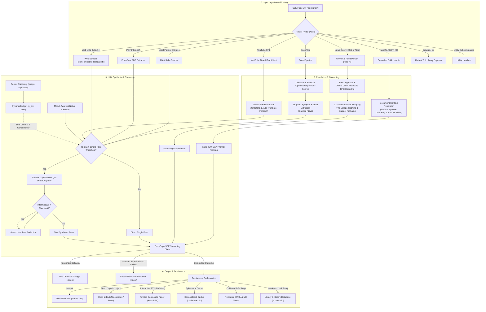
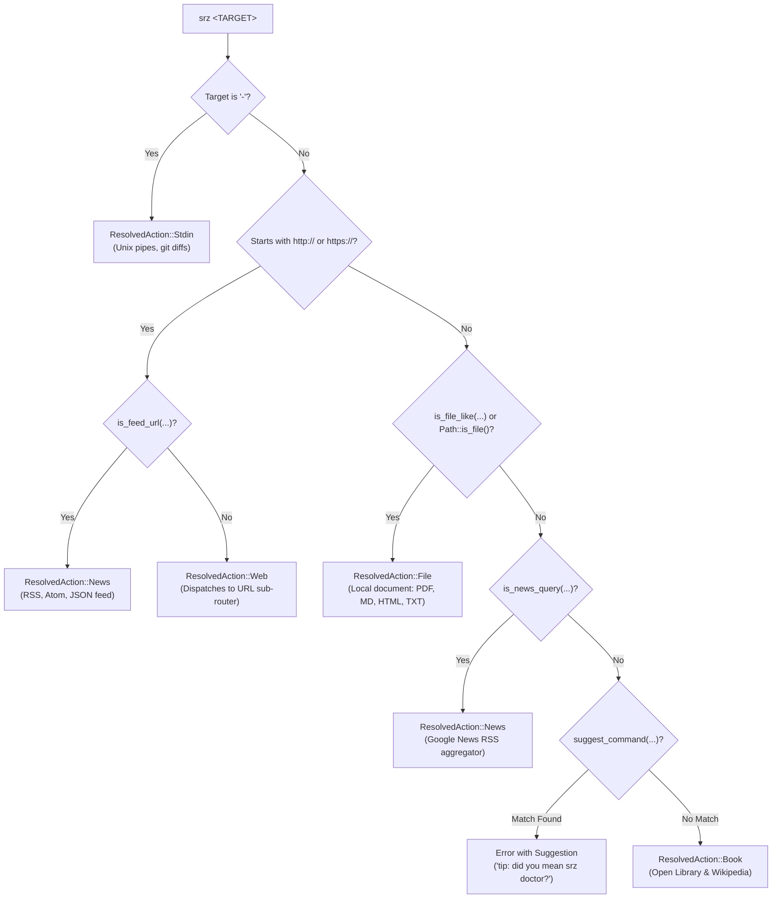
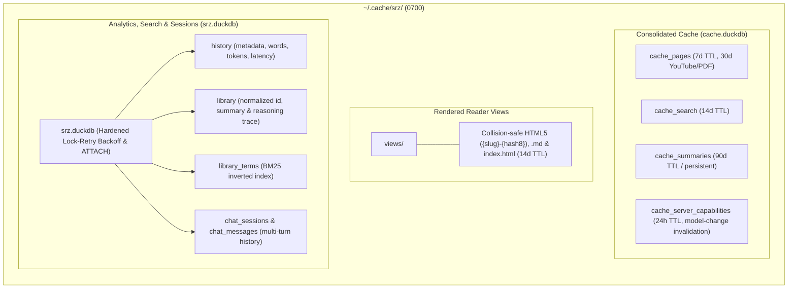

# Architecture & Design

`srz` (Summarize) is a modular, high-performance Rust CLI tool for extracting and synthesizing structured summaries from **webpages**, **YouTube video transcripts**, **PDFs & local documents**, **Unix stdin streams**, **books**, and **live news digests** using local OpenAI-compliant LLMs (`llama.cpp`, `Ollama`, `LM Studio`, `vLLM`).

It is engineered for instantaneous responsiveness, low memory overhead, and 100% local privacy.

---

## 1. High-Level Subsystem Architecture



### Subsystem Directory Organization

```text
src/
├── commands/     # CLI subcommand workflows (summarize, ask, library, diagnostics)
├── config/       # CLI parsing, auto-detection heuristics, and config file profiles
├── engine/       # SSE streaming client, dynamic token budgeting, and chunkers
├── sources/      # Content ingestion: web scraper, book search, YouTube, and feeds
├── storage/      # Embedded DuckDB cache, library database, and pruning
├── system/       # Hardware profiling, text sanitization, atomic filesystem, and updater
├── ui/           # Terminal console formatting, spinners, streaming renderer, and TUI
├── lib.rs        # Library crate root and public module exports
└── main.rs       # Binary entry point and CLI orchestration
```

### Module Responsibilities

| Subsystem | File | Module | Primary Responsibility |
| :--- | :--- | :--- | :--- |
| **Entry Points** | [`src/main.rs`](https://github.com/NewGuy012/srz/blob/master/src/main.rs) | `main` | Application lifecycle, config resolution, signal routing, and CLI dispatch. |
| | [`src/lib.rs`](https://github.com/NewGuy012/srz/blob/master/src/lib.rs) | `lib` | Root library interface and backward-compatible module re-exports. |
| **Commands** | [`src/commands/summarize.rs`](https://github.com/NewGuy012/srz/blob/master/src/commands/summarize.rs) | `commands::summarize` | Summarization workflows for web, YouTube, documents, stdin, and books. |
| | [`src/commands/ask.rs`](https://github.com/NewGuy012/srz/blob/master/src/commands/ask.rs) | `commands::ask` | Grounded Q&A, stop-word filtered in-memory BM25 chunk selection, automatic re-fetching on cache expiration, interactive REPL (`rustyline`), and DuckDB chat persistence. |
| | [`src/commands/library.rs`](https://github.com/NewGuy012/srz/blob/master/src/commands/library.rs) | `commands::library` | Handlers for `history`, `stats`, `find` (BM25), `query` (SQL), and `export`. |
| | [`src/commands/diagnostics.rs`](https://github.com/NewGuy012/srz/blob/master/src/commands/diagnostics.rs) | `commands::diagnostics` | Backend verification (`doctor`), model enumeration, and config inspection. |
| **Configuration** | [`src/config/cli.rs`](https://github.com/NewGuy012/srz/blob/master/src/config/cli.rs) | `config::cli` | `clap` CLI parser, style presets, flags, and target auto-detection heuristics. |
| | [`src/config/file.rs`](https://github.com/NewGuy012/srz/blob/master/src/config/file.rs) | `config::file` | `config.toml` profiles, configuration loading, and template generation. |
| **Engine** | [`src/engine/llm.rs`](https://github.com/NewGuy012/srz/blob/master/src/engine/llm.rs) | `engine::llm` | Zero-copy SSE client, server discovery (`/props`), native `/tokenize`, and rate tracking. |
| | [`src/engine/budget.rs`](https://github.com/NewGuy012/srz/blob/master/src/engine/budget.rs) | `engine::budget` | Dynamic token budgeting (`DynamicBudget`) scaling chunks and worker slots. |
| | [`src/engine/chunker.rs`](https://github.com/NewGuy012/srz/blob/master/src/engine/chunker.rs) | `engine::chunker` | BPE token counting (`tiktoken-rs`), $O(1)$ fast paths, and paragraph chunking. |
| **Sources** | [`src/sources/document.rs`](https://github.com/NewGuy012/srz/blob/master/src/sources/document.rs) | `sources::document` | Local document validation (20 MB cap), text extraction, and sanitization. |
| | [`src/sources/scraper.rs`](https://github.com/NewGuy012/srz/blob/master/src/sources/scraper.rs) | `sources::scraper` | HTTP client (10 MB cap), Mozilla Readability DOM parsing (`dom_smoothie`), and Markdown conversion. |
| | [`src/sources/pdf.rs`](https://github.com/NewGuy012/srz/blob/master/src/sources/pdf.rs) | `sources::pdf` | Pure-Rust single-pass PDF text layer and metadata extraction (`pdf-extract`). |
| | [`src/sources/youtube.rs`](https://github.com/NewGuy012/srz/blob/master/src/sources/youtube.rs) | `sources::youtube` | Video ID parsing, Innertube client, XML/JSON3 caption streaming, chapter cue grouping (`parse_chapters_from_description`), and auto-translate (`&tlang=en`) fallback. |
| | [`src/sources/search.rs`](https://github.com/NewGuy012/srz/blob/master/src/sources/search.rs) | `sources::search` | Concurrent fan-out Open Library metadata & search candidates, candidate ranking, and targeted Wikipedia synopsis extraction (`extract_wikipedia_synopsis`). |
| | [`src/sources/news.rs`](https://github.com/NewGuy012/srz/blob/master/src/sources/news.rs) | `sources::news` | Syndication feeds (`feed-rs`), zero-network offline `CBMi` protobuf decoding, pre-scrape caching, RPC fallback, and RSS snippet fallback on paywalled links. |
| **Storage** | [`src/storage/cache.rs`](https://github.com/NewGuy012/srz/blob/master/src/storage/cache.rs) | `storage::cache` | Single-write DuckDB cache (`cache.duckdb`), collision-safe views, and LRU pruning. |
| | [`src/storage/db.rs`](https://github.com/NewGuy012/srz/blob/master/src/storage/db.rs) | `storage::db` | Embedded DuckDB database (`srz.duckdb`), BM25 index, lock-retry backoff, and chat tables. |
| **UI & Render** | [`src/ui/terminal.rs`](https://github.com/NewGuy012/srz/blob/master/src/ui/terminal.rs) | `ui::terminal` | CLI progress spinners (`indicatif`) and terminal escape sanitization. |
| | [`src/ui/printer.rs`](https://github.com/NewGuy012/srz/blob/master/src/ui/printer.rs) | `ui::printer` | `MadSkin` terminal Markdown, line-buffered stream rendering, and pager integration. |
| | [`src/ui/tui.rs`](https://github.com/NewGuy012/srz/blob/master/src/ui/tui.rs) | `ui::tui` | Full-screen interactive terminal explorer (`ratatui`) with live search. |
| | [`src/ui/render.rs`](https://github.com/NewGuy012/srz/blob/master/src/ui/render.rs) | `ui::render` | HTML reader generator (`pulldown-cmark`) with collapsible thought drawers. |
| **System** | [`src/system/hardware.rs`](https://github.com/NewGuy012/srz/blob/master/src/system/hardware.rs) | `system::hardware` | Host RAM/CPU detection (`sysinfo`) and Gemma 4 model advisories. |
| | [`src/system/text_util.rs`](https://github.com/NewGuy012/srz/blob/master/src/system/text_util.rs) | `system::text_util` | Fast HTML decoding, ASCII case-insensitive search, and zero-copy string utilities. |
| | [`src/system/fs_util.rs`](https://github.com/NewGuy012/srz/blob/master/src/system/fs_util.rs) | `system::fs_util` | Platform filesystem helpers, `0700`/`0600` permissions, and atomic file writes. |
| | [`src/system/upgrade.rs`](https://github.com/NewGuy012/srz/blob/master/src/system/upgrade.rs) | `system::upgrade` | In-place self-updater with release queries, SHA-256 verification, and atomic swap. |

---

## 2. Request & Execution Lifecycle

The sequence diagram below illustrates the end-to-end flow when summarizing a target:

```mermaid
sequenceDiagram
    autonumber
    actor User
    participant CLI as CLI & Router
    participant Cache as Disk Cache (~/.cache/srz)
    participant Search as BookSearcher & Open Library
    participant Scraper as WebScraper
    participant LLM as LlmClient (SseStreamState)
    participant DB as DuckDB (Lazy Init)

    User->>CLI: srz "The Hobbit"
    CLI->>Cache: Check summary cache (kind, title, style, model)
    alt Cache Hit (srz.duckdb Bypassed)
        Cache-->>CLI: Return cached summary
        CLI->>Cache: Verify existing HTML/MD reader view files
        CLI->>User: Print summary & clickable file:// links (<1ms)
    else Cache Miss
        CLI->>Search: Resolve Open Library metadata & ranked candidates
        opt Ambiguous Top Candidates (Interactive TTY)
            CLI->>User: Prompt selection [1-4, Enter for 1]
        end
        CLI->>Scraper: Fetch & clean canonical reference article
        CLI->>LLM: POST /v1/chat/completions (stream: true)
        loop Zero-Copy SSE Stream
            LLM-->>CLI: Live dimmed reasoning trace on stderr (💭 Thinking...)
            Note over CLI,User: Incremental line-buffered Markdown on stdout (--stream)
        end
        CLI->>Cache: Persist to cache.duckdb & render collision-safe views
        CLI->>DB: Lazily open srz.duckdb (lock-retry backoff) & transactional INSERT
        alt Interactive TTY
            CLI-->>User: Unified document in pager (Header + Body + Links + Hint)
        else Piped / Redirected
            CLI-->>User: Pure Markdown/JSON on stdout; view links & hints on stderr
        end
    end
```

### Execution Lifecycle Phases

1. **Sub-Millisecond Cache Fast-Path**: Probes embedded `cache.duckdb` using a deterministic key `(target, model, style)`. On a hit, cached content is returned immediately and reader view files on disk are verified. The permanent database (`srz.duckdb`) is bypassed entirely.
2. **Quarantined Content Ingestion**: On a cache miss, source content is fetched under strict safety limits (10 MB web payload ceiling, 20 MB local file cap). Untrusted text is stripped of ads and navigation menus via Mozilla Readability, then quarantined inside `<source_document>` XML boundary tags.
3. **Zero-Copy Streaming Inference**: Prompts are dispatched with Server-Sent Events (`stream: true`). Reasoning tokens (`<think>` or `reasoning_content`) are routed directly to `stderr` as a dimmed chain-of-thought trace (`💭 Thinking...`). Content tokens are rendered incrementally via line-buffered ANSI formatting (`StreamMarkdownRenderer`) when `--stream` is active, or buffered until completion.
4. **Atomic Persistence**: The final summary is committed to `cache.duckdb`, deterministic reader views (`views/{slug}-{hash8}.html` and `.md`) are written with collapsible thought drawers, and `srz.duckdb` is opened using lock-retry exponential backoff to record history and BM25 search tokens.
5. **Clean Unix Stream Separation**: When piped or in machine mode (`--plain`, `--json`), `stdout` receives pure text without ANSI escapes, URLs, or hints; diagnostics are routed to `stderr`. On interactive terminals, headers, styled Markdown, links, and hints are bundled into a single buffer and piped into `$PAGER` (`less -RFX`) if taller than the viewport.

---

## 3. Ingestion Router & Auto-Detection Subsystem

Rather than requiring dedicated subcommands like `srz web`, `srz file`, or `srz book`, `srz <TARGET>` inspects input structure and semantics to dispatch targets automatically.

### Target Classification Decision Flow



### Dispatch Rules & Sub-Routing

* **Standard Input (`-`)**: Targets equal to `"-"` route to `ResolvedAction::Stdin` for pipeline composability (`git diff | srz -`).
* **Web & Feeds**: URLs starting with `http://` or `https://` are inspected by `is_feed_url` for feed suffixes (`.rss`, `.atom`, `/feed`, `/rss.xml`, `/feed.json`) or query parameters (`?format=rss`). Feeds route to `ResolvedAction::News`; standard links route to `ResolvedAction::Web`.
* **Local Documents**: Checked via `is_file_like` and `Path::is_file()`. Recognizes paths starting with `./`, `../`, `/`, `~`, or containing path separators, as well as document extensions (`.pdf`, `.md`, `.txt`, `.html`, `.epub`, `.json`). Handled under a 20 MB ceiling.
* **Natural News Queries**: Queries starting with `news`, `headlines`, or `"current/latest ... updates/stories"` route to Google News RSS via `clean_news_query`.
* **Command Typo Guardrail**: Single-word inputs matching known subcommands within a small edit distance trigger an error with a suggestion (e.g. `srz doctur` $\rightarrow$ `doctor`), preventing mistyped commands from falling through to book search.
* **Fallback (Books)**: All remaining freeform text is treated as a book title (`ResolvedAction::Book`), resolving metadata across Open Library and Wikipedia.
* **URL Content Sub-Routing (`fetch_url_content`)**:
  * **YouTube**: `extract_youtube_video_id` detects video URLs and routes to the timed-text caption client, downloading XML/JSON3 subtitles without video media.
  * **Remote PDFs**: URLs ending in `.pdf` stream directly into the pure-Rust PDF parser.
  * **Web Articles**: Scraped via `reqwest` and cleaned using Mozilla Readability (`dom_smoothie`).
* **Interactive Q&A Disambiguation (`srz ask`)**: `is_probable_question` checks for question marks or interrogative prefixes (`what`, `how`, `why`, etc.). When only a question is provided, the target defaults to `None`, automatically grounding queries against the **most recent summary** in DuckDB.
* **Multi-Model Router Detection**: When probing `llama.cpp`'s `GET /props`, proxy gateways often return `role: "router"` or `n_ctx: 0`. `srz` detects this and automatically re-probes `GET /props?model=<MODEL>` to acquire model-specific context and slot allocations.

---

## 4. Storage & Cache Architecture

All state is stored under `~/.cache/srz/` (or `$XDG_CACHE_HOME/srz/`) with private `0700`/`0600` permissions:



### Retention Policies & Storage Engine Design

| Namespace / Asset | Retention Policy (TTL) | Eviction Trigger | Notes |
| :--- | :--- | :--- | :--- |
| **`cache_pages`** | **7 days** | SQL TTL expiration / LRU | Scraped DOM and clean text; YouTube & PDFs retain 30 days. |
| **`cache_search`** | **14 days** | SQL TTL expiration / LRU | Open Library and search metadata. |
| **`cache_summaries`** | **90 days** | LRU past max budget | Deterministic for `(target, model, style)`. |
| **`cache_server_capabilities`**| **24 hours** | TTL / Model change | Probed `n_ctx`, `total_slots`, and model descriptors. |
| **`views/`** | **14 days** | TTL expiration / LRU | `{slug}-{hash8}.html` and `.md` reader views with reasoning drawers. |
| **Total Cache Budget** | **500 MB** (configurable) | Unified SQL + disk LRU eviction | Evicts oldest entries across DuckDB and `views/` to 85% headroom. |
| **Auto-Prune Schedule** | **Opportunistic (24h)** | Deferred past fast-exit commands | Throttled via `.last_prune` with sub-millisecond overhead. |
| **Library (`srz.duckdb`)** | **Permanent** | Explicit `--reset-db` only | Normalized history, full summaries, reasoning traces, and BM25 index. |

* **Single-Write Architecture**: All transient artifacts live inside embedded `cache.duckdb`, preventing filesystem inode exhaustion and enabling sub-millisecond SQL TTL evaluation via `epoch_ms(cached_at)`.
* **Normalized Library & Reasoning**: `srz.duckdb` stores telemetry in `history` while summary text and complete reasoning traces reside in `library`, avoiding redundancy.
* **Collision-Safe Slugs**: View files use `slugify_unique(title, key)` appending an 8-character SHA-256 hash (`{slug}-{hash8}.html`), preventing file collisions across pages with identical titles.
* **Lock Contention Resilience**: Database connections use `open_hardened_duckdb_file_with_retry` with exponential backoff and jitter (up to 5 retries, 50–400ms) to safely support concurrent CLI processes.

---

## 5. Offline BM25 Full-Text Search

When executing `srz find <QUERY>`, relevance scores are evaluated offline in pure DuckDB SQL using the Robertson-Sparck Jones BM25 formula:

$$
\text{Score}(D, Q) = \sum_{t \in Q} \text{IDF}(t) \cdot w(t) \cdot \frac{f(t, D) \cdot (k_1 + 1)}{f(t, D) + k_1 \cdot \left(1 - b + b \cdot \frac{|D|}{\text{avgdl}}\right)}
$$

$$
\text{IDF}(t) = \ln\left( \frac{N - n(t) + 0.5}{n(t) + 0.5} + 1.0 \right)
$$

| Symbol | Parameter | Value / Role |
| :--- | :--- | :--- |
| $f(t, D)$ | Term Frequency | Frequency of query term $t$ in document $D$. |
| $w(t)$ | Field Weight | **2.5× Title Boost** for matches in document titles vs 1.0× in summary bodies. |
| $k_1$ | Saturation | `1.2`: Controls non-linear scaling of repeated term matches. |
| $b$ | Length Normalization | `0.75`: Penalizes verbose documents relative to average library length (`avgdl`). |
| $N$, $n(t)$ | Document Counts | $N$ is total library documents; $n(t)$ is document frequency of term $t$. |

The search executes using SQL Common Table Expressions (CTEs) directly against the inverted index table (`library_terms`). BM25 scores and preview snippets are computed in under 2 milliseconds without background search daemons.

---

## 6. Hardware-Aware Inference & Dynamic Budgeting

### Hardware Profiling & Gemma 4 Steering

`srz` detects host RAM and CPU architecture across macOS (`sysctl`), Linux (`/proc/meminfo`), and Windows (WMI) without C FFI dependencies. It classifies machines into memory tiers to recommend optimal models and context windows:

* **Google Gemma 4 (`Q8_0`) as Reference Profile**: Gemma 4 offers high parameter density and long-context coherence with low power consumption on battery. 8-bit `Q8_0` quantization avoids the semantic drift of aggressive 4-bit quantizations while fitting within modern unified RAM budgets. See the [Hardware Tier Reference Matrix](quickstart.md#hardware-tier-reference-matrix) for details.

### Synthesis Strategy: Single-Pass vs. Map-Reduce

* **Single-Pass**: Used when the document's token count is within ~70% of the server's context window (`n_ctx`). Preserves complete cross-chapter attention without fragmentation.
* **Map-Reduce & Hierarchical Tree Reduction**: When a document exceeds the single-pass threshold, `srz` partitions text into overlapping chunks sized strictly by `DynamicBudget`. Chunks are summarized in parallel across available inference slots (`total_slots`). If intermediate section summaries exceed the single-pass limit, `srz` groups them into consolidation batches and reduces them hierarchically before final synthesis.

### Dynamic Token Budgeting & Zero-Drift Calibration

Hardcoded token limits lead to Out-of-Memory crashes or underutilized context. `srz` queries the backend server capabilities and enforces a runtime capacity invariant:

$$
\text{effective\_ctx} = \text{prompt\_chunk} + \text{reserve\_completion} + \text{headroom} \le n_{\text{ctx}}
$$

* **Prompt Chunk**: ~45% of total context (bounded between 1,024 and 65,536 tokens).
* **Reserve Completion**: ~30% of total context (bounded between 512 and 8,192 tokens).
* **Safety Headroom**: ~25% (bounded between 512 and 4,096 tokens) for system prompt variance.
* **Zero-Drift Tokenization**: To eliminate the 15–25% drift between third-party BPE tokenizers and model vocabularies, `srz` pairs in-process model profiles (`TokenizerKind`: Gemma SentencePiece 256k, Llama 3 128k, `o200k_base`, `cl100k_base`) with server-native `/tokenize` or `/api/tokenize` probing for 0% count error.

---

## 7. Performance & Memory Efficiency

### Architectural Optimizations at a Glance

| Subsystem | Core Optimization | Architectural Benefit |
| :--- | :--- | :--- |
| **LLM Inference** | Parallel Map-Reduce + Hierarchical Tree Reduction + Zero-Drift Tokenization | Arbitrary document scaling without context overflow or token count drift. |
| **Streaming & Reasoning** | Live dimmed chain-of-thought on `stderr` + line-buffered `StreamMarkdownRenderer` | Real-time cognitive visibility; flicker-free ANSI Markdown without mid-line style breaks. |
| **Unix Stream Separation** | Strict stream routing: clean stdout for pipelines; diagnostics and links on `stderr` | Seamless piping into UNIX tools (`jq`, `cat`, files) without ANSI code contamination. |
| **Terminal & Pager** | Unified document composition piped directly into `$PAGER` (`less -RFX`) | Header, body, links, and hints kept together without viewport truncation. |
| **Content Ingestion** | Mozilla Readability (`dom_smoothie`), streaming XML, chapters & auto-translation, and bounded semaphores | Clean text stripped of web noise; chapter-aligned caption pulls; bounded worker concurrency. |
| **Storage & Caching** | Embedded DuckDB (`cache.duckdb`), lock-retry backoff, pre-scrape caching, and collision-safe slugs | Sub-millisecond hits, resilience across concurrent CLI runs, and collision-free reader views. |
| **Resolution & Grounding** | Offline `CBMi` protobuf decoding, targeted Wikipedia synopsis extraction, and in-memory BM25 chunking | Zero-network Google News link resolution; 70% fewer prompt tokens for books; discriminatory Q&A retrieval. |
| **Offline Search** | Inverted index (`library_terms`) evaluated with pure DuckDB SQL CTEs | Sub-2ms Google-style BM25 search without external search engines or daemons. |

### Key Implementation Mechanisms

* **Zero-Copy SSE Parsing**: The Server-Sent Events client parses payloads zero-copy from network byte slices (`Cow<str>`), batching terminal flushes to eliminate string reallocation overhead. Short documents execute an $O(1)$ byte check to bypass tokenization passes entirely.
* **Offline Protobuf URL Decoding**: Google News `CBMi` article links are decoded directly offline from base64 protobuf wire bytes, eliminating two sequential network roundtrips per article and accelerating news aggregation by 60–90%.
* **Targeted Wikipedia Synopsis Extraction**: `extract_wikipedia_synopsis` isolates lead introductions and `== Plot ==` / `== Synopsis ==` sections, stripping extraneous reference, cast, and publication tables to save up to 70% of LLM context tokens.
* **Stop-Word Filtered BM25 Grounding**: Question answering ranks candidate chunks with the Robertson-Sparck Jones BM25 formula, filtering English stop words so rare keywords carry maximum discriminative retrieval weight.
* **Native YouTube Chapter Markers**: Transcripts group cues by authored chapter boundaries extracted from video descriptions, preserving semantic continuity across paragraph chunking.
* **Line-Buffered Streaming Markdown**: Rather than printing raw chunks that break Markdown styling mid-word, `StreamMarkdownRenderer` buffers incoming tokens by line, tracking multi-line code fences and applying ANSI themes only on complete syntax blocks.
* **Bounded Parallelism**: News ingestion and map-reduce chunking bound background tasks with `tokio::sync::Semaphore`, terminating remaining background fetches as soon as the target count is satisfied.

---

## 8. Security, Privacy & System Hardening

* **Zero-Unsafe Guarantee**: The entire codebase enforces `#![forbid(unsafe_code)]` at both `src/lib.rs` and `src/main.rs`. Memory and data-race safety are mathematically guaranteed by the Rust compiler.
* **Filesystem Isolation & Local Privacy**: Zero telemetry, tracking, or cloud dependencies. Directories are created with `0700` and files with `0600` permissions via atomic tempfiles (`O_CREAT | O_EXCL`). Pre-planted symlinks are explicitly rejected.
* **Defensive Prompt Quarantining**: Ingested content is isolated within `<source_document>` XML boundary tags with case-insensitive escaping to neutralize prompt injection attacks.
* **Terminal Escape & BiDi Sanitization**: Titles, metadata, and streaming output pass through `sanitize_terminal_text`, stripping ANSI CSI/OSC control codes, C1 characters, and Unicode Bidirectional (BiDi) override codepoints to prevent clipboard hijacking and prompt spoofing.
* **Bounded Resource Limits**: Strict ceilings prevent resource exhaustion: 10 MB for web bodies and stdin, 20 MB for local documents, 50 MB for update binaries, with connection timeouts on all external requests.

---

## 9. Related Technical Guides & Resources

- 🦀 [**Rust Learning Guide**](rust_learning_guide.md): In-depth systems programming concepts and architectural tour of `srz`.
- 🛡️ [**Security Audit**](security_audit.md): Complete vulnerability analysis and threat mitigation verification.
- 📋 [**Changelog**](changelog.md): Release history, version highlights, and breaking changes.
- 📖 [**Command Reference**](commands.md): Complete CLI reference, auto-detection rules, subcommands, and flags.
- ⚙️ [**Configuration Guide**](configuration.md): Config file schema, named profiles, and cache retention tuning.
