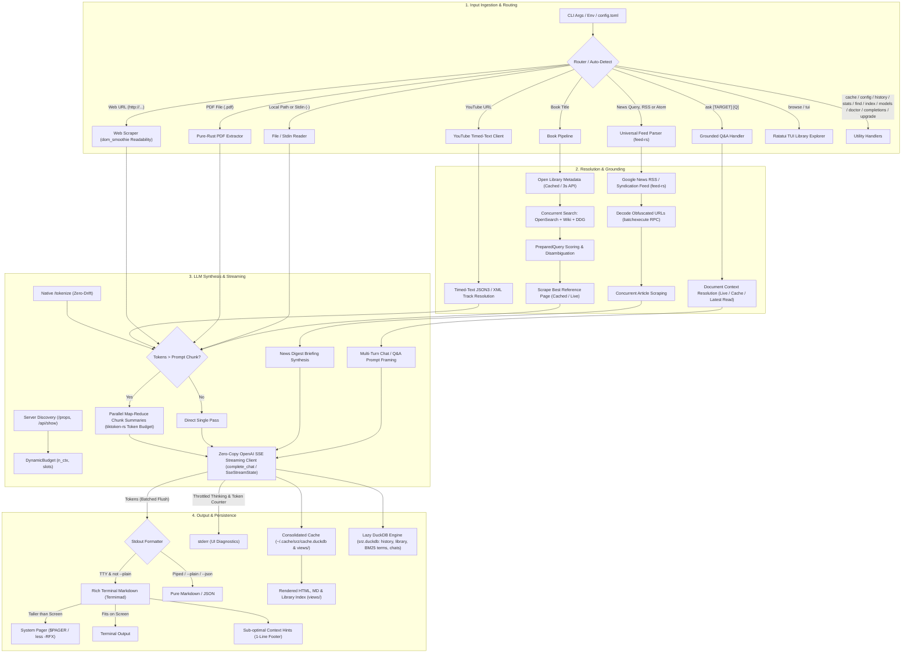
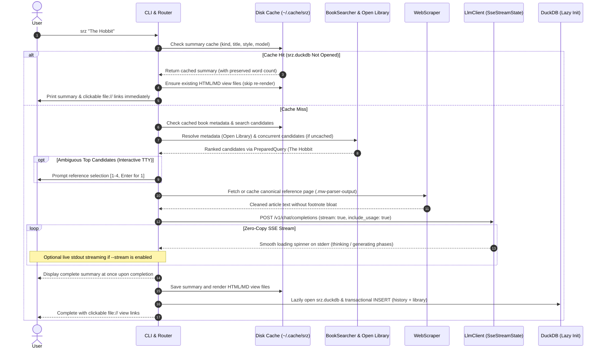
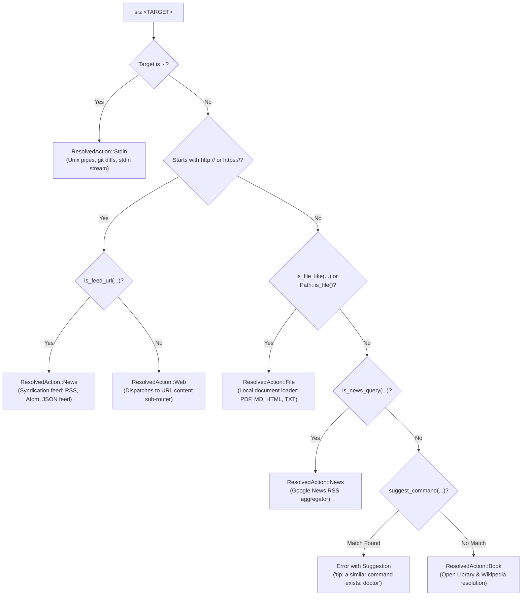
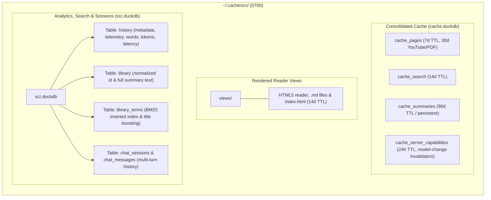

# Architecture & Design

`srz` (Summarize) is a high-performance, modular Rust CLI tool for extracting and synthesizing structured summaries from **webpages**, **YouTube video transcripts**, **PDF documents & local files**, **Unix stdin streams**, **books**, and **live news digests** using local OpenAI-compliant LLMs (such as llama.cpp, Ollama, LM Studio, or vLLM).

It is engineered from the ground up for instantaneous responsiveness, low memory overhead, and 100% local privacy.

---

## 1. High-Level Subsystem Architecture

The diagram below illustrates the end-to-end lifecycle of an `srz` invocation:



### Subsystem Directory Organization

The codebase is organized into cohesive functional subgroups within `src/`:

```text
src/
├── commands/     # CLI subcommand workflows and action dispatchers (ask, browse, cache...)
├── config/       # CLI argument parsing, flags, and config file profiles
├── engine/       # LLM streaming client, server discovery, dynamic budget, and /tokenize
├── sources/      # Content ingestion: web scraping, book search, YouTube, and news RSS
├── storage/      # Local disk caching, DuckDB server capability caching, and analytics
├── system/       # Hardware profiling, Gemma steering, filesystem security, and self-updater
├── ui/           # Terminal console formatting, spinners, footers, and HTML reader views
├── lib.rs        # Library crate root and backwards-compatible module exports
└── main.rs       # Binary entry point and CLI orchestration
```

### Module Responsibilities

| Subsystem | File | Module | Primary Responsibility |
| :--- | :--- | :--- | :--- |
| **Entry Points** | [`src/main.rs`](https://github.com/NewGuy012/srz/blob/master/src/main.rs) | `main` | Entry point, CLI lifecycle, profile loading, and subcommand dispatch. |
| | [`src/lib.rs`](https://github.com/NewGuy012/srz/blob/master/src/lib.rs) | `lib` | Root library interface and backward-compatible module re-exports. |
| **Commands** | [`src/commands/summarize.rs`](https://github.com/NewGuy012/srz/blob/master/src/commands/summarize.rs) | `commands::summarize` | Workflows for web articles, YouTube videos, books, local documents, stdin streams, news/syndication feed digests, and unified page caching (`fetch_or_cache_page_with`). |
| | [`src/commands/ask.rs`](https://github.com/NewGuy012/srz/blob/master/src/commands/ask.rs) | `commands::ask` | Grounded question answering, question-aware chunk retrieval (`select_relevant_context`), full library summary fallback, interactive multi-turn chat REPL (`srz ask`) with `rustyline`, DuckDB session persistence (`--chats`, `--resume`, `--show-chat`, `--delete-chat`), sliding conversational history, and prompt injection defense. |
| | [`src/commands/library.rs`](https://github.com/NewGuy012/srz/blob/master/src/commands/library.rs) | `commands::library` | Handlers for `history`, `stats` (reading habit telemetry, time saved, P50/P95 model throughput), `find` (BM25 relevance scoring), `index`, `query` (analytical SQL), `export` (Obsidian Markdown vault, JSON, CSV, Parquet), and `cache` subcommands. |
| | [`src/commands/diagnostics.rs`](https://github.com/NewGuy012/srz/blob/master/src/commands/diagnostics.rs) | `commands::diagnostics` | Handlers for `doctor`, `models`, and `config` verification. |
| **Configuration** | [`src/config/cli.rs`](https://github.com/NewGuy012/srz/blob/master/src/config/cli.rs) | `config::cli` | `clap` CLI parser, `SummaryStyle` presets, `NewsTimeframe`, `--max-tokens` and `--concurrency` flags, paging flags, chat session flags, and zero-allocation target auto-detection (`is_feed_url`, `is_news_query`, `clean_news_query`, `is_probable_question`). |
| | [`src/config/file.rs`](https://github.com/NewGuy012/srz/blob/master/src/config/file.rs) | `config::file` | `config.toml` file loading, named profile switching, and starter template generation. |
| **Engine** | [`src/engine/llm.rs`](https://github.com/NewGuy012/srz/blob/master/src/engine/llm.rs) | `engine::llm` | Zero-copy SSE client (`complete_chat` / `SseStreamState`), server capability discovery (`probe_server_capabilities`), native `/tokenize` queries, wall-clock token rate tracking, and dynamic map-reduce synthesis. |
| | [`src/engine/budget.rs`](https://github.com/NewGuy012/srz/blob/master/src/engine/budget.rs) | `engine::budget` | Dynamic token budgeting math (`DynamicBudget`) and server capability descriptors (`ServerCapabilities`) autoscaling prompt chunks and slot concurrency. |
| | [`src/engine/chunker.rs`](https://github.com/NewGuy012/srz/blob/master/src/engine/chunker.rs) | `engine::chunker` | Accurate BPE token budgeting (`tiktoken-rs` `cl100k_base`), token counting (`count_tokens`), token-safe truncation (`truncate_by_tokens`), $O(1)$ fast-path budget checks, and unified zero-copy `Cow` paragraph chunking (`chunk_with_metric`) for long documents (> 16k tokens). |
| **Sources** | [`src/sources/document.rs`](https://github.com/NewGuy012/srz/blob/master/src/sources/document.rs) | `sources::document` | Unified local document ingestion (`DocumentLoader`): shared file validation (`validate_file`, 20 MB cap), PDF extraction, HTML/Markdown normalization, and title fallbacks. |
| | [`src/sources/scraper.rs`](https://github.com/NewGuy012/srz/blob/master/src/sources/scraper.rs) | `sources::scraper` | HTTP client (10 MB cap), streaming body readers, Mozilla Readability DOM content extraction (`dom_smoothie`), semantic HTML-to-Markdown conversion (`htmd`), and text cleaning. |
| | [`src/sources/pdf.rs`](https://github.com/NewGuy012/srz/blob/master/src/sources/pdf.rs) | `sources::pdf` | Single-pass pure-Rust PDF `Document` parsing, text layer & `Info` trailer metadata extraction, and scanned-PDF detection via `pdf-extract`. |
| | [`src/sources/youtube.rs`](https://github.com/NewGuy012/srz/blob/master/src/sources/youtube.rs) | `sources::youtube` | Zero-allocation YouTube video ID extraction, Innertube player client iteration, timed-text XML/JSON3 caption resolution via streaming `quick-xml`, HTML entity decoding via `html-escape`, and chapter cue grouping via `TimedTranscriptBuilder`. |
| | [`src/sources/search.rs`](https://github.com/NewGuy012/srz/blob/master/src/sources/search.rs) | `sources::search` | Open Library metadata, Wikipedia OpenSearch/fulltext, DDG search, and candidate scoring. |
| | [`src/sources/news.rs`](https://github.com/NewGuy012/srz/blob/master/src/sources/news.rs) | `sources::news` | Universal syndication feed client (`feed-rs` for direct RSS 0.9/1.0/2.0, Atom, and JSON feed URLs + Google News queries), bounded `batchexecute` RPC redirect decoding, semaphore-bounded concurrent article fetching, and page caching (`collect_news_articles_with_cache`). |
| **Storage** | [`src/storage/cache.rs`](https://github.com/NewGuy012/srz/blob/master/src/storage/cache.rs) | `storage::cache` | Consolidated single-write DuckDB cache storage (`cache.duckdb`) in `XDG_CACHE_HOME` for pages, search metadata, and LLM summaries (with preserved `word_count`), read-only legacy disk fallback (`read_disk_entry`), and unified SQL + disk TTL/LRU pruning (`prune`). |
| | [`src/storage/db.rs`](https://github.com/NewGuy012/srz/blob/master/src/storage/db.rs) | `storage::db` | Embedded DuckDB database (`srz.duckdb`) in `XDG_DATA_HOME` with normalized `history` + `library` schema, raw analytical SQL execution (`query_raw`), multi-format library exports (`export_markdown_vault`, `export_json`, `export_csv`, `export_parquet`), inverted index BM25 search ranking (`library_terms`), and persistent multi-turn chat sessions. |
| **UI & Render** | [`src/ui/terminal.rs`](https://github.com/NewGuy012/srz/blob/master/src/ui/terminal.rs) | `ui::terminal` | CLI progress spinners (`indicatif`), colored text formatting, and terminal escape/control character sanitization (`sanitize_terminal_text`, `sanitize_title`). |
| | [`src/ui/printer.rs`](https://github.com/NewGuy012/srz/blob/master/src/ui/printer.rs) | `ui::printer` | Cached `LazyLock<MadSkin>` terminal Markdown styling and automatic `$PAGER` / `less -RFX` integration. |
| | [`src/ui/tui.rs`](https://github.com/NewGuy012/srz/blob/master/src/ui/tui.rs) | `ui::tui` | Interactive `ratatui` + `crossterm` terminal UI library explorer (`srz browse`) with event-driven redraws, pre-indexed live search, and seamless in-TUI grounded chat (`a` keybinding). |
| | [`src/ui/render.rs`](https://github.com/NewGuy012/srz/blob/master/src/ui/render.rs) | `ui::render` | GitHub Flavored Markdown-to-HTML converter (`pulldown-cmark`), zero-allocation `escape_html_cow` card formatting, CSS styling, index dashboard, unified `target_icon`/`target_badge`, slugify, and cross-platform browser opening (`open`). |
| **System** | [`src/system/hardware.rs`](https://github.com/NewGuy012/srz/blob/master/src/system/hardware.rs) | `system::hardware` | In-process, cross-platform hardware detection (`sysinfo`), physical RAM tiering, and Gemma 4 model advisories (`recommend`). |
| | [`src/system/text_util.rs`](https://github.com/NewGuy012/srz/blob/master/src/system/text_util.rs) | `system::text_util` | High-performance HTML entity decoding (`html-escape`), ASCII case-insensitive search (`find_ascii_case_insensitive`, `contains_ascii_case_insensitive`, `ends_with_ascii_case_insensitive`), URL scheme checking (`is_http_url`), single-pass `format_hex`, and zero-copy string utilities. |
| | [`src/system/fs_util.rs`](https://github.com/NewGuy012/srz/blob/master/src/system/fs_util.rs) | `system::fs_util` | Platform filesystem utilities, private directory/file permissions (`0700`/`0600`), crash-safe atomic file writes (`tempfile::NamedTempFile` persist), and XDG standard data directory compliance (`default_data_dir`). |
| | [`src/system/upgrade.rs`](https://github.com/NewGuy012/srz/blob/master/src/system/upgrade.rs) | `system::upgrade` | In-place self-updater: target detection, GitHub release queries, bounded archive extraction (`read_bounded_binary`), SHA256 verification, and atomic swap. |

---

## 2. Request & Execution Lifecycle Sequence

The sequence diagram below walks through the end-to-end lifecycle when summarizing a target (illustrated with a book search request):



### How a Request Flows Through the System

Understanding the request lifecycle reveals how `srz` balances sub-millisecond responsiveness for repeated reads with thorough, defensive processing for fresh documents.

#### The Sub-Millisecond Cache Fast-Path
When you invoke `srz` on a target, the engine first constructs a deterministic cache key from the target URL or path, the selected LLM model, and the summary style preset. It probes the embedded `cache.duckdb` database. If an exact match exists, `srz` retrieves the cached summary and verifies that the corresponding standalone HTML and Markdown reader views exist on disk. The output is formatted and displayed immediately, achieving sub-millisecond return times. In this fast-path branch, the permanent library database (`srz.duckdb`) is never initialized, bypassing database locking and schema checks entirely.

#### Concurrent Metadata Resolution and Disambiguation
When a request misses the cache, the router classifies the target type and launches the appropriate ingestion pipeline. For book queries or news topics, `srz` initiates concurrent metadata lookups across Open Library, Wikipedia, and search APIs. Because book titles can be ambiguous (for example, distinguishing a novel from film adaptations or academic commentaries), a candidate scoring engine ranks the results. If multiple high-scoring candidates emerge on an interactive terminal, `srz` politely prompts the user to select the canonical reference edition before initiating downloads.

#### Quarantined Content Ingestion and Text Extraction
Once the canonical reference is established, `srz` fetches the source content under strict defensive constraints. Web scrapers enforce a 10 MB payload ceiling and apply Mozilla's Readability algorithm to discard sidebars, banner ads, and navigation menus. Local PDFs are extracted using pure-Rust text-layer parsing, and YouTube links stream timed-text captions via pull-parser XML events. To protect against prompt injection attacks, the extracted text is strictly isolated inside sanitized `<source_document>` XML boundary tags, with delimiter sequences safely neutralized.

#### Zero-Copy SSE Streaming Inference
With context prepared, `srz` queries the server's native `/tokenize` endpoint and dynamically calculates token budgets. The prompt is dispatched to the local LLM backend using an HTTP POST request requesting Server-Sent Events (`stream: true`). Rather than allocating intermediate buffers, `srz` parses the SSE stream zero-copy from network byte slices. Tokens are either streamed directly to standard output as they arrive (when `--stream` is enabled) or accumulated while displaying a lightweight progress indicator on standard error, tracking token generation velocity and elapsed wall-clock time in real time.

#### Transactional Persistence and Reader Generation
As the final tokens arrive, `srz` performs atomic persistence across storage tiers. The completed summary and its word counts are committed to `cache.duckdb`, and pre-styled HTML and Markdown reader views are written to the `views/` directory. Finally, `srz` lazily opens `srz.duckdb` to record reading habit telemetry, update reading streaks, and insert query terms into the inverted BM25 index within an ACID transaction.

---

## 3. Ingestion Router & Target Auto-Detection Subsystem

Rather than requiring users to memorize discrete subcommands for different media types (such as `srz web <URL>`, `srz file <PATH>`, or `srz book <TITLE>`), `srz` employs an intelligent input router and auto-detection subsystem. When `<TARGET>` is provided as a root positional argument, `srz` inspects the structure, scheme, filesystem presence, and semantic characteristics of the argument to automatically dispatch it to the appropriate ingestion pipeline.

### Target Classification Flowchart

The decision hierarchy inside `Cli::resolve_action` (`src/config/cli.rs`) resolves raw CLI arguments into typed `ResolvedAction` variants:



### Ingestion Dispatch Rules & Precedence

1. **Standard Input Stream (`-`)**:
   - If `<TARGET>` is exactly `"-"`, the router immediately selects `ResolvedAction::Stdin`. This integrates `srz` into UNIX command pipelines (e.g., `git diff | srz -`, `cat report.txt | srz -`).
2. **Web URLs & Feed Detection (`is_http_url`, `is_feed_url`)**:
   - URLs beginning with `http://` or `https://` are inspected for syndication feeds via `is_feed_url`.
   - The detector checks URL path suffixes (`.rss`, `.atom`, `/feed`, `/rss`, `/atom`, `/feed.xml`, `/rss.xml`, `/atom.xml`, `/index.xml`, `/feed.json`, `/rss/`) and query parameters (`format=rss`, `format=atom`, `output=rss`, `feed=rss`).
   - Matching feed URLs route to `ResolvedAction::News`, while standard web links route to `ResolvedAction::Web`.
3. **Local Files & File-Like Paths (`is_file_like`)**:
   - Non-URL targets are evaluated for local file characteristics:
     - Physical existence on disk via `std::path::Path::is_file()`.
     - Explicit path prefixes or separators (`./`, `../`, `/`, `~`, `\`).
     - Standard document extensions (`.pdf`, `.md`, `.markdown`, `.txt`, `.text`, `.html`, `.htm`, `.epub`, `.json`).
   - If matched, the target routes to `ResolvedAction::File`, where `DocumentLoader` enforces a 20 MB ceiling, extracts plain text and metadata, and quarantines content.
4. **Natural News Queries (`is_news_query`)**:
   - Freeform strings beginning with `news`, `headlines`, or phrases matching `"current ... updates"` / `"latest ... stories"` (e.g., `srz "news about quantum computing"`) are detected by `is_news_query`.
   - `clean_news_query` strips common conversational stop words (`"news"`, `"latest"`, `"about"`, `"regarding"`), routing the normalized topic to `ResolvedAction::News` (querying Google News RSS).
5. **Subcommand Typo Guardrail (`suggest_command`)**:
   - To prevent typos of top-level subcommands from accidentally triggering book or web searches, `suggest_command` calculates edit distance against all known subcommands (`ask`, `browse`, `doctor`, `models`, `stats`, `history`, `config`, etc.).
   - If the input closely resembles a known command (e.g., `srz doctur` or `srz modls`), `srz` aborts with a helpful suggestion (`tip: a similar command exists: 'doctor'`) and indicates how to summarize a book with that title if intended (`srz book "<TITLE>"`).
6. **Fallback: Freeform Book Title Search**:
   - Any query not intercepted by the preceding rules is treated as a book title (`ResolvedAction::Book`), launching concurrent Open Library and Wikipedia metadata and synopsis resolution.

### Protocol & Content Sub-Routing

Once an HTTP target enters the web workflow, `fetch_url_content` and `target_type_for_url` (`src/commands/summarize.rs`) apply secondary protocol-level auto-detection:

* **YouTube Transcripts**: `extract_youtube_video_id` identifies YouTube URLs (`youtube.com/watch?v=...`, `youtu.be/...`, `/shorts/`, `/embed/`). Instead of downloading audio or video media, `srz` routes directly to the YouTube timed-text caption client to pull XML/JSON3 subtitle tracks and chapter cues with zero video bandwidth.
* **Streaming Remote PDF Documents**: If the URL path ends with `.pdf` (even with query tokens), `srz` streams the file into memory and dispatches it directly to the pure-Rust PDF parser (`pdf.rs`).
* **Standard Web Articles**: All other web targets are downloaded with a 10 MB ceiling and parsed via Mozilla's Readability algorithm (`dom_smoothie`), extracting clean article body text and stripping navigation, ads, and footers.

### Interactive Q&A Auto-Detection (`srz ask`)

In the grounded Q&A command (`srz ask [first] [second]`), arguments are dynamically disambiguated:

* **Question Identification (`is_probable_question`)**:
  - The detector checks if the string ends with a question mark (`?`) or begins with common interrogative words (`what`, `why`, `how`, `who`, `when`, `where`, `which`, `can`, `could`, `should`, `would`, `is`, `are`, `explain`, `summarize`, `tell`, `describe`, `clarify`).
* **Implicit Context Fallback**:
  - If a user passes only a question without a target (e.g., `srz ask "What was the conclusion?"`), the router sets target to `None`. The execution engine then automatically resolves context by retrieving the **most recent summary** stored in `srz.duckdb`.

### Backend Capability & Multi-Model Router Auto-Detection

In `src/engine/llm.rs`, `probe_server_capabilities` probes the local LLM server at startup to detect context limits, slot capacity, and server topology:

* **Multi-Model Router / Proxy Detection**:
  - Multi-model routers and proxies (such as llama.cpp router mode or OpenRouter gateways) often respond to root `GET /props` with `role: "router"` or `n_ctx: 0`.
  - When this pattern is detected, `srz` automatically re-probes using a model-qualified endpoint: `GET /props?model=<ENCODED_MODEL>` to obtain accurate, model-specific `n_ctx` (context window) and `total_slots` values.
* **Native Tokenizer Auto-Detection**:
  - Probes server endpoints (`/tokenize` on llama.cpp, `/api/tokenize` on Ollama) to enable zero-drift token counting.
* **Capability Caching**:
  - Detected server capabilities are cached in `cache_server_capabilities` (in `cache.duckdb`), allowing subsequent CLI invocations to start in under a millisecond while auto-invalidating if the model changes.

---

## 4. Storage & Cache Architecture

All state is isolated under `~/.cache/srz/` (or `$XDG_CACHE_HOME/srz/`), unified via `Cache::default_cache_dir()`, enforced with `0700`/`0600` owner-only Unix permissions, completely bypassable via `--no-cache`, and safely maintainable via `srz cache`:



### Retention Policies & Lifecycle Schedule

| Namespace / Asset | Retention Policy (TTL) | Eviction Trigger | Notes |
| :--- | :--- | :--- | :--- |
| **`cache_pages` (in `cache.duckdb`)** | **7 days** | SQL TTL expiration / LRU | Scraped DOM, feed articles, and clean text; YouTube & PDFs retain for 30 days. Read-only fallback to legacy `pages/`. |
| **`cache_search` (in `cache.duckdb`)** | **14 days** | SQL TTL expiration / LRU | Open Library metadata and DDG candidates. Read-only fallback to legacy `search/`. |
| **`cache_summaries` (in `cache.duckdb`)** | **90 days** | LRU past max budget | Deterministic for `(target, model, style)` with preserved `word_count`. Read-only fallback to legacy `summaries/`. |
| **`cache_server_capabilities` (in `cache.duckdb`)** | **24 hours** | TTL / Model change | Probed server `n_ctx`, `total_slots`, and detected model identity. |
| **`views/`** | **14 days** | TTL expiration / LRU | Ephemeral reader views; lazily regenerated via `srz browse` or `srz index`. |
| **Total Cache Budget** | **500 MB** (configurable) | Unified SQL + disk LRU eviction | Evicts oldest entries across `cache.duckdb` tables and `views/` down to 85% headroom. |
| **Auto-Prune Schedule** | **Opportunistic (24h)** | Deferred past fast-exit commands | Throttled via `~/.cache/srz/.last_prune` (sub-millisecond overhead). |
| **Library DuckDB (`srz.duckdb`)** | **Permanent (Not a cache)** | Explicit `--reset-db` only | Preserved across `srz cache clean`; normalized `history` + `library` schema, BM25 index, and chats. |

### Storage Engine Design Principles

The storage subsystem in `srz` departs from traditional CLI tool patterns that scatter thousands of raw JSON files across the user's cache directory. Instead, it pairs an embedded single-write DuckDB engine with an ACID-compliant library database.

#### Consolidated Single-Write Architecture
Rather than writing discrete `.json` files for scraped web DOMs, Open Library search metadata, and LLM completions, `srz` stores all ephemeral assets within `~/.cache/srz/cache.duckdb`. This prevents inode exhaustion on high-volume workstations and reduces lookup overhead to sub-millisecond scale. Furthermore, storing content in DuckDB enables atomic SQL byte accounting via `strlen` and precise millisecond TTL evaluation via `epoch_ms(cached_at)::BIGINT`, eliminating slow filesystem traversal during cleanup.

#### Lazy Initialization and Normalized Schemas
To maintain instantaneous CLI startup times, both `cache.duckdb` and the permanent `srz.duckdb` skip schema DDL evaluation when the databases are already initialized. Lightweight or fast-exit subcommands (such as `srz models` or `srz config show`) bypass the database layer altogether. Within `srz.duckdb`, the schema is normalized: full summary text is stored uniquely in the `library` table, while reading habit telemetry, word counts, and token rates live in `history`. Joining on the primary key eliminates redundant metadata duplication across repeated queries.

#### Unified LRU Eviction and Storage Safety
Disk budgets are enforced through `Cache::prune`, which executes a unified pass across both DuckDB tables and rendered standalone files in the `views/` directory. When total cache usage approaches the 500 MB budget, the engine evicts the oldest items down to an 85% safety threshold. Every database transaction is executed within strict ACID boundaries, ensuring that power loss or terminal interrupts never leave your library or persistent chat histories in a corrupted state.

---

## 5. Offline BM25 Full-Text Search Algorithm

When executing `srz find <QUERY>`, `srz` computes relevance scores offline across the library using the Robertson-Sparck Jones BM25 ranking formula:

$$
\text{Score}(D, Q) = \sum_{t \in Q} \text{IDF}(t) \cdot w(t) \cdot \frac{f(t, D) \cdot (k_1 + 1)}{f(t, D) + k_1 \cdot \left(1 - b + b \cdot \frac{|D|}{\text{avgdl}}\right)}
$$

Where the Robertson-Sparck Jones Inverse Document Frequency $\text{IDF}(t)$ is computed as:

$$
\text{IDF}(t) = \ln\left( \frac{N - n(t) + 0.5}{n(t) + 0.5} + 1.0 \right)
$$

### Algorithm & Parameter Breakdown

For developers and learners curious about the mechanics behind offline library search:

| Symbol / Variable | Value / Formula | Description |
| :--- | :--- | :--- |
| **$f(t, D)$** | Term Frequency | Number of times query term $t$ appears in document $D$. |
| **$w(t)$** | $2.5$ (title) / $1.0$ (body) | **2.5× Title Boost**: Matching query terms in the document title are weighted 2.5× higher than terms in the summary body. |
| **$k_1$** | `1.2` | **Term Frequency Saturation**: Controls non-linear scaling of repeated term matches, preventing long repetitive documents from monopolizing results. |
| **$b$** | `0.75` | **Document Length Normalization**: Penalizes verbose documents relative to the average length (`avgdl`). |
| **$|D|$ / $\text{avgdl}$** | Relative Doc Length | The word count of document $D$ divided by the average word count across your library history. |
| **$N$** | Total Documents | Total number of summarized items stored in `history`. |
| **$n(t)$** | Document Frequency | Number of library documents containing term $t$. |

### Pure SQL Evaluation in DuckDB

Unlike search architectures that require external search daemons (such as Elasticsearch) or platform-specific C extensions (such as SQLite FTS5), `srz` implements the entire Robertson-Sparck Jones BM25 ranking algorithm in pure DuckDB SQL. 

When a user executes `srz find`, query terms are tokenized and injected into a parameterized query with Common Table Expressions (CTEs). The query first aggregates collection-wide statistics (`doc_stats`), joins matching terms from the inverted index table (`library_terms`), applies title boost multipliers ($w(t)$), and computes saturation scores using DuckDB's vectorized analytical execution engine. Because the inverted index is populated during summary generation, search queries execute in under two milliseconds across thousands of stored documents without network access or background daemons. High-density preview sentences are extracted directly around query stems to facilitate rapid scanning in terminal outputs.

---

## 6. Hardware-Aware Inference & Zero-Drift Tokenization

To eliminate context length guesswork and prevent Out-of-Memory context truncation, `srz` incorporates intelligent host and server profiling:

### Safe Kernel Probing & Gemma 4 Steering

`srz` auto-detects physical host RAM and CPU architecture across macOS (`sysctl -n hw.memsize`), Linux (`/proc/meminfo`), and Windows (PowerShell WMI) without external C FFI dependencies.

For the mapping of physical memory tiers to recommended models, parameters, disk sizes, and context windows, refer to the canonical [Hardware Tier Reference Matrix](quickstart.md#hardware-tier-reference-matrix) in the Quick Start guide.

### Why Google Gemma 4 (`Q8_0`) on Modern Laptops

Selecting the right local model requires balancing reasoning accuracy against hardware constraints such as unified RAM capacity, battery draw, and thermal throttling. Through extensive testing across Apple Silicon and modern x86 platforms, `srz` steers users toward Google's Gemma 4 models running at 8-bit quantization (`Q8_0`).

Google's Gemma 4 architecture offers exceptional parameter density and instruction-following fidelity. In long-form document synthesis, smaller earlier-generation models (such as legacy 7B or 8B weights) frequently struggle with narrative continuity, omitting crucial caveats or hallucinating connections between disparate sections. Gemma 4 provides high-fidelity synthesis while maintaining low power consumption, making it well suited for laptops running on battery power.

Equally critical is the choice of quantization. While aggressive 4-bit schemes (such as `Q4_K_M`) reduce memory footprints, they introduce subtle degradation in semantic nuance, numeric precision, and prompt compliance. In contrast, 8-bit `Q8_0` quantization preserves near-FP16 reasoning precision while fitting comfortably within unified memory budgets. Coupled with native support for context windows up to 128k tokens, Gemma 4 delivers desktop-class summarization without overheating or draining mobile hardware.

### Synthesis Strategy: Single-Pass vs. Map-Reduce Chunking

The synthesis engine dynamically adapts its execution strategy based on the ratio between the document length and the active context window (`n_ctx`) reported by the backend server.

When the document's token count is within approximately 70% of the server's context window, `srz` synthesizes the document in a single inference pass. Single-pass synthesis is the optimal operational mode: because the entire document fits into the model's active attention window simultaneously, the LLM retains complete cross-chapter awareness, tracking narrative arcs and complex thematic relationships without contextual fragmentation.

When a document exceeds the single-pass threshold—such as a 300-page book or a 100-page technical specification evaluated against an 8k context server—`srz` automatically transitions into Map-Reduce mode. The document chunker partitions the text into overlapping token windows sized strictly by `DynamicBudget`. These chunks are dispatched concurrently across the server's available inference slots (`total_slots`), and their individual intermediate syntheses are aggregated in a final reduction pass to produce a unified, comprehensive summary.

### Zero-Drift Server-Native Tokenization

Third-party BPE tokenizers (such as OpenAI's `cl100k_base`) drift by 15–25% when measuring tokens intended for Google Gemma or Meta Llama models. `srz` probes and uses the server's native `/tokenize` endpoint (`llama.cpp /tokenize` or `Ollama /api/tokenize`), ensuring 0% token count discrepancies between client chunking calculations and server KV cache allocations. When the server endpoint is unavailable, it gracefully falls back to `tiktoken-rs` (`cl100k_base`).

### Dynamic Context Budgeting (`DynamicBudget`)

Hardcoding token budgets leads to fragile CLI behavior: small 4k models crash with out-of-memory errors, while large 64k or 128k models are severely underutilized. To resolve this, `srz` queries the backend server capabilities and enforces a mathematical capacity invariant at runtime:

$$
\text{effective\_ctx} = \text{prompt\_chunk} + \text{reserve\_completion} + \text{headroom} \le n_{\text{ctx}}
$$

Under this model, `DynamicBudget` partitions the server's detected context window into three deliberate allocations. Prompt chunks are scaled to approximately 45% of total context (bounded between 1,024 and 65,536 tokens), guaranteeing that source text consumes the majority of attention without crowding completion buffers. The completion reserve is allocated approximately 30% of the context (clamped between 512 and 8,192 tokens), ensuring the model has sufficient headroom to generate comprehensive, structured analyses. Finally, a 25% safety headroom (clamped between 512 and 4,096 tokens) accounts for token counting variance and system prompt overhead.

Concurrency is similarly auto-scaled: `DynamicBudget` probes server worker slots (`total_slots`) to scale parallel map-reduce workers without congesting the inference queue. When execution is constrained by small server context windows, `srz` emits a non-intrusive 1-line terminal footer hint, while `srz doctor` provides a full hardware optimization panel.

---

## 7. Performance & Architectural Optimizations

### Optimizations at a Glance

| Subsystem | Core Optimization | User Benefit |
| :--- | :--- | :--- |
| **LLM Inference** | Parallel Map-Reduce + exact BPE token budgeting (`tiktoken-rs`) | Summarizes long documents and books without context window truncation |
| **Streaming Output** | Zero-copy SSE parser with batched terminal flushes | Smooth, real-time typing output with minimal CPU and memory overhead |
| **Content Ingestion** | Mozilla Readability algorithm (`dom_smoothie`) & streaming XML | Clean article text stripped of ads/sidebars; rapid YouTube caption extraction |
| **Storage & Caching** | Consolidated embedded DuckDB (`cache.duckdb`) with SQL TTLs | Sub-millisecond cache hits, zero filesystem clutter, and automatic pruning |
| **Offline Library Search** | Local SQL BM25 ranking with title weighting | Fast, Google-style relevance search across your reading history without network access |
| **Security & Hardening** | `#![forbid(unsafe_code)]`, `0700`/`0600` permissions, XML prompt framing | Complete memory safety, zero telemetry, local file isolation, and injection defense |

---

### Performance & Memory Efficiency Deep Dive

The architecture of `srz` is guided by the philosophy that a CLI tool should never waste system resources or introduce perceptible latency. Every subsystem—from network ingestion to terminal rendering—is engineered to minimize memory allocations and CPU overhead.

#### Zero-Overhead LLM Processing and Context Management
Inference efficiency begins with accurate token budgeting. Rather than guessing context capacities, `srz` queries the backend server's native `/tokenize` endpoint and capability descriptors (`GET /props` in llama.cpp, `POST /api/show` in Ollama, or `GET /v1/models` in vLLM) to detect the active context window (`n_ctx`) and slot concurrency (`total_slots`). These parameters are cached within `cache_server_capabilities` in DuckDB, allowing subsequent CLI commands to start in under a millisecond while automatically invalidating if the backend model changes.

Streaming responses use a zero-copy Server-Sent Events (SSE) parser that borrows string slices directly from network byte buffers (`Cow<str>`). Terminal flushes are batched per packet, completely eliminating the string reallocations and terminal redraw flicker common in naive CLI streaming implementations. For short documents, the chunker executes an $O(1)$ byte-length check that instantly approves texts that comfortably fit within budget, bypassing tokenizer passes altogether.

#### High-Speed Ingestion and Content Normalization
Raw web content is notoriously noisy, laden with navigation headers, advertisements, tracking pixels, and legal notices. `srz` runs scraped HTML through a pure-Rust implementation of Mozilla's Readability algorithm (`dom_smoothie`), scoring DOM container density to extract clean article text before prompting the language model. Syndication feeds and Google News queries are parsed via `feed-rs`, with direct URL scheme detection normalizing diverse feed formats without regex fragility.

Document ingestion handles diverse formats through specialized, zero-copy pipelines. PDF files are parsed in a single memory-mapped pass with `pdf-extract`, extracting both text layers and trailer metadata simultaneously. YouTube video ingestion streams timed-text caption tracks via an event-driven XML pull parser (`quick-xml`), completely avoiding the overhead of loading full DOM trees into memory. When scraping live news topics, `srz` bounds parallel HTTP and RPC requests using a `tokio::sync::Semaphore` and immediately aborts superfluous background tasks once the desired article count is achieved.

#### Embedded DuckDB Storage and Instant Search
By consolidating all persistence into DuckDB, `srz` achieves transactional database reliability without the complexity of external database servers. The cache layer stores web pages, book metadata, and LLM summaries in `cache.duckdb`, replacing thousands of small files with structured tables indexed by SHA-256 hashes. This eliminates inode exhaustion, speeds up reads, and enables instant millisecond-accurate TTL pruning using standard SQL queries.

Offline search in `srz find` operates directly against the normalized `library_terms` inverted index in `srz.duckdb`. Because term frequencies, title weights, and document lengths are computed at write time, BM25 relevance ranking is evaluated using pure SQL window functions and CTEs, delivering Google-style relevance ranking across your reading history in under two milliseconds.

#### Responsive Terminal UI and Standalone Reader Views
Terminal rendering is built for visual fluidity. Markdown theme styles (`MadSkin`) are instantiated once in a globally cached `LazyLock`, eliminating repeated style allocations during streaming or multi-turn chat sessions. When browsing your reading library in the full-screen Ratatui TUI (`srz browse`), search filtering compares queries on-the-fly using zero-copy ASCII case-insensitive scans, short-circuiting on document titles and authors before inspecting full summaries.

For users who prefer reading in a browser, `srz` compiles GitHub Flavored Markdown into HTML5 reader views complete with responsive typography and light/dark theme toggles. Browser launching is handled through non-blocking detached processes (`open::that_detached`), allowing the CLI to terminate immediately without waiting for browser tabs to close.

---

## 8. Security, Privacy & System Hardening

Because `srz` processes untrusted content from the public internet, local documents, and generative AI models, defense-in-depth is integrated into every layer of the architecture.

### Memory Safety and the Zero-Unsafe Guarantee
The entire codebase strictly enforces `#![forbid(unsafe_code)]` at both crate roots (`src/lib.rs` and `src/main.rs`). Not a single `unsafe` block exists in the project. Memory safety, thread safety, and data-race freedom are mathematically guaranteed by the Rust compiler, eliminating entire classes of vulnerabilities including buffer overflows, use-after-free, and null-pointer dereferences.

### Complete Local Privacy and Filesystem Sandboxing
`srz` operates entirely on your local machine with zero telemetry, zero analytics tracking, and zero third-party cloud requirements. All cache files, database records, and configuration files are created with private Unix permissions (`0700` directories, `0600` files created atomically via `O_CREAT | O_EXCL` and `mode(0o600)`). Furthermore, filesystem handlers explicitly refuse pre-planted symlinks, preventing malicious directory traversal and symlink swap attacks.

### Defensive Prompt Isolation and Tag Neutralization
Untrusted content ingested from web pages, YouTube transcripts, or user documents is strictly quarantined inside `<source_document>` XML boundary tags. A centralized prompt framing engine performs case-insensitive scanning to escape any attempts by malicious web pages to prematurely close delimiter tags, neutralizing prompt injection attacks and preventing untrusted text from hijacking LLM system instructions.

### Terminal Escape Sanitization and BiDi Shielding
Displaying untrusted text in terminal emulators presents severe security risks, including clipboard hijacking (via OSC 52 sequences) and prompt spoofing. `srz` filters all document titles, metadata, and LLM streaming outputs through a robust sanitizer (`sanitize_terminal_text`). The sanitizer strips ANSI CSI sequences, OSC commands, C1 control codes, and Unicode Bidirectional (BiDi) override codepoints, rendering Trojan Source attacks completely inert.

### Bounded Resource Ceilings and Supply-Chain Verification
To prevent denial-of-service from oversized payloads, `srz` enforces strict byte limits: 10 MB for web responses and stdin streams, 20 MB for local documents, and 50 MB for update binaries, backed by strict connection and streaming timeouts. External media lookups validate host authority against official domains (`youtube.com`, `youtu.be`) to prevent Server-Side Request Forgery (SSRF). In addition, `srz upgrade` requires cryptographic SHA-256 validation and semver regex checks, and continuous integration pipelines enforce strict licensing and dependency advisory audits via `cargo-deny` and `cargo-audit`.

---

## 9. Related Technical Guides & Resources

- 🦀 [**Rust Learning Guide**](rust_learning_guide.md): Architectural deep-dive and systems programming concepts using `srz` as a case study.
- 🛡️ [**Security Audit**](security_audit.md): In-depth security analysis, memory safety guarantees, and threat mitigations.
- 📋 [**Changelog**](changelog.md): Release history, version highlights, and breaking changes.
- 📖 [**Command Reference**](commands.md): Complete CLI reference, auto-detection rules, subcommands, and flags.
- ⚙️ [**Configuration Guide**](configuration.md): Config file schema, named profiles, and cache retention tuning.
