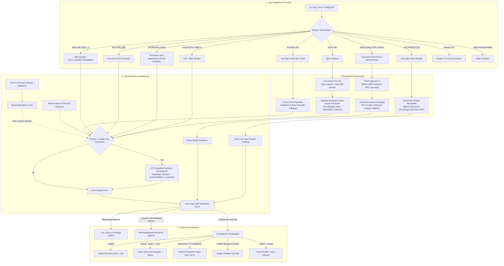
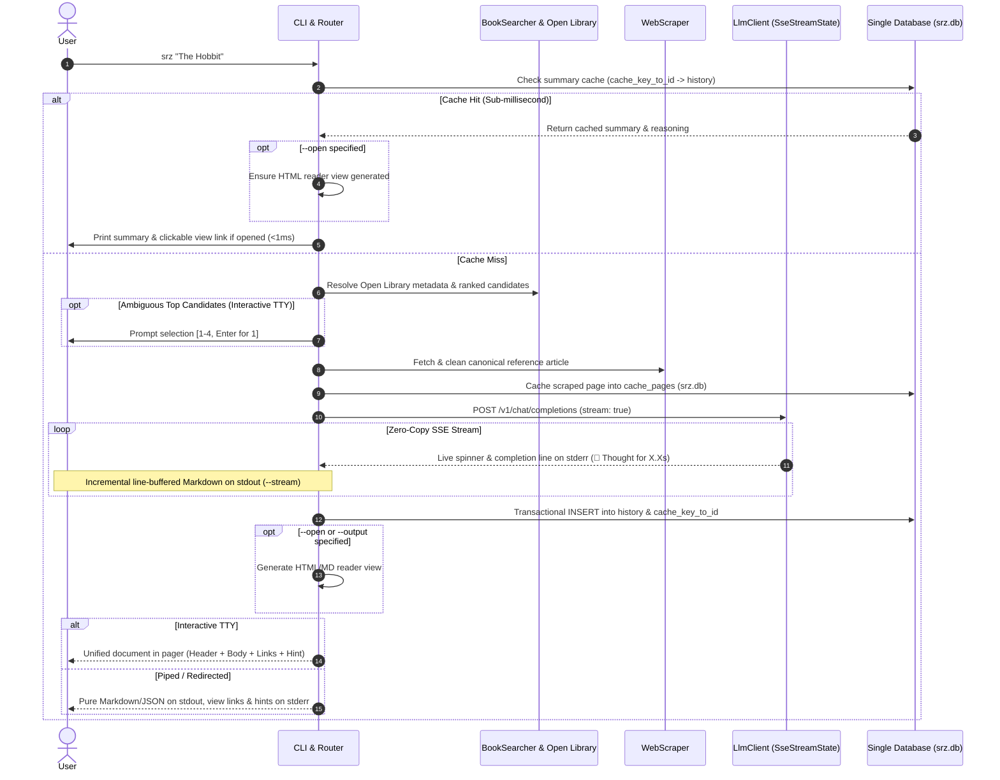
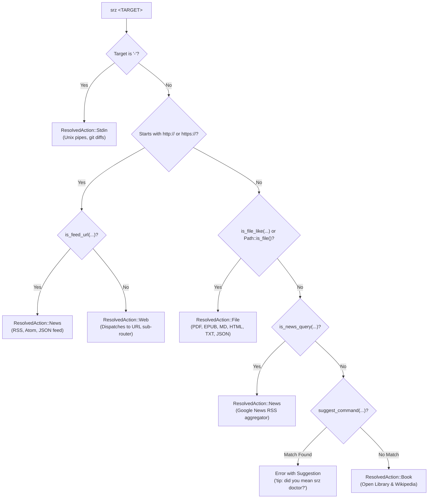
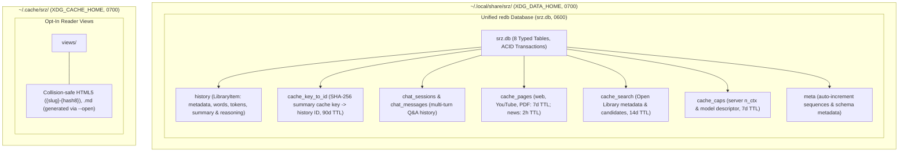

# Architecture & Design

`srz` (Summarize) is a fast command-line tool that turns **webpages**, **YouTube videos**, **PDFs & ebooks**, **local files**, **piped text**, **books**, and **news feeds** into clear summaries using AI models—especially local models running privately on your own computer (`llama.cpp`, `Ollama`, `LM Studio`, `vLLM`).

Designed to work locally first, `srz` starts immediately, stays comfortably within your computer's memory limits, saves your reading history in a single private database on your device, and streams answers live as the model writes them.

---

## 1. High-Level Subsystem Architecture

The diagram below illustrates how input targets flow through ingestion, resolution, token-budgeted synthesis, and persistence:



### Subsystem Directory Organization

The codebase is organized into seven domain modules under `src/`, separating command orchestration from low-level ingestion, inference, and storage engines:

```text
src/
├── commands/     # CLI subcommand workflows (summarize, ask, library, diagnostics, completions)
├── config/       # CLI parsing, auto-detection heuristics, and config file profiles
├── engine/       # SSE streaming client, dynamic token budgeting, and chunkers
├── sources/      # Content ingestion: web scraper, book search, YouTube, and feeds
├── storage/      # Embedded redb cache, library database, and pruning
├── system/       # Hardware profiling, SHA-256, ZIP/text/XML utilities, atomic filesystem, and updater
├── ui/           # Shared Markdown parser, terminal formatting/spinners, HTML reader, and TUI
├── lib.rs        # Library crate root and public module exports
└── main.rs       # Binary entry point and CLI orchestration
```

Most of `srz`'s reusable building blocks live inside `src/` (made available through `src/lib.rs`), while `src/main.rs` handles reading your settings and launching whichever action you requested.

### Module Responsibilities

| Subsystem | File | Module | Primary Responsibility |
| :--- | :--- | :--- | :--- |
| **Entry Points** | [`src/main.rs`](https://github.com/NewGuy012/srz/blob/master/src/main.rs) | `main` | Application lifecycle, config resolution, signal routing, and CLI dispatch. |
| | [`src/lib.rs`](https://github.com/NewGuy012/srz/blob/master/src/lib.rs) | `lib` | Root library interface and backward-compatible module re-exports. |
| **Commands** | [`src/commands/mod.rs`](https://github.com/NewGuy012/srz/blob/master/src/commands/mod.rs) | `commands` | Command routing, CLI dispatch (`dispatch_cli`), shell completion generation, database loan manager (`with_db`), cache commands, and dashboard updates. |
| | [`src/commands/summarize.rs`](https://github.com/NewGuy012/srz/blob/master/src/commands/summarize.rs) | `commands::summarize` | Summarization workflows for web, YouTube, documents, stdin, and books. |
| | [`src/commands/ask.rs`](https://github.com/NewGuy012/srz/blob/master/src/commands/ask.rs) | `commands::ask` | Grounded Q&A, shared BM25 context retrieval, automatic re-fetching on cache expiration, standard I/O REPL, and chat persistence. |
| | [`src/commands/library.rs`](https://github.com/NewGuy012/srz/blob/master/src/commands/library.rs) | `commands::library` | Handlers for `history`, `stats`, `find` (title-weighted offline search), and `export`. |
| | [`src/commands/diagnostics.rs`](https://github.com/NewGuy012/srz/blob/master/src/commands/diagnostics.rs) | `commands::diagnostics` | Backend verification (`doctor`), model enumeration, and config inspection. |
| **Configuration** | [`src/config/cli.rs`](https://github.com/NewGuy012/srz/blob/master/src/config/cli.rs) | `config::cli` | `clap` CLI parser, style presets, flags, target auto-detection heuristics, `config.toml` profiles, symlink-safe config loading, and template generation. |
| **Engine** | [`src/engine/compressor.rs`](https://github.com/NewGuy012/srz/blob/master/src/engine/compressor.rs) | `engine::compressor` | CPU Heading-Skeleton + Centroid BM25 Stratified Salience Compression and Robertson-Sparck Jones BM25 context retrieval for `srz ask`. |
| | [`src/engine/llm.rs`](https://github.com/NewGuy012/srz/blob/master/src/engine/llm.rs) | `engine::llm` | High-level LLM client, single-pass streaming orchestration, book summarization, and news digest synthesis. |
| | [`src/engine/sse.rs`](https://github.com/NewGuy012/srz/blob/master/src/engine/sse.rs) | `engine::sse` | Zero-copy SSE parser, streaming state machine, live thinking token/elapsed spinner formatting, and generation rate tracking. |
| | [`src/engine/prompts.rs`](https://github.com/NewGuy012/srz/blob/master/src/engine/prompts.rs) | `engine::prompts` | Prompt templating, XML boundary escaping, and untrusted prompt wrapping. |
| | [`src/engine/budget.rs`](https://github.com/NewGuy012/srz/blob/master/src/engine/budget.rs) | `engine::budget` | Dynamic token budgeting (`DynamicBudget`), server capability discovery (`/props`, `/api/show`), context window discovery, and context clamping. |
| | [`src/engine/chunker.rs`](https://github.com/NewGuy012/srz/blob/master/src/engine/chunker.rs) | `engine::chunker` | In-process model-aware token estimation (`TokenizerKind`), $O(1)$ fast paths, and hierarchical binary-search chunking. |
| **Sources** | [`src/sources/document.rs`](https://github.com/NewGuy012/srz/blob/master/src/sources/document.rs) | `sources::document` | Consolidated document loader, pure-Rust single-pass PDF text layer extraction, pure-Rust zero-dependency EPUB chapter & metadata extraction, format dispatch, and file size bounding (`MAX_FILE_BYTES`). |
| | [`src/sources/scraper.rs`](https://github.com/NewGuy012/srz/blob/master/src/sources/scraper.rs) | `sources::scraper` | HTTP client (10 MB cap), SSRF mitigation blocking private/loopback/metadata/transition IPv6 targets, Mozilla Readability DOM parsing (`dom_smoothie`), and streaming HTML-to-Markdown conversion (`XmlScanner`). |
| | [`src/sources/youtube.rs`](https://github.com/NewGuy012/srz/blob/master/src/sources/youtube.rs) | `sources::youtube` | Video ID parsing, Innertube client, XML/JSON3 caption streaming, chapter cue grouping (`parse_chapters_from_description`), and auto-translate (`&tlang=en`) fallback. |
| | [`src/sources/search.rs`](https://github.com/NewGuy012/srz/blob/master/src/sources/search.rs) | `sources::search` | Concurrent fan-out Open Library metadata & search candidates with strict `work_key` path traversal validation, candidate ranking, and targeted Wikipedia synopsis extraction (`extract_wikipedia_synopsis`). |
| | [`src/sources/news.rs`](https://github.com/NewGuy012/srz/blob/master/src/sources/news.rs) | `sources::news` | Syndication feeds (RSS/Atom/JSON via `XmlScanner`), SSRF validation on direct feed URLs, offline `CBMi` protobuf decoding, pre-scrape caching, RPC fallback, and RSS snippet fallback on paywalled links. |
| **Storage** | [`src/storage/cache.rs`](https://github.com/NewGuy012/srz/blob/master/src/storage/cache.rs) | `storage::cache` | Unified `redb` cache (`srz.db`), 2h news TTL, 7d page/capability TTL, opt-in views, and LRU pruning. |
| | [`src/storage/db.rs`](https://github.com/NewGuy012/srz/blob/master/src/storage/db.rs) | `storage::db` | Embedded pure-Rust `redb` database (`srz.db`), 8 typed tables, generic TTL JSON cache helpers, stop-word-filtered title-weighted `history` search, bounded pagination, ACID transactions, and chat tables. |
| **UI & Render** | [`src/ui/markdown.rs`](https://github.com/NewGuy012/srz/blob/master/src/ui/markdown.rs) | `ui::markdown` | Zero-dependency shared CommonMark + GFM parser, XSS-safe link filter (`is_safe_markdown_url`), and ANSI terminal / HTML5 renderer. |
| | [`src/ui/terminal.rs`](https://github.com/NewGuy012/srz/blob/master/src/ui/terminal.rs) | `ui::terminal` | Zero-dependency background thread progress spinners, terminal escape sanitization, ANSI terminal Markdown rendering (`ui::markdown`), line-buffered stream rendering, and pager integration. |
| | [`src/ui/tui.rs`](https://github.com/NewGuy012/srz/blob/master/src/ui/tui.rs) | `ui::tui` | Full-screen interactive terminal explorer (`ratatui`) with RAII `TerminalSessionGuard` cleanup, live search, and system clipboard integration. |
| | [`src/ui/render.rs`](https://github.com/NewGuy012/srz/blob/master/src/ui/render.rs) | `ui::render` | HTML reader generator (`ui::markdown`) with collapsible thought drawers. |
| **System** | [`src/system/hardware.rs`](https://github.com/NewGuy012/srz/blob/master/src/system/hardware.rs) | `system::hardware` | Host RAM/CPU detection (cached via `LazyLock`, native kernel `sysctl`/`/proc/meminfo`) and Gemma 4 model advisories. |
| | [`src/system/sha256.rs`](https://github.com/NewGuy012/srz/blob/master/src/system/sha256.rs) | `system::sha256` | Zero-dependency pure-Rust FIPS 180-4 SHA-256 implementation for cache keys and release checksums. |
| | [`src/system/text_util.rs`](https://github.com/NewGuy012/srz/blob/master/src/system/text_util.rs) | `system::text_util` | Streaming pull-based `XmlScanner`, quoted attribute extraction, flattened Damerau-Levenshtein distance, zero-copy ASCII tokenizers, fast HTML decoding, and string utilities. |
| | [`src/system/fs_util.rs`](https://github.com/NewGuy012/srz/blob/master/src/system/fs_util.rs) | `system::fs_util` | Platform filesystem helpers, `0700`/`0600` permissions, consolidated safe unique tempfile creation, and atomic file writes. |
| | [`src/system/zip.rs`](https://github.com/NewGuy012/srz/blob/master/src/system/zip.rs) | `system::zip` | Lightweight safe ZIP archive extractor & deflate decompressor (`flate2`). |
| | [`src/system/upgrade.rs`](https://github.com/NewGuy012/srz/blob/master/src/system/upgrade.rs) | `system::upgrade` | In-place self-updater with release queries, SHA-256 verification, zero-dependency streaming USTAR tar decoder, and atomic swap with automatic rollback. |

---

## 2. Request & Execution Lifecycle

The sequence diagram below traces the end-to-end execution flow when summarizing a target:



### Execution Lifecycle Phases

#### Instant Repeat Lookups & Offline Commands
Every summary request builds a unique fingerprint from what you asked to read (the URL, book title, or file), the AI model name, and the summary style. `srz` checks its local database (`srz.db`) before opening any network connection or contacting an AI server. If you already summarized that exact item, `srz` shows your saved summary—along with any saved reasoning notes—in under a millisecond. If you added `--open`, it also opens or creates the matching HTML/Markdown reader file. Past chat commands (`--chats`, `--show-chat`, `--delete-chat`) work offline the exact same way.

#### Safe Content Fetching & Cleanup
When summarizing something new, `srz` opens only the matching source reader and enforces strict size caps (10 MB for webpages and piped input; 20 MB for local files) so unusually huge inputs won't freeze your computer. Web articles are cached locally for 7 days (or 2 hours for fast-changing news), stripped of navigation menus, ads, and sidebars, and book searches check Open Library and Wikipedia for plot or topic overviews. Before sending anything to the AI model, fetched text is placed inside `<source_document>` safety markers (with any fake closing tags inside the text escaped) so instructions hidden inside a webpage can't confuse the model.

#### Live Streaming Responses
Once the prompt is sized to fit your AI server's memory window, `srz` asks for a streaming response so words arrive as they are generated instead of waiting until the very end. While the model thinks, a compact live indicator shows the current sentence-cased reasoning step on screen (for example, `💭 Thinking: Analyze the request...`, settling into `💭 Thought for 5.2s` once complete), or prints the full reasoning trace if you pass `--show-thinking`. Passing `--stream` prints formatted text live as it is written; otherwise a quiet spinner runs until the full summary is ready.

#### Automatic History & Optional Reader Files
When the AI finishes, `srz` saves the summary, word counts, and reasoning notes together inside one local database (`srz.db`) so a crash or interruption won't leave half-written data behind. Standalone HTML and Markdown reader files (`views/{slug}-{hash8}.html` and `.md`) are only created when you ask for them via `--open` or `--output`, keeping your cache directory clutter-free.

#### Clean Output for Humans and Scripts
`srz` keeps the actual summary text separate from status spinners, file links, and helpful tips. When you pipe output into another tool or pass `--plain` or `--json`, standard output gets pure Markdown or JSON with no extra colors or terminal codes mixed in. When reading interactively in a terminal, long summaries open automatically in your scrollable viewer (`less -RFX`) with the title, summary, links, and hints together.

---

## 3. Ingestion Router & Auto-Detection Subsystem

Instead of making you remember separate subcommands like `srz web`, `srz file`, or `srz book`, `srz <TARGET>` looks at what you typed—whether it's a web link, a local file path, a news query, or a book title—and picks the right reader automatically.

### Target Classification Decision Flow



### How Inputs Are Matched (in Priority Order)

#### Piped Text, Web Links & News Feeds
`srz` checks the most specific input types first. Passing `"-"` reads text piped in from another command (such as `git diff | srz -`). Web addresses starting with `http://` or `https://` are checked for common RSS/Atom/JSON feed endings (like `.rss`, `.atom`, `/feed`, `/rss.xml`, or `?format=rss`): feed URLs go straight to the news digest reader, while all other links go to the web/video reader.

#### Local Documents & News Searches
Anything that isn't a web URL is checked against files on your computer. Any existing file on disk, path prefix (`./`, `../`, `/`, `~`), or document extension (`.pdf`, `.epub`, `.md`, `.markdown`, `.txt`, `.text`, `.html`, `.htm`, `.json`) is read straight from your drive. If it isn't a file path, `srz` checks whether it sounds like a news request—such as starting with `news` or `headlines`, or asking for `"latest ... updates/stories"`—strips conversational filler, and searches Google News.

#### Typo Checks & Book Lookups
Before assuming leftover text is a book title, `srz` compares single words against built-in command names (`TOP_LEVEL_COMMANDS`). If you mistyped a command (like `srz doctur`), it stops and suggests the right spelling (`srz doctor`) instead of searching for a book by that name. Any remaining text is treated as a book title.

### Smart URL Handling & Follow-Up Context

#### YouTube, Remote PDFs & Webpages
Within web links, `srz` routes special links automatically. YouTube links (`youtube.com/watch`, `youtu.be/`, `/shorts/`) pull subtitles and chapters directly without downloading video files. Links ending in `.pdf` extract readable text from the PDF, and ordinary webpages are fetched and stripped of ads and menus.

#### Follow-Up Q&A (`srz ask`)
`srz ask` works with a target plus a question (`srz ask article.pdf "what changed?"`), or with just a question on its own (`srz ask "what changed?"`). Local file targets share the canonical `file://` page cache in `srz.db` (`load_file_with_cache`) between `srz <file>` and `srz ask <file>`. When you leave out the target, `srz` automatically looks up your most recent summary in `srz.db`, and if the cached copy of that page or file has expired, it refreshes the source before searching for passages to answer your question.

#### Multi-Model Routers & Proxies
If you use a local router or proxy that serves multiple AI models (`llama.cpp` routers often report a placeholder `n_ctx: 0`), `srz` notices automatically and sends a second check specifically for your selected model so it still gets the right context window size.

#### Faster Book Lookups
When you ask `srz` about a book (`srz "The Hobbit"`), five built-in shortcuts keep uncached searches quick:
1. **Run startup checks in parallel**: Checks your AI server's settings at the same time it searches online for the book, instead of waiting for one before starting the other.
2. **Wikipedia first**: Queries Wikipedia's fast APIs (~100–150ms) before falling back to slower web scraping—skipping backup searches completely whenever a strong match is found.
3. **Skip web-page clutter early**: Cuts off references, bibliographies, and page footers before converting HTML, reducing memory use by roughly 70%.
4. **Keep the core story and themes**: Pulls `## Plot` / `## Synopsis` sections for fiction or `## Overview` / `## Key themes` / `## Core concepts` for non-fiction, trimming bibliographies so the full overview fits in one fast AI pass.
5. **Open Library description fallback**: If reference articles can't be fetched, falls back to Open Library's official book description before relying on the AI's general memory.

---

## 4. Storage & Cache Architecture

`srz` follows your operating system's standard data and cache folder conventions, storing your library, chat history, and temporary caches in a single private database file (`srz.db`) locked with owner-only permissions (`0700` on folders, `0600` on files):



### Retention Policies & Storage Schedule

| Namespace / Asset | Retention Policy (TTL) | Eviction Trigger | Notes |
| :--- | :--- | :--- | :--- |
| **`cache_pages`** | **7 days** (News: **2 hours**) | TTL expiration / Bounded LRU | Cached web articles, YouTube transcripts, and PDF text (`pages_ttl`: 7d); news articles use 2h `news_ttl`. |
| **`cache_search`** | **14 days** | TTL expiration / Bounded LRU | Open Library and search candidate metadata (`search_ttl`). |
| **`history` & `cache_key_to_id`** | **Permanent** (Cache lookup: **90 days**) | `--reset-db` (`history`); `clean` (`cache_key_to_id`) | `history` holds summaries, metrics, and reasoning traces; `cache_key_to_id` indexes summary cache hits for 90 days (`summaries_ttl`). |
| **`cache_caps`** | **7 days** | TTL expiration / Model change | Probed `n_ctx` and model descriptors (`caps_ttl`); invalidated immediately when the active model changes. |
| **`views/`** | **14 days** | TTL expiration / Disk LRU | Opt-in via `--open` or explicit output flags. Includes collapsible reasoning drawers. |
| **Total Cache Budget** | **500 MB** (configurable) | Bounded LRU eviction | Evicts oldest cached records across cache tables in `redb` and `views/` on disk by timestamp. |
| **Auto-Prune Schedule** | **Opportunistic (24h)** | Deferred past fast-exit commands | Throttled via `.last_prune` with sub-millisecond overhead. |

### Storage Design

#### Everything in One Self-Contained File (`srz.db`)
Instead of relying on external database programs or scattering files across dozens of folders, `srz` stores your entire summary library, chat history, and temporary caches inside one self-contained database file (`srz.db`) with 8 organized tables. Changes are saved safely all-or-nothing, so even an unexpected power loss or Ctrl-C won't corrupt your history.

#### Fresh News Caching (2 Hours)
News updates quickly, so cached news pages and digests expire automatically after 2 hours (`news_ttl`). Regular webpages, YouTube transcripts, and PDFs stay cached for 7 days (`pages_ttl`) so repeat reads and follow-up Q&A are instant.

#### Automatic Size Cleanup
When temporary cache entries grow past your storage limit (500 MB by default), `srz` automatically clears the oldest temporary cached pages by timestamp in one quick pass—without deleting your saved summary library.

#### Clean Folders by Default (`--open`)
Because `srz` already formats summaries cleanly right in your terminal, standalone `.html` and `.md` reader files are not created on disk unless you ask for them with `--open` or `--output`, avoiding unnecessary folder clutter.

#### Collision-Safe Reader Filenames
When you do export or open HTML/Markdown reader files in `views/`, `srz` adds a short unique fingerprint from the page's address or file path (`{slug}-{hash8}.html`). Two different websites both titled "Documentation" or "Home" will never overwrite each other, and HTML views tuck the AI's reasoning trace cleanly inside a collapsible section.

#### Safe Concurrent Use
Multiple reads can safely browse your saved history at the same time while writes stay neatly ordered, without needing any background database server running.

---

## 5. Searching Your Library & Asking Questions

### Searching Saved Summaries (`srz find`)

When you search with `srz find <QUERY>`, `srz` searches your saved library (`srz.db`) right on your computer without needing internet access or an external search index:

1. **Skips Common Filler Words**: Common words like "the", "and", or "in" are filtered out so your real topic words drive the search.
2. **Fast Case-Insensitive Matching**: Checks saved titles and summaries quickly for both standard English text and international characters.
3. **Title Matches Count 10× More**: Each keyword match in a title scores `10` points versus `1` point in the summary body (`score = 10.0 * title_matches + summary_matches`), showing the most recent match first on ties along with a short preview snippet.

### Finding Relevant Passages for Q&A (`srz ask`)

When you ask a question about a long report or webpage with `srz ask`, sending the entire 300-page document could overflow the AI's memory or drown out the answer. Instead, `srz` splits the document into short passages and scores which paragraphs are most relevant to your question's unique keywords (giving extra weight to rare topic words and preferring whole-word matches rather than tiny noisy fragments). The top-scoring passages that fit within `ask_doc_budget` are then put back in their original reading order so the AI answers using exact quotes and context.

For readers curious about the underlying ranking formula (`compute_bm25_scores`), `srz` uses standard Robertson-Sparck Jones BM25 scoring:

$$
\text{Score}(D, Q) = \sum_{t \in Q} \max(\text{IDF}(t), 0.1) \cdot \frac{f(t, D) \cdot (k_1 + 1)}{f(t, D) + k_1 \cdot \left(1 - b + b \cdot \frac{|D|}{\text{avgdl}}\right)}
$$

$$
\text{IDF}(t) = \ln\left( \frac{N - n(t) + 0.5}{n(t) + 0.5} + 1.0 \right)
$$

| Symbol | Parameter | Role |
| :--- | :--- | :--- |
| $f(t, D)$ | Term Frequency | Whole-word matches of query word $t$ in passage $D$. |
| $k_1$ | Saturation | `1.2`: Keeps repeated mentions from overpowering passages that cover several distinct keywords. |
| $b$ | Length Normalization | `0.75`: Gently favors focused passages over rambling walls of text. |
| $N$, $n(t)$ | Passage Counts | $N$ is total passages; $n(t)$ is how many passages contain word $t$. |

---

## 6. Hardware Awareness & Smart Context Sizing

### Automatic Hardware Check & Gemma 4 Profile

`srz` safely checks how much memory (RAM) and what processor your computer has on macOS, Linux, and Windows, then groups your machine into a hardware tier so `srz recommend` and `srz doctor` can suggest models that run comfortably on your device.

For everyday laptops and desktops, `srz` recommends **Google Gemma 4 at 8-bit quality (`Q8_0`)** as its baseline profile. Compared with smaller 4-bit versions (`Q4_K_M`)—which shrink download size at the cost of missing nuance or making more mistakes on long texts—`Q8_0` keeps high accuracy across long documents while still fitting nicely in everyday laptop memory. See the [Hardware Tier Reference Matrix](quickstart.md#hardware-tier-reference-matrix) for tier-by-tier recommendations.

### Summarizing in One Fast Pass

Local AI models are much faster at **reading** text all at once than **writing** dozens of intermediate summaries back and forth. Older tools split long books into small pieces, wait for the AI to summarize each piece one by one, and then summarize the summaries again—taking minutes and locking up your computer. `srz` avoids multi-step loops and summarizes every document in **one fast pass**:

1. **Normal Documents (Sent Whole)**: Whenever a document fits within `single_pass_threshold`, `srz` sends the entire text straight to the AI model so it sees the full story and every detail together.
2. **Extra-Long Books & Reports (`compress_document_stratified`)**: When a document is too big for the model's context window (like a long PDF report, transcript, or 300-page EPUB book), `srz` trims it down cleanly in milliseconds on your CPU before sending:
   - Skips any trimming if the text already fits.
   - Reads paragraph breaks and Markdown headings (`#`, `##`, `###`, plus `[MM:SS]`/`[HH:MM:SS]` YouTube chapter titles) while ignoring `#` comments inside code snippets, and breaks huge unbroken blocks on line and word boundaries.
   - Always keeps the opening introduction (up to **25%** of space) and closing conclusion (**15%**), preserves an outline skeleton of `#`, `##`, and `###` headings across the whole document (up to **30%**, prioritizing main headings first), and fills the remaining budget with the most informative middle paragraphs matching the document's core topics, separated by `...` in reading order.
   - Double-checks the final length using your active AI model's word-counting profile (`TokenizerKind`) so the trimmed text is guaranteed to fit cleanly.

This ensures you always get live streaming output right away without long wait times or out-of-memory errors.

### Smart Token Budgeting (No Manual Guesswork)

Hardcoded size limits either crash smaller local AI setups with out-of-memory errors or waste the room available on larger ones. Instead, `srz` asks your AI server how large its context window (`n_ctx`) is at startup (clamped between `2_048` and `2_097_152`), and `DynamicBudget` divides that space safely:

$$
\text{usable} = n_{\text{ctx}} - \big(\text{max\_completion} + \text{system\_margin} + \text{cushion}\big) \ge 0
$$

- **Room for the AI's Reply (`max_completion`)**: Scales with your chosen summary style (`concise`, `bullets`, `detailed`) or `--max-tokens` flag (default `(n_ctx / 4).clamp(1024, 8192)`, capped at one-third of `n_ctx`).
- **Instruction Overhead (`system_margin`)**: Reserves `500` tokens for system instructions and document wrapper tags.
- **Safety Buffer (`cushion`)**: Sets aside 5% of `n_ctx` (`(n_ctx / 20).clamp(200, 1600)`) so minor counting differences never overflow the server.
- **Q&A Mode (`srz ask`)**: Splits usable input room cleanly between relevant document passages (`ask_doc_budget`, 50%) and recent conversation messages (`ask_hist_budget`, 40%).

Because different AI models count words and subwords slightly differently (off by 15–25% if you only count one way), `srz` carries built-in lightweight counting profiles (`TokenizerKind` for Gemma, Llama 3, `o200k_base`, and `cl100k_base`). Everything is measured locally in memory with zero extra server roundtrips.

---

## 7. Performance & Memory Efficiency

### Architectural Optimizations at a Glance

| Subsystem | Core Optimization | Architectural Benefit |
| :--- | :--- | :--- |
| **LLM Inference** | Single-Pass Streaming + CPU Stratified Salience Compression + Zero-Drift Tokenization | Fast live streaming on long documents without multi-pass decode penalties. |
| **Streaming & Reasoning** | Live dimmed chain-of-thought on `stderr` + line-buffered `StreamMarkdownRenderer` | Real-time cognitive visibility; flicker-free ANSI Markdown without mid-line style breaks. |
| **Unix Stream Separation** | Strict stream routing: clean stdout for pipelines; diagnostics and links on `stderr` | Seamless piping into UNIX tools (`jq`, `cat`, files) without ANSI code contamination. |
| **Terminal & Pager** | Unified document composition piped directly into `$PAGER` (`less -RFX`) | Header, body, links, and hints kept together without viewport truncation. |
| **Content Ingestion** | Mozilla Readability (`dom_smoothie`), streaming XML, chapters & auto-translation, and bounded semaphores | Clean text stripped of web noise; chapter-aligned caption pulls; bounded worker concurrency. |
| **Storage & Caching** | Unified `redb` (`srz.db`), LRU pruning, 2h news TTL, and opt-in reader views | Sub-millisecond hits, zero cache duplication, atomic LRU pruning, and clean disk views. |
| **Resolution & Grounding** | Offline `CBMi` protobuf decoding, targeted Wikipedia synopsis extraction, and in-memory BM25 chunking | Zero-network Google News link resolution; fewer prompt tokens for books; discriminative Q&A retrieval. |
| **Offline Search** | Stop-word-filtered 10× title-boosted search across `history` in `redb` | Fast offline summary search without external search engines or daemons. |

### How `srz` Stays Fast

#### Smooth Live Streaming Without Mid-Word Glitches
As answers arrive from your AI server, `srz` reads text fragments directly from the network buffer without unnecessary copying, and skips heavy sizing work completely on short inputs. When `--stream` is active, `StreamMarkdownRenderer` buffers complete lines and shares the CommonMark fence parser (`parse_fence_open` / `is_fence_close`) across backtick and tilde code blocks so terminal bolding, lists, and syntax styling never break mid-word.

#### Faster Google News Link Resolution
Google News feeds wrap article addresses inside encoded links that normally require multiple extra web requests just to find the real website. `srz` decodes those links offline right away—cutting feed loading time by roughly 60–90%—downloads articles concurrently within a safe cap, caches scraped pages, and falls back gracefully to the news feed's short summary when a publisher site is paywalled.

#### Trimmed Book & Video Context
When summarizing a book, `srz` searches Open Library and Wikipedia together and cuts out long bibliography, cast, and edition tables before sending Wikipedia text to the AI—shrinking prompt size by up to 70% while keeping the main plot, overview, and themes intact. For YouTube, it reads chapter timestamps straight from the video description and switches automatically to English auto-translation when needed.

#### Whole-Word Q&A Matching
When `srz ask` picks passages to answer a question, common filler words are filtered out so specific topic words carry full weight. Keywords are matched strictly on whole-word boundaries (`is_word_boundary`) so searching for `"rust"` won't accidentally match `"trust"` or `"frustrated"`.

#### Compressed Downloads & Parallel Startup
Web fetches, news feeds, and API calls use transparent `gzip` compression so pages download faster. On uncached book lookups, `srz` checks your AI server's capabilities at the same time it searches online, and waits to run background cache cleanup until after your summary finishes printing.

#### Style-Aware Sizing & Fast Pre-Trimming
Rather than holding back the full 8,192-token reply budget on short summaries, `srz` scales reply space dynamically based on your preset (`concise` $\to$ 1,536, `bullets` $\to$ 2,048, `detailed` $\to$ 8,192). That leaves even more room for longer articles to fit without trimming. When a document still exceeds `single_pass_threshold`, `compress_document_stratified` preserves the outline headings alongside intro/conclusion anchors and key middle paragraphs in milliseconds so every summary finishes in one smooth pass.

#### Clean Web & PDF Extraction
Before extracting article text from HTML, `srz` removes scripts, stylesheets, vector icons, and fallback blocks so clunky websites parse quickly. On PDF documents, `PdfExtractor` removes trailing reference/bibliography lists and citation tags (`[1]`, `[12, 15]`), reconnects broken lines into readable paragraphs, and caches remote PDF text so switching summary styles or asking follow-up questions stays instant.

---

## 8. Security, Privacy & System Hardening

### Built-In Memory Safety
Every line of `srz` is written in 100% safe Rust—`unsafe` code is banned project-wide at the compiler level (`#![forbid(unsafe_code)]` in both `src/lib.rs` and `src/main.rs`). That means whole classes of memory corruption, buffer overflows, and crash bugs are prevented at compile time.

### Private Local Storage & Safe File Writes
`srz` never sends telemetry, analytics, or usage data anywhere. Its history and cache folders are locked to your user account only (`0700` directory and `0600` file permissions). Settings files (`config.toml`), local document loads (`fs_util::read_file_bytes_limited` inspecting file-descriptor metadata before bounded reads), databases, and updates refuse shortcut links (`symlinks`) and write safely through temporary files before renaming, blocking tricks that attempt to overwrite unrelated system files. EPUB ZIP entry resolution (`resolve_epub_path`) additionally normalizes both `/` and `\` segments after percent-decoding to clamp in-archive path traversal.

### Keeping Web Text Separate from Instructions
Because downloaded webpages and PDFs can contain hidden prompt-injection instructions, `srz` wraps all external content inside `<source_document>` boundaries and neutralizes any look-alike closing tags inside the text so untrusted documents stay strictly treated as data to summarize.

### Safe Terminal Display
Untrusted webpage titles and model outputs can contain hidden terminal control sequences that corrupt your screen, fake text direction, or interact with clipboard escapes. `srz` filters all titles, metadata, spinners, and streamed text through `sanitize_terminal_text` before anything prints to your terminal.

### Network Limits & Verified Self-Updates
Every public web request (`srz` articles, remote PDFs, feeds, DuckDuckGo search result URLs, and redirects up to 10 hops) checks the destination address first (`validate_public_http_url`) to block accidental or malicious connections to your local machine, home network, or cloud metadata addresses—alongside strict size caps (10 MB for webpages and piped text, 20 MB for local files, and 50 MB for update archives) and request timeouts. When updating via `srz upgrade`, redirect hops are enforced as HTTPS-only public hosts (`validate_upgrade_redirect_url`) and downloaded packages are verified against cryptographic SHA-256 checksums before swapping binaries cleanly with automatic rollback if anything fails.

---

## 9. Related Technical Guides & Resources

- 🦀 [**Rust Learning Guide**](rust_learning_guide.md): In-depth systems programming concepts and architectural tour of `srz`.
- 🛡️ [**Security Audit**](security_audit.md): Complete vulnerability analysis and threat mitigation verification.
- 📋 [**Changelog**](changelog.md): Release history, version highlights, and breaking changes.
- 📖 [**Command Reference**](commands.md): Complete CLI reference, auto-detection rules, subcommands, and flags.
- ⚙️ [**Configuration Guide**](configuration.md): Config file schema, named profiles, and cache retention tuning.
