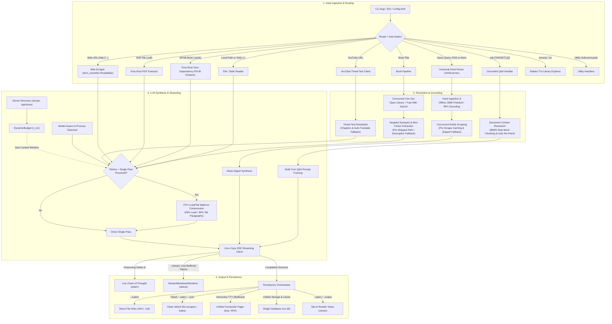
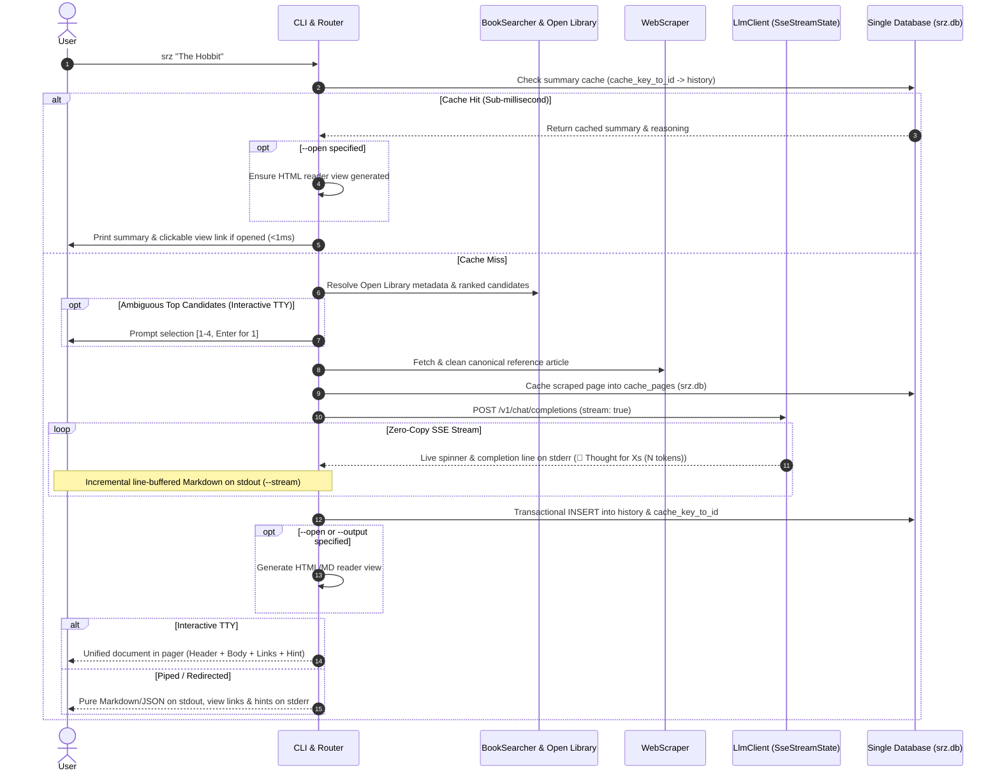
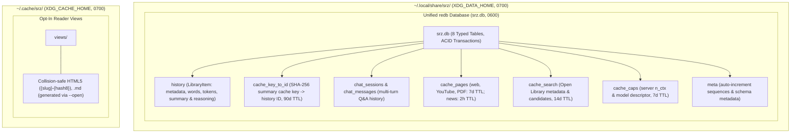

# Architecture & Design

`srz` (Summarize) is a modular, high-performance Rust CLI tool for extracting and synthesizing structured summaries from **webpages**, **YouTube video transcripts**, **PDFs & local documents**, **Unix stdin streams**, **books**, and **live news digests** using local OpenAI-compliant LLMs (`llama.cpp`, `Ollama`, `LM Studio`, `vLLM`).

Designed from the ground up as a local-first systems utility, `srz` pairs zero-copy network streaming and hardware-aware token budgeting with an embedded analytical database. Every subsystem is engineered for instantaneous startup, predictable memory ceilings, and complete local privacy.

---

## 1. High-Level Subsystem Architecture

The diagram below illustrates how input targets flow through ingestion, resolution, token-budgeted synthesis, and persistence:



### Subsystem Directory Organization

The codebase is organized into seven domain modules under `src/`, separating command orchestration from low-level ingestion, inference, and storage engines:

```text
src/
├── commands/     # CLI subcommand workflows (summarize, ask, library, diagnostics, completions)
├── config/       # CLI parsing, auto-detection heuristics, and config file profiles
├── engine/       # SSE streaming client, dynamic token budgeting, and chunkers
├── sources/      # Content ingestion: web scraper, book search, YouTube, and feeds
├── storage/      # Embedded redb cache, library database, and pruning
├── system/       # Hardware profiling, SHA-256, ZIP/text/XML utilities, atomic filesystem, and updater
├── ui/           # Shared Markdown parser, terminal formatting/spinners, HTML reader, and TUI
├── lib.rs        # Library crate root and public module exports
└── main.rs       # Binary entry point and CLI orchestration
```

`src/lib.rs` exposes the core subsystems as a testable library crate, while `src/main.rs` serves as a thin binary entry point responsible for configuration merging, signal handling, and dispatching resolved actions.

### Module Responsibilities

| Subsystem | File | Module | Primary Responsibility |
| :--- | :--- | :--- | :--- |
| **Entry Points** | [`src/main.rs`](https://github.com/NewGuy012/srz/blob/master/src/main.rs) | `main` | Application lifecycle, config resolution, signal routing, and CLI dispatch. |
| | [`src/lib.rs`](https://github.com/NewGuy012/srz/blob/master/src/lib.rs) | `lib` | Root library interface and backward-compatible module re-exports. |
| **Commands** | [`src/commands/mod.rs`](https://github.com/NewGuy012/srz/blob/master/src/commands/mod.rs) | `commands` | Command routing, CLI dispatch (`dispatch_cli`), shell completion generation, database loan manager (`with_db`), cache commands, and dashboard updates. |
| | [`src/commands/summarize.rs`](https://github.com/NewGuy012/srz/blob/master/src/commands/summarize.rs) | `commands::summarize` | Summarization workflows for web, YouTube, documents, stdin, and books. |
| | [`src/commands/ask.rs`](https://github.com/NewGuy012/srz/blob/master/src/commands/ask.rs) | `commands::ask` | Grounded Q&A, shared BM25 context retrieval, automatic re-fetching on cache expiration, standard I/O REPL, and chat persistence. |
| | [`src/commands/library.rs`](https://github.com/NewGuy012/srz/blob/master/src/commands/library.rs) | `commands::library` | Handlers for `history`, `stats`, `find` (title-weighted offline search), and `export`. |
| | [`src/commands/diagnostics.rs`](https://github.com/NewGuy012/srz/blob/master/src/commands/diagnostics.rs) | `commands::diagnostics` | Backend verification (`doctor`), model enumeration, and config inspection. |
| **Configuration** | [`src/config/cli.rs`](https://github.com/NewGuy012/srz/blob/master/src/config/cli.rs) | `config::cli` | `clap` CLI parser, style presets, flags, target auto-detection heuristics, `config.toml` profiles, symlink-safe config loading, and template generation. |
| **Engine** | [`src/engine/compressor.rs`](https://github.com/NewGuy012/srz/blob/master/src/engine/compressor.rs) | `engine::compressor` | CPU Lead/Tail Compression (65% lead / 35% tail paragraphs) and Robertson-Sparck Jones BM25 context retrieval for `srz ask`. |
| | [`src/engine/llm.rs`](https://github.com/NewGuy012/srz/blob/master/src/engine/llm.rs) | `engine::llm` | High-level LLM client, single-pass streaming orchestration, book summarization, and news digest synthesis. |
| | [`src/engine/sse.rs`](https://github.com/NewGuy012/srz/blob/master/src/engine/sse.rs) | `engine::sse` | Zero-copy SSE parser, streaming state machine, live thinking token/elapsed spinner formatting, and generation rate tracking. |
| | [`src/engine/prompts.rs`](https://github.com/NewGuy012/srz/blob/master/src/engine/prompts.rs) | `engine::prompts` | Prompt templating, XML boundary escaping, and untrusted prompt wrapping. |
| | [`src/engine/budget.rs`](https://github.com/NewGuy012/srz/blob/master/src/engine/budget.rs) | `engine::budget` | Dynamic token budgeting (`DynamicBudget`), server capability discovery (`/props`, `/api/show`), context window discovery, and context clamping. |
| | [`src/engine/chunker.rs`](https://github.com/NewGuy012/srz/blob/master/src/engine/chunker.rs) | `engine::chunker` | In-process model-aware token estimation (`TokenizerKind`), $O(1)$ fast paths, and hierarchical binary-search chunking. |
| **Sources** | [`src/sources/document.rs`](https://github.com/NewGuy012/srz/blob/master/src/sources/document.rs) | `sources::document` | Consolidated document loader, pure-Rust single-pass PDF text layer extraction, pure-Rust zero-dependency EPUB chapter & metadata extraction, format dispatch, and file size bounding (`MAX_FILE_BYTES`). |
| | [`src/sources/scraper.rs`](https://github.com/NewGuy012/srz/blob/master/src/sources/scraper.rs) | `sources::scraper` | HTTP client (10 MB cap), SSRF mitigation blocking private/loopback/metadata/transition IPv6 targets, Mozilla Readability DOM parsing (`dom_smoothie`), and streaming HTML-to-Markdown conversion (`XmlScanner`). |
| | [`src/sources/youtube.rs`](https://github.com/NewGuy012/srz/blob/master/src/sources/youtube.rs) | `sources::youtube` | Video ID parsing, Innertube client, XML/JSON3 caption streaming, chapter cue grouping (`parse_chapters_from_description`), and auto-translate (`&tlang=en`) fallback. |
| | [`src/sources/search.rs`](https://github.com/NewGuy012/srz/blob/master/src/sources/search.rs) | `sources::search` | Concurrent fan-out Open Library metadata & search candidates with strict `work_key` path traversal validation, candidate ranking, and targeted Wikipedia synopsis extraction (`extract_wikipedia_synopsis`). |
| | [`src/sources/news.rs`](https://github.com/NewGuy012/srz/blob/master/src/sources/news.rs) | `sources::news` | Syndication feeds (RSS/Atom/JSON via `XmlScanner`), SSRF validation on direct feed URLs, offline `CBMi` protobuf decoding, pre-scrape caching, RPC fallback, and RSS snippet fallback on paywalled links. |
| **Storage** | [`src/storage/cache.rs`](https://github.com/NewGuy012/srz/blob/master/src/storage/cache.rs) | `storage::cache` | Unified `redb` cache (`srz.db`), 2h news TTL, 7d page/capability TTL, opt-in views, and LRU pruning. |
| | [`src/storage/db.rs`](https://github.com/NewGuy012/srz/blob/master/src/storage/db.rs) | `storage::db` | Embedded pure-Rust `redb` database (`srz.db`), 8 typed tables, generic TTL JSON cache helpers, stop-word-filtered title-weighted `history` search, bounded pagination, ACID transactions, and chat tables. |
| **UI & Render** | [`src/ui/markdown.rs`](https://github.com/NewGuy012/srz/blob/master/src/ui/markdown.rs) | `ui::markdown` | Zero-dependency shared CommonMark + GFM parser, XSS-safe link filter (`is_safe_markdown_url`), and ANSI terminal / HTML5 renderer. |
| | [`src/ui/terminal.rs`](https://github.com/NewGuy012/srz/blob/master/src/ui/terminal.rs) | `ui::terminal` | Zero-dependency background thread progress spinners, terminal escape sanitization, ANSI terminal Markdown rendering (`ui::markdown`), line-buffered stream rendering, and pager integration. |
| | [`src/ui/tui.rs`](https://github.com/NewGuy012/srz/blob/master/src/ui/tui.rs) | `ui::tui` | Full-screen interactive terminal explorer (`ratatui`) with RAII `TerminalSessionGuard` cleanup, live search, and system clipboard integration. |
| | [`src/ui/render.rs`](https://github.com/NewGuy012/srz/blob/master/src/ui/render.rs) | `ui::render` | HTML reader generator (`ui::markdown`) with collapsible thought drawers. |
| **System** | [`src/system/hardware.rs`](https://github.com/NewGuy012/srz/blob/master/src/system/hardware.rs) | `system::hardware` | Host RAM/CPU detection (cached via `LazyLock`, native kernel `sysctl`/`/proc/meminfo`) and Gemma 4 model advisories. |
| | [`src/system/sha256.rs`](https://github.com/NewGuy012/srz/blob/master/src/system/sha256.rs) | `system::sha256` | Zero-dependency pure-Rust FIPS 180-4 SHA-256 implementation for cache keys and release checksums. |
| | [`src/system/text_util.rs`](https://github.com/NewGuy012/srz/blob/master/src/system/text_util.rs) | `system::text_util` | Streaming pull-based `XmlScanner`, quoted attribute extraction, flattened Damerau-Levenshtein distance, zero-copy ASCII tokenizers, fast HTML decoding, and string utilities. |
| | [`src/system/fs_util.rs`](https://github.com/NewGuy012/srz/blob/master/src/system/fs_util.rs) | `system::fs_util` | Platform filesystem helpers, `0700`/`0600` permissions, consolidated safe unique tempfile creation, and atomic file writes. |
| | [`src/system/zip.rs`](https://github.com/NewGuy012/srz/blob/master/src/system/zip.rs) | `system::zip` | Lightweight safe ZIP archive extractor & deflate decompressor (`flate2`). |
| | [`src/system/upgrade.rs`](https://github.com/NewGuy012/srz/blob/master/src/system/upgrade.rs) | `system::upgrade` | In-place self-updater with release queries, SHA-256 verification, zero-dependency streaming USTAR tar decoder, and atomic swap with automatic rollback. |

---

## 2. Request & Execution Lifecycle

The sequence diagram below traces the end-to-end execution flow when summarizing a target:



### Execution Lifecycle Phases

#### Sub-Millisecond Cache Fast-Path & Offline Dispatch
Every summarization request begins by constructing a deterministic SHA-256 cache key from the target identifier (URLs, canonical book titles, or local file hashes/mtimes), model name, and summary style preset. `srz` probes `srz.db` directly (`cache_key_to_id` $\to$ `history`) before initializing network clients or the LLM inference client. On a cache hit, the stored summary and preserved chain-of-thought reasoning are returned in under a millisecond. If `--open` was supplied, existing HTML/Markdown reader views on disk are verified or generated on demand. Offline chat session management commands (`--chats`, `--show-chat`, `--delete-chat`) are similarly intercepted and served directly from storage before any LLM connectivity check. During these fast paths, network connections and unnecessary database locks are avoided entirely.

#### Quarantined Content Ingestion
On a cache miss, the router dispatches the target to its specialized source pipeline. Network and filesystem reads enforce strict resource ceilings (10 MB for web payloads and stdin, 20 MB for local files). Scraped web pages are cached in `cache_pages` (with news items adhering to a 2-hour TTL), stripped of navigation menus, ads, and boilerplate via Mozilla's Readability algorithm (`dom_smoothie`), while book lookups concurrently fan out across Open Library and Wikipedia/search endpoints to extract lead and plot synopses. All untrusted source text is then quarantined inside `<source_document>` XML boundary tags with case-insensitive delimiter escaping before reaching the prompt builder.

#### Zero-Copy Streaming Inference
With the prompt assembled and sized according to the server's active context window, `srz` initiates an HTTP POST request with Server-Sent Events enabled (`stream: true`). Incoming byte chunks are parsed zero-copy using borrowed string slices (`Cow<str>`). Model reasoning tokens (`reasoning_content` deltas or in-band `<think>` blocks) update a live single-line progress spinner on `stderr` with token count and elapsed duration (e.g. `💭 Thinking... (42 tokens • 1.5s)`) and settle into a clean completion line (`💭 Thought for 35s (633 tokens)`), while content tokens are either rendered incrementally via `StreamMarkdownRenderer` when `--stream` is passed or buffered behind a clean spinner until completion. Full raw trace streaming to `stderr` can be opted into via `--show-thinking`, `--thinking`, or `--verbose`.

#### Unified Persistence & Opt-In View Generation
Once inference completes, `srz` persists the outcome into the unified `srz.db` database. Within a single ACID write transaction, reading telemetry, metrics, summary text, and chain-of-thought reasoning traces are written as a serialized `LibraryItem` in `history`, indexed by deterministic `cache_key` inside `cache_key_to_id`. Standalone HTML5 and Markdown reader views (`views/{slug}-{hash8}.html` and `.md`) are generated strictly on an opt-in basis via `--open` or explicit output flags (`--output`), avoiding disk file clutter.

#### Clean Unix Stream Separation
At the presentation boundary, `srz` strictly separates data streams from UI diagnostics. When standard output is piped or `--plain` / `--json` is active, `stdout` receives pure Markdown or JSON free of ANSI escape sequences, banners, or file links, while diagnostics are routed to `stderr`. On interactive terminals, the metadata header, styled Markdown body, clickable `file://` view links, and context hints are composed into a single buffer and piped into `$PAGER` (`less -RFX`) whenever the output exceeds the terminal viewport height.

---

## 3. Ingestion Router & Auto-Detection Subsystem

Rather than requiring dedicated subcommands such as `srz web`, `srz file`, or `srz book`, `srz <TARGET>` inspects input structure, URL schemes, filesystem presence, and phrasing heuristics to dispatch targets automatically.

### Target Classification Decision Flow


### Input Classification & Precedence

#### Standard Input, Web URLs & Syndication Feeds
The router evaluates targets in order of structural specificity. An argument equal to `"-"` immediately routes to `ResolvedAction::Stdin` for Unix pipeline composability (such as `git diff | srz -`). Strings beginning with `http://` or `https://` are inspected by `is_feed_url` for syndication path suffixes (`.rss`, `.atom`, `/rss`, `/feed`, `/atom`, `/feed.xml`, `/rss.xml`, `/atom.xml`, `/index.xml`, `/feed.json`, or `/rss/`) or feed query parameters (`?format=rss`, `?format=atom`, `?output=rss`, `?feed=rss`). Matching feed URLs route directly to the universal feed parser (`ResolvedAction::News`), whereas standard links proceed to the web workflow (`ResolvedAction::Web`).

#### Local Documents & Natural News Queries
Non-URL inputs are tested against `is_file_like` and `Path::is_file()`. Any existing file on disk, path prefix (`./`, `../`, `/`, `~`), or recognized document extension (`.pdf`, `.epub`, `.md`, `.markdown`, `.txt`, `.text`, `.html`, `.htm`, `.json`) routes to `ResolvedAction::File`. If the input is not a local path, `is_news_query` checks for topical news phrasing—such as strings starting with `news` or `headlines`, or matching `"current/latest ... updates/stories"`—and strips conversational filler via `clean_news_query` before querying Google News RSS.

#### Command Typo Guardrail & Book Fallback
Before treating remaining freeform text as a book title, `suggest_command` computes the Damerau-Levenshtein edit distance between single-word inputs and known CLI subcommands and aliases (`TOP_LEVEL_COMMANDS`). If a close match is found (for example, `srz doctur`), execution aborts with a helpful suggestion rather than launching an unintended book search. All other freeform strings fall through to `ResolvedAction::Book`.

### Protocol Sub-Routing & Context Disambiguation

#### URL Content Sub-Routing
Within the web workflow, `fetch_url_content` performs secondary protocol inspection. YouTube URLs (`youtube.com/watch`, `youtu.be/`, `/shorts/`) are intercepted by `extract_youtube_video_id` and routed to the Innertube timed-text client, which downloads XML/JSON3 subtitle tracks without fetching video streams. Remote links ending in `.pdf` stream directly into the pure-Rust PDF extractor, and all remaining web pages are fetched via `reqwest` and cleaned with `dom_smoothie`.

#### Grounded Q&A Disambiguation (`srz ask`)
The `srz ask` command accepts either a target paired with a question or a standalone question. `is_probable_question` identifies questions by trailing question marks or interrogative prefixes (`what`, `how`, `why`, `explain`, etc.). When a user provides only a question, the target defaults to `None` and automatically grounds the query against the most recent summary in `srz.db`. If the underlying source page cache has expired, `srz ask` automatically re-fetches the live URL or local document before ranking relevant passages.

#### Multi-Model Router & Proxy Probing
When `probe_server_capabilities` queries `GET /props` on `llama.cpp` routers or proxy gateways, the server often responds with `role: "router"` or `n_ctx: 0`. `srz` detects this topology automatically and issues a follow-up request to `GET /props?model=<MODEL>` to retrieve accurate, model-specific context window (`n_ctx`) allocations.

#### Book Resolution Pipeline & Fast Discovery
When summarizing a book (`srz <TITLE>`), `srz` accelerates uncached runs across five coordinated optimizations:
1. **Startup Concurrency**: LLM capabilities probing (`/props` or `/api/show`) runs concurrently via `tokio::join!` with candidate discovery, eliminating startup serialization.
2. **Wikipedia-First Short-Circuit**: `search_raw_candidates` prioritizes official Wikipedia OpenSearch and Full-text JSON APIs (~100–150ms). When a confident match ($\text{score} \ge 85$) is returned, execution short-circuits immediately, completely bypassing unauthenticated DuckDuckGo HTML scraping and saving up to 4 seconds of latency. DuckDuckGo is retained strictly as a fallback when Wikipedia yields no confident matches.
3. **HTML Pre-Truncation & Reflist Stripping**: When downloading Wikipedia reference pages, raw HTML is truncated prior to the references, bibliography, and navigation footers before running Readability DOM parsing or Markdown conversion, reducing memory allocations by ~70% and accelerating page conversion.
4. **Non-Fiction Extraction & Distillation Avoidance**: `extract_wikipedia_synopsis` recognizes both fiction narrative headings (`## Plot`, `## Synopsis`) and non-fiction structure headings (`## Overview`, `## Content`, `## Contents`, `## Key themes`, `## Core concepts`). Terminal reference lists and bibliographies are stripped from fallback content with `clean_text`, ensuring even full non-fiction articles fit directly within `single_pass_threshold` and avoid multi-chunk Map-Reduce distillation.
5. **Open Library Editorial Description Fallback**: If web scraping fails or yields no candidates, `srz` retrieves the official Open Library work description (`/works/OL...` JSON endpoint, validated by `is_valid_work_key`) as a grounded fallback context before resorting to parametric LLM memory.

---

## 4. Storage & Cache Architecture

`srz` adheres strictly to XDG Base Directory specifications, unifying all persistent data and caching into a single hardened pure-Rust `redb` file in `XDG_DATA_HOME` with private `0700` directory and `0600` file permissions:



### Retention Policies & Storage Schedule

| Namespace / Asset | Retention Policy (TTL) | Eviction Trigger | Notes |
| :--- | :--- | :--- | :--- |
| **`cache_pages`** | **7 days** (News: **2 hours**) | TTL expiration / Bounded LRU | Cached web articles, YouTube transcripts, and PDF text (`pages_ttl`: 7d); news articles use 2h `news_ttl`. |
| **`cache_search`** | **14 days** | TTL expiration / Bounded LRU | Open Library and search candidate metadata (`search_ttl`). |
| **`history` & `cache_key_to_id`** | **Permanent** (Cache lookup: **90 days**) | `--reset-db` (`history`); `clean` (`cache_key_to_id`) | `history` holds summaries, metrics, and reasoning traces; `cache_key_to_id` indexes summary cache hits for 90 days (`summaries_ttl`). |
| **`cache_caps`** | **7 days** | TTL expiration / Model change | Probed `n_ctx` and model descriptors (`caps_ttl`); invalidated immediately when the active model changes. |
| **`views/`** | **14 days** | TTL expiration / Disk LRU | Opt-in via `--open` or explicit output flags. Includes collapsible reasoning drawers. |
| **Total Cache Budget** | **500 MB** (configurable) | Bounded LRU eviction | Evicts oldest cached records across cache tables in `redb` and `views/` on disk by timestamp. |
| **Auto-Prune Schedule** | **Opportunistic (24h)** | Deferred past fast-exit commands | Throttled via `.last_prune` with sub-millisecond overhead. |

### Storage Engine Design

#### Unified Single-File Pure-Rust redb Architecture
Instead of depending on external C/C++ database libraries or heavy analytical engines, `srz` unifies all persistent library records, chat sessions, sequence counters (`meta`), and transient cache tables into a single pure-Rust `redb` file (`srz.db`) with 8 typed tables. `redb` provides embedded key-value storage with zero C FFI overhead, atomic ACID transactions, table-level isolation, and safe concurrent readers. Summaries and reasoning traces serialized into `history` serve as the single source of truth for reading analytics, search, and cache hits resolved via `cache_key_to_id`.

#### Short-Lived News Caching (2-Hour TTL)
Fast-moving news feeds and syndication channels require timely updates. To prevent readers from receiving stale briefings, news pages retrieved via `get_news_page` and news briefings cached with `get_news_summary` automatically use a 2-hour TTL (`news_ttl`), whereas standard web articles, YouTube transcripts, and cached remote PDFs use the 7-day `pages_ttl`.

#### Bounded LRU Pruning
Cache eviction operates directly on `redb` table iterators, scanning timestamps and deleting expired or budget-exceeding records within atomic write transactions:
When total cached bytes exceed the storage budget, the oldest entries past the budget are deleted in a single atomic transaction without CPU or memory overhead.

#### Opt-In View Generation
Because modern terminal rendering is styled and formatted cleanly via `ui::markdown`, automatic generation of standalone `.html` and `.md` view files on every run is disabled. View files in `views/` are generated strictly when requested via `--open` or explicit output flags (`--output`), eliminating disk clutter while preserving one-click browser viewing when desired.

#### Collision-Safe Reader Views
Standalone HTML5 and Markdown reader files in `views/` are named using `slugify_unique(title, key)`, which appends an 8-character SHA-256 digest of the source URL or file path (`{slug}-{hash8}.html`). This guarantees zero filename collisions when summarizing different pages that share generic titles like "Documentation" or "Home". Each HTML view embeds the model's reasoning trace inside a collapsible `<details class="thought-drawer">` element.

#### Pure-Rust ACID Isolation & Multi-Process Safety
`redb` enforces multi-reader single-writer ACID transaction semantics with zero external lock daemons. Within the same CLI process, components share the underlying database safely through standard Rust ownership and `Mutex` guards.

---

## 5. Offline Library Search & BM25 Q&A Grounding

### Offline Library Search (`srz find`)

When executing `srz find <QUERY>`, `Database::search` evaluates saved records offline across `TABLE_HISTORY` in `srz.db` without requiring an external search engine or SQL index:

1. **Stop-Word Filtering**: Queries are tokenized via `tokenize_search_terms`, removing high-frequency English stop words to isolate discriminative keywords.
2. **ASCII Fast-Path & UTF-8 Fallback**: ASCII terms match with zero allocations via `find_ascii_case_insensitive`, while Unicode terms fall back to UTF-8 safe lowercase character-index scanning.
3. **10× Title Weight Boost**: Each matched query term in a document title scores `10.0` vs `1.0` in the summary body (`score = 10.0 * title_matches + summary_matches`), breaking score ties by most recent entry `id` and extracting UTF-8 safe preview snippets around matched terms (`extract_snippet`).

### Grounded Document Retrieval (`srz ask`)

When querying long documents via `srz ask`, `engine::compressor::compute_bm25_scores` ranks in-memory document chunks using the Robertson-Sparck Jones BM25 formula:

$$
\text{Score}(D, Q) = \sum_{t \in Q} \max(\text{IDF}(t), 0.1) \cdot \frac{f(t, D) \cdot (k_1 + 1)}{f(t, D) + k_1 \cdot \left(1 - b + b \cdot \frac{|D|}{\text{avgdl}}\right)}
$$

$$
\text{IDF}(t) = \ln\left( \frac{N - n(t) + 0.5}{n(t) + 0.5} + 1.0 \right)
$$

| Symbol | Parameter | Value / Role |
| :--- | :--- | :--- |
| $f(t, D)$ | Term Frequency | Exact word-boundary occurrences of query term $t$ in chunk $D$ (`is_word_boundary`). |
| $k_1$ | Saturation | `1.2`: Controls non-linear scaling of repeated term matches. |
| $b$ | Length Normalization | `0.75`: Penalizes verbose chunks relative to average chunk token length (`avgdl`). |
| $N$, $n(t)$ | Document Counts | $N$ is candidate chunk count; $n(t)$ is the number of chunks containing term $t$. |

Query terms are stop-word filtered and deduplicated first so rare domain concepts carry full weight, while top-scoring chunks within `DynamicBudget::ask_doc_budget` are reassembled in original reading order.

---

## 6. Hardware-Aware Inference & Dynamic Budgeting

### Hardware Profiling & Gemma 4 Steering

`srz` inspects host RAM and CPU architecture across macOS (`sysctl`), Linux (`/proc/meminfo`), and Windows (WMI) without unsafe C FFI bindings, classifying machines into memory tiers to recommend optimal models and context sizes.

Across modern laptops and workstations, `srz` steers users toward **Google Gemma 4 at 8-bit quantization (`Q8_0`)** as its reference profile. Gemma 4 delivers high parameter density and strong instruction adherence across long context windows with low battery draw. Running at `Q8_0` preserves near-FP16 semantic fidelity and avoids the nuance degradation common in aggressive 4-bit quantizations while fitting comfortably within unified memory budgets. See the [Hardware Tier Reference Matrix](quickstart.md#hardware-tier-reference-matrix) for tier-by-tier recommendations.

### Synthesis Strategy: Single-Pass with CPU Lead/Tail Salience Compression

Local LLMs have an asymmetric latency profile: prompt prefill runs compute-bound at high throughput, while token generation (decode) is memory-bandwidth bound. Traditional Map-Reduce and recursive tree reduction multiply decoding passes, forcing the local runner through sequential intermediate generation loops that lock up consumer GPUs and unified memory.

To eliminate multi-minute latency on local machines, `srz` guarantees **Single-Pass Streaming Synthesis** across all document lengths:

1. **Direct Single-Pass**: When a document fits within `single_pass_threshold`, `srz` feeds the complete text directly into the model's attention window, preserving global thematic coherence and full cross-chapter context.
2. **CPU Lead/Tail Compression (`compress_document_stratified`)**: When content exceeds `single_pass_threshold` (such as long PDF reports or 300-page EPUB books), `srz` compresses the document deterministically in **< 20ms on the CPU**:
   - Evaluates an $O(1)$ byte-length fast path (`content.len() <= max_tokens`) to skip compression on short inputs.
   - Splits non-empty paragraphs on `\n\n` boundaries (falling back to binary-search token truncation via `TextChunker::truncate_by_tokens` for monolithic single-paragraph blocks).
   - Allocates **65%** of the token budget to leading paragraphs (establishing premises, definitions, and opening chapters) and the remaining **35%** to trailing paragraphs (preserving conclusions and final synthesis), joined by `\n\n...\n\n`.
   - Enforces a final token check via the active `TokenizerKind` profile, truncating on clean boundaries if needed so total input stays $\le \text{single\_pass\_threshold}$.

This guarantees that every command streams live output to the terminal without recursive tree reduction loops or context overflow.

### Dynamic Token Budgeting & Zero-Drift Calibration

Hardcoded token limits either crash small context servers with Out-of-Memory errors or leave large context windows underutilized. `srz` queries backend capabilities at runtime (`probe_server_capabilities`), clamps `n_ctx` to `[2_048, 2_097_152]`, and enforces a strict capacity invariant in `DynamicBudget`:

$$
\text{usable} = n_{\text{ctx}} - \big(\text{max\_completion} + \text{system\_margin} + \text{cushion}\big) \ge 0
$$

Specifically, `DynamicBudget::new` reserves:
- **`max_completion`**: Defaults to `(n_ctx / 4).clamp(1024, 8192)`, or the resolved style/CLI `--max-tokens` capped at `(n_ctx / 3).clamp(512, u32::MAX)`.
- **`system_margin`**: Fixed `500` tokens for system instructions and `<source_document>` delimiters.
- **`cushion`**: `(n_ctx / 20).clamp(200, 1600)` (5% headroom for tokenizer variance).
- **Q&A Budgets (`srz ask`)**: Allocates `ask_doc_budget = usable / 2` (50% of usable input) for BM25-ranked passages and `ask_hist_budget = usable * 4 / 10` (40% of usable input) for sliding chat history.

To eliminate the 15–25% token count drift typical when applying generic BPE tokenizers to non-OpenAI models, `srz` uses in-process model-aware profiles (`TokenizerKind` supporting Gemma SentencePiece 256k, Llama 3 128k, `o200k_base`, and `cl100k_base`), eliminating network latency and token drift without external `/tokenize` roundtrips. When compressing large documents or selecting `srz ask` context, `srz` counts tokens using the active model's profile (`engine::compressor`) to enforce the context boundary.

---

## 7. Performance & Memory Efficiency

### Architectural Optimizations at a Glance

| Subsystem | Core Optimization | Architectural Benefit |
| :--- | :--- | :--- |
| **LLM Inference** | Single-Pass Streaming + CPU Lead/Tail Compression + Zero-Drift Tokenization | Fast live streaming on long documents without multi-pass decode penalties. |
| **Streaming & Reasoning** | Live dimmed chain-of-thought on `stderr` + line-buffered `StreamMarkdownRenderer` | Real-time cognitive visibility; flicker-free ANSI Markdown without mid-line style breaks. |
| **Unix Stream Separation** | Strict stream routing: clean stdout for pipelines; diagnostics and links on `stderr` | Seamless piping into UNIX tools (`jq`, `cat`, files) without ANSI code contamination. |
| **Terminal & Pager** | Unified document composition piped directly into `$PAGER` (`less -RFX`) | Header, body, links, and hints kept together without viewport truncation. |
| **Content Ingestion** | Mozilla Readability (`dom_smoothie`), streaming XML, chapters & auto-translation, and bounded semaphores | Clean text stripped of web noise; chapter-aligned caption pulls; bounded worker concurrency. |
| **Storage & Caching** | Unified `redb` (`srz.db`), LRU pruning, 2h news TTL, and opt-in reader views | Sub-millisecond hits, zero cache duplication, atomic LRU pruning, and clean disk views. |
| **Resolution & Grounding** | Offline `CBMi` protobuf decoding, targeted Wikipedia synopsis extraction, and in-memory BM25 chunking | Zero-network Google News link resolution; fewer prompt tokens for books; discriminative Q&A retrieval. |
| **Offline Search** | Stop-word-filtered 10× title-boosted search across `history` in `redb` | Fast offline summary search without external search engines or daemons. |

### Core Performance Mechanisms

#### Zero-Copy SSE Parsing & Line-Buffered Rendering
The Server-Sent Events client parses streaming JSON frames zero-copy from network buffers (`Cow<str>`) and batches terminal flushes per packet to avoid string reallocations. Short inputs pass an $O(1)$ byte-length check that skips tokenization entirely. When `--stream` is active, `StreamMarkdownRenderer` buffers incoming tokens by line and tracks multi-line code fences so ANSI styles are applied only to complete syntactic lines rather than breaking mid-word.

#### Offline Protobuf Decoding & Bounded News Ingestion
Google News RSS feeds wrap article URLs inside base64 `CBMi` protobuf payloads. Rather than issuing two sequential HTTP roundtrips per article to resolve redirects, `srz` decodes the target URL directly offline from the protobuf wire bytes—accelerating news ingestion by 60–90%—and falls back to `batchexecute` RPC only when needed. Concurrent article scraping is bounded by a `tokio::sync::Semaphore`, caches scraped pages prior to synthesis, and falls back to clean RSS summary snippets whenever publisher links are paywalled.

#### Targeted Synopsis Extraction & Chapter-Aligned Transcripts
During book resolution, `srz` fans out metadata and search queries concurrently across Open Library and Wikipedia. When scraping Wikipedia reference articles, `extract_wikipedia_synopsis` isolates the lead introduction and `== Plot ==` / `== Synopsis ==` sections while discarding bibliography, cast, and edition tables—reducing prompt token volume by up to 70%. Similarly, the YouTube pipeline parses chapter timestamps from video descriptions (`parse_chapters_from_description`) to group caption cues into semantic sections and automatically falls back to YouTube's `&tlang=en` auto-translation parameter when native English tracks are unavailable.

#### Discriminative BM25 Grounding & Word-Boundary Occurrence Matching
When answering questions in `srz ask`, candidate document chunks are scored in memory using a stop-word filtered Robertson-Sparck Jones BM25 ranker. Stripping high-frequency English stop words ensures that domain-specific keywords carry maximum inverse document frequency weight when selecting grounding passages for the prompt window. Term occurrences within document chunks are evaluated using strict word-boundary matching (`is_word_boundary`), eliminating false-positive substring matches (such as matching "rust" inside "trust" or "frustrated") with zero string allocations. All Q&A parameters are encapsulated in `AskArgs` and turn contexts in `AskSessionContext` to guarantee parameter safety across interactive REPL sessions.

#### Overlapped Pipeline Startup & Transport Compression
To eliminate latency on uncached runs, `srz` activates transparent HTTP `gzip` payload compression across web scraping, feed parsing, and API roundtrips. During startup on uncached book summaries, LLM capability probing (`/props` or `/api/show`) runs concurrently with target search via `tokio::join!`, and opportunistic storage maintenance (`maybe_auto_prune`) is deferred until after output presentation.

#### Style-Aware Token Budgeting & CPU Context Compression
Rather than allocating a fixed 8,192-token completion budget regardless of requested length, `srz` scales default completion reservations dynamically based on summary preset (`concise` $\to$ 1,536, `bullets` $\to$ 2,048, `detailed` $\to$ 8,192). This expands available input context on concise and bulleted runs, allowing medium-length documents and transcripts to fit in a single uncompressed inference pass. When documents exceed context capacity, CPU Lead/Tail Salience Compression (`compress_document_stratified`) trims the text to fit within `single_pass_threshold` in <20ms, ensuring all outputs stream live in a single generation pass.

#### Boilerplate HTML Tag Stripping & PDF Clean Extraction
Before parsing web pages with Mozilla Readability, raw HTML is scanned to strip `<script>`, `<style>`, `<svg>`, and `<noscript>` blocks, reducing DOM tree size substantially on hydration-heavy sites. For PDF documents, `PdfExtractor` strips trailing `References`, `Bibliography`, and inline citation markers (`[1]`, `[12, 15]`), reconstructs natural paragraph boundaries, and remote PDF extractions are cached in `cache_pages` to accelerate subsequent style adjustments and interactive chat.

---

## 8. Security, Privacy & System Hardening

### Memory Safety & Zero-Unsafe Guarantee
The entire codebase enforces `#![forbid(unsafe_code)]` at both `src/lib.rs` and `src/main.rs`. Every parser, network stream, and database query is written in 100% safe Rust, providing compile-time mathematical guarantees against buffer overflows, use-after-free bugs, and data races.

### Local Privacy & Atomic Filesystem Isolation
`srz` operates with zero telemetry, analytics, or cloud dependencies. Cache and data directories are created with owner-only `0700` permissions, `config.toml` loading rejects symlinks and bounds file size to prevent `CWE-59` exposure, and files are written atomically using temporary files (`O_CREAT | O_EXCL` with `0600` permissions) while explicitly rejecting pre-planted symlinks to prevent directory traversal and symlink swap attacks.

### Defensive Prompt Quarantining
Because web pages and documents may contain adversarial instructions, all ingested content is isolated within `<source_document>` XML boundary tags. The prompt framing layer performs case-insensitive scanning to neutralize embedded closing tags, preventing untrusted text from escaping its quarantine container and hijacking system instructions.

### Terminal Escape & BiDi Sanitization
Rendering untrusted text in terminal emulators carries risks of clipboard hijacking (via OSC 52 sequences) and visual spoofing. `srz` passes all titles, metadata, and streaming LLM outputs through `sanitize_terminal_text`, stripping ANSI CSI/OSC control sequences, C1 control characters, and Unicode Bidirectional (BiDi) override codepoints.

### SSRF Guardrails, Bounded Resource Ceilings & Verified Upgrades
All outbound public web fetches — including articles, remote PDFs, RSS/Atom/JSON feeds, and HTTP redirect hops (capped at 10) — enforce `validate_public_http_url` / `validate_parsed_public_http_url` to reject non-HTTP(S) schemes, embedded userinfo, IPv6 zone IDs (`%`), and private, loopback, link-local, special-purpose IPv6, or cloud-metadata IP/host targets. Strict byte ceilings protect the host from resource exhaustion: 10 MB for web responses and stdin streams, 20 MB for local documents, and 50 MB for release archives, reinforced by connection and read timeouts on all HTTP clients. Self-updates via `srz upgrade` verify release binaries against cryptographic SHA-256 checksums before performing an atomic binary swap.

---

## 9. Related Technical Guides & Resources

- 🦀 [**Rust Learning Guide**](rust_learning_guide.md): In-depth systems programming concepts and architectural tour of `srz`.
- 🛡️ [**Security Audit**](security_audit.md): Complete vulnerability analysis and threat mitigation verification.
- 📋 [**Changelog**](changelog.md): Release history, version highlights, and breaking changes.
- 📖 [**Command Reference**](commands.md): Complete CLI reference, auto-detection rules, subcommands, and flags.
- ⚙️ [**Configuration Guide**](configuration.md): Config file schema, named profiles, and cache retention tuning.
