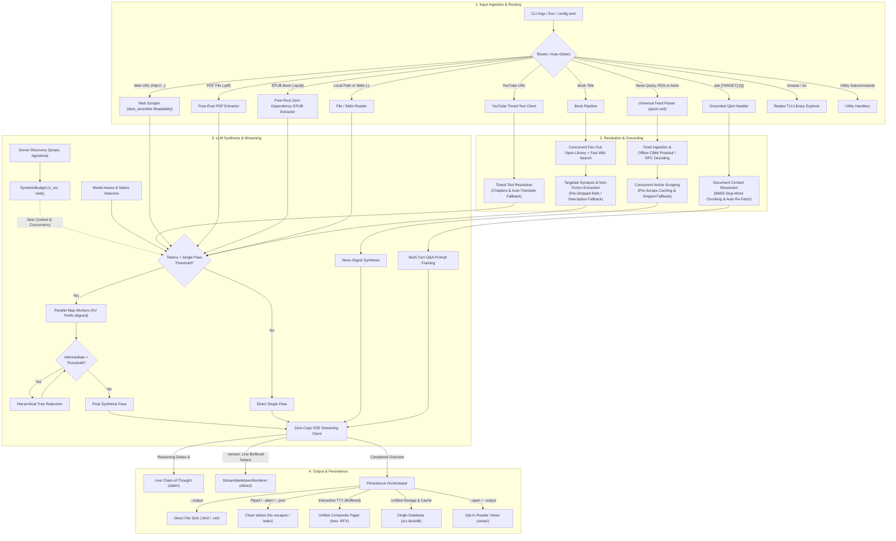
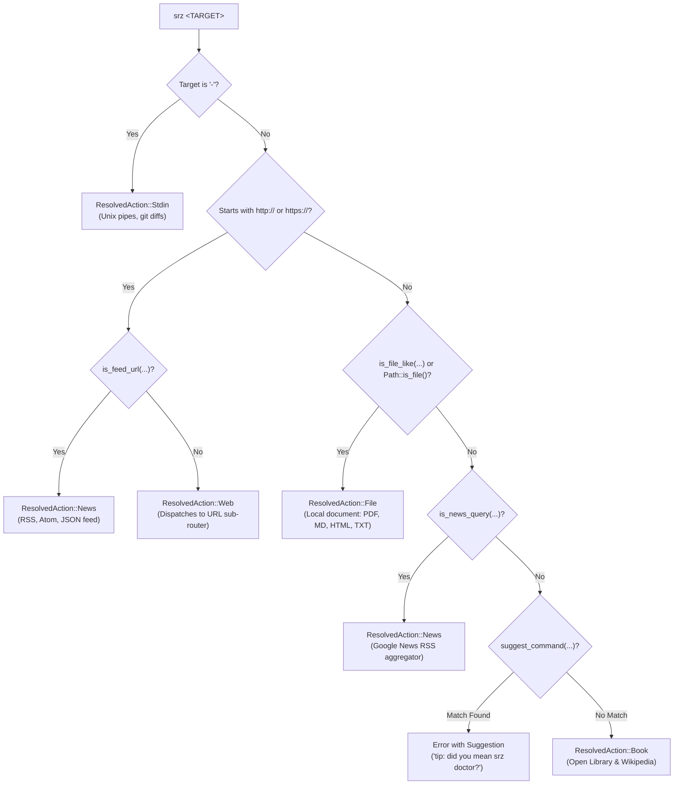
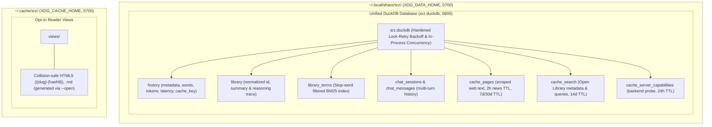

# Architecture & Design

`srz` (Summarize) is a modular, high-performance Rust CLI tool for extracting and synthesizing structured summaries from **webpages**, **YouTube video transcripts**, **PDFs & local documents**, **Unix stdin streams**, **books**, and **live news digests** using local OpenAI-compliant LLMs (`llama.cpp`, `Ollama`, `LM Studio`, `vLLM`).

Designed from the ground up as a local-first systems utility, `srz` pairs zero-copy network streaming and hardware-aware token budgeting with an embedded analytical database. Every subsystem is engineered for instantaneous startup, predictable memory ceilings, and complete local privacy.

---

## 1. High-Level Subsystem Architecture

The diagram below illustrates how input targets flow through ingestion, resolution, token-budgeted synthesis, and persistence:



### Subsystem Directory Organization

The codebase is organized into seven domain modules under `src/`, separating command orchestration from low-level ingestion, inference, and storage engines:

```text
src/
├── commands/     # CLI subcommand workflows (summarize, ask, library, diagnostics)
├── config/       # CLI parsing, auto-detection heuristics, and config file profiles
├── engine/       # SSE streaming client, dynamic token budgeting, and chunkers
├── sources/      # Content ingestion: web scraper, book search, YouTube, and feeds
├── storage/      # Embedded DuckDB cache, library database, and pruning
├── system/       # Hardware profiling, text sanitization, atomic filesystem, and updater
├── ui/           # Terminal console formatting, spinners, streaming renderer, and TUI
├── lib.rs        # Library crate root and public module exports
└── main.rs       # Binary entry point and CLI orchestration
```

`src/lib.rs` exposes the core subsystems as a testable library crate, while `src/main.rs` serves as a thin binary entry point responsible for configuration merging, signal handling, and dispatching resolved actions.

### Module Responsibilities

| Subsystem | File | Module | Primary Responsibility |
| :--- | :--- | :--- | :--- |
| **Entry Points** | [`src/main.rs`](https://github.com/NewGuy012/srz/blob/master/src/main.rs) | `main` | Application lifecycle, config resolution, signal routing, and CLI dispatch. |
| | [`src/lib.rs`](https://github.com/NewGuy012/srz/blob/master/src/lib.rs) | `lib` | Root library interface and backward-compatible module re-exports. |
| **Commands** | [`src/commands/summarize.rs`](https://github.com/NewGuy012/srz/blob/master/src/commands/summarize.rs) | `commands::summarize` | Summarization workflows for web, YouTube, documents, stdin, and books. |
| | [`src/commands/ask.rs`](https://github.com/NewGuy012/srz/blob/master/src/commands/ask.rs) | `commands::ask` | Grounded Q&A, stop-word filtered in-memory BM25 chunk selection, automatic re-fetching on cache expiration, interactive REPL (`rustyline`), and DuckDB chat persistence. |
| | [`src/commands/library.rs`](https://github.com/NewGuy012/srz/blob/master/src/commands/library.rs) | `commands::library` | Handlers for `history`, `stats`, `find` (BM25), `query` (SQL), and `export`. |
| | [`src/commands/diagnostics.rs`](https://github.com/NewGuy012/srz/blob/master/src/commands/diagnostics.rs) | `commands::diagnostics` | Backend verification (`doctor`), model enumeration, and config inspection. |
| **Configuration** | [`src/config/cli.rs`](https://github.com/NewGuy012/srz/blob/master/src/config/cli.rs) | `config::cli` | `clap` CLI parser, style presets, flags, and target auto-detection heuristics. |
| | [`src/config/file.rs`](https://github.com/NewGuy012/srz/blob/master/src/config/file.rs) | `config::file` | `config.toml` profiles, configuration loading, and template generation. |
| **Engine** | [`src/engine/llm.rs`](https://github.com/NewGuy012/srz/blob/master/src/engine/llm.rs) | `engine::llm` | High-level LLM client, single-pass and parallel Map-Reduce orchestration, book summarization, and tree reduction. |
| | [`src/engine/sse.rs`](https://github.com/NewGuy012/srz/blob/master/src/engine/sse.rs) | `engine::sse` | Zero-copy SSE parser, streaming state machine, thought headline extraction, thinking duration formatting, and rate tracking. |
| | [`src/engine/probe.rs`](https://github.com/NewGuy012/srz/blob/master/src/engine/probe.rs) | `engine::probe` | Server capability discovery (`/props`, `/api/show`), native `/tokenize` probing, context window discovery, and context clamping. |
| | [`src/engine/prompts.rs`](https://github.com/NewGuy012/srz/blob/master/src/engine/prompts.rs) | `engine::prompts` | Prompt templating, XML boundary escaping, untrusted prompt wrapping, and tree-reduction batch partitioning. |
| | [`src/engine/budget.rs`](https://github.com/NewGuy012/srz/blob/master/src/engine/budget.rs) | `engine::budget` | Dynamic token budgeting (`DynamicBudget`) scaling chunks and worker slots. |
| | [`src/engine/chunker.rs`](https://github.com/NewGuy012/srz/blob/master/src/engine/chunker.rs) | `engine::chunker` | BPE token counting (`tiktoken-rs`), $O(1)$ fast paths, and paragraph chunking. |
| **Sources** | [`src/sources/document.rs`](https://github.com/NewGuy012/srz/blob/master/src/sources/document.rs) | `sources::document` | Local document validation (20 MB cap), format dispatch (PDF, EPUB, HTML, Markdown, plain text), and sanitization. |
| | [`src/sources/epub.rs`](https://github.com/NewGuy012/srz/blob/master/src/sources/epub.rs) | `sources::epub` | Pure-Rust zero-dependency EPUB chapter & metadata extraction (`zip`, `quick-xml`, `htmd`). |
| | [`src/sources/scraper.rs`](https://github.com/NewGuy012/srz/blob/master/src/sources/scraper.rs) | `sources::scraper` | HTTP client (10 MB cap), Mozilla Readability DOM parsing (`dom_smoothie`), and Markdown conversion. |
| | [`src/sources/pdf.rs`](https://github.com/NewGuy012/srz/blob/master/src/sources/pdf.rs) | `sources::pdf` | Pure-Rust single-pass PDF text layer and metadata extraction (`pdf-extract`). |
| | [`src/sources/youtube.rs`](https://github.com/NewGuy012/srz/blob/master/src/sources/youtube.rs) | `sources::youtube` | Video ID parsing, Innertube client, XML/JSON3 caption streaming, chapter cue grouping (`parse_chapters_from_description`), and auto-translate (`&tlang=en`) fallback. |
| | [`src/sources/search.rs`](https://github.com/NewGuy012/srz/blob/master/src/sources/search.rs) | `sources::search` | Concurrent fan-out Open Library metadata & search candidates, candidate ranking, and targeted Wikipedia synopsis extraction (`extract_wikipedia_synopsis`). |
| | [`src/sources/news.rs`](https://github.com/NewGuy012/srz/blob/master/src/sources/news.rs) | `sources::news` | Syndication feeds (RSS/Atom via `quick-xml`), zero-network offline `CBMi` protobuf decoding, pre-scrape caching, RPC fallback, and RSS snippet fallback on paywalled links. |
| **Storage** | [`src/storage/cache.rs`](https://github.com/NewGuy012/srz/blob/master/src/storage/cache.rs) | `storage::cache` | Unified DuckDB cache (`srz.duckdb`), 2h news TTL, opt-in views, and pure SQL windowed LRU pruning. |
| | [`src/storage/db.rs`](https://github.com/NewGuy012/srz/blob/master/src/storage/db.rs) | `storage::db` | Embedded DuckDB database (`srz.duckdb`), BM25 index, lock-retry backoff, and chat tables. |
| **UI & Render** | [`src/ui/terminal.rs`](https://github.com/NewGuy012/srz/blob/master/src/ui/terminal.rs) | `ui::terminal` | CLI progress spinners (`indicatif`) and terminal escape sanitization. |
| | [`src/ui/printer.rs`](https://github.com/NewGuy012/srz/blob/master/src/ui/printer.rs) | `ui::printer` | `MadSkin` terminal Markdown, line-buffered stream rendering, and pager integration. |
| | [`src/ui/tui.rs`](https://github.com/NewGuy012/srz/blob/master/src/ui/tui.rs) | `ui::tui` | Full-screen interactive terminal explorer (`ratatui`) with live search and system clipboard integration. |
| | [`src/ui/render.rs`](https://github.com/NewGuy012/srz/blob/master/src/ui/render.rs) | `ui::render` | HTML reader generator (`pulldown-cmark`) with collapsible thought drawers. |
| **System** | [`src/system/hardware.rs`](https://github.com/NewGuy012/srz/blob/master/src/system/hardware.rs) | `system::hardware` | Host RAM/CPU detection (native kernel `sysctl`/`/proc/meminfo`) and Gemma 4 model advisories. |
| | [`src/system/text_util.rs`](https://github.com/NewGuy012/srz/blob/master/src/system/text_util.rs) | `system::text_util` | Fast HTML decoding, ASCII case-insensitive search, and zero-copy string utilities. |
| | [`src/system/fs_util.rs`](https://github.com/NewGuy012/srz/blob/master/src/system/fs_util.rs) | `system::fs_util` | Platform filesystem helpers, `0700`/`0600` permissions, and atomic file writes. |
| | [`src/system/upgrade.rs`](https://github.com/NewGuy012/srz/blob/master/src/system/upgrade.rs) | `system::upgrade` | In-place self-updater with release queries, SHA-256 verification, and atomic swap. |

---

## 2. Request & Execution Lifecycle

The sequence diagram below traces the end-to-end execution flow when summarizing a target:


### Execution Lifecycle Phases

#### Sub-Millisecond Cache Fast-Path & Offline Dispatch
Every summarization request begins by constructing a deterministic cache key from the target identifier (URLs, canonical book titles, or local file hashes/mtimes), model name, and summary style preset. `srz` probes `srz.duckdb` directly (`history` joined with `library`) using `cache_key` before initializing network clients or the LLM inference client. On a cache hit, the stored summary and preserved chain-of-thought reasoning are returned in under a millisecond. If `--open` was supplied, existing HTML/Markdown reader views on disk are verified or generated on demand. Offline chat session management commands (`--chats`, `--show-chat`, `--delete-chat`) are similarly intercepted and served directly from DuckDB before any LLM connectivity check. During these fast paths, network connections and unnecessary database locks are avoided entirely.

#### Quarantined Content Ingestion
On a cache miss, the router dispatches the target to its specialized source pipeline. Network and filesystem reads enforce strict resource ceilings (10 MB for web payloads and stdin, 20 MB for local files). Scraped web pages are cached in `cache_pages` (with news items adhering to a 2-hour TTL), stripped of navigation menus, ads, and boilerplate via Mozilla's Readability algorithm (`dom_smoothie`), while book lookups concurrently fan out across Open Library and search endpoints to extract lead and plot synopses. All untrusted source text is then quarantined inside `<source_document>` XML boundary tags with case-insensitive delimiter escaping before reaching the prompt builder.

#### Zero-Copy Streaming Inference
With the prompt assembled and sized according to the server's active context window, `srz` initiates an HTTP POST request with Server-Sent Events enabled (`stream: true`). Incoming byte chunks are parsed zero-copy using borrowed string slices (`Cow<str>`). Model reasoning tokens (`reasoning_content` deltas or in-band `<think>` blocks) dynamically update a live single-line spinner with the active step summary (e.g. `💭 Thinking: Analyzing the request...`) and settle into a dimmed collapsible dropdown indicator (`💭 Thought for 35s ›`), while content tokens are either rendered incrementally via `StreamMarkdownRenderer` when `--stream` is passed or buffered behind a clean spinner until completion. Full raw trace streaming to `stderr` can be opted into via `--show-thinking` or `--verbose`.

#### Unified Persistence & Opt-In View Generation
Once inference completes, `srz` persists the outcome into the unified `srz.duckdb` database. Reading telemetry, token metrics, and `cache_key` are committed to `history`, while full summary text and chain-of-thought reasoning traces reside in `library` within a single ACID transaction. Standalone HTML5 and Markdown reader views (`views/{slug}-{hash8}.html` and `.md`) are generated strictly on an opt-in basis via `--open` or explicit output flags (`--output`), avoiding disk file clutter.

#### Clean Unix Stream Separation
At the presentation boundary, `srz` strictly separates data streams from UI diagnostics. When standard output is piped or `--plain` / `--json` is active, `stdout` receives pure Markdown or JSON free of ANSI escape sequences, banners, or file links, while diagnostics are routed to `stderr`. On interactive terminals, the metadata header, styled Markdown body, clickable `file://` view links, and context hints are composed into a single buffer and piped into `$PAGER` (`less -RFX`) whenever the output exceeds the terminal viewport height.

---

## 3. Ingestion Router & Auto-Detection Subsystem

Rather than requiring dedicated subcommands such as `srz web`, `srz file`, or `srz book`, `srz <TARGET>` inspects input structure, URL schemes, filesystem presence, and phrasing heuristics to dispatch targets automatically.

### Target Classification Decision Flow



### Input Classification & Precedence

#### Standard Input, Web URLs & Syndication Feeds
The router evaluates targets in order of structural specificity. An argument equal to `"-"` immediately routes to `ResolvedAction::Stdin` for Unix pipeline composability (such as `git diff | srz -`). Strings beginning with `http://` or `https://` are inspected by `is_feed_url` for syndication path suffixes (`.rss`, `.atom`, `/feed`, `/rss.xml`, `/feed.json`) or feed query parameters (`?format=rss`). Matching feed URLs route directly to the universal feed parser (`ResolvedAction::News`), whereas standard links proceed to the web workflow (`ResolvedAction::Web`).

#### Local Documents & Natural News Queries
Non-URL inputs are tested against `is_file_like` and `Path::is_file()`. Any existing file on disk, path prefix (`./`, `../`, `/`, `~`), or recognized document extension (`.pdf`, `.md`, `.txt`, `.html`, `.epub`, `.json`) routes to `ResolvedAction::File`. If the input is not a local path, `is_news_query` checks for topical news phrasing—such as strings starting with `news` or `headlines`, or matching `"current/latest ... updates/stories"`—and strips conversational filler via `clean_news_query` before querying Google News RSS.

#### Command Typo Guardrail & Book Fallback
Before treating remaining freeform text as a book title, `suggest_command` computes the edit distance between single-word inputs and known CLI subcommands (`doctor`, `models`, `browse`, `stats`, `history`, `ask`). If a close match is found (for example, `srz doctur`), execution aborts with a helpful suggestion rather than launching an unintended book search. All other freeform strings fall through to `ResolvedAction::Book`.

### Protocol Sub-Routing & Context Disambiguation

#### URL Content Sub-Routing
Within the web workflow, `fetch_url_content` performs secondary protocol inspection. YouTube URLs (`youtube.com/watch`, `youtu.be/`, `/shorts/`) are intercepted by `extract_youtube_video_id` and routed to the Innertube timed-text client, which downloads XML/JSON3 subtitle tracks without fetching video streams. Remote links ending in `.pdf` stream directly into the pure-Rust PDF extractor, and all remaining web pages are fetched via `reqwest` and cleaned with `dom_smoothie`.

#### Grounded Q&A Disambiguation (`srz ask`)
The `srz ask` command accepts either a target paired with a question or a standalone question. `is_probable_question` identifies questions by trailing question marks or interrogative prefixes (`what`, `how`, `why`, `explain`, etc.). When a user provides only a question, the target defaults to `None` and automatically grounds the query against the most recent summary in `srz.duckdb`. If the underlying source page cache has expired, `srz ask` automatically re-fetches the live URL or local document before ranking relevant passages.

#### Multi-Model Router & Proxy Probing
When `probe_server_capabilities` queries `GET /props` on `llama.cpp` routers or proxy gateways, the server often responds with `role: "router"` or `n_ctx: 0`. `srz` detects this topology automatically and issues a follow-up request to `GET /props?model=<MODEL>` to retrieve accurate, model-specific context window (`n_ctx`) and concurrency slot (`total_slots`) allocations.

#### Book Resolution Pipeline & Fast Discovery
When summarizing a book (`srz <TITLE>` or `srz book <TITLE>`), `srz` accelerates uncached runs across five coordinated optimizations:
1. **Startup Concurrency**: LLM capabilities probing (`/props` and `/tokenize`) runs concurrently via `tokio::join!` with candidate discovery, eliminating startup serialization.
2. **Wikipedia-First Short-Circuit**: `search_raw_candidates` prioritizes official Wikipedia OpenSearch and Full-text JSON APIs (~100–150ms). When a confident match ($\text{score} \ge 85$) is returned, execution short-circuits immediately, completely bypassing unauthenticated DuckDuckGo HTML scraping and saving up to 4 seconds of latency. DuckDuckGo is retained strictly as a fallback when Wikipedia yields no confident matches.
3. **HTML Pre-Truncation & Reflist Stripping**: When downloading Wikipedia reference pages, raw HTML is truncated prior to the references, bibliography, and navigation footers before running Readability DOM parsing or Markdown conversion, reducing memory allocations by ~70% and accelerating page conversion.
4. **Non-Fiction Extraction & Distillation Avoidance**: `extract_wikipedia_synopsis` recognizes both fiction narrative headings (`## Plot`, `## Synopsis`) and non-fiction structure headings (`## Overview`, `## Content`, `## Contents`, `## Key themes`, `## Core concepts`). Terminal reference lists and bibliographies are stripped from fallback content with `clean_text`, ensuring even full non-fiction articles fit directly within `single_pass_threshold` and avoid multi-chunk Map-Reduce distillation.
5. **Open Library Editorial Description Fallback**: If web scraping fails or yields no candidates, `srz` retrieves the official Open Library work description (`/works/OL...W.json`) as a grounded fallback context before resorting to parametric LLM memory.

---

## 4. Storage & Cache Architecture

`srz` adheres strictly to XDG Base Directory specifications, unifying all persistent data and caching into a single hardened DuckDB file in `XDG_DATA_HOME` with private `0700` directory and `0600` file permissions:



### Retention Policies & Storage Schedule

| Namespace / Asset | Retention Policy (TTL) | Eviction Trigger | Notes |
| :--- | :--- | :--- | :--- |
| **`cache_pages`** | **7 days** (News: **2 hours**) | SQL TTL expiration / Pure SQL window LRU | Scraped DOM and clean text; news URLs expire in 2 hours; YouTube & PDFs retain 30 days. |
| **`cache_search`** | **14 days** | SQL TTL expiration / Pure SQL window LRU | Open Library and search metadata. |
| **`history` & `library`** | **Permanent** (Cache lookup: 90 days) | Explicit `--reset-db` only | Single source of truth. Summaries and reasoning traces are indexed by `cache_key`. |
| **`cache_server_capabilities`**| **24 hours** | TTL / Model change | Probed `n_ctx`, `total_slots`, and model descriptors. |
| **`views/`** | **14 days** | TTL expiration / Disk LRU | Opt-in via `--open` or explicit output flags. Includes collapsible reasoning drawers. |
| **Total Cache Budget** | **500 MB** (configurable) | Pure SQL windowed eviction | Evicts oldest entries in DuckDB via `SUM(...) OVER (ORDER BY cached_at DESC)` without memory overhead. |
| **Auto-Prune Schedule** | **Opportunistic (24h)** | Deferred past fast-exit commands | Throttled via `.last_prune` with sub-millisecond overhead. |

### Storage Engine Design

#### Unified Single-File DuckDB Architecture
Instead of maintaining separate databases (`cache.duckdb` and `srz.duckdb`) and redundant summary tables (`cache_summaries`), `srz` unifies all persistent library records, chat sessions, and transient cache tables into a single database file (`srz.duckdb`). Summaries and reasoning traces stored in `history` and `library` serve as the single source of truth for both user reading history and cache lookup hits via deterministic `cache_key` indexing. This eliminates cross-database lock contention, prevents schema drift, and avoids duplicate disk writes.

#### Short-Lived News Caching (2-Hour TTL)
Fast-moving news feeds and syndication channels require timely updates. To prevent readers from receiving stale briefings, web pages matching news patterns (`news.google.com`, `news.ycombinator.com`, `/rss`, `/feed`) automatically use a 2-hour TTL (`news_ttl`). Standard web articles retain a 7-day TTL, while YouTube transcripts and static PDF documents retain a 30-day TTL.

#### Pure SQL Windowed LRU Pruning
Cache eviction runs directly inside DuckDB using pure SQL window functions, avoiding the CPU and memory overhead of loading thousands of rows into Rust data structures to sort:
```sql
DELETE FROM cache_pages WHERE cache_key IN (
    SELECT cache_key FROM (
        SELECT cache_key, SUM(strlen(url) + coalesce(strlen(title), 0) + strlen(content) + 32)
            OVER (ORDER BY cached_at DESC) AS running_bytes
        FROM cache_pages
    ) sub WHERE running_bytes > ?
);
CHECKPOINT;
VACUUM;
```
When total cached bytes exceed the storage budget, the oldest entries past the budget are deleted in a single atomic SQL statement, followed immediately by `CHECKPOINT` and `VACUUM` to release physical disk pages back to the operating system.

#### Opt-In View Generation
Because modern terminal rendering is styled and formatted cleanly via `MadSkin`, automatic generation of standalone `.html` and `.md` view files on every run is disabled. View files in `views/` are generated strictly when requested via `--open` or explicit output flags (`--output`), eliminating disk clutter while preserving one-click browser viewing when desired.

#### Collision-Safe Reader Views
Standalone HTML5 and Markdown reader files in `views/` are named using `slugify_unique(title, key)`, which appends an 8-character SHA-256 digest of the source URL or file path (`{slug}-{hash8}.html`). This guarantees zero filename collisions when summarizing different pages that share generic titles like "Documentation" or "Home". Each HTML view embeds the model's reasoning trace inside a collapsible `<details class="thought-drawer">` element.

#### Lock Contention Resilience
DuckDB enforces single-writer file locks across separate processes. `srz` wraps database initialization in `open_hardened_duckdb_file_with_retry`, applying exponential backoff with random jitter (up to 5 retries between 50 ms and 400 ms) and supporting cross-database queries via DuckDB's `ATTACH` mechanism. Within the same CLI process, multi-component connections share the underlying in-process database cleanly without locking conflicts.

---

## 5. Offline BM25 Full-Text Search

When executing `srz find <QUERY>`, relevance scores are evaluated offline in pure DuckDB SQL using the Robertson-Sparck Jones BM25 ranking formula:

$$
\text{Score}(D, Q) = \sum_{t \in Q} \text{IDF}(t) \cdot w(t) \cdot \frac{f(t, D) \cdot (k_1 + 1)}{f(t, D) + k_1 \cdot \left(1 - b + b \cdot \frac{|D|}{\text{avgdl}}\right)}
$$

$$
\text{IDF}(t) = \ln\left( \frac{N - n(t) + 0.5}{n(t) + 0.5} + 1.0 \right)
$$

| Symbol | Parameter | Value / Role |
| :--- | :--- | :--- |
| $f(t, D)$ | Term Frequency | Frequency of query term $t$ in document $D$. |
| $w(t)$ | Field Weight | **2.5× Title Boost** for matches in document titles vs 1.0× in summary bodies. |
| $k_1$ | Saturation | `1.2`: Controls non-linear scaling of repeated term matches. |
| $b$ | Length Normalization | `0.75`: Penalizes verbose documents relative to average library length (`avgdl`). |
| $N$, $n(t)$ | Document Counts | $N$ is total library documents; $n(t)$ is document frequency of term $t$. |

### Vectorized SQL Evaluation & Index Hygiene

Rather than relying on external search daemons or platform-specific C extensions, `srz` maintains an inverted index table (`library_terms`) populated transactionally whenever a summary is saved. During indexing, terms are filtered against an allocation-free English stop-word table and single-character ASCII tokens, cutting index storage footprint by up to 45% and eliminating low-entropy table bloat. During `srz find`, query tokens are evaluated through SQL Common Table Expressions (CTEs) that compute collection-wide document statistics, apply the $2.5\times$ title boost multiplier, and rank results alongside contextual preview snippets in under 2 milliseconds, falling back gracefully to case-insensitive substring matching when queries match stop words or short codes.

---

## 6. Hardware-Aware Inference & Dynamic Budgeting

### Hardware Profiling & Gemma 4 Steering

`srz` inspects host RAM and CPU architecture across macOS (`sysctl`), Linux (`/proc/meminfo`), and Windows (WMI) without unsafe C FFI bindings, classifying machines into memory tiers to recommend optimal models and context sizes.

Across modern laptops and workstations, `srz` steers users toward **Google Gemma 4 at 8-bit quantization (`Q8_0`)** as its reference profile. Gemma 4 delivers high parameter density and strong instruction adherence across long context windows with low battery draw. Running at `Q8_0` preserves near-FP16 semantic fidelity and avoids the nuance degradation common in aggressive 4-bit quantizations while fitting comfortably within unified memory budgets. See the [Hardware Tier Reference Matrix](quickstart.md#hardware-tier-reference-matrix) for tier-by-tier recommendations.

### Synthesis Strategy: Single-Pass vs. Map-Reduce

The synthesis engine chooses its execution strategy dynamically based on the ratio between document token length and the server's active context window (`n_ctx`). When a document fits within roughly 70% of `n_ctx`, `srz` executes a **Single-Pass** synthesis, keeping the entire text inside the model's attention window simultaneously to preserve cross-chapter narrative continuity.

When a document exceeds the single-pass threshold, `srz` switches to **Parallel Map-Reduce with Hierarchical Tree Reduction**. The chunker decomposes text hierarchically—starting from natural paragraph boundaries (`\n\n`), falling back to line boundaries (`\n`), sentence boundaries, whitespace word boundaries, and character boundaries when encountering oversized or monolithic blocks lacking paragraph breaks—into overlapping windows sized by `DynamicBudget`, dispatching chunks concurrently across the server's available worker slots (`total_slots`). If the resulting intermediate summaries still exceed the single-pass limit, `srz` recursively groups them into consolidation batches and reduces them in a tree hierarchy before performing the final synthesis pass. Every chunk completion, consolidation batch, and direct pass is strictly bounded by `DynamicBudget::single_pass_threshold` to guarantee that prompts never exceed the server's attention window.

### Dynamic Token Budgeting & Zero-Drift Calibration

Hardcoded token limits either crash small context servers with Out-of-Memory errors or leave large context windows underutilized. `srz` queries backend capabilities at runtime and enforces a strict capacity invariant:

$$
\text{effective\_ctx} = \text{prompt\_chunk} + \text{reserve\_completion} + \text{headroom} \le n_{\text{ctx}}
$$

`DynamicBudget` divides the detected context window into three bounded regions: approximately **45% for the prompt chunk** (clamped between 1,024 and 65,536 tokens), **30% for completion reserve** (512 to 8,192 tokens), and **25% for safety headroom** (512 to 4,096 tokens) to absorb system prompt overhead.

To eliminate the 15–25% token count drift typical when applying generic BPE tokenizers to non-OpenAI models, `srz` combines in-process model-aware profiles (`TokenizerKind` supporting Gemma SentencePiece 256k, Llama 3 128k, `o200k_base`, and `cl100k_base`) with authoritative server queries. When chunking large documents, `srz` computes a single-pass calibration ratio between server `/tokenize` tokens and local BPE tokens to dynamically scale chunk boundaries, completely eliminating sequential N+1 HTTP tokenization loops. During hierarchical tree reduction, intermediate summary counts are consistently measured using the active model's tokenizer. In interactive Q&A (`srz ask`), grounded context is dynamically re-ranked via Robertson-Sparck Jones BM25 per conversational turn, providing discriminative section grounding tailored to each user query.

---

## 7. Performance & Memory Efficiency

### Architectural Optimizations at a Glance

| Subsystem | Core Optimization | Architectural Benefit |
| :--- | :--- | :--- |
| **LLM Inference** | Parallel Map-Reduce + Hierarchical Tree Reduction + Zero-Drift Tokenization | Arbitrary document scaling without context overflow or token count drift. |
| **Streaming & Reasoning** | Live dimmed chain-of-thought on `stderr` + line-buffered `StreamMarkdownRenderer` | Real-time cognitive visibility; flicker-free ANSI Markdown without mid-line style breaks. |
| **Unix Stream Separation** | Strict stream routing: clean stdout for pipelines; diagnostics and links on `stderr` | Seamless piping into UNIX tools (`jq`, `cat`, files) without ANSI code contamination. |
| **Terminal & Pager** | Unified document composition piped directly into `$PAGER` (`less -RFX`) | Header, body, links, and hints kept together without viewport truncation. |
| **Content Ingestion** | Mozilla Readability (`dom_smoothie`), streaming XML, chapters & auto-translation, and bounded semaphores | Clean text stripped of web noise; chapter-aligned caption pulls; bounded worker concurrency. |
| **Storage & Caching** | Unified DuckDB (`srz.duckdb`), SQL window pruning, 2h news TTL, and opt-in reader views | Sub-millisecond hits, zero cache duplication, instant SQL window pruning, and clean disk views. |
| **Resolution & Grounding** | Offline `CBMi` protobuf decoding, targeted Wikipedia synopsis extraction, and in-memory BM25 chunking | Zero-network Google News link resolution; 70% fewer prompt tokens for books; discriminative Q&A retrieval. |
| **Offline Search** | Inverted index (`library_terms`) evaluated with pure DuckDB SQL CTEs | Sub-2ms Google-style BM25 search without external search engines or daemons. |

### Core Performance Mechanisms

#### Zero-Copy SSE Parsing & Line-Buffered Rendering
The Server-Sent Events client parses streaming JSON frames zero-copy from network buffers (`Cow<str>`) and batches terminal flushes per packet to avoid string reallocations. Short inputs pass an $O(1)$ byte-length check that skips tokenization entirely. When `--stream` is active, `StreamMarkdownRenderer` buffers incoming tokens by line and tracks multi-line code fences so ANSI styles are applied only to complete syntactic lines rather than breaking mid-word.

#### Offline Protobuf Decoding & Bounded News Ingestion
Google News RSS feeds wrap article URLs inside base64 `CBMi` protobuf payloads. Rather than issuing two sequential HTTP roundtrips per article to resolve redirects, `srz` decodes the target URL directly offline from the protobuf wire bytes—accelerating news ingestion by 60–90%—and falls back to `batchexecute` RPC only when needed. Concurrent article scraping is bounded by a `tokio::sync::Semaphore`, caches scraped pages prior to synthesis, and falls back to clean RSS summary snippets whenever publisher links are paywalled.

#### Targeted Synopsis Extraction & Chapter-Aligned Transcripts
During book resolution, `srz` fans out metadata and search queries concurrently across Open Library and Wikipedia. When scraping Wikipedia reference articles, `extract_wikipedia_synopsis` isolates the lead introduction and `== Plot ==` / `== Synopsis ==` sections while discarding bibliography, cast, and edition tables—reducing prompt token volume by up to 70%. Similarly, the YouTube pipeline parses chapter timestamps from video descriptions (`parse_chapters_from_description`) to group caption cues into semantic sections and automatically falls back to YouTube's `&tlang=en` auto-translation parameter when native English tracks are unavailable.

#### Discriminative BM25 Grounding & Word-Boundary Occurrence Matching
When answering questions in `srz ask`, candidate document chunks are scored in memory using a stop-word filtered Robertson-Sparck Jones BM25 ranker. Stripping high-frequency English stop words ensures that domain-specific keywords carry maximum inverse document frequency weight when selecting grounding passages for the prompt window. Term occurrences within document chunks are evaluated using strict word-boundary matching (`is_word_boundary`), eliminating false-positive substring matches (such as matching "rust" inside "trust" or "frustrated") with zero string allocations. All Q&A parameters are encapsulated in `AskArgs` and turn contexts in `AskSessionContext` to guarantee parameter safety across interactive REPL sessions.

#### Overlapped Pipeline Startup & Transport Compression
To eliminate latency on uncached runs, `srz` activates transparent HTTP payload compression (`gzip`, `brotli`, `deflate`) across all web scraping, RSS feed parsing, and API roundtrips. During initial startup, LLM capability probing (`/props` and `/tokenize`) runs concurrently with target web and document ingestion via `tokio::join!`, and opportunistic DuckDB maintenance (`maybe_auto_prune`) is deferred until after output presentation.

#### Style-Aware Token Budgeting & Chunk Reasoning Suppression
Rather than allocating a fixed 8,192-token completion budget regardless of requested length, `srz` scales default completion reservations dynamically based on summary preset (`concise` $\to$ 1,536, `bullets` $\to$ 2,048, `detailed` $\to$ 8,192). This expands the single-pass threshold by 26–41%, allowing medium-length documents and transcripts to fit in a single inference pass. When Map-Reduce is necessary, intermediate chunk passes are capped at 1,024 tokens and prompt instructions explicitly suppress chain-of-thought `<think>` tags to avoid runaway reasoning latency on intermediate sections.

#### Boilerplate HTML Tag Stripping & PDF Clean Extraction
Before parsing web pages with Mozilla Readability, raw HTML is scanned to strip `<script>`, `<style>`, `<svg>`, and `<noscript>` blocks, reducing DOM tree size by 50–80% on hydration-heavy modern sites. For local PDF documents, `PdfExtractor` strips trailing `References`, `Bibliography`, and inline citation markers (`[1]`, `[12, 15]`), cutting prompt token volume by 20–35% on academic papers, reconstructs natural paragraph boundaries, and caches extracted text layers in `cache_pages` to accelerate subsequent style adjustments and interactive chat.

---

## 8. Security, Privacy & System Hardening

### Memory Safety & Zero-Unsafe Guarantee
The entire codebase enforces `#![forbid(unsafe_code)]` at both `src/lib.rs` and `src/main.rs`. Every parser, network stream, and database query is written in 100% safe Rust, providing compile-time mathematical guarantees against buffer overflows, use-after-free bugs, and data races.

### Local Privacy & Atomic Filesystem Isolation
`srz` operates with zero telemetry, analytics, or cloud dependencies. Cache and data directories are created with owner-only `0700` permissions, and files are written atomically using temporary files (`O_CREAT | O_EXCL` with `0600` permissions) while explicitly rejecting pre-planted symlinks to prevent directory traversal and symlink swap attacks.

### Defensive Prompt Quarantining
Because web pages and documents may contain adversarial instructions, all ingested content is isolated within `<source_document>` XML boundary tags. The prompt framing layer performs case-insensitive scanning to neutralize embedded closing tags, preventing untrusted text from escaping its quarantine container and hijacking system instructions.

### Terminal Escape & BiDi Sanitization
Rendering untrusted text in terminal emulators carries risks of clipboard hijacking (via OSC 52 sequences) and visual spoofing. `srz` passes all titles, metadata, and streaming LLM outputs through `sanitize_terminal_text`, stripping ANSI CSI/OSC control sequences, C1 control characters, and Unicode Bidirectional (BiDi) override codepoints.

### Bounded Resource Ceilings & Verified Upgrades
Strict byte ceilings protect the host from resource exhaustion: 10 MB for web responses and stdin streams, 20 MB for local documents, and 50 MB for release archives, reinforced by connection and read timeouts on all HTTP clients. Self-updates via `srz upgrade` verify release binaries against cryptographic SHA-256 checksums before performing an atomic binary swap.

---

## 9. Related Technical Guides & Resources

- 🦀 [**Rust Learning Guide**](rust_learning_guide.md): In-depth systems programming concepts and architectural tour of `srz`.
- 🛡️ [**Security Audit**](security_audit.md): Complete vulnerability analysis and threat mitigation verification.
- 📋 [**Changelog**](changelog.md): Release history, version highlights, and breaking changes.
- 📖 [**Command Reference**](commands.md): Complete CLI reference, auto-detection rules, subcommands, and flags.
- ⚙️ [**Configuration Guide**](configuration.md): Config file schema, named profiles, and cache retention tuning.
