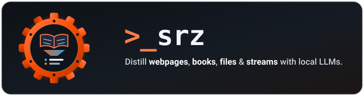

  

# `srz` (Summarize)

`srz` (Summarize) is a high-performance, modular Rust CLI tool for extracting and synthesizing structured summaries using local OpenAI-compliant LLMs (such as **llama.cpp**, **Ollama**, **LM Studio**, or **vLLM**) from:

- 🌐 **Webpages & articles** (Mozilla Readability extraction)
- 📺 **YouTube video transcripts**
- 📄 **PDF documents & local files**
- ⌨️ **Unix stdin streams**
- 📚 **Books**
- 📰 **Live news digests & universal RSS/Atom feeds**

---

## What Makes `srz` Different?

Modern AI tools frequently require cloud subscriptions, stream your private reading data to remote servers, and clutter your system with disparate scripts and background daemons. `srz` takes an unapologetically local, high-performance approach designed for developers, researchers, and avid readers:

### 100% Local Privacy & Instant Response
Every step of the synthesis pipeline executes on your local machine. By connecting to local OpenAI-compliant runners like **llama.cpp**, **Ollama**, or **LM Studio**, `srz` extracts insights from articles, books, and transcripts without sending a single byte of telemetry to the cloud. Pairing zero-copy Server-Sent Events (SSE) streaming with automated terminal paging (`less -RFX`) ensures that output begins rendering immediately with near-zero latency.

### Multi-Format Ingestion with Automatic Routing
Instead of requiring separate commands for each format, `srz` automatically classifies inputs based on URL patterns, file extensions, and data streams. It strips advertisements and clutter from web articles using Mozilla Readability, extracts timed-text transcripts from YouTube videos, searches Open Library and Wikipedia for book synopses, reads Unix pipes (`git diff | srz -`), and parses local PDFs or syndication feeds—all through a single unified CLI entry point.

### Embedded Analytics & Offline Library Search
Summaries are permanently stored in an embedded DuckDB database (`srz.duckdb`). Using an offline Robertson-Sparck Jones BM25 ranking algorithm with title boosting, `srz find` delivers Google-style relevance search across your entire reading history in milliseconds without network access. The built-in Ratatui terminal dashboard (`srz browse`) provides a keyboard-driven reader and search explorer, while `srz stats` tracks your reading streaks and model throughput percentiles.

---

## Documentation Guide

> 🧭 **Where should I begin?**
> - **Brand new to `srz` or local LLMs?** Start with [Installation](installation.md) and the [Quick Start](quickstart.md) to run your first summary in under 2 minutes.
> - **Looking for specific flags, subcommands, or keybindings?** Jump straight to the [Command Reference](commands.md).
> - **Curious how it works under the hood?** Explore [Architecture & Design](architecture.md) and the deep-dive [Rust Learning Guide](rust_learning_guide.md).

Browse through the chapters:

- [**Installation**](installation.md): Quick one-line curl/PowerShell scripts, Homebrew tap, Cargo build, precompiled releases, and in-place self-upgrades.
- [**Quick Start**](quickstart.md): Connect your local LLM backend (Llama-macOS, Llama-Windows, llama.cpp, Ollama, LM Studio) and run your first summaries.
- [**Command Reference**](commands.md): In-depth guide covering CLI auto-detection, subcommands, flags, interactive TUI keybindings, and session management.
- [**Configuration**](configuration.md): `config.toml` structure, named profiles, storage limits, and cache retention policies.
- [**Architecture & Design**](architecture.md): Systems architecture, lifecycle sequence flows, ingestion pipelines, embedded DuckDB schema, BM25 ranking algorithm, performance optimizations, and security model.

### Deep-Dive Guides & Audits

- 🦀 [**Rust Learning Guide**](rust_learning_guide.md): Architectural deep-dive and systems programming concepts using `srz` as a case study.
- 🛡️ [**Security Audit**](security_audit.md): Comprehensive security analysis, memory safety guarantees, and threat mitigations.
- 📋 [**Changelog**](changelog.md): Release history, version highlights, and breaking changes.
