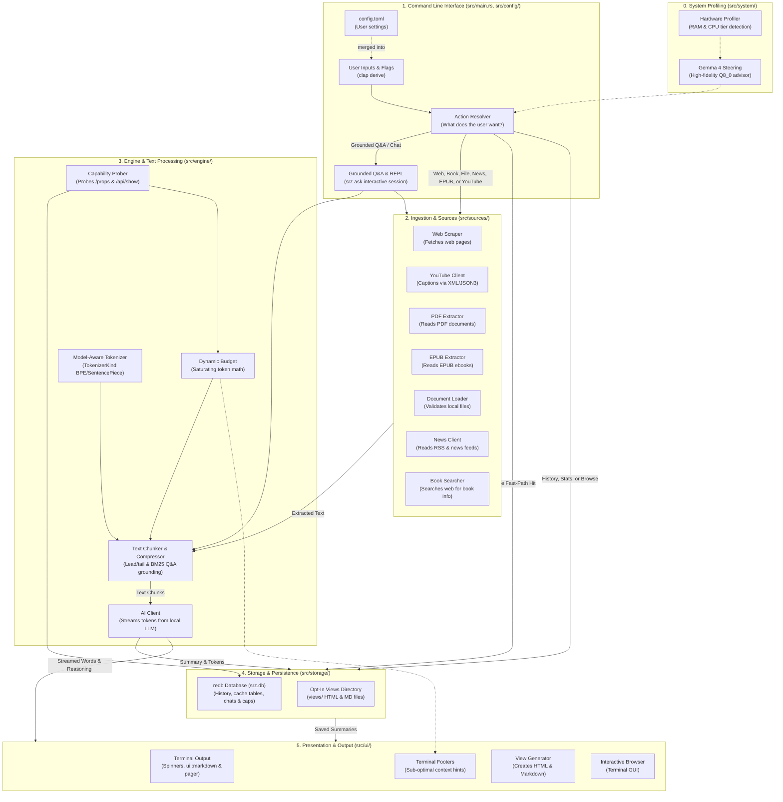
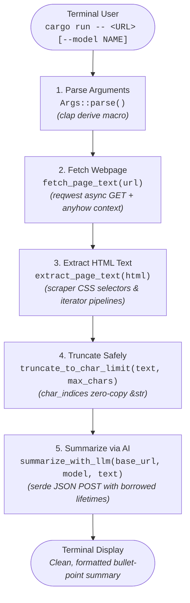
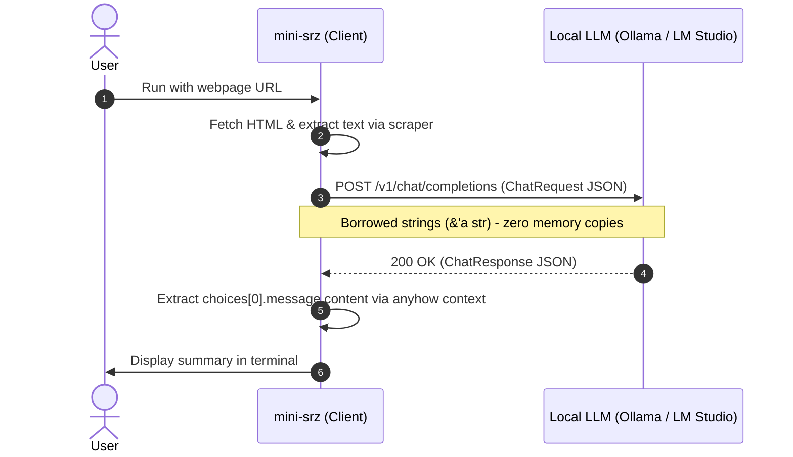
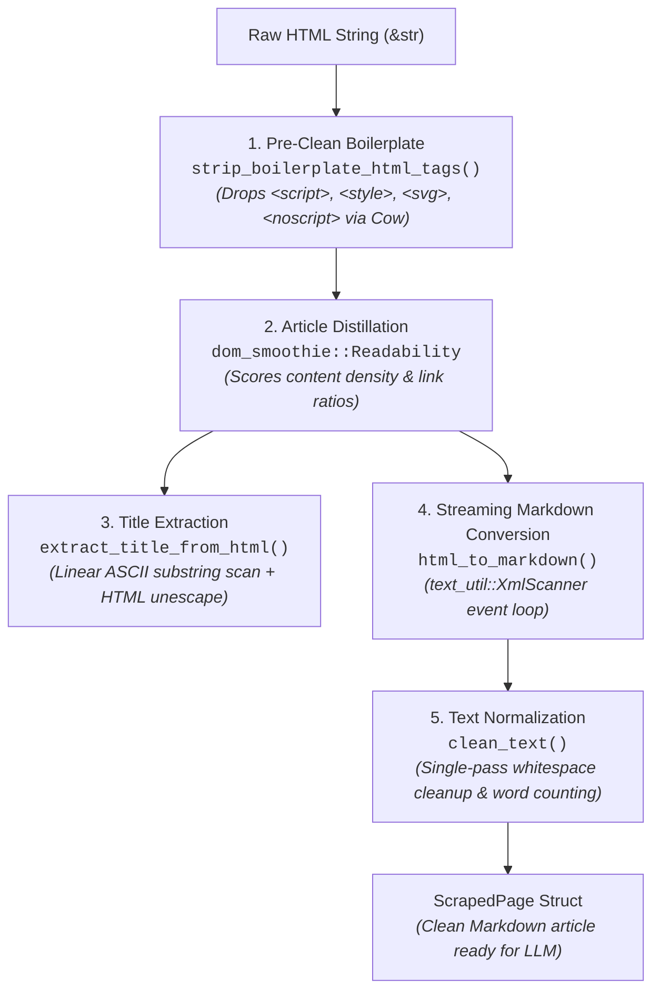

# Learning Rust Through Real-World Code: The `srz` Architecture & Concepts Guide

> 🎯 **Primary Purpose**: This guide uses `srz` (a fast, modular AI CLI tool) as a practical case study to help you **learn and understand Rust better**. Instead of memorizing abstract language rules in isolation, you will see how production-grade Rust concepts—ownership, borrowing, enums, lifetimes, state machines, and concurrency—are applied in real-world systems code.

Welcome to `srz`! This guide explains the architecture of the codebase and highlights the **hows and whys** of coding in Rust.

Whether you are a **beginner**, **non-technical learner**, or an **experienced developer coming from Python, JavaScript, Go, or C++**, this guide uses simple real-world analogies, visual diagrams, and direct chapter connections to [The Rust Programming Language](https://doc.rust-lang.org/book/) book to make Rust concepts intuitive, memorable, and practical.

Following the pedagogical progression of the official [Rust Book](https://doc.rust-lang.org/book/), this guide starts with **foundational concepts** (ownership, borrowing, enums, pattern matching, error handling), builds systematically into **intermediate and advanced topics** (lifetimes, closures, RAII, concurrency, async, macros, and unsafe safety proofs), tours the complete **system architecture**, and concludes with a full **hands-on follow-along tutorial** where you build your own working CLI tool from scratch.

---

## 📚 Table of Contents

- [Introduction: How to Use This Guide](#introduction-how-to-use-this-guide)
- [**Part I: Foundational Rust Concepts**](#part-i-foundational-rust-concepts)
  - [Chapter 1: The Rust Mental Model & Core Philosophy](#chapter-1-the-rust-mental-model--core-philosophy) *(Rust Book Ch 1–3)*
    - [1.1 Why Learn Rust with `srz`?](#11-why-learn-rust-with-srz)
    - [1.2 The Core Rust Mental Model](#12-the-core-rust-mental-model)
  - [Chapter 2: Understanding Ownership, Borrowing, and Slices](#chapter-2-understanding-ownership-borrowing-and-slices) *(Rust Book Ch 4)*
    - [2.1 What is Ownership & Move Semantics?](#21-what-is-ownership--move-semantics)
    - [2.2 The "Move vs. Borrow" Trap in Real Code](#22-the-move-vs-borrow-trap-in-real-code)
    - [2.3 Slices and UTF-8 Safe Memory](#23-slices-and-utf-8-safe-memory)
    - [2.4 Defensive Streaming & Memory Protection](#24-defensive-streaming--memory-protection)
  - [Chapter 3: Structs and Enums with Payloads](#chapter-3-structs-and-enums-with-payloads) *(Rust Book Ch 5 & 6.1)*
    - [3.1 Structs for Domain Modeling](#31-structs-for-domain-modeling)
    - [3.2 Enums with Payloads (Tagged Unions): Making Invalid States Unrepresentable](#32-enums-with-payloads-tagged-unions-making-invalid-states-unrepresentable)
  - [Chapter 4: Control Flow and Pattern Matching](#chapter-4-control-flow-and-pattern-matching) *(Rust Book Ch 6.2–6.3)*
    - [4.1 Exhaustive Pattern Matching (`match`) as a Co-Pilot](#41-exhaustive-pattern-matching-match-as-a-co-pilot)
    - [4.2 Modern Let-Chains (`if let ... && ...`)](#42-modern-let-chains-if-let----)
    - [4.3 Match Guards & Offline Fast-Paths](#43-match-guards--offline-fast-paths)
  - [Chapter 5: Strings, Collections, and Memory Allocation](#chapter-5-strings-collections-and-memory-allocation) *(Rust Book Ch 8)*
    - [5.1 Strings in Memory: `String` vs. `&str`](#51-strings-in-memory-string-vs-str)
    - [5.2 Pre-allocating Capacity to Prevent Reallocation](#52-pre-allocating-capacity-to-prevent-reallocation)
  - [Chapter 6: Robust Error Handling without Exceptions](#chapter-6-robust-error-handling-without-exceptions) *(Rust Book Ch 9)*
    - [6.1 The Parcel Model: `Option<T>` and `Result<T, E>`](#61-the-parcel-model-optiont-and-resultt-e)
    - [6.2 Ergonomic Error Propagation with the `?` Operator](#62-ergonomic-error-propagation-with-the--operator)
    - [6.3 Application-Level Error Handling with `anyhow`](#63-application-level-error-handling-with-anyhow)
- [**Part II: Intermediate & Advanced Topics**](#part-ii-intermediate--advanced-topics)
  - [Chapter 7: Generic Types, Traits, and Lifetimes](#chapter-7-generic-types-traits-and-lifetimes) *(Rust Book Ch 10)*
    - [7.1 Lifetimes as Loan Rulers (`'a`)](#71-lifetimes-as-loan-rulers-a)
    - [7.2 Lifetimes in Structs (`NewSummaryRecord<'a>`)](#72-lifetimes-in-structs-newsummaryrecorda)
    - [7.3 Zero-Copy Deserialization with `#[serde(borrow)]`](#73-zero-copy-deserialization-with-serdeborrow)
    - [7.4 Trait Bounds & Monomorphization: Generic Caching and Futures](#74-trait-bounds--monomorphization-generic-caching-and-futures)
  - [Chapter 8: Functional Features: Closures and Iterators](#chapter-8-functional-features-closures-and-iterators) *(Rust Book Ch 13)*
    - [8.1 Higher-Order Functions & Closures (`FnMut`)](#81-higher-order-functions--closures-fnmut)
    - [8.2 Functional Iterator Pipelines & Combinators](#82-functional-iterator-pipelines--combinators)
  - [Chapter 9: Smart Pointers, RAII, and Resource Management](#chapter-9-smart-pointers-raii-and-resource-management) *(Rust Book Ch 15)*
    - [9.1 Terminal State Management: Sequential Cleanup vs. RAII Destructors (`Drop`)](#91-terminal-state-management-sequential-cleanup-vs-raii-destructors-drop)
    - [9.2 The Generic Closure Loan Pattern (`with_db<T: Default>`)](#92-the-generic-closure-loan-pattern-with_dbt-default)
    - [9.3 Clone-on-Write in Action (`Cow<'a, str>`)](#93-clone-on-write-in-action-cowa-str)
  - [Chapter 10: Fearless Concurrency & Thread-Safe State](#chapter-10-fearless-concurrency--thread-safe-state) *(Rust Book Ch 16)*
    - [10.1 Safe Global State with `std::sync::LazyLock`](#101-safe-global-state-with-stdsynclazylock)
    - [10.2 Eliminating Static Initialization Hazards](#102-eliminating-static-initialization-hazards)
  - [Chapter 11: Asynchronous Programming & Streaming I/O](#chapter-11-asynchronous-programming--streaming-io) *(Rust Book Ch 17)*
    - [11.1 Async Entry Point (`#[tokio::main]`)](#111-async-entry-point-tokiomain)
    - [11.2 Work-Stealing Without Thread Bloat](#112-work-stealing-without-thread-bloat)
  - [Chapter 12: Advanced Features: Macros, Portability, and Safety Proofs](#chapter-12-advanced-features-macros-portability-and-safety-proofs) *(Rust Book Ch 14 & 19)*
    - [12.1 Declarative Derive Macros (`clap` & `serde`)](#121-declarative-derive-macros-clap--serde)
    - [12.2 Compile-Time OS Switches (`#[cfg(unix)]`)](#122-compile-time-os-switches-cfgunix)
    - [12.3 Mathematical Compile-Time Safety: `#![forbid(unsafe_code)]`](#123-mathematical-compile-time-safety-forbidunsafe_code)
    - [12.4 Layered Host Hardware Profiling Without FFI or `unsafe`](#124-layered-host-hardware-profiling-without-ffi-or-unsafe)
    - [12.5 The Mathematical Invariant of Dynamic Context Budgeting](#125-the-mathematical-invariant-of-dynamic-context-budgeting)
    - [12.6 Model-Aware Caching & Invalidation in Embedded Storage](#126-model-aware-caching--invalidation-in-embedded-storage)
    - [12.7 Dependency Pruning & Zero-Cost Parsing: How and Why `srz` Removed `scraper`](#127-dependency-pruning--zero-cost-parsing-how-and-why-srz-removed-scraper)
    - [12.8 Zero-Dependency Systems Modules (`XmlScanner`, `ZipReader`, `Sha256`)](#128-zero-dependency-systems-modules-xmlscanner-zipreader-sha256)
    - [12.9 State-Machine Markdown & XSS-Safe URL Filtering (`ui::markdown`)](#129-state-machine-markdown--xss-safe-url-filtering-uimarkdown)
    - [12.10 Embedded ACID Storage (`redb`), SSRF Defense & Filesystem Hardening](#1210-embedded-acid-storage-redb-ssrf-defense--filesystem-hardening)
- [**Part III: System Architecture & Synthesis**](#part-iii-system-architecture--synthesis)
  - [Chapter 13: System Architecture & Data Flow Tour](#chapter-13-system-architecture--data-flow-tour)
    - [13.1 High-Level Architecture Diagram](#131-high-level-architecture-diagram)
    - [13.2 End-to-End Data Flow](#132-end-to-end-data-flow)
  - [Chapter 14: Quick Reference: Rust Concepts in `srz`](#chapter-14-quick-reference-rust-concepts-in-srz)
- [**Part IV: Capstone Project**](#part-iv-capstone-project)
  - [Chapter 15: Follow-Along Hands-On Tutorial: Build "Mini-Srz" from Scratch](#chapter-15-follow-along-hands-on-tutorial-build-mini-srz-from-scratch)
    - [15.1 Project Overview & Architecture Roadmap](#151-project-overview--architecture-roadmap)
    - [15.2 The Educational Goal: The Standard Trio (`clap`, `scraper`, `anyhow`)](#152-the-educational-goal-the-standard-trio-clap-scraper-anyhow)
    - [15.3 Step 1: Initialize Project with Cargo](#153-step-1-initialize-project-with-cargo)
    - [15.4 Step 2: Dependencies (`Cargo.toml`)](#154-step-2-dependencies-cargotoml)
    - [15.5 Step 3: Declarative CLI Parsing with `clap` Derive](#155-step-3-declarative-cli-parsing-with-clap-derive)
    - [15.6 Step 4: HTML Text Extraction with `scraper` and CSS Selectors](#156-step-4-html-text-extraction-with-scraper-and-css-selectors)
    - [15.7 Step 5: Safe Text Processing (UTF-8 Slicing)](#157-step-5-safe-text-processing-utf-8-slicing)
    - [15.8 Step 6: Calling Local LLMs with Zero-Copy Lifetimes](#158-step-6-calling-local-llms-with-zero-copy-lifetimes)
    - [15.9 Step 7: Complete, Self-Contained `src/main.rs`](#159-step-7-complete-self-contained-srcmainrs)
    - [15.10 Step 8: Build and Run](#1510-step-8-build-and-run)
    - [15.11 Concepts Mastered Summary](#1511-concepts-mastered-summary)
    - [15.12 Progressive Next Milestones for `Mini-Srz`](#1512-progressive-next-milestones-for-mini-srz)
    - [15.13 Production Evolution: Graduating from `scraper` to `dom_smoothie` & Streaming XML](#1513-production-evolution-graduating-from-scraper-to-dom_smoothie--streaming-xml)

---

<a id="introduction-how-to-use-this-guide"></a>
## Introduction: How to Use This Guide

This guide is organized in pedagogical order following the [official Rust Book](https://doc.rust-lang.org/book/):

1. **Part I (Foundations)**: Understand ownership, borrowing, enums, pattern matching, strings, and error handling before worrying about advanced language features.
2. **Part II (Advanced Topics)**: Explore lifetimes, closures, RAII, concurrency, async runtimes, derive macros, zero-dependency parsers, `redb` ACID storage, and compile-time safety proofs.
3. **Part III (Synthesis)**: See how all these individual concepts combine into `srz`'s unified, modular production architecture.
4. **Part IV (Capstone Tutorial)**: Follow a step-by-step tutorial to build `mini-srz`, explore progressive upgrade milestones, and see how production `srz` replaced `scraper` with Readability + streaming XML.

> 🧭 **Where to Start Reading `srz` in 30 Minutes (Recommended 4-File Tour)**
> If you want to explore the repository side-by-side while reading, open these four files in order:
> 1. [`src/main.rs`](https://github.com/NewGuy012/srz/blob/master/src/main.rs) *(36 lines)* — Binary entry point (`#![forbid(unsafe_code)]`, Tokio async startup, argument & config handoff).
> 2. [`src/commands/mod.rs`](https://github.com/NewGuy012/srz/blob/master/src/commands/mod.rs) — Exhaustive `ResolvedAction` routing, match guards, and database/UI orchestration.
> 3. [`src/engine/budget.rs`](https://github.com/NewGuy012/srz/blob/master/src/engine/budget.rs) — Pure-math context window clamping (`DynamicBudget`) with zero I/O side effects.
> 4. [`src/storage/db.rs`](https://github.com/NewGuy012/srz/blob/master/src/storage/db.rs) — Typed `redb` schema definitions (`TableDefinition`), ACID transactions, and borrowed records (`NewSummaryRecord<'a>`).

---

<a id="part-i-foundational-rust-concepts"></a>
# Part I: Foundational Rust Concepts

<a id="chapter-1-the-rust-mental-model--core-philosophy"></a>
## Chapter 1: The Rust Mental Model & Core Philosophy
*(Rust Book Connection: [Ch 1: Getting Started](https://doc.rust-lang.org/book/ch01-00-getting-started.html) & [Ch 3: Common Programming Concepts](https://doc.rust-lang.org/book/ch03-00-common-programming-concepts.html))*

<a id="11-why-learn-rust-with-srz"></a>
### 1.1 Why Learn Rust with `srz`?

1. **Real-World Patterns**: See how memory safety works without garbage collection pauses or manual `malloc`/`free` calls.
2. **Zero-Cost Abstractions**: Observe how iterators, lifetimes, and zero-copy slices (`Cow`, `&str`) deliver speed without wasting RAM.
3. **From Theory to Practice**: Study production patterns first, then follow a hands-on tutorial to build your own CLI tool using core ecosystem crates (`clap`, `scraper`, `anyhow`), and see how production tools graduate from high-level crates to optimized, zero-copy in-tree pipelines.

<a id="12-the-core-rust-mental-model"></a>
### 1.2 The Core Rust Mental Model (How to Think in Rust)

If you are coming from Python, JavaScript, Java, Go, or C++, here is the mental shift that makes Rust click:

| Rust Syntax | What it Means | Everyday Mental Picture |
| :--- | :--- | :--- |
| `let x = ...` | **Immutable by default** | Locked in solid glass; cannot be changed unless declared `mut`. |
| `x` (no `&`) | **Ownership Move** | Handing your keys to a friend. You don't have them anymore. |
| `&x` | **Shared Read-Only Borrow** | Letting multiple friends read a book over your shoulder. Many can look; none can write. |
| `&mut x` | **Exclusive Mutable Borrow** | Handing your car to a mechanic. *Only ONE* person can work on it, and nobody else can drive it. |
| `Option<T>` | **Explicit Presence / Absence** | A wrapped gift box: either has `Some(gift)` or is `None` (empty). No hidden `null` crashes! |
| `Result<T, E>` | **Explicit Success / Failure** | A wrapped parcel: either has `Ok(item)` or `Err(return slip)`. No uncaught exceptions! |
| `'a` (Lifetime) | **Loan Duration Guarantee** | An expiring security badge: guarantees you leave before your host goes home. |
| `Cow<'a, T>` | **Clone-on-Write** | Read the original text for free; make a photocopy only if you need to edit it. |

---

<a id="chapter-2-understanding-ownership-borrowing-and-slices"></a>
## Chapter 2: Understanding Ownership, Borrowing, and Slices
*(Rust Book Connection: [Ch 4: Understanding Ownership](https://doc.rust-lang.org/book/ch04-00-understanding-ownership.html))*

Ownership is Rust's most unique feature. It enables memory safety guarantees without needing a garbage collector or manual pointer deallocation.

<a id="21-what-is-ownership--move-semantics"></a>
### 2.1 What is Ownership & Move Semantics?
- 💡 **Simple Analogy:** A physical house key. There is only one master key. If you hand it to your roommate, they now own it, and you cannot unlock the door with your empty hands.
- 💡 **The "Click" Moment:** In languages like Python, Java, or JavaScript, assigning a variable or passing it to a function creates another shared reference managed by a runtime garbage collector. In C/C++, assigning a pointer leaves memory cleanup to programmer discipline. In Rust, assigning a value or passing it by value **moves** ownership. The previous variable becomes immediately invalid, preventing double-free bugs and dangling pointers at compile time.
- 📖 **The Rust Book Reference:** [Chapter 4.1: What is Ownership?](https://doc.rust-lang.org/book/ch04-01-what-is-ownership.html)

<a id="22-the-move-vs-borrow-trap-in-real-code"></a>
### 2.2 The "Move vs. Borrow" Trap in Real Code
- 💡 **Simple Analogy:** Handing someone a physical book (move) vs. letting them read over your shoulder (borrow `&`). If you hand it to them, you no longer have it. If they look over your shoulder, you both retain access to the information.
- 💡 **The "Click" Moment: Ownership is Linear:** In Rust, every value has exactly *one* owner at any given moment. Moving a variable gives away ownership permanently. If you need to use the variable again, you must **borrow** it (`&`) rather than moving it.
- 🔍 **Real Code in `srz` ([src/main.rs](https://github.com/NewGuy012/srz/blob/master/src/main.rs#L19-L26)):**
  ```rust
  let (config, config_path) = match &args.config {
      Some(p) => {
          let cfg = Config::load_from_path(p)?;
          (cfg, Some(p.clone()))
      }
      None => Config::load_default(),
  };
  args.apply_config(&config, Some(&matches)); // 👈 `args` is used again here!
  ```
- 💥 **The Common Beginner Trap:** What happens if you remove that tiny ampersand (`match args.config`)?
  In other languages like Python, passing an object just passes another reference. In Rust, `args.config` would be **moved** out of `args`. Seven lines later, `args.apply_config(...)` would crash at compile time with:
  ```text
  error[E0382]: borrow of partially moved value: `args`
  ```
  Adding the `&` (`match &args.config`) **borrows** the config path, leaving `args` completely valid for the rest of `main()`.
- 🔄 **If you know other languages:** Python and JS pass references automatically. In Rust, values move by default unless you explicitly add `&` to borrow.
- 📖 **The Rust Book Reference:** [Chapter 4.2: References and Borrowing](https://doc.rust-lang.org/book/ch04-02-references-and-borrowing.html)

<a id="23-slices-and-utf-8-safe-memory"></a>
### 2.3 Slices and UTF-8 Safe Memory
- 💡 **Simple Analogy:** A clear bookmark that points to a specific range of pages in a book without tearing out the pages.
- 💡 **The "Click" Moment:** Strings in Rust are guaranteed valid UTF-8. Slicing raw bytes (`&text[..5]`) can slice in the middle of a multi-byte Unicode character (like an emoji or accent), triggering a program panic. Slices (`&str`, `&[T]`) let you view contiguous sequences of memory without copying data.
- 🔍 **Visualizing UTF-8 Layout:**
  ```text
  Text: "Hi 🦀" (4 characters, 7 bytes total in memory)

  Character:   'H'      'i'      ' '     🦀 (Ferris emoji)
  Byte Index:   0        1        2       3     4     5     6
  Byte Value:  [72]    [105]     [32]    [240, 159, 166, 128]

  ❌ text[..5]             --> PANIC: Byte 5 is in the middle of 🦀!
  ✅ char_indices().nth(3) --> byte 3: "Hi "
  ✅ char_indices().nth(4) --> byte 7: "Hi 🦀" (zero-copy slice!)
  ```
- 📖 **The Rust Book Reference:** [Chapter 4.3: The Slice Type](https://doc.rust-lang.org/book/ch04-03-slices.html) and [Chapter 8.2: Slicing Strings](https://doc.rust-lang.org/book/ch08-02-strings.html#slicing-strings)

<a id="24-defensive-streaming--memory-protection"></a>
### 2.4 Defensive Streaming & Memory Protection
- 💡 **Simple Analogy:** A fuel tank nozzle with an automatic shutoff valve. If a pump tries to dump 1,000 gallons into a 10-gallon tank, the valve snaps shut before the tank overflows.
- 💡 **The "Click" Moment: Defending Against Out-Of-Memory (OOM) Attacks:** Calling `response.bytes().await` blindly buffers an entire web page into RAM. If a malicious web server returns an infinite stream ("decompression bomb"), your app crashes. `srz` inspects HTTP headers first, streams chunk by chunk, and terminates the connection if bytes exceed `max_bytes`.
- 🔍 **Real Code in `srz` ([src/sources/scraper.rs](https://github.com/NewGuy012/srz/blob/master/src/sources/scraper.rs#L219-L254)):**
  ```rust
  pub async fn read_response_bytes_limited(
      mut response: reqwest::Response,
      max_bytes: usize,
  ) -> Result<Vec<u8>> {
      if let Some(content_len) = response.content_length()
          && content_len as usize > max_bytes
      {
          anyhow::bail!(
              "Response content length ({} bytes) exceeds limit of {} MB",
              content_len,
              max_bytes / (1024 * 1024)
          );
      }

      let mut bytes = if let Some(content_len) = response.content_length() {
          Vec::with_capacity((content_len as usize).min(max_bytes))
      } else {
          Vec::new()
      };

      while let Some(chunk) = response
          .chunk()
          .await
          .context("Failed to read response body chunk")?
      {
          if bytes.len() + chunk.len() > max_bytes {
              anyhow::bail!(
                  "Response body exceeded limit of {} MB",
                  max_bytes / (1024 * 1024)
              );
          }
          bytes.extend_from_slice(&chunk);
      }

      Ok(bytes)
  }
  ```
- 📖 **The Rust Book Reference:** [Chapter 4.1: What is Ownership?](https://doc.rust-lang.org/book/ch04-01-what-is-ownership.html)

> 🧪 **Try It Yourself (Break It on Purpose):**
> 1. In [`src/main.rs#L19-L26`](https://github.com/NewGuy012/srz/blob/master/src/main.rs#L19-L26), trace why `match &args.config` uses `&` before `args.apply_config(...)` runs—removing `&` moves `args.config` (`Option<PathBuf>`) out of `args`, causing compiler error `E0382` (*borrow of partially moved value*) at line `26`.
> 2. Verify `srz`'s response bounds and SSRF tests locally with:
>    ```bash
>    cargo test --lib scraper::tests::test_ssrf_validation_blocks_private_and_local_targets
>    ```

---

<a id="chapter-3-structs-and-enums-with-payloads"></a>
## Chapter 3: Structs and Enums with Payloads
*(Rust Book Connection: [Ch 5: Using Structs](https://doc.rust-lang.org/book/ch05-00-structs.html) & [Ch 6.1: Defining an Enum](https://doc.rust-lang.org/book/ch06-01-defining-an-enum.html))*

<a id="31-structs-for-domain-modeling"></a>
### 3.1 Structs for Domain Modeling

Structs allow you to package related values together into named types, creating clear mental models for your domain entities. In `srz`, structs represent everything from configuration flags to database records and CLI arguments.

<a id="32-enums-with-payloads-tagged-unions-making-invalid-states-unrepresentable"></a>
### 3.2 Enums with Payloads (Tagged Unions): Making Invalid States Unrepresentable
- 💡 **Simple Analogy:** A Swiss Army knife where each fold-out tool holds its own specific accessories. The screwdriver slot carries screwdriver bits; the scissors slot carries replacement springs. You can never accidentally put a screwdriver bit into the scissors.
- 💡 **The "Click" Moment: Make Invalid States Unrepresentable:** In OOP, you might build an `Action` class with `url`, `title`, and `limit` fields—all nullable (`None`/`null`). You have to remember: *"If action is WEB, make sure `url` isn't null, but ignore `limit`."* In Rust, each enum variant holds *only* the specific data it needs. An invalid state cannot even exist in memory.
- 🔍 **Real Code in `srz` ([src/config/cli.rs](https://github.com/NewGuy012/srz/blob/master/src/config/cli.rs#L389-L440)):**
  ```rust
  #[derive(Debug, PartialEq, Eq)]
  pub enum ResolvedAction<'a> {
      Web { url: &'a str },
      Book { title: &'a str },
      History { limit: usize },
      Stats, // Holds no data at all!
  }
  ```
  A `Web` command *only* holds a URL slice; a `History` command *only* holds a limit; `Stats` holds no data at all.
- 🔄 **If you know other languages:** In C, Java, or TypeScript, enums are usually just numbers or string labels. In Rust, each enum variant can carry unique data payloads, making invalid combinations impossible to construct.
- 📖 **The Rust Book Reference:** [Chapter 6.1: Defining an Enum](https://doc.rust-lang.org/book/ch06-01-defining-an-enum.html)

---

<a id="chapter-4-control-flow-and-pattern-matching"></a>
## Chapter 4: Control Flow and Pattern Matching
*(Rust Book Connection: [Ch 6.2: The match Control Flow Construct](https://doc.rust-lang.org/book/ch06-02-match.html) & [Ch 6.3: Concise Control Flow with if let](https://doc.rust-lang.org/book/ch06-03-if-let.html))*

<a id="41-exhaustive-pattern-matching-match-as-a-co-pilot"></a>
### 4.1 Exhaustive Pattern Matching (`match`) as a Co-Pilot
- 💡 **Simple Analogy:** A strict postal sorting room with a designated bin for every single zip code. If a new zip code is introduced and there isn't a bin for it, the conveyor belt stops immediately until a bin is built.
- 💡 **The "Click" Moment: The Compiler as a Co-Pilot:** Unlike `switch` in C/Java where forgetting a `break` or omitting a case causes silent runtime bugs, Rust's `match` is strictly exhaustive. If you add a new action variant (e.g. `Podcast`), the Rust compiler will flag every single `match` statement across your codebase that hasn't handled it yet.
- 🔍 **Real Code in `srz` ([src/commands/mod.rs](https://github.com/NewGuy012/srz/blob/master/src/commands/mod.rs#L241-L265)):**
  ```rust
  match action {
      crate::cli::ResolvedAction::Cache(cache_cmd) => {
          handle_cache(cache_cmd, &cache)?;
          return Ok(());
      }
      crate::cli::ResolvedAction::History { limit } => {
          return with_db(|db| handle_history(db, limit, args.json));
      }
      crate::cli::ResolvedAction::Stats => {
          return with_db(|db| handle_stats(db, args.json));
      }
      crate::cli::ResolvedAction::Find { query } => {
          return with_db(|db| handle_find(db, query, &cache, args.json));
      }
      // Stage 1 dispatches immediate utility tasks;
      // Subsequent stages exhaustively handle content summarization!
  }
  ```
- 🔄 **If you know other languages:** Unlike `switch` in C/Java where a missing `case` can silently cause bugs, Rust guarantees all possibilities are covered before compiling.
- 📖 **The Rust Book Reference:** [Chapter 6.2: The `match` Control Flow Construct](https://doc.rust-lang.org/book/ch06-02-match.html)

<a id="42-modern-let-chains-if-let----"></a>
### 4.2 Modern Let-Chains (`if let ... && ...`)
- 💡 **Simple Analogy:** An airport boarding gate check: *"If your boarding pass is valid AND your passport is unexpired, please board the plane."*
- 💡 **The "Click" Moment: Eliminating the Pyramid of Doom:** In older Rust (or languages like Go/Python), combining condition checks and value extractions required deeply nested `if` statements. Let-chains combine boolean conditions (`!outcome.cached`) and pattern-matching variable extractions (`let Some(db) = ...`) into a single guard condition without indentation drift.
- 🔍 **Real Code in `srz` ([src/commands/summarize.rs](https://github.com/NewGuy012/srz/blob/master/src/commands/summarize.rs#L1046-L1070)):**
  ```rust
  // Record newly generated summaries in redb history & library (lazily opened)
  if !outcome.cached
      && let Some(db) = cache
          .open_database()
          .or_else(crate::commands::open_db_or_warn)
  {
      let record = crate::db::NewSummaryRecord { /* ... */ };
      let _ = db.record_summary_with_key(&record, outcome.cache_key.as_deref());
  }
  ```
- 📖 **The Rust Book Reference:** [Chapter 6.3: Concise Control Flow with `if let`](https://doc.rust-lang.org/book/ch06-03-if-let.html)

<a id="43-match-guards--offline-fast-paths"></a>
### 4.3 Match Guards & Offline Fast-Paths
- 💡 **Simple Analogy:** An express checkout lane at a supermarket: *"If you have 10 items or fewer, skip the entire main queue."*
- 💡 **The "Click" Moment: Short-Circuiting Heavy Runtime Setup:** Rust allows `match` arms to attach an extra `if <condition>` **match guard** directly onto the destructured pattern. In `srz`, utility inspection flags like `srz ask --chats`, `--show-chat`, and `--delete-chat` share the same `ResolvedAction::Ask` enum variant as live LLM Q&A—yet they need zero HTTP clients or model probing. By guarding that arm with `if list_chats || show_chat.is_some() || delete_chat.is_some()`, `dispatch_cli` intercepts and handles offline chat management immediately, before initializing scrapers or LLM clients. (Similarly, lines `#L324-L377` probe the local `redb` cache in sub-millisecond time before connecting to backends.)
- 🔍 **Real Code in `srz` ([src/commands/mod.rs](https://github.com/NewGuy012/srz/blob/master/src/commands/mod.rs#L231-L240)):**
  ```rust
  match action {
      crate::cli::ResolvedAction::Ask {
          list_chats,
          show_chat,
          delete_chat,
          ..
      } if list_chats || show_chat.is_some() || delete_chat.is_some() => {
          handle_ask_management(list_chats, show_chat, delete_chat, args.json)?;
          return Ok(());
      }
      crate::cli::ResolvedAction::Cache(cache_cmd) => { /* ... */ }
      // ...
  }
  ```
- 🔄 **If you know other languages:** In Python or Go, you would unpack the struct first and branch in nested `if` blocks or fall through manually. In Rust, match guards combine pattern destructuring and extra boolean conditions atomically inside a single `match` arm, falling through cleanly to the next arm if the guard is false.
- 📖 **The Rust Book Reference:** [Chapter 18.3: Pattern Syntax (Extra Conditionals with Match Guards)](https://doc.rust-lang.org/book/ch18-03-pattern-syntax.html#extra-conditionals-with-match-guards)

> 🧪 **Try It Yourself (Break It on Purpose):**
> 1. In [`src/commands/mod.rs#L388`](https://github.com/NewGuy012/srz/blob/master/src/commands/mod.rs#L388), look at the main `match action` block. Adding a new variant to `ResolvedAction` in [`src/config/cli.rs`](https://github.com/NewGuy012/srz/blob/master/src/config/cli.rs#L389-L440) without handling it produces compiler error `E0004` (*non-exhaustive patterns*).
> 2. Notice why the fast-path `match` at `#L231` ends with `_ => {}`: removing `_ => {}` wouldn't compile unless every remaining `ResolvedAction` variant were listed explicitly. Run the CLI routing suite to see how all action resolutions are tested:
>    ```bash
>    cargo test --test integration_tests test_cli_action_resolution_and_validation
>    ```

---

<a id="chapter-5-strings-collections-and-memory-allocation"></a>
## Chapter 5: Strings, Collections, and Memory Allocation
*(Rust Book Connection: [Ch 8: Common Collections](https://doc.rust-lang.org/book/ch08-00-common-collections.html))*

<a id="51-strings-in-memory-string-vs-str"></a>
### 5.1 Strings in Memory: `String` vs. `&str`

Rust differentiates clearly between owned, growable strings (`String`) and borrowed string slices (`&str`):
- `String`: Owned, heap-allocated buffer with a pointer, length, and capacity. It can grow, shrink, and mutate.
- `&str`: Borrowed view of existing UTF-8 bytes somewhere in memory (on the stack, on the heap, or in static binary memory).

Understanding this difference is critical for writing high-performance Rust without unnecessary heap allocations.

<a id="52-pre-allocating-capacity-to-prevent-reallocation"></a>
### 5.2 Pre-allocating Capacity to Prevent Reallocation
- 💡 **Simple Analogy:** Booking a bus for 30 passengers upfront, instead of hailing a 4-seater taxi, discovering it is full, hailing an 8-seater, and transferring luggage again and again.
- 💡 **The "Click" Moment: The Hidden Cost of Dynamic Resizing:** A `String` or `Vec` stores data on the heap. When it fills up, the OS must allocate a new chunk of memory twice as big, copy *every single existing byte* over, and free the old buffer. When rendering Markdown to HTML, `srz` knows the text will expand by roughly 50%, so it pre-allocates `md.len() * 3 / 2` upfront in a single allocation.
- 🔍 **Real Code in `srz` ([src/ui/markdown.rs](https://github.com/NewGuy012/srz/blob/master/src/ui/markdown.rs#L35-L38)):**
  ```rust
  // Pre-allocate buffer: Markdown -> HTML expands text by ~50%
  let mut out = String::with_capacity(md.len() * 3 / 2);
  render_blocks(md, &mut out, true);
  ```
- 📖 **The Rust Book Reference:** [Chapter 8.2: Storing UTF-8 Encoded Text with Strings](https://doc.rust-lang.org/book/ch08-02-strings.html#updating-a-string)

---

<a id="chapter-6-robust-error-handling-without-exceptions"></a>
## Chapter 6: Robust Error Handling without Exceptions
*(Rust Book Connection: [Ch 9: Error Handling](https://doc.rust-lang.org/book/ch09-00-error-handling.html))*

<a id="61-the-parcel-model-optiont-and-resultt-e"></a>
### 6.1 The Parcel Model: `Option<T>` and `Result<T, E>`
- 💡 **Simple Analogy:**
  - `Option<T>` is a gift box that holds either a present (`Some(value)`) or is empty (`None`).
  - `Result<T, E>` is a parcel that holds either a present (`Ok(value)`) or a return receipt (`Err(error)`).
- 💡 **The "Click" Moment:** In languages like Python, Java, or C++, any function call can invisibly throw an unhandled exception at runtime. In Rust, functions that might fail must explicitly declare `Result<T, E>` in their signature. You cannot read the value inside `Ok` without explicitly handling the possibility of `Err`.

<a id="62-ergonomic-error-propagation-with-the--operator"></a>
### 6.2 Ergonomic Error Propagation with the `?` Operator
- 💡 **Simple Analogy:** A relay race baton. If a runner encounters an obstacle, they hand the "error baton" straight back out of the race to the team captain, rather than tumbling down the track and breaking other equipment.
- 💡 **The "Click" Moment:** The `?` operator unboxes the parcel: if it's `Ok`, it unwraps and returns the inner value; if it's `Err`, it stops the function immediately and returns the error to the caller. No hidden exceptions, no surprise crashes!
- 🔍 **Real Code in `srz` ([src/main.rs](https://github.com/NewGuy012/srz/blob/master/src/main.rs#L19-L26) & [src/system/fs_util.rs](https://github.com/NewGuy012/srz/blob/master/src/system/fs_util.rs#L125-L137)):**
  ```rust
  // In src/main.rs: unwrap with ? or return early on failure
  let cfg = Config::load_from_path(p)?;

  // In src/system/fs_util.rs: returning an explicit io::Error
  if let Ok(meta) = fs::symlink_metadata(path)
      && meta.file_type().is_symlink()
  {
      return Err(std::io::Error::new(
          std::io::ErrorKind::InvalidInput,
          format!(
              "Refusing to create directory at symlink path: {}",
              path.display()
          ),
      ));
  }
  ```
- 🔄 **If you know other languages:** Python, Java, and C++ use exceptions (`try/catch`), which can be thrown invisibly from anywhere. Rust treats errors as explicit return values, making potential failures obvious in the code.
- 📖 **The Rust Book Reference:** [Chapter 9.2: Recoverable Errors with `Result`](https://doc.rust-lang.org/book/ch09-02-recoverable-errors-with-result.html)

<a id="63-application-level-error-handling-with-anyhow"></a>
### 6.3 Application-Level Error Handling with `anyhow`

In application code (like CLIs and servers), writing dozens of custom error enums can become repetitive boilerplate. The `anyhow` crate provides:
1. `anyhow::Result<T>`: A universal return type that absorbs any standard error.
2. `.context("...")`: Adds contextual breadcrumbs to errors so users know *what failed and why*.
3. `bail!("...")`: Returns an error immediately without verbose `return Err(...)` syntax.

---

<a id="part-ii-intermediate--advanced-topics"></a>
# Part II: Intermediate & Advanced Topics

<a id="chapter-7-generic-types-traits-and-lifetimes"></a>
## Chapter 7: Generic Types, Traits, and Lifetimes
*(Rust Book Connection: [Ch 10: Generic Types, Traits, and Lifetimes](https://doc.rust-lang.org/book/ch10-00-generics.html))*

<a id="71-lifetimes-as-loan-rulers-a"></a>
### 7.1 Lifetimes as Loan Rulers (`'a`)
- 💡 **Simple Analogy:** A visitor security badge that expires at 5:00 PM when your host leaves the office. The badge guarantees you cannot roam the building after your host has gone home.
- 💡 **The "Click" Moment: Lifetimes are Rulers, Not Timers:** A common beginner misconception is that lifetimes (`'a`) make variables live longer. They do not. A lifetime annotation is just a ruler that the Rust compiler holds up to verify that a borrowed loan does not outlive its owner.
- 📖 **The Rust Book Reference:** [Chapter 10.3: Validating References with Lifetimes](https://doc.rust-lang.org/book/ch10-03-lifetime-syntax.html)

<a id="72-lifetimes-in-structs-newsummaryrecorda"></a>
### 7.2 Lifetimes in Structs (`NewSummaryRecord<'a>`)
- 💡 **Simple Analogy:** Filling out a library checkout receipt that references a manuscript on display, rather than having to make a full physical copy of the manuscript just to fill in the receipt.
- 💡 **The "Click" Moment:** Why not make `summary: String` in database insertion structs? If a summary is 50KB long, having `String` fields forces Rust to duplicate all 50,000 characters on the heap just to insert it into the database. By annotating the struct with `'a`, `NewSummaryRecord` borrows existing strings in memory. The Rust compiler guarantees at compile time that the record cannot outlive the strings it borrows, preventing dangling pointers with **zero allocations**.
- 🔍 **Real Code in `srz` ([src/storage/db.rs](https://github.com/NewGuy012/srz/blob/master/src/storage/db.rs#L25-L39) and [src/commands/summarize.rs](https://github.com/NewGuy012/srz/blob/master/src/commands/summarize.rs#L1051-L1066)):**
  ```rust
  // In src/storage/db.rs: Struct holding borrowed strings
  pub struct NewSummaryRecord<'a> {
      pub target_type: &'a str,
      pub title: &'a str,
      pub author: Option<&'a str>,
      pub url: Option<&'a str>,
      pub style: &'a str,
      pub model: &'a str,
      pub word_count: usize,
      pub prompt_tokens: Option<u32>,
      pub completion_tokens: Option<u32>,
      pub duration_ms: u64,
      pub tokens_per_second: Option<f64>,
      pub summary: &'a str, // 👈 Borrows reference instead of cloning a 50KB string!
      pub reasoning: Option<&'a str>, // 👈 Borrows optional chain-of-thought tokens!
  }
  ```
  ```rust
  // In src/commands/summarize.rs: Populating the borrowed record
  let record = crate::db::NewSummaryRecord {
      target_type: outcome.target_type,
      title: &outcome.title,
      author: outcome.author.as_deref(),
      url: outcome.url.as_deref(),
      style: args.style.as_str(),
      model: &args.model,
      word_count: outcome.word_count,
      prompt_tokens: outcome.prompt_tokens,
      completion_tokens: outcome.completion_tokens,
      duration_ms: outcome.duration_ms,
      tokens_per_second: outcome.tokens_per_second,
      summary: &outcome.summary, // 👈 Pure zero-copy loan
      reasoning: outcome.reasoning.as_deref(),
  };
  let _ = db.record_summary_with_key(&record, outcome.cache_key.as_deref());
  ```
- 🔄 **If you know other languages:** In C++, storing raw pointers (`const char*`) in a struct is risky because if the original string is freed, you get a segfault. In Go or Python, structs hold pointers with garbage collection overhead. Rust gives you raw pointer performance with compile-time memory safety.
- 📖 **The Rust Book Reference:** [Chapter 10.3: Lifetime Annotations in Struct Definitions](https://doc.rust-lang.org/book/ch10-03-lifetime-syntax.html#lifetime-annotations-in-struct-definitions)

<a id="73-zero-copy-deserialization-with-serdeborrow"></a>
### 7.3 Zero-Copy Deserialization with `#[serde(borrow)]`
- 💡 **Simple Analogy:** Highlighting words directly in a physical letter mailed to you, instead of manually re-copying the entire letter word-for-word onto a separate notepad.
- 💡 **The "Click" Moment: Eliminating the Heap Allocation Tax:** When streaming AI responses at 80 tokens per second, creating 80 new heap `String`s every second causes constant memory allocation churn. With `#[serde(borrow)]`, Rust deserializes JSON strings by pointing `Cow<'a, str>` directly to the slice inside Tokio's network buffer—allocating **0 bytes** of extra heap memory!
- 🔍 **Real Code in `srz` ([src/engine/sse.rs](https://github.com/NewGuy012/srz/blob/master/src/engine/sse.rs#L33-L55)):**
  ```rust
  #[derive(Deserialize)]
  pub(crate) struct ChatCompletionChunk<'a> {
      #[serde(default, borrow)]
      pub(crate) choices: Vec<ChunkChoice<'a>>,
      pub(crate) usage: Option<TokenUsage>,
  }

  #[derive(Deserialize)]
  pub(crate) struct ChunkChoice<'a> {
      #[serde(borrow)]
      pub(crate) delta: ChunkDelta<'a>,
      #[serde(borrow)]
      pub(crate) finish_reason: Option<Cow<'a, str>>,
  }

  #[derive(Deserialize, Default)]
  pub(crate) struct ChunkDelta<'a> {
      #[serde(borrow)]
      pub(crate) content: Option<Cow<'a, str>>, // 👈 Borrows directly from incoming network buffer!
      /// Emitted by llama.cpp / Gemma 4 / DeepSeek during internal chain-of-thought
      #[serde(borrow)]
      pub(crate) reasoning_content: Option<Cow<'a, str>>, // 👈 Zero-copy reasoning stream!
  }
  ```
- 🔄 **If you know other languages:** In Python or Go, parsing JSON allocates new strings in memory for every key and value. Rust allows "borrowing" directly from the raw incoming buffer, saving CPU and RAM.
- 📖 **The Rust Book Reference:** [Chapter 10.3: Validating References with Lifetimes](https://doc.rust-lang.org/book/ch10-03-lifetime-syntax.html)

<a id="74-trait-bounds--monomorphization-generic-caching-and-futures"></a>
### 7.4 Trait Bounds & Monomorphization: Generic Caching and Futures
- 💡 **Simple Analogy:** A universal USB-C charger. Whether you plug in a phone, a tablet, or a laptop, as long as the device satisfies the USB-C charging contract, one charger handles them all without separate adapters.
- 💡 **The "Click" Moment: Zero-Cost Static Polymorphism (Monomorphization):** Rather than duplicating separate `get_cached_page`, `get_cached_search`, and `get_cached_caps` deserialization loops—or wrapping every caller in heap-allocated trait objects (`Box<dyn ...>`)—Rust lets you constrain generic type parameters with **trait bounds** (`T: DeserializeOwned`, `T: Serialize + ?Sized`, or `F: Future<Output = Result<ScrapedPage>>`). At compile time, the Rust compiler monomorphizes a specialized, inline-able function for each concrete type with zero dynamic dispatch overhead.
- 🔍 **Real Code in `srz` ([src/storage/db.rs](https://github.com/NewGuy012/srz/blob/master/src/storage/db.rs#L1026-L1060) & [src/commands/summarize.rs](https://github.com/NewGuy012/srz/blob/master/src/commands/summarize.rs#L96-L120)):**
  ```rust
  // 1. In src/storage/db.rs: One generic method stores/loads any serde type in redb
  pub fn get_cached_json<T: DeserializeOwned>(
      &self,
      table_def: TableDefinition<&str, &[u8]>,
      key: &str,
      ttl: Duration,
  ) -> Option<T> {
      let read_txn = self.db.begin_read().ok()?;
      let table = read_txn.open_table(table_def).ok()?;
      let val = table.get(key).ok()??;
      let entry: CachedEntry<T> = serde_json::from_slice(val.value()).ok()?;
      if now_unix_secs().saturating_sub(entry.cached_at) > ttl.as_secs() {
          return None;
      }
      Some(entry.value)
  }

  pub fn set_cached_json<T: Serialize + ?Sized>(
      &self,
      table_def: TableDefinition<&str, &[u8]>,
      key: &str,
      value: &T,
  ) -> Result<()> { /* serializes & commits to redb */ }

  // 2. In src/commands/summarize.rs: Generic Future bound for any async page fetcher
  pub async fn fetch_or_cache_page_with<F>(
      url: &str,
      cache: &Cache,
      cache_hit_msg: &str,
      spinner_msg: &'static str,
      done_msg: &str,
      fetch_fut: F,
  ) -> Result<ScrapedPage>
  where
      F: std::future::Future<Output = Result<ScrapedPage>>,
  ```
  *(Note: For file writers like [`write_private_file`](https://github.com/NewGuy012/srz/blob/master/src/system/fs_util.rs#L171), `srz` uses `impl AsRef<[u8]>` so callers can pass either `b""`, `&[u8]`, or `&String` seamlessly, while [`EpubExtractor`](https://github.com/NewGuy012/srz/blob/master/src/sources/document.rs#L315-L316) decodes raw slices directly via our zero-dependency `ZipReader::new(bytes)` without `Read + Seek` wrappers.)*
- 🔄 **If you know other languages:** In Java or Go, generic interfaces often dispatch through virtual method tables (`interface{}` / vtables) or require boxing primitives. In Rust, `where T: DeserializeOwned` or `F: Future<...>` generates concrete, inlined machine code for every cached struct (`ScrapedPage`, `ServerCapabilities`, `Vec<SearchResult>`) and async pipeline (YouTube captions vs. remote PDFs).
- 📖 **The Rust Book Reference:** [Chapter 10.2: Traits: Defining Shared Behavior](https://doc.rust-lang.org/book/ch10-02-traits.html#traits-as-parameters)

> 🧪 **Try It Yourself (Break It on Purpose):**
> 1. Why does `get_cached_json` require `T: DeserializeOwned` instead of `Deserialize<'a>`? Because `read_txn` and `val` live *inside* `get_cached_json` and drop when the function returns—if `T` held a `&'a str` slice pointing into `val.value()`, it would dangle! Contrast that with `ChatCompletionChunk<'a>` in `src/engine/sse.rs`, where the caller keeps the SSE line buffer alive while consuming the deserialized chunk.
> 2. Run both lifetime-heavy streaming tests and generic cache tests locally:
>    ```bash
>    cargo test --lib sse::tests
>    cargo test --lib storage::cache::tests::test_page_cache_roundtrip
>    ```

---

<a id="chapter-8-functional-features-closures-and-iterators"></a>
## Chapter 8: Functional Features: Closures and Iterators
*(Rust Book Connection: [Ch 13: Functional Language Features](https://doc.rust-lang.org/book/ch13-00-functional-features.html))*

<a id="81-higher-order-functions--closures-fnmut"></a>
### 8.1 Higher-Order Functions & Closures (`FnMut`)
- 💡 **Simple Analogy:** A universal bread-slicing machine where you can swap out the slicing blade. You can inject any token-counting function without rewriting the paragraph splitting, merging, or binary-search logic.
- 💡 **The "Click" Moment: Zero-Cost Monomorphization:** In Python or JS, passing callbacks creates heap-allocated closures and dynamic dispatch overhead. In Rust, generic closures (`where F: FnMut(&str) -> usize`) monomorphize into specialized machine code with zero runtime function-pointer indirection.
- 🔍 **Real Code in `srz` ([src/engine/chunker.rs](https://github.com/NewGuy012/srz/blob/master/src/engine/chunker.rs#L77-L99) & [#L225](https://github.com/NewGuy012/srz/blob/master/src/engine/chunker.rs#L225)):**
  ```rust
  // 1. Passing the model-aware tokenizer closure `|s| kind.count_tokens(s)`
  pub fn chunk_by_tokens_with_counts_and_kind<'a>(
      text: &'a str,
      max_tokens: usize,
      overlap_tokens: usize,
      kind: TokenizerKind,
  ) -> Vec<(Cow<'a, str>, usize)> {
      if text.len() <= max_tokens {
          return vec![(Cow::Borrowed(text), kind.count_tokens(text))];
      }
      Self::chunk_with_metric_with_counts(text, max_tokens, overlap_tokens, |s| {
          kind.count_tokens(s)
      })
  }

  // 2. Generic engine accepting any closure implementing FnMut(&str) -> usize
  fn chunk_with_metric_with_counts<'a, F>(
      text: &'a str,
      max_limit: usize,
      overlap_limit: usize,
      mut count_fn: F,
  ) -> Vec<(Cow<'a, str>, usize)>
  where
      F: FnMut(&str) -> usize,
  ```
  And in `split_at_best_boundary` (`#L225`), `candidates.partition_point(|&pos| count_fn(&remaining[..pos]) <= max_limit)` uses another zero-cost closure to binary-search sentence/word cutoffs!
- 📖 **The Rust Book Reference:** [Chapter 13.1: Closures](https://doc.rust-lang.org/book/ch13-01-closures.html)

<a id="82-functional-iterator-pipelines--combinators"></a>
### 8.2 Functional Iterator Pipelines & Combinators
- 💡 **The "Click" Moment:** Iterators in Rust are lazy zero-cost abstractions. Chaining `.split_whitespace()`, `.filter()`, and `.collect()` compiles down into a single tight loop without allocating intermediate filtered vectors at every step.
- 🔍 **Real Code in `srz` ([src/config/cli.rs](https://github.com/NewGuy012/srz/blob/master/src/config/cli.rs#L753-L762) & [src/system/zip.rs](https://github.com/NewGuy012/srz/blob/master/src/system/zip.rs#L94-L97)):**
  ```rust
  // In src/config/cli.rs (`clean_news_query`): Filter conversational stop words lazily
  let words: Vec<&str> = s
      .split_whitespace()
      .filter(|w| !STOP_WORDS.iter().any(|stop| w.eq_ignore_ascii_case(stop)))
      .collect();

  // In src/system/zip.rs (`ZipReader::file_names`): Return an uncollected lazy iterator
  pub fn file_names(&self) -> impl Iterator<Item = &str> {
      self.entries.iter().map(|e| e.name)
  }
  ```
- 📖 **The Rust Book Reference:** [Chapter 13.2: Processing a Series of Items with Iterators](https://doc.rust-lang.org/book/ch13-02-iterators.html)

---

<a id="chapter-9-smart-pointers-raii-and-resource-management"></a>
## Chapter 9: Smart Pointers, RAII, and Resource Management
*(Rust Book Connection: [Ch 15: Smart Pointers](https://doc.rust-lang.org/book/ch15-00-smart-pointers.html))*

<a id="91-terminal-state-management-sequential-cleanup-vs-raii-destructors-drop"></a>
### 9.1 Terminal State Management: Sequential Cleanup vs. RAII Destructors (`Drop`)
- 💡 **Simple Analogy:** A hotel room keycard that turns on the lights when inserted and turns off all electricity automatically when you remove the card and step outside.
- 💡 **The "Click" Moment: Deterministic Destruction:** In other languages, if an interactive terminal program crashes, your terminal is left in "raw mode" (keys don't echo, cursor is invisible, typing `Enter` doesn't work). In Rust, types implementing `Drop` run automatic cleanup when unwinding the stack. In `srz`, the RAII guard `TerminalSessionGuard` restores canonical terminal modes (disables raw mode, leaves alternate screen, restores cursor) unconditionally on drop—even on errors or unexpected panics!
- 🔍 **Real Code in `srz` ([src/ui/tui.rs](https://github.com/NewGuy012/srz/blob/master/src/ui/tui.rs#L155-L186)):**
  ```rust
  pub struct TerminalSessionGuard;

  impl TerminalSessionGuard {
      pub fn new() -> Result<Self> {
          enable_raw_mode()?;
          let mut stdout = stdout();
          execute!(stdout, EnterAlternateScreen)?;
          Ok(Self)
      }
  }

  impl Drop for TerminalSessionGuard {
      fn drop(&mut self) {
          let mut stdout = stdout();
          let _ = disable_raw_mode();
          let _ = execute!(stdout, LeaveAlternateScreen);
          let _ = execute!(stdout, crossterm::cursor::Show);
      }
  }

  pub fn run_tui(db: &Database, cache: &Cache) -> Result<TuiAction> {
      let _guard = TerminalSessionGuard::new()?;
      let stdout = stdout();
      let backend = CrosstermBackend::new(stdout);
      let mut terminal = Terminal::new(backend)?;

      let items = db.get_all_library_items().unwrap_or_default();
      let mut state = AppState::new(items, cache.views_dir());

      run_loop(&mut terminal, &mut state, db)
  }
  ```
- 🔄 **If you know other languages:** In Python or C, an uncaught crash during a terminal GUI session often leaves the user's terminal scrambled and unresponsive. Rust's deterministic destructors (`Drop`) prevent this.
- 📖 **The Rust Book Reference:** [Chapter 15.3: Running Code on Cleanup with the `Drop` Trait](https://doc.rust-lang.org/book/ch15-03-drop.html)

<a id="92-the-generic-closure-loan-pattern-with_dbt-default"></a>
### 9.2 The Generic Closure Loan Pattern (`with_db<T: Default>`)
- 💡 **Simple Analogy:** A safe deposit box at a bank. The vault manager unlocks the door for you, lends you access to your box, waits until you are done with your transaction, and locks the heavy vault door behind you the moment you leave.
- 💡 **The "Click" Moment: Scoped RAII Lending with Generic Return Types:** Instead of forcing callers to remember `db.close()`, `with_db` enforces a strict lexical lifetime. The database connection cannot leak outside the closure because the borrow `&Database` is invalid once the closure returns. Furthermore, generic typing `<T: Default>` allows closures to return any value (such as `TuiAction` or query results) while safely falling back to `T::default()` if the database is locked or unavailable.
- 🔍 **Real Code in `srz` ([src/commands/mod.rs](https://github.com/NewGuy012/srz/blob/master/src/commands/mod.rs#L58-L65) and [src/commands/mod.rs](https://github.com/NewGuy012/srz/blob/master/src/commands/mod.rs#L249-L275)):**
  ```rust
  // In src/commands/mod.rs: Generic return type with Default bound
  pub fn with_db<T: Default>(f: impl FnOnce(&Database) -> Result<T>) -> Result<T> {
      if let Some(db) = open_db_or_warn() {
          f(&db) // 👈 Lends temporary borrowed reference &db to caller closure
      } else {
          Ui::error("Database unavailable.");
          Ok(T::default())
      }
  }
  ```
  ```rust
  // In src/commands/mod.rs: Callers return Result<()>, since () implements Default!
  crate::cli::ResolvedAction::History { limit } => {
      return with_db(|db| handle_history(db, limit, args.json));
  }
  crate::cli::ResolvedAction::Stats => {
      return with_db(|db| handle_stats(db, args.json));
  }
  crate::cli::ResolvedAction::Find { query } => {
      return with_db(|db| handle_find(db, query, &cache, args.json));
  }
  // Or in Browse: returns Result<TuiAction>!
  let action = with_db(|db| crate::ui::run_tui(db, &cache))?;
  ```
  Instead of each command manually opening connections, checking for missing databases, handling locks, and remembering to close connections, `with_db` acts as an RAII loan manager. `impl FnOnce(&Database)` means: "Give me any closure that accepts a borrowed `&Database` once." When the closure returns, `db` is dropped and the database connection is cleanly closed.
- 🔄 **If you know other languages:** This is Rust's idiomatic replacement for Python's `with open(...) as f:` context managers or Java's `try-with-resources`. Rather than adding special language syntax, Rust achieves this cleanly using higher-order closures and borrowing.
- 📖 **The Rust Book Reference:** [Chapter 13.1: Closures](https://doc.rust-lang.org/book/ch13-01-closures.html) and [Chapter 15.3: The `Drop` Trait](https://doc.rust-lang.org/book/ch15-03-drop.html)

<a id="93-clone-on-write-in-action-cowa-str"></a>
### 9.3 Clone-on-Write in Action (`std::borrow::Cow<'a, str>`)
- 💡 **Simple Analogy:** Reading a library book with transparent sticky notes. You read the original text for free (borrowed). Only if you need to rewrite or reformat a sentence do you photocopy that page and write on your copy (owned/cloned).
- 💡 **The "Click" Moment: Borrow by Default, Allocate on Demand:** If a function only needs to modify data occasionally, returning `String` forces an allocation every time. `Cow<'a, str>` acts as a smart enum: it holds `Cow::Borrowed(&'a str)` when reading existing data, and seamlessly converts to `Cow::Owned(String)` only when edits are needed.
- 🔍 **Real Code in `srz` ([src/commands/summarize.rs](https://github.com/NewGuy012/srz/blob/master/src/commands/summarize.rs#L964-L974)):**
  ```rust
  let content = if crate::render::is_html_path(output_path) {
      // 1. User wants HTML: Allocate a brand-new styled HTML document string
      std::borrow::Cow::Owned(crate::render::render_html_document_with_reasoning(
          &outcome.title,
          &outcome.summary,
          outcome.reasoning.as_deref(),
      ))
  } else {
      // 2. User wants Markdown: Borrow the existing summary with ZERO allocations!
      std::borrow::Cow::Borrowed(outcome.summary.as_str())
  };

  crate::fs_util::write_private_file(output_path, content.as_bytes())
      .with_context(|| format!("Failed to write output to {:?}", output_path))?;
  ```
  If a user saves a 20,000-word summary as Markdown, `srz` does not duplicate a single byte. `Cow::Borrowed` wraps the existing slice. Both branches implement `Deref`, so `content.as_bytes()` works seamlessly without caring whether the data is owned or borrowed!
- 📖 **The Rust Book Reference:** [Chapter 4.3: The Slice Type](https://doc.rust-lang.org/book/ch04-03-slices.html) and [Chapter 8.2: Strings](https://doc.rust-lang.org/book/ch08-02-strings.html)

> 🧪 **Try It Yourself (Observe `Cow` & RAII Cleanup):**
> 1. Inspect how [`TerminalSessionGuard`](https://github.com/NewGuy012/srz/blob/master/src/ui/tui.rs#L155-L186) restores canonical mode on exit even if `run_tui` returns `Err(...)`. Think: why doesn't `Drop` itself propagate a `Result`?
> 2. Run the HTML-entity single-pass `Cow` unit test and filesystem guard tests:
>    ```bash
>    cargo test --lib system::text_util::tests::test_decode_html_entities
>    cargo test --lib fs_util::tests
>    ```

---

<a id="chapter-10-fearless-concurrency--thread-safe-state"></a>
## Chapter 10: Fearless Concurrency & Thread-Safe State
*(Rust Book Connection: [Ch 16: Fearless Concurrency](https://doc.rust-lang.org/book/ch16-00-concurrency.html))*

<a id="101-safe-global-state-with-stdsynclazylock"></a>
### 10.1 Safe Global State with `std::sync::LazyLock`
- 💡 **Simple Analogy:** A motion-activated light. It draws zero electricity until someone steps into the room for the very first time, turns on smoothly, and stays on for everyone else safely.
- 💡 **The "Click" Moment: Zero Startup Lag & No Static Fiascos:** In C++, static globals risk undefined initialization order ("Static Initialization Order Fiasco"). In Python, heavy module imports slow down CLI startup. In Rust, `LazyLock` defers expensive one-time initialization—such as probing physical RAM and processor characteristics via kernel sysctls—until the exact millisecond they are first queried, and caches them thread-safely with zero ongoing lock overhead.
- 🔍 **Real Code in `srz` ([src/system/hardware.rs](https://github.com/NewGuy012/srz/blob/master/src/system/hardware.rs#L59-L63)):**
  ```rust
  static DETECTED_PROFILE: std::sync::LazyLock<HardwareProfile> = std::sync::LazyLock::new(|| {
      let total_memory_bytes = detect_total_memory().unwrap_or(16 * 1024 * 1024 * 1024);
      let chip_name = detect_chip_name().unwrap_or_else(|| "Standard CPU".to_string());
      HardwareProfile::from_specs(total_memory_bytes, chip_name)
  });
  ```
- 📖 **The Rust Book Reference:** [Chapter 16.3: Shared-State Concurrency](https://doc.rust-lang.org/book/ch16-03-shared-state.html)

> 💡 **Architectural Evolution Note on Dependency Pruning:**
> Earlier versions of `srz` used `LazyLock` to compile static CSS selectors (`static OG_TITLE_SEL: LazyLock<Selector> = ...`) for the `scraper` crate. When `scraper` was pruned from the codebase, those static CSS selectors were completely eliminated in favor of fast, zero-copy string scanning in `src/sources/scraper.rs`, removing both runtime selector parsing overhead and 20+ transitive dependencies (see Section 12.7).

<a id="102-eliminating-static-initialization-hazards"></a>
### 10.2 Eliminating Static Initialization Hazards

Because `LazyLock` is integrated directly into the standard library in modern Rust, synchronization is handled safely across multiple worker threads using atomic memory fences without requiring external crates or unsafe code.

---

<a id="chapter-11-asynchronous-programming--streaming-io"></a>
## Chapter 11: Asynchronous Programming & Streaming I/O
*(Rust Book Connection: [Ch 17: Async and Await](https://doc.rust-lang.org/book/ch17-00-async-await.html))*

<a id="111-async-entry-point-tokiomain"></a>
### 11.1 Async Entry Point (`#[tokio::main]`)
- 💡 **Simple Analogy:** A busy restaurant waiter serving 10 tables at once. Instead of standing idle in the kitchen waiting for a steak to grill (blocking), the waiter delivers drinks to table 2, takes an order from table 3, and returns the second the steak is ready (non-blocking).
- 💡 **The "Click" Moment: Work-Stealing Without Thread Bloat:** Operating systems only understand synchronous `fn main()`. The `#[tokio::main]` macro expands your `async fn main()` into a standard OS entry point that initializes a multi-threaded work-stealing thread pool. When waiting on LLM streaming or web network packets, threads don't sleep—they immediately pick up another pending task.
- 🔍 **Real Code in `srz` ([src/main.rs](https://github.com/NewGuy012/srz/blob/master/src/main.rs#L10-L17)):**
  ```rust
  #[tokio::main]
  async fn main() -> Result<()> {
      let cmd = Cli::command();
      let matches = cmd.get_matches();
      // ...
  ```
- 🔄 **If you know other languages:** In Node.js, async runs on a single event-loop thread. In Go, goroutines use a hidden runtime scheduler. In Rust, async is zero-cost: you only include a runtime (Tokio) when you need fast, asynchronous network I/O.
- 📖 **The Rust Book Reference:** [Chapter 17: Async and Await](https://doc.rust-lang.org/book/ch17-00-async-await.html)

<a id="112-work-stealing-without-thread-bloat"></a>
### 11.2 Work-Stealing Without Thread Bloat

Rust tasks spawned onto Tokio run cooperatively. An application can comfortably run tens of thousands of concurrent futures without consuming gigabytes of thread stack memory.

---

<a id="chapter-12-advanced-features-macros-portability-and-safety-proofs"></a>
## Chapter 12: Advanced Features: Macros, Portability, and Safety Proofs
*(Rust Book Connection: [Ch 14: More About Cargo](https://doc.rust-lang.org/book/ch14-00-more-about-cargo.html) & [Ch 19: Advanced Features](https://doc.rust-lang.org/book/ch19-00-advanced-features.html))*

<a id="121-declarative-derive-macros-clap--serde"></a>
### 12.1 Declarative Derive Macros (`clap` & `serde`)
- 💡 **Simple Analogy:** Drawing a simple floor plan on paper, and having an automated robot 3D-print the entire furnished house overnight with all wiring and plumbing included.
- 💡 **The "Click" Moment: Zero-Cost Compile-Time Code Generation:** In Python or Ruby, command-line arguments and serialization require runtime inspection (reflection) which slows down boot time. In Rust, `#[derive(...)]` tells the compiler to write hundreds of lines of parsing, validation, and documentation code *at compile time*. The doc-comments (`/// Concise summary...`) become the actual `--help` manual!
- 🔍 **Real Code in `srz` ([src/config/cli.rs](https://github.com/NewGuy012/srz/blob/master/src/config/cli.rs#L8-L17)):**
  ```rust
  #[derive(ValueEnum, Clone, Copy, Debug, PartialEq, Eq, Hash, Serialize, Deserialize)]
  #[serde(rename_all = "lowercase")]
  pub enum SummaryStyle {
      /// Concise summary with key takeaways
      Concise,
      /// Detailed comprehensive summary
      Detailed,
      /// Bulleted key points
      Bullets,
  }
  ```
- 🔄 **If you know other languages:** In Python (`argparse`) or JavaScript, command-line arguments are checked while the program runs. In Rust, the parser is verified at compile time, eliminating runtime crashes and startup lag.
- 📖 **The Rust Book Reference:** [Chapter 10.2: Traits](https://doc.rust-lang.org/book/ch10-02-traits.html) and [Chapter 19.5: Macros (Derive Macros)](https://doc.rust-lang.org/book/ch19-06-macros.html#how-to-write-a-custom-derive-macro)

<a id="122-compile-time-os-switches-cfgunix"></a>
### 12.2 Compile-Time OS Switches (`#[cfg(unix)]`)
- 💡 **Simple Analogy:** Packing winter coats for an Alaska trip and light shorts for a Hawaii trip *before* you leave, rather than carrying both outfits everywhere.
- 💡 **The "Click" Moment: Zero-Cost Portability:** In Python (`if sys.platform == 'win32':`) or C, platform checks happen at runtime or through complex build files. In Rust, `#[cfg(unix)]` tells the compiler: "Only compile this block when targeting macOS or Linux." On Windows, the Unix-specific `std::os::unix::fs::PermissionsExt` trait isn't even compiled, avoiding missing symbol errors completely.
- 🔍 **Real Code in `srz` ([src/system/fs_util.rs](https://github.com/NewGuy012/srz/blob/master/src/system/fs_util.rs#L113-L121)):**
  ```rust
  pub fn set_private_file_perms(path: &Path) {
      #[cfg(unix)]
      {
          use std::os::unix::fs::PermissionsExt;
          let _ = fs::set_permissions(path, fs::Permissions::from_mode(0o600));
      }
      #[cfg(not(unix))]
      let _ = path; // Silences unused variable warnings on Windows
  }
  ```
- 📖 **The Rust Book Reference:** [Chapter 14.1: Customizing Builds with Release Profiles](https://doc.rust-lang.org/book/ch14-01-release-profiles.html)

<a id="123-mathematical-compile-time-safety-forbidunsafe_code"></a>
### 12.3 Mathematical Compile-Time Safety: `#![forbid(unsafe_code)]`
- 💡 **Simple Analogy:** A sealed airplane cockpit door. The flight rules strictly forbid opening it during flight, guaranteeing that nobody can accidentally bump an emergency switch.
- 💡 **The "Click" Moment: Mathematical Safety Proof:** Rust gives developers an `unsafe { ... }` escape hatch for writing low-level device drivers or C bindings. Writing `#![forbid(unsafe_code)]` on line 1 mathematically proves at compile time that the entire binary contains zero null-pointer dereferences, zero buffer overflows, and zero data races.
- 🔍 **Real Code in `srz` ([src/main.rs](https://github.com/NewGuy012/srz/blob/master/src/main.rs#L1) and [src/lib.rs](https://github.com/NewGuy012/srz/blob/master/src/lib.rs#L1)):**
  ```rust
  #![forbid(unsafe_code)]
  ```
- 🔄 **If you know other languages:** In C or C++, memory safety depends on programmer discipline (which routinely fails). In Rust, the compiler guarantees safety by default, and this directive ensures no backdoor `unsafe` blocks bypass that guarantee.
- 📖 **The Rust Book Reference:** [Chapter 19.1: Unsafe Rust](https://doc.rust-lang.org/book/ch19-01-unsafe-rust.html)

<a id="124-layered-host-hardware-profiling-without-ffi-or-unsafe"></a>
### 12.4 Layered Host Hardware Profiling Without FFI or `unsafe`
- 💡 **Simple Analogy:** Looking at the speedometer on your car dashboard rather than taking the transmission apart while driving.
- 💡 **The "Click" Moment: Zero-FFI Layered Resiliency:** Many C/C++ libraries query physical RAM or CPU architectures using complex Foreign Function Interfaces (FFI) with raw pointers and `libc` calls, which risk memory corruption if types mismatch across OS releases. In `srz`, because `#![forbid(unsafe_code)]` is strictly enforced across the codebase, hardware profiling must be 100% memory-safe. Instead of complex C FFI bindings or heavy external dependencies, `srz` queries native host kernel interfaces and procfs directly (`sysctl` on macOS, `/proc/meminfo` on Linux, PowerShell/WMI on Windows), parsing standard UTF-8 streams defensively with zero `unsafe` code.
- 🔍 **Real Code in `srz` ([src/system/hardware.rs](https://github.com/NewGuy012/srz/blob/master/src/system/hardware.rs#L247-L293)):**
  ```rust
  fn detect_total_memory() -> Option<u64> {
      #[cfg(target_os = "macos")]
      {
          if let Ok(output) = Command::new("sysctl").args(["-n", "hw.memsize"]).output()
              && output.status.success()
              && let Ok(text) = std::str::from_utf8(&output.stdout)
              && let Ok(bytes) = text.trim().parse::<u64>()
          {
              return Some(bytes);
          }
      }

      #[cfg(target_os = "linux")]
      {
          if let Ok(content) = std::fs::read_to_string("/proc/meminfo") {
              for line in content.lines() {
                  if let Some(rest) = line.strip_prefix("MemTotal:") {
                      let parts: Vec<&str> = rest.split_whitespace().collect();
                      if let Some(kb_str) = parts.first()
                          && let Ok(kb) = kb_str.parse::<u64>()
                      {
                          return Some(kb * 1024);
                      }
                  }
              }
          }
      }
      // ... Windows (PowerShell/CIM) ...
      None
  }
  ```
- 🔄 **If you know other languages:** In C or Go (cgo), calling kernel APIs often requires importing OS headers and linking dynamic libraries. In Rust, utilizing process boundaries guarantees total memory isolation without risk of segfaulting the main process.
- 📖 **The Rust Book Reference:** [Chapter 19.1: Unsafe Rust](https://doc.rust-lang.org/book/ch19-01-unsafe-rust.html) and [Chapter 12.1: Accepting Command-Line Arguments](https://doc.rust-lang.org/book/ch12-01-accepting-command-line-arguments.html)

<a id="125-the-mathematical-invariant-of-dynamic-context-budgeting"></a>
### 12.5 The Mathematical Invariant of Dynamic Context Budgeting
- 💡 **Simple Analogy:** A shipping container with a hard weight limit. You reserve capacity for completion output and safety headroom, precisely sizing prompt inputs so the context window never overflows.
- 💡 **The "Click" Moment: Model-Aware Tokenization & Invariant Arithmetic:** Hardcoded limits (like assuming 12k or 16k tokens) break on small 4k models or underutilize 128k models. Worse, measuring tokens with an inaccurate generic tokenizer against Gemma or Llama models introduces significant "tokenizer drift" error. `srz` uses in-process model-aware tokenizers (`TokenizerKind`), then feeds the exact capacity (`n_ctx`) into a mathematical invariant struct `DynamicBudget`. The struct enforces the mathematical capacity invariant at runtime:

  $$ \text{overhead} = \text{max\_completion} + \text{system\_margin} + \text{cushion} \le n_{\text{ctx}} $$

  This mathematically guarantees with saturating arithmetic that document grounding budgets (for `srz ask`), and completion headroom fit within hardware bounds without arithmetic overflow or OOM panics.
- 🔍 **Real Code in `srz` ([src/engine/budget.rs](https://github.com/NewGuy012/srz/blob/master/src/engine/budget.rs#L30-L69)):**
  ```rust
  #[derive(Debug, Clone, Copy, PartialEq, Eq, Serialize, Deserialize)]
  pub struct DynamicBudget {
      pub n_ctx: usize,
      pub max_completion: u32,
      pub single_pass_threshold: usize,
      pub ask_doc_budget: usize,
      pub ask_hist_budget: usize,
  }

  impl DynamicBudget {
      pub fn new(n_ctx: usize, cli_max_tokens: Option<u32>) -> Self {
          let n_ctx = n_ctx.clamp(MIN_CONTEXT_WINDOW, MAX_CONTEXT_WINDOW);
          let max_completion_cap = (n_ctx / 3).clamp(512, u32::MAX as usize) as u32;
          let max_completion = match cli_max_tokens {
              Some(m) if m > 0 => m.min(max_completion_cap),
              _ => (n_ctx / 4).clamp(1024, 8192) as u32,
          };
          let system_margin = 500usize;
          let cushion = (n_ctx / 20).clamp(200, 1600); // 5% headroom
          let overhead = (max_completion as usize)
              .saturating_add(system_margin)
              .saturating_add(cushion);
          let usable = n_ctx.saturating_sub(overhead);
          let single_pass_threshold = usable;
          let ask_doc_budget = usable / 2;
          let ask_hist_budget = usable.saturating_mul(4) / 10;

          Self {
              n_ctx,
              max_completion,
              single_pass_threshold,
              ask_doc_budget,
              ask_hist_budget,
          }
      }
  }
  ```
- 📖 **The Rust Book Reference:** [Chapter 5.3: Method Syntax](https://doc.rust-lang.org/book/ch05-03-method-syntax.html) and [Chapter 3.2: Data Types (Integer Overflow)](https://doc.rust-lang.org/book/ch03-02-data-types.html)

<a id="126-model-aware-caching--invalidation-in-embedded-storage"></a>
### 12.6 Model-Aware Caching & Invalidation in Embedded Storage
- 💡 **Simple Analogy:** A library card catalog that immediately updates a shelf note if a book is replaced with a revised edition.
- 💡 **The "Click" Moment: Deterministic Schema Migration & Invalidation:** Probing server properties on every single CLI invocation would add 10–30ms of network latency. To eliminate this, `srz` caches server capabilities (`n_ctx`, `model_id`) in the unified embedded storage (`srz.db`). If the user switches models in Ollama or `llama.cpp`, the cached model string mismatches: the cache automatically invalidates the stale entry and executes a fresh probe.
- 🔍 **Real Code in `srz` ([src/storage/cache.rs](https://github.com/NewGuy012/srz/blob/master/src/storage/cache.rs#L574-L591)):**
  ```rust
  pub fn get_server_capabilities(
      &self,
      endpoint: &str,
      model: &str,
  ) -> Option<ServerCapabilities> {
      if !self.enabled {
          return None;
      }
      let db = self.get_or_init_db()?;
      let caps: ServerCapabilities =
          db.get_cached_json(TABLE_CACHE_CAPS, endpoint, self.policy.caps_ttl)?;
      if caps.model_id == model {
          Some(caps)
      } else {
          let _ = db.remove_cached_entry(TABLE_CACHE_CAPS, endpoint);
          None
      }
  }
  ```
- 📖 **The Rust Book Reference:** [Chapter 16.3: Shared-State Concurrency](https://doc.rust-lang.org/book/ch16-03-shared-state.html) and [Chapter 9.2: Recoverable Errors](https://doc.rust-lang.org/book/ch09-02-recoverable-errors-with-result.html)

<a id="127-dependency-pruning--zero-cost-parsing-how-and-why-srz-removed-scraper"></a>
### 12.7 Dependency Pruning & Zero-Cost Parsing: How and Why `srz` Removed `scraper`
- 💡 **Simple Analogy:** Swapping a 500-pound general-purpose machine shop tool cart (holding drills, lathes, saws, and jigs) for a dedicated pocket laser-cutter designed specifically for your exact cutting task.
- 💡 **The "Click" Moment: Why General-Purpose Crates Become Bottlenecks in Production:**
  When prototyping HTML parsing in Rust, the `scraper` crate is the most common recommendation: it allows querying HTML strings using familiar CSS selectors (`h1, h2, p, li`). However, in a high-performance CLI tool like `srz`, relying on `scraper` introduced three distinct production bottlenecks:
  1. **Heavy Transitive Dependencies & Compilation Bloat**: Because `scraper` is powered by the Servo browser engine, pulling it in also dragged in `html5ever`, `cssparser`, `selectors`, `ego-tree`, and `precomputed-hash`—adding over 20 transitive crates to `Cargo.lock`, substantially slowing compilation and inflating release binary size.
  2. **In-Memory DOM Tree Construction**: Calling `Html::parse_document(&html)` allocates an entire in-memory tree representation of every single HTML tag, attribute, and text node. For a 2 MB web page, this creates thousands of short-lived heap allocations, even though the summarizer only cares about the article body.
  3. **CSS Selectors Cannot Distinguish Content from Clutter**: Querying `article` or `main` is fragile. Real-world webpages wrap body text inside complex nested wrappers alongside navigation bars, cookie banners, sidebars, related article carousels, and ads that CSS selectors cannot cleanly isolate without an endless list of brittle ad-hoc selectors.

  To solve this, `srz` dropped the `scraper` dependency entirely and re-architected HTML ingestion around specialized, zero-copy, and streaming primitives:

  | Ingestion Subsystem | Legacy Approach (`scraper`) | Modern Production Pipeline (In-Tree / Lightweight) | Rust Engineering Advantage |
  | :--- | :--- | :--- | :--- |
  | **Article Distillation** | Brittle CSS selectors (`article, main, #content`) | Mozilla Readability algorithm via `dom_smoothie::Readability` | Scores text density against link-to-text ratios to extract actual article prose while stripping ads, sidebars, and navbars. |
  | **HTML to Markdown** | Walked in-memory DOM nodes or flattened text | Streaming XML pull-parser via `text_util::XmlScanner` | Translates headers (`#`), bullet lists (`*`), pre/code blocks, and emphasis directly in a single pass without allocating a DOM tree or external crate. |
  | **Title & OpenGraph Metadata** | `static OG_TITLE_SEL: LazyLock<Selector>` | Linear ASCII substring search via `extract_title_from_html` | Scans raw HTML bytes for `property="og:title"`, `<title>`, or `<h1>`, decoding entities in-place with zero CSS selector engine overhead. |
  | **Search Snippet Extraction** | `document.select(&DDG_RESULT_SEL)` in `src/sources/search.rs` | Cursor-based string slice indexing (`html[cursor..].find(...)`) | Parses DuckDuckGo and Wikipedia search candidates directly on string slices with zero DOM construction and minimal heap allocations. |
  | **Pre-Clean Fast-Paths** | Relied on DOM parser ignoring tags | Pre-strips `<script>`, `<style>`, `<svg>`, `<noscript>` via `strip_boilerplate_html_tags` | Eliminates 60–80% of raw HTML bytes *before* parsing, returning `Cow::Borrowed` when no boilerplate tags exist. |

- 🔍 **Real Code in `srz` ([src/sources/scraper.rs](https://github.com/NewGuy012/srz/blob/master/src/sources/scraper.rs#L502-L529)):**
  ```rust
  // 1. Attempt Readability extraction first (dom_smoothie)
  let (article_title, extracted_html) =
      match dom_smoothie::Readability::new(sanitized.as_ref(), Some(url), None) {
          Ok(mut readability) => match readability.parse() {
              Ok(article) => {
                  let title = if !article.title.trim().is_empty() {
                      Some(article.title.trim().to_string())
                  } else {
                      None
                  };
                  (title, Cow::Owned(article.content.to_string()))
              }
              Err(_) => (None, Cow::Borrowed(raw_html)),
          },
          Err(_) => (None, Cow::Borrowed(raw_html)),
      };

  // 2. Extract or fallback Title via zero-copy substring scanning
  let title = match article_title {
      Some(t) => Some(t),
      None => extract_title_from_html(raw_html),
  };

  // 3. Convert HTML to clean semantic Markdown via streaming pull parser
  let rendered_markdown = html_to_markdown(&extracted_html);
  ```

- 📖 **The Rust Book Reference:** [Chapter 13.2: Processing a Series of Items with Iterators](https://doc.rust-lang.org/book/ch13-02-iterators.html) and [Chapter 14.1: Release Profiles & Cargo Dependencies](https://doc.rust-lang.org/book/ch14-01-release-profiles.html)

<a id="128-zero-dependency-systems-modules-xmlscanner-zipreader-sha256"></a>
### 12.8 Zero-Dependency Systems Modules (`XmlScanner`, `ZipReader`, `Sha256`)
- 💡 **Simple Analogy:** Instead of ordering three separate factory machines to open an envelope, slice a sticker sheet, and stamp a serial number, a skilled carpenter keeps a razor blade, ruler, and rubber stamp right at the bench—zero external dependencies, zero maintenance bloat.
- 💡 **The "Click" Moment: Safe Slice Parsing Eliminates Whole Crates:** Because Rust gives safe, bounds-checked byte and UTF-8 slicing (`&[u8]`, `&'a str`) plus checked conversions (`try_into()?`) and saturating arithmetic, `srz` replaced heavy crates like `quick-xml`, `zip`, and extra crypto wrappers with small, auditable in-tree modules:
  1. **Streaming XML Pull-Parser (`XmlScanner<'a>`)**: Emits `Copy` enum events (`XmlEvent::Start`, `XmlEvent::End`, `XmlEvent::Text`, `XmlEvent::CData`) holding `&'a str` slices directly into the source XML/HTML string, powering HTML-to-Markdown (`html_to_markdown`), RSS/Atom feeds, and EPUB extraction with zero DOM tree allocation.
  2. **Zero-Copy Archive Directory (`ZipReader<'a>`)**: Locates the End of Central Directory (EOCD) backwards over `&'a [u8]`, decodes little-endian integers via `u16::from_le_bytes(...try_into()?)`, exposes filenames lazily via `impl Iterator<Item = &str>`, and bounds `flate2::read::DeflateDecoder` with `.take(limit)` against zip bombs.
  3. **Pure-Rust Streaming Hashing (`Sha256`)**: Initializes a fixed `[u8; 64]` block buffer and `[u32; 8]` state via `const fn new()` with zero heap allocations, hashing cache keys and verifying release artifacts in 100% safe Rust.
- 🔍 **Real Code in `srz` ([src/system/text_util.rs](https://github.com/NewGuy012/srz/blob/master/src/system/text_util.rs#L558-L590), [src/system/zip.rs](https://github.com/NewGuy012/srz/blob/master/src/system/zip.rs#L95-L150), [src/system/sha256.rs](https://github.com/NewGuy012/srz/blob/master/src/system/sha256.rs#L33-L41)):**
  ```rust
  // 1. Borrowing pull-parser events in src/system/text_util.rs
  #[derive(Debug, Clone, Copy, PartialEq, Eq)]
  pub enum XmlEvent<'a> {
      Start { name: &'a str, attrs: &'a str, is_empty: bool },
      End { name: &'a str },
      Text(&'a str),
      CData(&'a str),
  }

  // 2. Bounded decompression against zip bombs in src/system/zip.rs
  let limit = (max_bytes as u64) + 1;
  match entry.compression_method {
      8 => {
          let mut decoder = DeflateDecoder::new(compressed).take(limit);
          let mut out = Vec::with_capacity(entry.uncompressed_size.min(max_bytes));
          decoder.read_to_end(&mut out)?;
          if out.len() > max_bytes {
              bail!("Decompressed entry exceeds limit of {} bytes", max_bytes);
          }
          Ok(out)
      }
      // ...
  }
  ```
- 🧪 **Verify Locally:** Run the XML scanner and NIST SHA-256 vector tests directly:
  ```bash
  cargo test --lib text_util::tests::test_xml_scanner_and_attrs
  cargo test --lib sha256::tests
  ```
- 📖 **The Rust Book Reference:** [Chapter 4.3: The Slice Type](https://doc.rust-lang.org/book/ch04-03-slices.html) and [Chapter 10.2: Returning Types That Implement Traits (`impl Trait`)](https://doc.rust-lang.org/book/ch10-02-traits.html#returning-types-that-implement-traits)

<a id="129-state-machine-markdown--xss-safe-url-filtering-uimarkdown"></a>
### 12.9 State-Machine Markdown & XSS-Safe URL Filtering (`ui::markdown`)
- 💡 **Simple Analogy:** A dual-output translator at a security checkpoint: the same interpreter reads incoming prose once and produces either clean ANSI colors for your terminal or strict, script-free HTML for your browser—refusing dangerous hyperlinks at the door.
- 💡 **The "Click" Moment: Unifying Two Render Targets Without `pulldown-cmark`:** Previously `srz` depended on `pulldown-cmark` for HTML views and `termimad` for terminal rendering. Now [`src/ui/markdown.rs`](https://github.com/NewGuy012/srz/blob/master/src/ui/markdown.rs#L7-L62) replaces both with a single CommonMark/GFM subset state machine (`render_blocks(md, &mut out, html: bool)`):
  - Pre-allocates output buffers upfront (`md.len() * 3 / 2` for HTML, `markdown.len() * 2` for ANSI terminal output).
  - Escapes raw HTML characters (`&`, `<`, `>`, `"`) in `push_escaped` when `html == true` so untrusted text from summaries or fetched web pages cannot inject `<script>` elements.
  - Filters Markdown links with `is_safe_markdown_url`, rejecting control characters and unsafe URI schemes (`javascript:`, `vbscript:`, `data:`, `file:`) while permitting `http`, `https`, `mailto`, `/` paths, and `#` anchors.
- 🔍 **Real Code in `srz` ([src/ui/markdown.rs](https://github.com/NewGuy012/srz/blob/master/src/ui/markdown.rs#L7-L46)):**
  ```rust
  pub fn is_safe_markdown_url(url: &str) -> bool {
      let trimmed = url.trim();
      if trimmed.is_empty() || trimmed.chars().any(|c| c.is_control()) {
          return false;
      }
      if trimmed.starts_with('#') || trimmed.starts_with('/') {
          return true;
      }
      if let Some(colon_pos) = trimmed.find(':') {
          let slash_pos = trimmed.find('/');
          let query_pos = trimmed.find('?');
          let hash_pos = trimmed.find('#');
          let first_delimiter = [slash_pos, query_pos, hash_pos]
              .into_iter()
              .flatten()
              .min()
              .unwrap_or(usize::MAX);
          if colon_pos < first_delimiter {
              let scheme = &trimmed[..colon_pos];
              return scheme.eq_ignore_ascii_case("http")
                  || scheme.eq_ignore_ascii_case("https")
                  || scheme.eq_ignore_ascii_case("mailto");
          }
      }
      true
  }
  ```
- 🧪 **Verify Locally:** Run the Markdown XSS and HTML rendering tests:
  ```bash
  cargo test --lib ui::render::tests
  ```
- 📖 **The Rust Book Reference:** [Chapter 8.2: Storing UTF-8 Encoded Text with Strings](https://doc.rust-lang.org/book/ch08-02-strings.html) and [Chapter 6.2: The `match` Control Flow Construct](https://doc.rust-lang.org/book/ch06-02-match.html)

<a id="1210-embedded-acid-storage-redb-ssrf-defense--filesystem-hardening"></a>
### 12.10 Embedded ACID Storage (`redb`), SSRF Defense & Filesystem Hardening
- 💡 **Simple Analogy:** Three locks on one vault: typed B-tree ledgers (`redb`) verify every key-value schema at compile time, an IP border inspector blocks requests aimed at your local network before dialing out, and an entrance guard checks that config/database files are real files rather than sneaky symlinks.
- 💡 **The "Click" Moment: Type-Level Security & Storage Contracts:**
  1. **Typed Embedded Transactions (`redb`)**: In [`src/storage/db.rs`](https://github.com/NewGuy012/srz/blob/master/src/storage/db.rs#L15-L23), every table is declared as a `const TableDefinition<K, V>`. Opening `TABLE_HISTORY` (`u64` → `&[u8]`) with a `&str` key simply fails to compile—turning schema drift bugs into compile errors—while `begin_write()` / `.commit()` guarantee crash-safe ACID updates and `redb::backends::InMemoryBackend` lets unit tests run at full speed with zero temporary files.
  2. **SSRF Validation on URLs & IPv6 Variants**: In [`src/sources/scraper.rs`](https://github.com/NewGuy012/srz/blob/master/src/sources/scraper.rs#L270-L373), `validate_parsed_public_http_url` inspects HTTP/HTTPS schemes, rejects embedded credentials, blocks `.localhost` / `.local` / `.internal` / `.lan` hosts and zone IDs (`%`), and checks both `Ipv4Addr` and tricky `Ipv6Addr` transition ranges (`::ffff:0:0/96` IPv4-mapped, NAT64, Discard-Only, Teredo, ULA `fc00::/7`, link-local `fe80::/10`).
  3. **Symlink & Size-Cap File Loading**: Before opening `config.toml` or `srz.db`, [`Config::load_from_path`](https://github.com/NewGuy012/srz/blob/master/src/config/cli.rs#L965-L1001) and [`Database::open_at`](https://github.com/NewGuy012/srz/blob/master/src/storage/db.rs#L351-L355) inspect `fs::symlink_metadata` / `path.is_symlink()`, reject symlinks and non-regular files, and bound config reads with `.take(MAX_CONFIG_BYTES + 1)` (1 MiB cap).
- 🔍 **Real Code in `srz` ([src/storage/db.rs](https://github.com/NewGuy012/srz/blob/master/src/storage/db.rs#L15-L23) & [src/config/cli.rs](https://github.com/NewGuy012/srz/blob/master/src/config/cli.rs#L965-L997)):**
  ```rust
  // 1. Compile-time typed redb tables (src/storage/db.rs)
  const TABLE_HISTORY: TableDefinition<u64, &[u8]> = TableDefinition::new("history");
  const TABLE_CACHE_KEY_TO_ID: TableDefinition<&str, u64> =
      TableDefinition::new("cache_key_to_id");
  pub(super) const TABLE_CACHE_CAPS: TableDefinition<&str, &[u8]> =
      TableDefinition::new("cache_caps");

  // 2. Symlink + 1 MiB read-cap enforcement (src/config/cli.rs)
  let sym_meta = fs::symlink_metadata(path)
      .with_context(|| format!("Failed to read config file metadata at {:?}", path))?;
  if sym_meta.file_type().is_symlink() {
      anyhow::bail!("Refusing to load config from symlink path: {:?}", path);
  }
  let bytes_read = file.take(MAX_CONFIG_BYTES + 1).read_to_string(&mut content)?;
  if bytes_read as u64 > MAX_CONFIG_BYTES {
      anyhow::bail!("Config file {:?} exceeds maximum allowed size ({} bytes)", path, MAX_CONFIG_BYTES);
  }
  ```
- 🧪 **Verify Locally:** Run the config bounds, database symlink, and SSRF tests:
  ```bash
  cargo test --lib config::cli::tests::test_load_from_path_bounds_and_file_type
  cargo test --lib storage::db::tests::test_database_refuses_symlink
  ```
- 📖 **The Rust Book Reference:** [Chapter 19.3: Advanced Types](https://doc.rust-lang.org/book/ch19-03-advanced-types.html) and [Chapter 18.3: Matching Ranges & Destructuring](https://doc.rust-lang.org/book/ch18-03-pattern-syntax.html)

---

<a id="part-iii-system-architecture--synthesis"></a>
# Part III: System Architecture & Synthesis

<a id="chapter-13-system-architecture--data-flow-tour"></a>
## Chapter 13: System Architecture & Data Flow Tour

Now that you have explored the foundational and advanced language concepts in isolation, let's see how they orchestrate together in `srz`'s end-to-end production architecture.

<a id="131-high-level-architecture-diagram"></a>
### 13.1 High-Level Architecture Diagram

At its core, `srz` takes an input target (a web link, a book title, or a document), extracts its text, condenses it with an AI model, and presents the summary in clean formats:



<a id="132-end-to-end-data-flow"></a>
### 13.2 End-to-End Data Flow

1. **System & Profiling Layer (`src/system/`)**: Detects physical host memory and CPU architecture via safe native kernel sysctls/WMI and procfs, classifying machines into hardware tiers and recommending optimal high-fidelity Gemma 4 quantization presets (`Q8_0`), alongside zero-dependency SHA-256 hashing (`sha256.rs`), DEFLATE ZIP reading (`zip.rs`), and streaming XML parsing (`XmlScanner`).
2. **CLI Layer (`src/main.rs`, `src/config/`, `src/commands/`)**: Parses arguments with `clap`, merges defaults from `config.toml`, probes sub-millisecond cache fast-paths, and resolves user intentions into strongly typed `ResolvedAction` variants using exhaustive `match`—dispatching summaries, grounded Q&A (`srz ask`), model recommendations (`srz recommend`), health checks (`srz doctor`), or self-upgrades (`srz upgrade`).
3. **Sources Layer (`src/sources/`)**: Fetches data from webpages, YouTube timed-text caption tracks (XML/JSON3), PDF documents, EPUB ebooks (`.epub` via `text_util::XmlScanner` and `crate::system::zip`), local text/JSON files, Unix stdin streams, Open Library & Wikipedia book candidates, and live Google News / RSS / Atom / JSON feeds. Uses `dom_smoothie` (Mozilla Readability) and streaming `text_util::XmlScanner` event parsing, enforcing strict SSRF URL checks and byte limits.
4. **Engine Layer (`src/engine/`)**: Discovers OpenAI/llama.cpp/Ollama server capabilities (`n_ctx`), eliminates tokenizer drift via model-aware `TokenizerKind` profiles, compresses oversized texts via 65%/35% lead/tail splitting, ranks Q&A passages via BM25, and dynamically sizes context budgets and completion headroom (`DynamicBudget`).
5. **Storage Layer (`src/storage/`)**: Caches server capabilities (`cache_caps`), scraped pages (`cache_pages`), and search metadata (`cache_search`), and persists reading history (`history` + `cache_key_to_id`) and chat sessions (`chat_sessions`, `chat_messages`) inside pure-Rust `redb` (`srz.db`) using borrowed records (`NewSummaryRecord<'a>`) and stop-word-filtered title-weighted `srz find` search, while keeping rendered HTML/MD files opt-in under `views/`.
6. **UI Layer (`src/ui/`)**: Renders styled Markdown/HTML via shared CommonMark/GFM parser `ui::markdown`, streams dual-channel reasoning `<think>` tokens to `stderr` and summary text to `stdout`, routes tall outputs to the system `$PAGER`, emits subtle 1-line context advisor footers for constrained hardware, and hosts full-screen interactive browsing safely restored on exit via RAII `TerminalSessionGuard`.

---

<a id="chapter-14-quick-reference-rust-concepts-in-srz"></a>
## Chapter 14: Quick Reference: Rust Concepts in `srz`

| Concept | File Location | Real-World Analogy & Mental Model | The Rust Book Reference |
| :--- | :--- | :--- | :--- |
| **Move vs. Borrow (`&`)** | [`src/main.rs#L19-L26`](https://github.com/NewGuy012/srz/blob/master/src/main.rs#L19-L26) | **Reading over a shoulder**: Borrowing with `&` avoids transferring ownership and triggering error `E0382`. | [Ch 4.2: References & Borrowing](https://doc.rust-lang.org/book/ch04-02-references-and-borrowing.html) |
| **Defensive Streaming** | [`src/sources/scraper.rs#L219-L254`](https://github.com/NewGuy012/srz/blob/master/src/sources/scraper.rs#L219-L254) | **Fuel pump auto-shutoff**: Streaming chunks with hard byte limits protects against Out-of-Memory DOS attacks. | [Ch 4.1: Ownership](https://doc.rust-lang.org/book/ch04-01-what-is-ownership.html) |
| **`Cow<'a, str>`** | [`src/commands/summarize.rs#L964-L974`](https://github.com/NewGuy012/srz/blob/master/src/commands/summarize.rs#L964-L974) | **Reading with sticky notes**: Zero-copy borrowing by default, lazily allocating `String` only when edits occur. | [Ch 4.3: Slices](https://doc.rust-lang.org/book/ch04-03-slices.html) |
| **Enums with Payloads** | [`src/config/cli.rs#L389-L440`](https://github.com/NewGuy012/srz/blob/master/src/config/cli.rs#L389-L440) | **Swiss Army Knife**: Makes invalid states unrepresentable; each variant holds only the fields it requires. | [Ch 6.1: Defining an Enum](https://doc.rust-lang.org/book/ch06-01-defining-an-enum.html) |
| **Exhaustive `match`** | [`src/commands/mod.rs#L241-L265`](https://github.com/NewGuy012/srz/blob/master/src/commands/mod.rs#L241-L265) | **Postal sorting bins**: The compiler flags missing variants if new commands are introduced. | [Ch 6.2: Pattern Matching](https://doc.rust-lang.org/book/ch06-02-match.html) |
| **Modern Let-Chains** | [`src/commands/summarize.rs#L1046-L1070`](https://github.com/NewGuy012/srz/blob/master/src/commands/summarize.rs#L1046-L1070) | **Airport boarding gate**: Combines bool checks and `let Some(...)` extraction into a single readable line. | [Ch 6.3: `if let`](https://doc.rust-lang.org/book/ch06-03-if-let.html) |
| **Match Guards** | [`src/commands/mod.rs#L231-L240`](https://github.com/NewGuy012/srz/blob/master/src/commands/mod.rs#L231-L240) | **Express checkout**: Pattern arm condition (`if ...`) that routes offline flags without launching network clients. | [Ch 18.3: Match Guards](https://doc.rust-lang.org/book/ch18-03-pattern-syntax.html#extra-conditionals-with-match-guards) |
| **Capacity Pre-allocation** | [`src/ui/markdown.rs#L35-L38`](https://github.com/NewGuy012/srz/blob/master/src/ui/markdown.rs#L35-L38) | **Booking bus upfront**: Eliminates multiple heap reallocations during Markdown-to-HTML conversions. | [Ch 8.2: Strings](https://doc.rust-lang.org/book/ch08-02-strings.html#updating-a-string) |
| **`Result`, `Option`, & `?`** | [`src/main.rs#L19-L26`](https://github.com/NewGuy012/srz/blob/master/src/main.rs#L19-L26), [`src/system/fs_util.rs#L125-L137`](https://github.com/NewGuy012/srz/blob/master/src/system/fs_util.rs#L125-L137) | **Gift box & return receipt**: Explicit type-based errors that propagate cleanly without hidden crashes. | [Ch 9.2: Result](https://doc.rust-lang.org/book/ch09-02-recoverable-errors-with-result.html) |
| **Lifetimes in Structs (`'a`)** | [`src/storage/db.rs#L25-L39`](https://github.com/NewGuy012/srz/blob/master/src/storage/db.rs#L25-L39), [`src/commands/summarize.rs#L1051-L1066`](https://github.com/NewGuy012/srz/blob/master/src/commands/summarize.rs#L1051-L1066) | **Expiring visitor pass**: Lets database records borrow 50KB strings without duplicating memory on the heap. | [Ch 10.3: Struct Lifetimes](https://doc.rust-lang.org/book/ch10-03-lifetime-syntax.html#lifetime-annotations-in-struct-definitions) |
| **`#[serde(borrow)]`** | [`src/engine/sse.rs#L33-L55`](https://github.com/NewGuy012/srz/blob/master/src/engine/sse.rs#L33-L55) | **Highlighting original letter**: Deserializes streaming LLM JSON directly from network buffers with **0B allocations**. | [Ch 10.3: Lifetimes](https://doc.rust-lang.org/book/ch10-03-lifetime-syntax.html) |
| **Trait Bounds (`DeserializeOwned` / `Future`)** | [`src/storage/db.rs#L1026-L1060`](https://github.com/NewGuy012/srz/blob/master/src/storage/db.rs#L1026-L1060), [`src/commands/summarize.rs#L96-L120`](https://github.com/NewGuy012/srz/blob/master/src/commands/summarize.rs#L96-L120) | **Universal USB-C charger**: Static monomorphization allowing one generic helper to serve all cached types or async fetchers. | [Ch 10.2: Traits](https://doc.rust-lang.org/book/ch10-02-traits.html#traits-as-parameters) |
| **Closures & `FnMut`** | [`src/engine/chunker.rs#L77-L99`](https://github.com/NewGuy012/srz/blob/master/src/engine/chunker.rs#L77-L99), [`#L225`](https://github.com/NewGuy012/srz/blob/master/src/engine/chunker.rs#L225) | **Swappable bread-slicing blades**: Zero-cost monomorphization allowing flexible metric counting and binary search. | [Ch 13.1: Closures](https://doc.rust-lang.org/book/ch13-01-closures.html) |
| **Crash-Safe Terminal (RAII)** | [`src/ui/tui.rs#L155-L186`](https://github.com/NewGuy012/srz/blob/master/src/ui/tui.rs#L155-L186) | **Hotel keycard light switch**: Restores normal terminal modes upon function exit, even after panics via `TerminalSessionGuard`. | [Ch 15.3: Drop Trait](https://doc.rust-lang.org/book/ch15-03-drop.html) |
| **Closure Loan Pattern** | [`src/commands/mod.rs#L58-L65`](https://github.com/NewGuy012/srz/blob/master/src/commands/mod.rs#L58-L65), [`src/commands/mod.rs#L249-L275`](https://github.com/NewGuy012/srz/blob/master/src/commands/mod.rs#L249-L275) | **Bank vault attendant**: Enforces strict lexical database access boundaries with generic return types `<T: Default>`. | [Ch 15.3: Drop Trait](https://doc.rust-lang.org/book/ch15-03-drop.html) |
| **`LazyLock<T>`** | [`src/system/hardware.rs#L59-L63`](https://github.com/NewGuy012/srz/blob/master/src/system/hardware.rs#L59-L63) | **Motion-sensor light**: Safe, one-time, thread-safe hardware specs detection cached across calls with zero ongoing lock cost. | [Ch 16.3: Concurrency](https://doc.rust-lang.org/book/ch16-03-shared-state.html) |
| **`#[tokio::main]`** | [`src/main.rs#L10-L17`](https://github.com/NewGuy012/srz/blob/master/src/main.rs#L10-L17) | **Restaurant waiter**: Non-blocking work-stealing thread pool for high-throughput network I/O. | [Ch 17: Async/Await](https://doc.rust-lang.org/book/ch17-00-async-await.html) |
| **`#[cfg(unix)]`** | [`src/system/fs_util.rs#L113-L121`](https://github.com/NewGuy012/srz/blob/master/src/system/fs_util.rs#L113-L121) | **Packing for the weather**: Zero-overhead platform-specific file permissions compiled without runtime checks. | [Ch 14.1: Profiles](https://doc.rust-lang.org/book/ch14-01-release-profiles.html) |
| **`#![forbid(unsafe_code)]`** | [`src/main.rs#L1`](https://github.com/NewGuy012/srz/blob/master/src/main.rs#L1), [`src/lib.rs#L1`](https://github.com/NewGuy012/srz/blob/master/src/lib.rs#L1) | **Sealed cockpit door**: Mathematical compile-time guarantee of zero memory corruption or segfaults. | [Ch 19.1: Unsafe Rust](https://doc.rust-lang.org/book/ch19-01-unsafe-rust.html) |
| **Derive Macros** | [`src/config/cli.rs#L8-L17`](https://github.com/NewGuy012/srz/blob/master/src/config/cli.rs#L8-L17) | **3D architectural printer**: Generates hundreds of lines of type validation and `--help` CLI text at compile time. | [Ch 19.5: Macros](https://doc.rust-lang.org/book/ch19-06-macros.html#how-to-write-a-custom-derive-macro) |
| **Safe Hardware Profiling** | [`src/system/hardware.rs#L247-L293`](https://github.com/NewGuy012/srz/blob/master/src/system/hardware.rs#L247-L293) | **Dashboard gauges**: Reads RAM/CPU metrics via native kernel sysctls and procfs with zero `unsafe`. | [Ch 19.1: Unsafe Rust](https://doc.rust-lang.org/book/ch19-01-unsafe-rust.html) |
| **Dynamic Budgeting** | [`src/engine/budget.rs#L30-L69`](https://github.com/NewGuy012/srz/blob/master/src/engine/budget.rs#L30-L69) | **Vessel weight balancing**: Invariant math sizing prompt thresholds and reserve headroom to eliminate OOMs. | [Ch 5.3: Method Syntax](https://doc.rust-lang.org/book/ch05-03-method-syntax.html) |
| **Model Cache Invalidation** | [`src/storage/cache.rs#L574-L591`](https://github.com/NewGuy012/srz/blob/master/src/storage/cache.rs#L574-L591) | **Card catalog update**: Embedded storage invalidates cached context size when server switches models. | [Ch 16.3: Shared-State](https://doc.rust-lang.org/book/ch16-03-shared-state.html) |
| **Streaming Pull Parsing (`XmlScanner<'a>`)** | [`src/system/text_util.rs#L558-L714`](https://github.com/NewGuy012/srz/blob/master/src/system/text_util.rs#L558-L714) | **Conveyor-belt scanner**: Yields borrowed `XmlEvent<'a>` tokens with zero DOM allocation or external XML crates. | [Ch 4.3: Slices](https://doc.rust-lang.org/book/ch04-03-slices.html) |
| **Bounded Binary & ZIP Parsing (`impl Iterator`)** | [`src/system/zip.rs#L95-L150`](https://github.com/NewGuy012/srz/blob/master/src/system/zip.rs#L95-L150) | **Baggage weight limit**: Decodes central directory slices lazily and bounds DEFLATE reads against zip bombs. | [Ch 10.2: `impl Trait`](https://doc.rust-lang.org/book/ch10-02-traits.html#returning-types-that-implement-traits) |
| **State-Machine Markdown & XSS Filter** | [`src/ui/markdown.rs#L7-L62`](https://github.com/NewGuy012/srz/blob/master/src/ui/markdown.rs#L7-L62) | **Dual-output checkpoint**: Renders HTML or ANSI from one parser while blocking `javascript:`/`data:` link schemes. | [Ch 8.2: Strings](https://doc.rust-lang.org/book/ch08-02-strings.html) |
| **Typed Embedded ACID Storage (`redb`)** | [`src/storage/db.rs#L15-L23`](https://github.com/NewGuy012/srz/blob/master/src/storage/db.rs#L15-L23), [`#L326-L390`](https://github.com/NewGuy012/srz/blob/master/src/storage/db.rs#L326-L390) | **Compile-time vault ledger**: `TableDefinition<K, V>` prevents key/value schema mismatches before execution. | [Ch 19.3: Advanced Types](https://doc.rust-lang.org/book/ch19-03-advanced-types.html) |
| **SSRF & Symlink Defense** | [`src/sources/scraper.rs#L270-L373`](https://github.com/NewGuy012/srz/blob/master/src/sources/scraper.rs#L270-L373), [`src/config/cli.rs#L965-L1001`](https://github.com/NewGuy012/srz/blob/master/src/config/cli.rs#L965-L1001) | **Border & identity check**: Blocks loopback/private/ULA/mapped IPv6 hosts and refuses symlinked files or >1 MiB configs. | [Ch 18.3: Pattern Syntax](https://doc.rust-lang.org/book/ch18-03-pattern-syntax.html) |

---

<a id="part-iv-capstone-project"></a>
# Part IV: Capstone Project

<a id="chapter-15-follow-along-hands-on-tutorial-build-mini-srz-from-scratch"></a>
## Chapter 15: Follow-Along Hands-On Tutorial: Build "Mini-Srz" from Scratch
*(Rust Book Connection: [Ch 12: An I/O Project](https://doc.rust-lang.org/book/ch12-00-an-io-project.html) & [Ch 20: Final Project](https://doc.rust-lang.org/book/ch20-00-final-project-a-web-server.html))*

In this hands-on tutorial, you will build a standalone, working Rust CLI tool from scratch that implements the core pipeline of `srz`:
1. **Command-Line Parsing**: Accepts a URL and optional flags (`--model`, `--base-url`, `--max-chars`) using declarative derive macros.
2. **Web Scraping & Cleaning**: Fetches the webpage and extracts readable text using CSS selectors.
3. **Safe Text Truncation**: Slices text on Unicode boundaries with zero memory copies.
4. **Local LLM Summarization**: Sends an OpenAI-compatible JSON request to a local model (Ollama, LM Studio, etc.) and prints the summary.

---

<a id="151-project-overview--architecture-roadmap"></a>
### 15.1 Project Overview & Architecture Roadmap

Here is the visual roadmap of data flow through `mini-srz`:



---

<a id="152-the-educational-goal-the-standard-trio-clap-scraper-anyhow"></a>
### 15.2 The Educational Goal: The Standard Trio (`clap`, `scraper`, `anyhow`)

In real-world Rust development, you don't reinvent CLI parsers, HTML tokenizers, or error trait objects by hand. Production tools like `srz` leverage the industry-standard trio to keep code concise, expressive, and resilient:

- **`clap` (derive)**: Transforms a simple Rust `struct` into a production-grade CLI parser with auto-generated `--help`, type validation, and default values.
- **`scraper`**: Replaces fragile character-by-character tag-stripping with robust CSS selector queries (`h1, h2, h3, p, li`) powered by the Servo browser engine. (In Section 15.13, we study why and how production `srz` graduated beyond `scraper` to eliminate 20+ transitive dependencies using specialized streaming and Readability parsers).
- **`anyhow`**: Delivers ergonomic, application-level error handling with `anyhow::Result<T>`, contextual breadcrumbs (`.context(...)`), and clean early returns (`bail!`).

By building `mini-srz` with this trio, you will directly practice:
- **Derive Macros (`#[derive(Parser)]`)** ([Ch 19.5](https://doc.rust-lang.org/book/ch19-06-macros.html#how-to-write-a-custom-derive-macro))
- **CSS Selectors & DOM Traversal (`scraper`)**
- **Ergonomic Application Error Handling (`anyhow::Result`, `.context()`, `bail!`)** ([Ch 9.2](https://doc.rust-lang.org/book/ch09-02-recoverable-errors-with-result.html))
- **Iterator Pipelines & Combinators (`select`, `map`, `filter`, `collect`, `join`)** ([Ch 13.2](https://doc.rust-lang.org/book/ch13-02-iterators.html))
- **Safe UTF-8 Slicing & Zero-Copy Memory (`&str`, `char_indices`)** ([Ch 8.2](https://doc.rust-lang.org/book/ch08-02-strings.html) & [Ch 4.3](https://doc.rust-lang.org/book/ch04-03-slices.html))
- **Lifetimes in Data Models (`Message<'a>`)** ([Ch 10.3](https://doc.rust-lang.org/book/ch10-03-lifetime-syntax.html))
- **Async/Await Non-Blocking I/O (`tokio`, `reqwest`)** ([Ch 17](https://doc.rust-lang.org/book/ch17-00-async-await.html))

---

<a id="153-step-1-initialize-project-with-cargo"></a>
### 15.3 Step 1: Initialize Project with Cargo

Open your terminal and run:

```bash
cargo new mini-srz
cd mini-srz
```

Cargo generates:
- `Cargo.toml`: Project manifest defining dependencies and compiler settings.
- `src/main.rs`: The binary entry point.

> 📖 **The Rust Book Connection**: [Chapter 1.3: Hello, Cargo!](https://doc.rust-lang.org/book/ch01-03-hello-cargo.html) and [Chapter 14: More About Cargo](https://doc.rust-lang.org/book/ch14-00-more-about-cargo.html)

---

<a id="154-step-2-dependencies-cargotoml"></a>
### 15.4 Step 2: Dependencies (`Cargo.toml`)

Open `Cargo.toml` and add the dependencies to match `srz`'s modern stack:

```toml
[package]
name = "mini-srz"
version = "0.1.0"
edition = "2024"

[dependencies]
# 1. Declarative CLI parsing with derive macros
clap = { version = "4", features = ["derive"] }

# 2. HTML parsing with CSS selectors
scraper = "0.29"

# 3. Ergonomic application-level error handling
anyhow = "1.0"

# 4. Async runtime for non-blocking I/O
tokio = { version = "1", features = ["macros", "rt-multi-thread"] }

# 5. HTTP client to fetch web pages and send LLM requests
reqwest = { version = "0.13", features = ["json"] }

# 6. JSON serialization and deserialization
serde = { version = "1.0", features = ["derive"] }
serde_json = "1.0"
```

> ⚠️ **Toolchain & Scope Note:**
> - `edition = "2024"` requires **Rust 1.85+** (`rustc --version`). Run `rustup update` if your compiler is older.
> - To keep `mini-srz` under 150 lines, this starter binary omits production hardening like SSRF URL checks (`validate_parsed_public_http_url`) and bounded response streaming (`read_response_bytes_limited`). See Section [15.12](#1512-progressive-next-milestones-for-mini-srz) for step-by-step upgrades.
>
> 💡 **Why These Three Crates Simplify Everything:**
> - **`clap`**: Replaces 60+ lines of manual `std::env::args()` loops with an annotated struct. (See `srz`'s CLI in [`src/config/cli.rs`](https://github.com/NewGuy012/srz/blob/master/src/config/cli.rs#L145-L154)).
> - **`scraper`**: In `mini-srz`, eliminates custom regex and state machines for HTML parsing by querying the DOM with standard CSS selectors (`h1, h2, h3, p, li`). *(Note: In production `srz`, this dependency was removed in favor of `dom_smoothie` Readability and zero-dependency streaming `text_util::XmlScanner` parsing — along with `ui::markdown` instead of `pulldown-cmark` — to eliminate 20+ transitive dependencies; see Sections 12.7 and 15.13).*
> - **`anyhow`**: Replaces verbose `Box<dyn std::error::Error>` trait objects with a clean `Result<T>` and rich contextual failure messages. (See `srz`'s error handling in [`src/sources/scraper.rs`](https://github.com/NewGuy012/srz/blob/master/src/sources/scraper.rs#L1)).
>
> 📖 **The Rust Book Connection**: [Chapter 7.1: Packages and Crates](https://doc.rust-lang.org/book/ch07-01-packages-and-crates.html)

---

<a id="155-step-3-declarative-cli-parsing-with-clap-derive"></a>
### 15.5 Step 3: Declarative CLI Parsing with `clap` Derive

Instead of manually reading command-line arguments using `std::env::args()`, matching hyphens, and handling string conversions, we define our command-line interface declaratively with `clap`:

```rust
use clap::Parser;

#[derive(Parser, Debug)]
#[command(name = "mini-srz", about = "Summarize web pages with a local LLM")]
struct Args {
    /// URL of the webpage to summarize
    url: String,

    /// LLM API base URL
    #[arg(long, default_value = "http://localhost:11434/v1")]
    base_url: String,

    /// Model name to use for summarization
    #[arg(long, default_value = "llama3")]
    model: String,

    /// Maximum characters of webpage text to send to the LLM
    #[arg(long, default_value_t = 8000)]
    max_chars: usize,
}
```

#### How `clap` Works Under the Hood:
```text
User command: mini-srz https://example.com --model llama3 --max-chars 5000

Args::parse() automatically:
  1. Captures positional argument "https://example.com" -> args.url
  2. Parses "--model llama3"                           -> args.model = "llama3"
  3. Parses and validates "--max-chars 5000"           -> args.max_chars: usize = 5000
  4. Generates formatted --help screen from doc-comments (/// ...)
```

> 💡 **Rust Concepts Learned Here:**
> 1. **Derive Macros (`#[derive(Parser)]`)**: Zero-boilerplate code generation at compile time. The compiler generates all argument checking, validation, and help formatting.
> 2. **Doc Comments as Help Text**: The three slashes `/// URL of the webpage...` are parsed by `clap` into the CLI `--help` text.
> 3. **Type-Safe Parsing**: Fields like `max_chars: usize` are automatically parsed into numeric types with compile-time type safety; passing invalid text like `--max-chars foo` triggers a user-friendly error message automatically.
>
> 📖 **The Rust Book Connection**: [Chapter 10.2: Traits](https://doc.rust-lang.org/book/ch10-02-traits.html) and [Chapter 19.5: Macros (Derive Macros)](https://doc.rust-lang.org/book/ch19-06-macros.html#how-to-write-a-custom-derive-macro)

---

<a id="156-step-4-html-text-extraction-with-scraper-and-css-selectors"></a>
### 15.6 Step 4: HTML Text Extraction with `scraper` and CSS Selectors

Webpages contain boilerplate headers, navigation bars, `<script>`, and `<style>` blocks. With `scraper`, we parse the HTML into a DOM tree and use CSS selectors to extract only meaningful content elements:

```rust
use scraper::{Html, Selector};

fn extract_page_text(html: &str) -> String {
    let document = Html::parse_document(html);
    let selector = Selector::parse("h1, h2, h3, p, li").unwrap();

    document
        .select(&selector)
        .map(|el| el.text().collect::<Vec<_>>().join(" "))
        .map(|s| s.trim().to_string())
        .filter(|s| !s.is_empty())
        .collect::<Vec<_>>()
        .join("\n\n")
}
```

#### Sample Transformation:
```html
<!-- Input HTML: -->
<html>
  <head><style>body { color: red; }</style></head>
  <body>
    <header><nav><a href="/">Home</a></nav></header>
    <h1>Rust in 2026</h1>
    <p>Rust is <b>safe</b> and fast.</p>
    <script>analytics.track();</script>
    <p>It provides memory safety without garbage collection.</p>
  </body>
</html>

<!-- Output Text: -->
Rust in 2026

Rust is safe and fast.

It provides memory safety without garbage collection.
```

> 💡 **Rust Concepts Learned Here:**
> 1. **DOM Tree Traversal (`Html::parse_document`)**: Parses the raw HTML into a structured node hierarchy.
> 2. **Targeted CSS Selectors (`Selector::parse`)**: Targets `h1, h2, h3, p, li` directly, naturally ignoring `<script>`, `<style>`, and navigation clutter without complex regex or fragile state machines.
> 3. **Functional Iterator Pipelines**:
>    - `.select(&selector)` yields matching element nodes.
>    - `.map(|el| el.text().collect::<Vec<_>>().join(" "))` flattens inner text (including inline tags like `<b>`).
>    - `.filter(|s| !s.is_empty())` removes blank nodes.
>    - `.collect::<Vec<_>>().join("\n\n")` joins paragraphs cleanly.
>
> 💡 **Looking Ahead to Production Systems:**
> > While `scraper` is ideal for educational prototypes because it parses HTML with just 10 lines of declarative code, production systems like `srz` replace it with readability scoring (`dom_smoothie`) and a zero-dependency streaming pull-parser (`text_util::XmlScanner`) to avoid DOM tree heap allocations and eliminate external parser dependencies (see Section 15.13).
>
> 📖 **The Rust Book Connection**: [Chapter 13.2: Processing a Series of Items with Iterators](https://doc.rust-lang.org/book/ch13-02-iterators.html)

---

<a id="157-step-5-safe-text-processing-utf-8-slicing"></a>
### 15.7 Step 5: Safe Text Processing (UTF-8 Slicing)

In Rust, strings are stored as **UTF-8 bytes**. If you slice raw bytes (`&text[..5000]`), your program will panic if index 5000 splits a multi-byte character (like an emoji or foreign letter) in half!

Here is the safe way to truncate text in Rust without memory allocations:

```rust
fn truncate_to_char_limit(text: &str, max_chars: usize) -> &str {
    match text.char_indices().nth(max_chars) {
        Some((byte_idx, _)) => &text[..byte_idx],
        None => text, // Text is shorter than max_chars
    }
}
```

> 💡 **Rust Concepts Learned Here:**
> - `&str` is a borrowed string slice (a pointer and a length).
> - `char_indices()` iterates over Unicode scalar values and gives their exact byte positions.
> - Returning `&text[..byte_idx]` creates a borrowed slice with **zero heap memory allocations**.
>
> 📖 **The Rust Book Connection**: [Chapter 8.2: Strings (Slicing Strings)](https://doc.rust-lang.org/book/ch08-02-strings.html#slicing-strings) and [Chapter 4.3: The Slice Type](https://doc.rust-lang.org/book/ch04-03-slices.html)

---

<a id="158-step-6-calling-local-llms-with-zero-copy-lifetimes"></a>
### 15.8 Step 6: Calling Local LLMs with Zero-Copy Lifetimes

#### API Request/Response Flow:


Define the request and response shapes matching OpenAI's `/v1/chat/completions` API:

```rust
use anyhow::{bail, Context, Result};
use serde::{Deserialize, Serialize};

#[derive(Serialize)]
struct Message<'a> {
    role: &'a str,
    content: &'a str,
}

#[derive(Serialize)]
struct ChatRequest<'a> {
    model: &'a str,
    messages: Vec<Message<'a>>,
    temperature: f32,
}

#[derive(Deserialize)]
struct ChatResponse {
    choices: Vec<ChatChoice>,
}

#[derive(Deserialize)]
struct ChatChoice {
    message: ResponseMessage,
}

#[derive(Deserialize)]
struct ResponseMessage {
    content: String,
}

async fn fetch_page_text(url: &str) -> Result<String> {
    let client = reqwest::Client::builder()
        .user_agent("mini-srz/0.1")
        .build()
        .context("Failed to build HTTP client")?;

    let html = client
        .get(url)
        .send()
        .await
        .with_context(|| format!("Failed to fetch URL: {}", url))?
        .error_for_status()
        .context("Web server returned an HTTP error status")?
        .text()
        .await
        .context("Failed to decode webpage response body")?;

    let text = extract_page_text(&html);

    if text.trim().is_empty() {
        bail!("No readable text content found on the webpage: {}", url);
    }

    Ok(text)
}

async fn summarize_with_llm(base_url: &str, model: &str, text: &str) -> Result<String> {
    let client = reqwest::Client::new();
    let prompt = format!(
        "Please provide a concise summary with key bullet points for the following text:\n\n{}",
        text
    );

    let request_payload = ChatRequest {
        model,
        messages: vec![
            Message {
                role: "system",
                content: "You are a concise, helpful assistant.",
            },
            Message {
                role: "user",
                content: &prompt,
            },
        ],
        temperature: 0.3,
    };

    let endpoint = format!("{}/chat/completions", base_url.trim_end_matches('/'));

    let response: ChatResponse = client
        .post(&endpoint)
        .json(&request_payload)
        .send()
        .await
        .with_context(|| format!("Failed to reach LLM endpoint at {}", endpoint))?
        .error_for_status()
        .context("LLM server returned an error status")?
        .json()
        .await
        .context("Failed to parse LLM JSON response")?;

    let summary = response
        .choices
        .first()
        .map(|c| c.message.content.clone())
        .context("LLM returned an empty choice list")?;

    Ok(summary)
}
```

> 💡 **Rust Concepts Learned Here:**
> 1. **`anyhow::Result<T>`**: Eliminates verbose error types while allowing any error implementing `std::error::Error` to propagate with `?`.
> 2. **Contextual Errors (`.context(...)` & `.with_context(...)`)**: Chains human-readable context to errors so users know *what failed and why*.
> 3. **Early Exits with `bail!`**: Returns an error immediately without verbose `return Err(...)` boilerplate.
> 4. **Lifetimes in Structs (`Message<'a>`)**: Borrows string slices (`&'a str`) directly from memory without allocating new `String` objects on the heap.
>
> 📖 **The Rust Book Connection**: [Chapter 9.2: Recoverable Errors with `Result`](https://doc.rust-lang.org/book/ch09-02-recoverable-errors-with-result.html) and [Chapter 10.3: Lifetimes](https://doc.rust-lang.org/book/ch10-03-lifetime-syntax.html)

---

<a id="159-step-7-complete-self-contained-srcmainrs"></a>
### 15.9 Step 7: Complete, Self-Contained `src/main.rs`

Replace `src/main.rs` with the complete, cohesive program:

```rust
use anyhow::{bail, Context, Result};
use clap::Parser;
use scraper::{Html, Selector};
use serde::{Deserialize, Serialize};

// ============================================================================
// 1. CLI Configuration (clap derive)
// ============================================================================

#[derive(Parser, Debug)]
#[command(name = "mini-srz", about = "Summarize web pages with a local LLM")]
struct Args {
    /// URL of the webpage to summarize
    url: String,

    /// LLM API base URL
    #[arg(long, default_value = "http://localhost:11434/v1")]
    base_url: String,

    /// Model name to use for summarization
    #[arg(long, default_value = "llama3")]
    model: String,

    /// Maximum characters of webpage text to send to the LLM
    #[arg(long, default_value_t = 8000)]
    max_chars: usize,
}

// ============================================================================
// 2. HTML Text Extraction (scraper CSS Selectors)
// ============================================================================

fn extract_page_text(html: &str) -> String {
    let document = Html::parse_document(html);
    let selector = Selector::parse("h1, h2, h3, p, li").unwrap();

    document
        .select(&selector)
        .map(|el| el.text().collect::<Vec<_>>().join(" "))
        .map(|s| s.trim().to_string())
        .filter(|s| !s.is_empty())
        .collect::<Vec<_>>()
        .join("\n\n")
}

// ============================================================================
// 3. UTF-8 Safe Text Truncation
// ============================================================================

fn truncate_to_char_limit(text: &str, max_chars: usize) -> &str {
    match text.char_indices().nth(max_chars) {
        Some((byte_idx, _)) => &text[..byte_idx],
        None => text,
    }
}

// ============================================================================
// 4. Local LLM Request & Response Models (Zero-Copy Lifetimes)
// ============================================================================

#[derive(Serialize)]
struct Message<'a> {
    role: &'a str,
    content: &'a str,
}

#[derive(Serialize)]
struct ChatRequest<'a> {
    model: &'a str,
    messages: Vec<Message<'a>>,
    temperature: f32,
}

#[derive(Deserialize)]
struct ChatResponse {
    choices: Vec<ChatChoice>,
}

#[derive(Deserialize)]
struct ChatChoice {
    message: ResponseMessage,
}

#[derive(Deserialize)]
struct ResponseMessage {
    content: String,
}

// ============================================================================
// 5. Network Pipelines (reqwest + anyhow)
// ============================================================================

async fn fetch_page_text(url: &str) -> Result<String> {
    let client = reqwest::Client::builder()
        .user_agent("mini-srz/0.1")
        .build()
        .context("Failed to build HTTP client")?;

    let html = client
        .get(url)
        .send()
        .await
        .with_context(|| format!("Failed to fetch URL: {}", url))?
        .error_for_status()
        .context("Web server returned an HTTP error status")?
        .text()
        .await
        .context("Failed to decode webpage response body")?;

    let text = extract_page_text(&html);

    if text.trim().is_empty() {
        bail!("No readable text content found on the webpage: {}", url);
    }

    Ok(text)
}

async fn summarize_with_llm(base_url: &str, model: &str, text: &str) -> Result<String> {
    let client = reqwest::Client::new();
    let prompt = format!(
        "Please provide a concise summary with key bullet points for the following text:\n\n{}",
        text
    );

    let request_payload = ChatRequest {
        model,
        messages: vec![
            Message {
                role: "system",
                content: "You are a concise, helpful assistant.",
            },
            Message {
                role: "user",
                content: &prompt,
            },
        ],
        temperature: 0.3,
    };

    let endpoint = format!("{}/chat/completions", base_url.trim_end_matches('/'));

    let response: ChatResponse = client
        .post(&endpoint)
        .json(&request_payload)
        .send()
        .await
        .with_context(|| format!("Failed to reach LLM endpoint at {}", endpoint))?
        .error_for_status()
        .context("LLM server returned an error status")?
        .json()
        .await
        .context("Failed to parse LLM JSON response")?;

    let summary = response
        .choices
        .first()
        .map(|c| c.message.content.clone())
        .context("LLM returned an empty choice list")?;

    Ok(summary)
}

// ============================================================================
// 6. Application Entry Point
// ============================================================================

#[tokio::main]
async fn main() -> Result<()> {
    let args = Args::parse();

    println!("🌐 Scraping: {}", args.url);
    let page_text = fetch_page_text(&args.url)
        .await
        .with_context(|| format!("Failed to retrieve content from {}", args.url))?;

    let char_count = page_text.chars().count();
    println!("📄 Extracted {} characters of text.", char_count);

    let processed_text = truncate_to_char_limit(&page_text, args.max_chars);

    println!("🤖 Generating summary with model '{}'...", args.model);
    let summary = summarize_with_llm(&args.base_url, &args.model, processed_text)
        .await
        .context("LLM summarization pipeline failed")?;

    println!("\n{}", "=".repeat(50));
    println!("SUMMARY");
    println!("{}\n", "=".repeat(50));
    println!("{}", summary.trim());

    Ok(())
}
```

---

<a id="1510-step-8-build-and-run"></a>
### 15.10 Step 8: Build and Run

1. **Check code compilation:**
   ```bash
   cargo check
   ```

2. **Test help message (generated automatically by `clap`):**
   ```bash
   cargo run -- --help
   ```

   Output:
   ```text
   Summarize web pages with a local LLM

   Usage: mini-srz [OPTIONS] <URL>

   Arguments:
     <URL>  URL of the webpage to summarize

   Options:
         --base-url <BASE_URL>    LLM API base URL [default: http://localhost:11434/v1]
         --model <MODEL>          Model name to use for summarization [default: llama3]
         --max-chars <MAX_CHARS>  Maximum characters of webpage text to send to the LLM [default: 8000]
     -h, --help                   Print help
   ```

3. **Run against any website using your local model (e.g. Ollama with `llama3`):**
   ```bash
   cargo run -- https://en.wikipedia.org/wiki/Rust_(programming_language) --model llama3
   ```

#### Sample Terminal Output:
```text
🌐 Scraping: https://en.wikipedia.org/wiki/Rust_(programming_language)
📄 Extracted 42,108 characters of text.
🤖 Generating summary with model 'llama3'...

==================================================
SUMMARY
==================================================
• Core Philosophy: Rust is a multi-paradigm, systems language emphasizing performance, type safety, and memory safety without a garbage collector.
• Memory Safety: Employs an ownership system with compile-time borrow checking, eliminating data races, dangling pointers, and buffer overflows.
• Tooling Ecosystem: Bundled with Cargo for package management, automated builds, testing, and dependency resolution.
• Adoption: Extensively utilized in production by Google (Android/Chromium), Microsoft (Windows kernel), Amazon (AWS), and the Linux kernel.
```

---

<a id="1511-concepts-mastered-summary"></a>
### 15.11 Concepts Mastered Summary

| Concept | Where It Was Used in Mini-Srz | What It Achieved |
| :--- | :--- | :--- |
| **`clap` Derive Macros** | `#[derive(Parser)] struct Args` | Declarative, type-safe CLI flag & positional argument parsing with automatic `--help` |
| **`scraper` DOM Parsing** | `Html::parse_document` & `Selector::parse` | Clean text extraction using CSS selectors (`h1, h2, h3, p, li`) without manual tag parsing |
| **`anyhow` Error Handling** | `Result<T>`, `.context(...)`, `bail!` | Rich, readable error chains with human context and effortless error propagation |
| **Iterator Combinators** | `.select().map().filter().collect().join()` | Expressive, functional element transformation without manual loops or indices |
| **Safe UTF-8 Slicing** | `char_indices().nth()` | Prevented slicing in the middle of multi-byte Unicode characters |
| **Borrowing & Lifetimes** | `struct Message<'a> { content: &'a str }` | Passed string slices to JSON serializers without duplicating memory on the heap |
| **Async/Await** | `async fn fetch_page_text()`, `tokio` | Handled non-blocking HTTP network I/O with zero thread overhead |

---

<a id="1512-progressive-next-milestones-for-mini-srz"></a>
### 15.12 Progressive Next Milestones for `Mini-Srz`

Once your single-file `mini-srz` binary runs end-to-end, bridge the gap toward production `srz` by completing these three incremental upgrades:

| Milestone | Concept Practiced | What to Upgrade in `mini-srz` | Production Reference in `srz` |
| :--- | :--- | :--- | :--- |
| **A. Safe Fetching & Byte Caps** | Defensive streaming & SSRF defense | Reject non-HTTP(S) schemes and private/loopback IPs (`IpAddr`) before connecting, then stream `response.chunk().await` up to `10 * 1024 * 1024` bytes instead of calling `.text().await`. | [`src/sources/scraper.rs#L219-L380`](https://github.com/NewGuy012/srz/blob/master/src/sources/scraper.rs#L219-L380) |
| **B. Live SSE Token Streaming** | `#[serde(borrow)]` & `Cow<'a, str>` | Set `"stream": true` on the request payload, iterate chunks splitting `data: ` lines, and deserialize into a borrowing struct `Delta<'a> { content: Option<Cow<'a, str>> }` to print tokens immediately as they arrive. | [`src/engine/sse.rs#L33-L55`](https://github.com/NewGuy012/srz/blob/master/src/engine/sse.rs#L33-L55) |
| **C. Zero-DOM Extraction** | Pull parsing & Readability | Replace `scraper = "0.29"` with `dom_smoothie` or write a 40-line `XmlEvent<'a>` state scanner that yields `Text(&'a str)` slices straight into a pre-allocated `String`, then inspect `cargo tree` shrink. | [`src/system/text_util.rs#L558-L714`](https://github.com/NewGuy012/srz/blob/master/src/system/text_util.rs#L558-L714) |

---

<a id="1513-production-evolution-graduating-from-scraper-to-dom_smoothie--streaming-xml"></a>
### 15.13 Production Evolution: Graduating from `scraper` to `dom_smoothie` & Streaming XML

Congratulations on building `mini-srz`! You have experienced how high-level crates like `clap`, `scraper`, and `anyhow` enable building a functional, end-to-end AI summarizer in under 150 lines of Rust.

However, as software evolves from an educational prototype into a production tool like `srz`, architectural trade-offs shift. Understanding **why and how `srz` removed the `scraper` dependency** teaches one of the most critical lessons in systems programming: *when and how to transition from high-level, general-purpose libraries to zero-cost, domain-specialized pipelines.*

#### 1. Why `scraper` Was Pruned from `srz`

| Pain Point in Production | What `scraper` Did | Why It Hurt `srz` |
| :--- | :--- | :--- |
| **Transitive Dependency Weight** | Brought in the Servo browser engine (`html5ever`, `cssparser`, `selectors`, `ego-tree`, `precomputed-hash`, `getopts`). | Bloated `Cargo.lock` with 21 transitive crates, increased incremental compile times, and enlarged the compiled release binary. |
| **Heap Allocation Overhead** | `Html::parse_document(&html)` allocated a complete arena DOM tree of every tag, attribute, and text node. | Wasted CPU cycles constructing tree nodes that were immediately traversed once and dropped. |
| **Lack of Content Awareness** | Selected elements blindly via CSS queries (`h1, h2, p, li`). | On real-world pages (news outlets, blogs, wikis), CSS selectors captured navigation menus, cookie disclosures, promotional banners, and author sidebars along with the article. |

#### 2. The Multi-Stage Production Replacement

To eliminate `scraper` without sacrificing functionality, `srz` restructured its HTML ingestion pipeline into five focused stages in [`src/sources/scraper.rs`](https://github.com/NewGuy012/srz/blob/master/src/sources/scraper.rs):



1. **Pre-Stripping Boilerplate (`strip_boilerplate_html_tags`)**:
   Before parsing, `srz` sweeps the raw HTML with byte scans, skipping `<script>`, `<style>`, `<svg>`, and `<noscript>` blocks. This discards 60–80% of unnecessary payload upfront. If no such tags are present, it returns `Cow::Borrowed(html)` with zero heap allocations.
2. **True Article Distillation (`dom_smoothie`)**:
   Instead of guessing CSS classes (`.article`, `.post-content`), `srz` delegates article extraction to `dom_smoothie` (a pure Rust implementation of Mozilla's Readability algorithm). Readability evaluates paragraph lengths, comma frequencies, and link-to-text density to extract the true content container while stripping advertisements, headers, and footers.
3. **Zero-Copy Metadata Search (`extract_title_from_html`)**:
   Instead of keeping static `LazyLock<Selector>` queries in memory for `<meta property="og:title">` or `<title>`, `srz` uses linear substring search (`find_ascii_case_insensitive`) and in-tree HTML entity unescaping (`decode_html_entities`). It runs in microseconds with zero DOM overhead.
4. **Zero-DOM Streaming Markdown (`html_to_markdown` via `text_util::XmlScanner`)**:
   Instead of building an intermediate DOM tree, `srz` passes the extracted article HTML through `crate::system::text_util::XmlScanner` (`XmlScanner::new` / `next_event`). As start/end events stream through (`XmlEvent::Start`, `XmlEvent::Text`, `XmlEvent::End`), headings (`#`), lists (`*`), and code blocks (`` ` ``) are written directly into the destination `String`.
5. **Zero-Copy Search Candidates (`src/sources/search.rs`)**:
   For book search and Wikipedia synopses, DuckDuckGo HTML results previously queried via `document.select(&DDG_RESULT_SEL)` were rewritten using cursor-based slice scanning (`html[cursor..].find("result__body")`), parsing search titles and URLs directly from string slices.

#### 3. Code Comparison: Prototype vs. Production

##### Prototype (`mini-srz` with `scraper`)

```rust
// - Heavy browser engine dependency
// - Full DOM arena tree constructed on heap
// - Captures ads, cookie notices, and navigation

use scraper::{Html, Selector};

fn extract_page_text(html: &str) -> String {
    let document = Html::parse_document(html);
    let selector = Selector::parse("h1, h2, h3, p, li").unwrap();

    document
        .select(&selector)
        .map(|el| el.text().collect::<Vec<_>>().join(" "))
        .map(|s| s.trim().to_string())
        .filter(|s| !s.is_empty())
        .collect::<Vec<_>>()
        .join("\n\n")
}
```

##### Production (`srz` with `dom_smoothie` & `text_util::XmlScanner`)

```rust
// - 0 browser engine or external XML parser crates
// - Mozilla Readability scores text density to drop ads & menus
// - text_util::XmlScanner streams XML/HTML events directly to Markdown with no DOM tree

pub fn normalize(&self, url: &str, raw_html: &str) -> Result<ScrapedPage> {
    let sanitized = strip_boilerplate_html_tags(raw_html);

    // 1. Density-scored content distillation (Mozilla Readability)
    let (article_title, extracted_html) =
        match dom_smoothie::Readability::new(sanitized.as_ref(), Some(url), None) {
            Ok(mut r) => match r.parse() {
                Ok(article) => (Some(article.title), Cow::Owned(article.content.to_string())),
                Err(_) => (None, Cow::Borrowed(raw_html)),
            },
            Err(_) => (None, Cow::Borrowed(raw_html)),
        };

    // 2. Fast substring fallback for title
    let title = article_title.or_else(|| extract_title_from_html(raw_html));

    // 3. Streaming pull-parser HTML -> Markdown (text_util::XmlScanner)
    let markdown = html_to_markdown(&extracted_html);

    // 4. Single-pass whitespace cleanup & word count
    let (cleaned, word_count) = clean_text(&markdown, true, 2);

    Ok(ScrapedPage { url: url.to_string(), title, content: cleaned, word_count })
}
```

#### 4. The Engineering Takeaway

When writing systems code in Rust:
1. **Prototype with Rich Crates**: In early phases or educational prototypes like `mini-srz`, leverage crates like `scraper` to validate product architecture in hours rather than days.
2. **Audit Your Dependency Tree Regularly**: Run `cargo tree` to inspect transitive bloat. Ask whether a 20-crate browser engine is justified if you only need article text extraction.
3. **Favor Streaming Pull Parsers Over Full DOM Trees**: Whenever transforming structured data into another representation, an event-driven pull parser (such as `text_util::XmlScanner` in `srz`) avoids in-memory DOM trees, eliminating external parser dependencies while keeping latency and heap footprint minimal.
